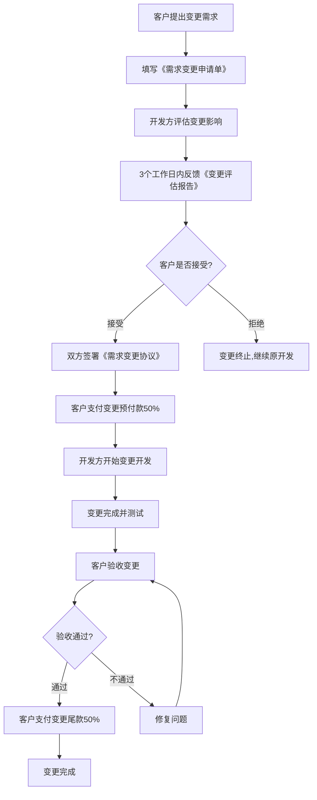

# 附件四：需求变更管理流程

**合同附件编号**：附件四  
**文档性质**：合同附件，具有法律效力  
**适用合同**：劳务中介管理系统开发合同  
**项目总价**：¥140万元（方案B）

---

## 🎯 流程目的

本流程用于规范项目开发过程中的需求变更管理，确保：
1. **变更可控**：所有变更都经过评估和审批
2. **成本透明**：变更费用事先明确，避免事后纠纷
3. **进度可控**：变更对项目进度的影响可预见
4. **双方共识**：变更由双方共同确认后实施

---

## 📋 什么是需求变更？

### 需求变更的定义

凡不在《附件二：功能清单确认书》中列明的功能、超出原功能描述的改动、新增的业务流程，均视为需求变更。

### 需求变更的具体情形

| 变更类型 | 说明 | 举例 | 是否收费 |
|---------|------|------|---------|
| **新增功能** | 原功能清单中没有的功能 | 新增"绩效考核"模块 | ✅ 收费 |
| **功能增强** | 原有功能的扩展或复杂化 | 原工资计算只支持计时，要求增加计件 | ✅ 收费 |
| **业务流程变更** | 改变已确认的业务流程 | 原审批流程2级，要求改为3级 | ✅ 收费 |
| **界面重新设计** | 对已确认的原型图或UI提出修改 | 已确认的首页布局要求重新设计 | ✅ 收费 |
| **数据结构变更** | 改变已确认的数据结构 | 原单据字段10个，要求增加到15个 | ✅ 收费 |
| **第三方对接** | 新增与第三方系统的对接 | 要求对接企业微信、钉钉 | ✅ 收费 |
| **性能优化** | 超出合同约定的性能优化 | 原要求500并发，要求优化到1000并发 | ✅ 收费 |
| **功能性Bug** | 系统实现与功能清单不符 | 清单中明确的功能未实现或实现错误 | ❌ 免费修复 |
| **体验优化建议** | 在功能清单范围内的小改进 | 按钮颜色调整、文字修改 | ⚠️ 视情况而定 |

### Bug与变更的界定标准

为避免争议，双方约定以下界定标准：

| 场景 | 界定 | 收费 | 依据 |
|------|------|------|------|
| 功能清单中有明确描述，但实现不符 | Bug | 免费修复 | 开发方责任 |
| 功能清单中无描述或描述模糊 | 变更 | 需收费 | 超出原合同范围 |
| 功能清单中描述A，客户要求改为B | 变更 | 需收费 | 需求变化 |
| 功能清单中描述模糊，理解不一致 | 共担责任 | 变更费用减半 | 双方各50%责任 |

**判断原则**：以《功能清单确认书》为唯一依据，清单中有=Bug，清单中无=变更。

---

## 🔄 需求变更流程（4步）



### 步骤1：客户提出变更申请

**操作人**：客户方项目经理或指定联系人

**操作方式**：
1. 填写《需求变更申请单》（模板见附录）
2. 发送至开发方项目经理邮箱
3. 邮件主题：【需求变更】项目名称-变更简要说明

**时限**：无限制（但开发阶段变更越早，成本越低）

### 步骤2：开发方评估变更影响

**操作人**：开发方项目经理+技术负责人

**评估内容**：
1. **技术可行性**：变更是否可实现，有无技术风险
2. **工作量评估**：需要多少人天完成
3. **费用评估**：变更费用（人天 × ¥1,500）
4. **进度影响**：对项目整体进度的影响（延期几天）
5. **风险评估**：变更可能带来的风险

**输出文档**：《变更评估报告》（模板见附录）

**时限**：收到变更申请后3个工作日内

### 步骤3：双方协商确认

**操作**：
1. 开发方将《变更评估报告》发送给客户
2. 双方就费用、进度进行协商
3. 协商一致后，签署《需求变更协议》（补充协议）

**《需求变更协议》必须包含**：
- 变更编号（如CR-001）
- 变更内容描述
- 变更费用（明确到元）
- 付款方式（50%预付+50%尾款）
- 变更工期（X个工作日）
- 对原合同的影响（如延期X天）
- 双方签字盖章

**时限**：评估报告发出后5个工作日内完成协商

### 步骤4：变更实施

**前置条件**：客户支付变更预付款（50%）

**实施步骤**：
1. 客户支付预付款后，开发方开始变更开发
2. 变更开发完成后，提交客户验收
3. 验收通过后，客户支付尾款（50%）
4. 变更正式纳入系统

**时限**：按《需求变更协议》约定的工期

---

## 💰 变更收费标准

### 基本收费标准

| 计费方式 | 单价 | 说明 |
|---------|------|------|
| **人天单价** | ¥1,500/人天 | 与原开发单价一致 |
| **最低收费** | ¥5,000 | 不足3.34人天按3.34人天计 |
| **紧急变更** | ¥2,250/人天 | 要求3日内完成，单价上浮50% |

### 工作量评估标准

| 变更类型 | 典型工作量 | 参考费用 |
|---------|-----------|---------|
| 新增简单页面（如列表+详情） | 2-3人天 | ¥5,000 |
| 新增复杂表单（如多步表单） | 5-7人天 | ¥7,500-10,500 |
| 新增简单功能模块（如公告管理） | 10-15人天 | ¥15,000-22,500 |
| 新增复杂功能模块（如考勤规则引擎） | 20-30人天 | ¥30,000-45,000 |
| 业务流程调整（如审批流程） | 3-5人天 | ¥5,000-7,500 |
| 报表新增（含查询+导出） | 3-4人天 | ¥5,000-6,000 |
| 第三方接口对接 | 5-10人天 | ¥7,500-15,000 |
| 界面重新设计 | 2-5人天 | ¥5,000-7,500 |

**注**：以上为参考值，实际费用以《变更评估报告》为准。

### 变更费用优惠

| 优惠类型 | 条件 | 优惠力度 |
|---------|------|---------|
| **批量变更** | 单次提交3个以上变更需求 | 总费用9折 |
| **早期变更** | 需求评审阶段提出（开发前） | 总费用8折 |
| **轻微变更** | 评估工作量<1人天的调整 | 免费（每月限1次） |

### 变更费用支付

| 节点 | 比例 | 时限 | 未付款后果 |
|------|------|------|-----------|
| 签署变更协议后 | 50% | 3个工作日 | 不开始变更开发 |
| 变更验收通过后 | 50% | 5个工作日 | 按逾期付款处理 |

---

## ⏱️ 变更对进度的影响

### 延期计算规则

1. **变更导致的延期不计入开发方开发周期**
2. **延期天数 = 变更实际工时 ÷ 5人（团队规模） ÷ 8小时**
3. **延期从变更开始实施之日起算**

**举例**：
- 变更工作量：20人天
- 团队规模：5人并行开发
- 延期天数：20 ÷ 5 = 4天
- 如2024年1月10日开始变更，则项目延期至1月14日

### 延期责任

| 延期原因 | 责任方 | 后果 |
|---------|--------|------|
| 客户需求变更 | 客户 | 延期不计入开发方周期，开发方不承担延期责任 |
| 开发方技术问题 | 开发方 | 延期计入开发方周期，可能触发延期违约金 |
| 双方理解偏差 | 共担 | 延期时间减半计入开发方周期 |

---

## 🚫 变更限制条款

### 累计变更限制

为保证项目可控，双方约定：

| 累计变更量 | 处理方式 |
|-----------|---------|
| **< 20人天** | 按本流程正常处理 |
| **20-50人天** | 需双方项目经理会议评审 |
| **> 50人天（原工时7.3%）** | 需重新评估项目范围，可能需签订补充合同 |

### 变更时间限制

| 阶段 | 是否接受变更 | 说明 |
|------|-------------|------|
| 需求评审阶段 | ✅ 接受，费用8折 | 开发前变更成本最低 |
| 开发阶段（前50%） | ✅ 接受，正常收费 | 可接受变更 |
| 开发阶段（后50%） | ⚠️ 谨慎接受 | 需评估影响，可能大幅延期 |
| 测试阶段 | ❌ 原则不接受 | 除非严重问题，否则P1再做 |
| 试运行阶段 | ❌ 不接受 | 记录需求，维保期或P1再做 |

### 紧急变更

若客户要求3个工作日内完成变更（紧急变更），需满足：
1. 变更工作量 ≤ 5人天
2. 不影响其他模块开发
3. 开发方有可调配资源
4. 费用上浮50%（¥2,250/人天）

否则，开发方有权拒绝紧急变更要求。

---

## 📄 变更文档模板

### 《需求变更申请单》模板

```
需求变更申请单

变更编号：CR-XXX（由开发方编号）
申请日期：YYYY-MM-DD
申请人：客户方项目经理姓名

一、变更概述
变更类型：□ 新增功能  □ 功能增强  □ 业务流程变更  □ 界面调整  □ 其他
变更紧急程度：□ 紧急（3日内）  □ 一般（1-2周）  □ 不紧急（>2周）
变更原因：___________________________________________

二、变更详细描述
当前功能：（描述现状）
___________________________________________

期望变更为：（描述变更后的期望）
___________________________________________

业务场景：（为什么需要这个变更）
___________________________________________

三、附件材料
□ 变更需求说明文档
□ 原型图或示意图
□ 业务流程图
□ 其他：___________

四、申请人签字
客户方项目经理：__________  日期：__________
```

### 《变更评估报告》模板

```
需求变更评估报告

变更编号：CR-XXX
评估日期：YYYY-MM-DD
评估人：开发方项目经理 + 技术负责人

一、变更概述
变更内容：___________________________________________
申请原因：___________________________________________

二、技术可行性评估
□ 可实现，无技术风险
□ 可实现，有一定技术风险：___________
□ 不可实现，原因：___________

三、工作量评估
涉及模块：___________________________________________
预计工作量：
- 后端开发：___ 人天
- 前端开发：___ 人天
- 测试：___ 人天
- 小计：___ 人天

四、费用评估
人天单价：¥1,500/人天
变更费用：___ 人天 × ¥1,500 = ¥_______ 元
是否满足最低收费：□ 是  □ 否，按最低¥5,000收费
是否紧急变更：□ 是，单价¥2,250/人天  □ 否
最终费用：¥_______ 元

五、进度影响评估
变更工期：___ 个工作日
对项目整体进度的影响：延期 ___ 天
新的预计交付日期：YYYY-MM-DD

六、风险评估
□ 无风险
□ 有风险：___________________________________________

七、开发方建议
□ 建议接受，立即实施
□ 建议接受，但建议调整为：___________
□ 建议拒绝，原因：___________
□ 建议延后到P1或维保期实施

八、评估人签字
项目经理：__________  技术负责人：__________  日期：__________
```

### 《需求变更协议》模板

```
需求变更协议
（《劳务中介管理系统开发合同》补充协议）

甲方（客户）：___________
乙方（开发方）：___________

鉴于甲乙双方于YYYY年MM月DD日签订了《劳务中介管理系统开发合同》（以下简称"原合同"），
现因甲方业务需要，需对原合同约定的功能进行变更，经双方友好协商，达成如下补充协议：

一、变更基本信息
变更编号：CR-XXX
变更申请日期：YYYY-MM-DD
变更评估报告日期：YYYY-MM-DD

二、变更内容
（详细描述变更的功能，可附原型图或说明文档）
___________________________________________
___________________________________________

三、变更费用
1. 变更工作量：___ 人天
2. 人天单价：¥1,500/人天（□ 一般变更  □ 紧急变更¥2,250）
3. 变更总费用：¥_______ 元（大写：人民币_______元整）

四、付款方式
1. 预付款：甲方在本协议签订后3个工作日内支付50%，即¥_______ 元
2. 尾款：变更完成并验收通过后5个工作日内支付50%，即¥_______ 元
3. 付款账户：（同原合同）

五、变更工期
1. 变更开发周期：___ 个工作日（自预付款到账之日起算）
2. 对原合同进度的影响：原交付日期延期 ___ 天
3. 新的预计交付日期：YYYY-MM-DD

六、验收标准
变更功能的验收标准：
___________________________________________
（变更功能需单独验收，验收通过后触发尾款支付义务）

七、违约责任
1. 若甲方未按时支付预付款，乙方有权不启动变更开发
2. 若乙方未按约定工期完成变更，每延期1日，减免变更费用的1%（最高减免10%）

八、其他约定
1. 本协议是原合同的补充协议，与原合同具有同等法律效力
2. 本协议未约定事项，按原合同执行
3. 本协议一式两份，甲乙双方各执一份

九、生效条件
本协议自双方签字盖章之日起生效。

甲方（客户）：                    乙方（开发方）：
法定代表人（签字）：              法定代表人（签字）：
公司盖章：                        公司盖章：
日期：YYYY-MM-DD                  日期：YYYY-MM-DD
```

---

## ⚠️ 特别约定

### 口头变更无效

双方确认：
1. 任何口头提出的变更需求、微信沟通的变更想法，均不具有法律效力
2. 变更必须通过本流程，签署《需求变更协议》后方可实施
3. 未经本流程确认的变更，开发方有权拒绝实施
4. 若开发方人员口头承诺"顺便帮你改"，不构成合同义务

### 变更争议处理

若双方对某项改动是否属于变更存在争议：
1. **优先查阅《功能清单确认书》**：清单中有明确描述→Bug，免费修；清单中无描述→变更，需付费
2. **协商解决**：双方项目经理协商，达成一致意见
3. **第三方鉴定**：协商不成的，可提交第三方技术专家鉴定（费用双方各半）
4. **从宽原则**：若鉴定结果仍有争议，从有利于客户的角度解释（即按Bug处理）

### 变更记录留档

所有变更都必须留档备查：
1. 开发方应建立《变更台账》，记录所有变更编号、费用、完成时间
2. 《变更台账》作为项目交付物的一部分，交付给客户
3. 若后续有纠纷，《变更台账》作为证据材料

---

## 📊 变更统计与分析

### 项目结束后的变更统计

开发方在项目验收时应提供《变更统计报告》：

| 变更编号 | 变更内容 | 工作量 | 费用 | 完成日期 |
|---------|---------|--------|------|---------|
| CR-001 | 新增XXX功能 | 5人天 | ¥7,500 | 2024-XX-XX |
| CR-002 | 调整XXX流程 | 3人天 | ¥5,000 | 2024-XX-XX |
| 合计 | | X人天 | ¥XXX | |

### 变更对项目的影响

| 影响项 | 数据 |
|--------|------|
| 原计划工期 | 23周 |
| 因变更延长工期 | X周 |
| 实际工期 | XX周 |
| 原合同金额 | ¥140万 |
| 变更增加金额 | ¥XX万 |
| 实际项目金额 | ¥XXX万 |

---

## 🔗 与其他附件的关系

| 附件 | 关系 |
|------|------|
| 附件一：模块验收标准清单 | 变更功能的验收也应制定明确的验收标准 |
| 附件二：功能清单确认书 | 判断是否为变更的唯一依据 |
| 附件三：分阶段交付计划 | 变更会影响交付进度，需相应调整 |
| 附件五：验收流程 | 变更完成后也需按此流程验收 |

---

## 🎯 流程执行建议

### 给客户的建议

1. **尽早提变更**：需求评审阶段提变更，费用8折
2. **批量提变更**：一次提3个以上，费用9折
3. **慎提紧急变更**：费用上浮50%，且不一定能满足
4. **变更前先评估**：收到评估报告后再决定是否实施

### 给开发方的建议

1. **及时响应**：3个工作日内必须反馈评估报告
2. **准确评估**：工作量评估要准确，避免后期扯皮
3. **保留证据**：所有变更相关的邮件、文档都要存档
4. **灵活处理**：对于工作量<1人天的轻微调整，可酌情免费（每月限1次）

---

## 📝 附录：常见问题FAQ

### Q1：客户提出的每个小改动都要走变更流程吗？

**A**：不是。我们有"轻微变更免费"政策：
- 工作量<1人天（如按钮颜色调整、文字修改）
- 每月限1次免费
- 超过1次或工作量≥1人天，需走变更流程

### Q2：开发方说是变更，客户说是Bug，怎么办？

**A**：以《功能清单确认书》为准：
- 清单中有明确描述 → Bug，免费修
- 清单中无描述 → 变更，需付费
- 清单描述模糊 → 双方各50%责任，变更费用减半

### Q3：开发方人员口头说"可以顺便帮你加这个功能"，算数吗？

**A**：不算数。必须走本变更流程，签署《需求变更协议》才生效。

### Q4：变更费用可以从原合同款项中扣吗？

**A**：不可以。变更费用是额外的，需单独支付。

### Q5：如果不接受变更费用，能要求免费做吗？

**A**：不能。变更是超出原合同范围的，开发方有权拒绝。
但可以协商：记录需求，等P1或维保期后再实施（可能另行收费）。

---

**本流程由开发方起草，双方在合同签订时共同确认。**

**甲方（客户）：__________  日期：__________**  
**乙方（开发方）：__________  日期：__________**
