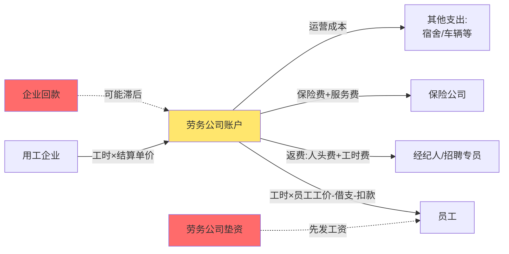
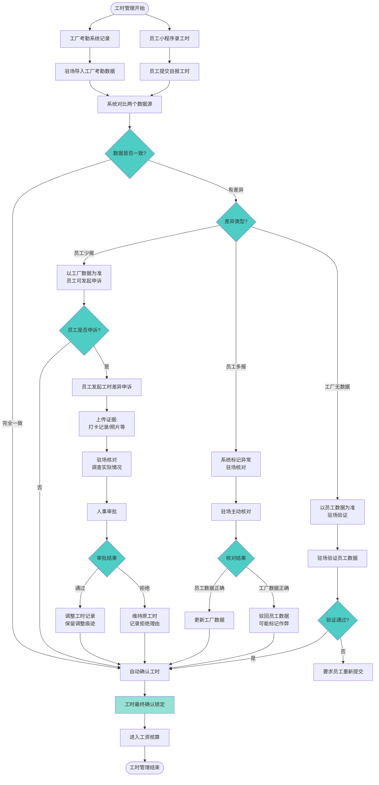
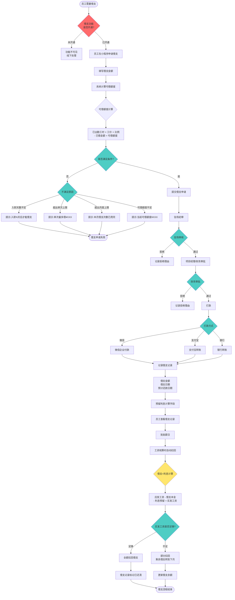
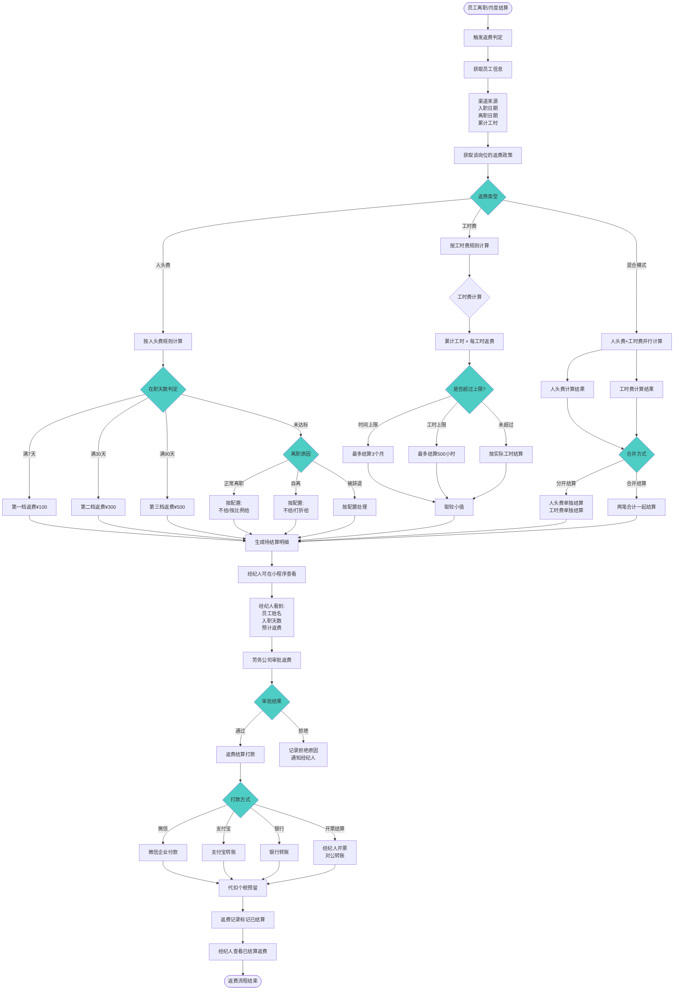
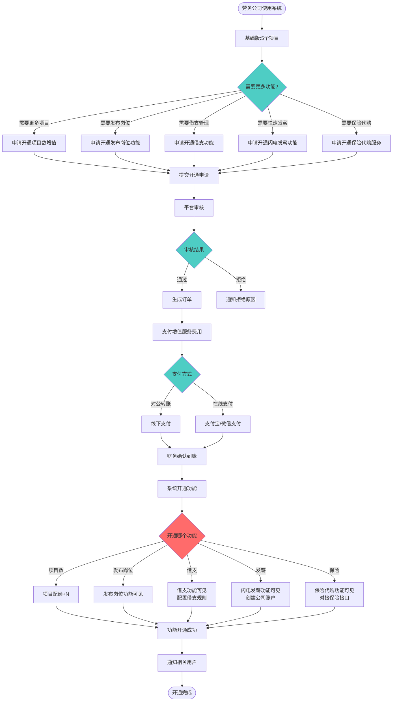
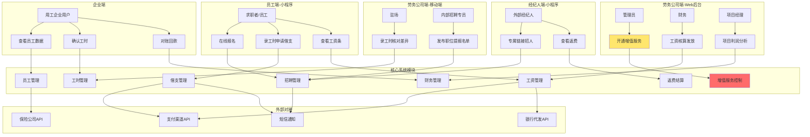
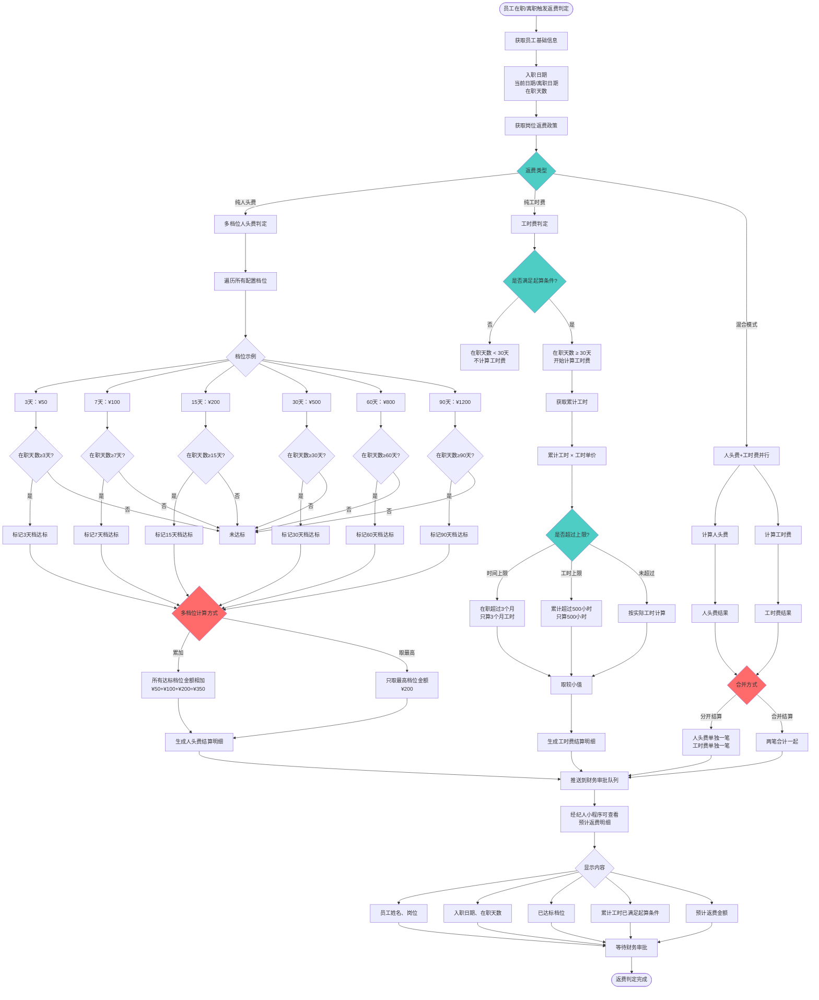
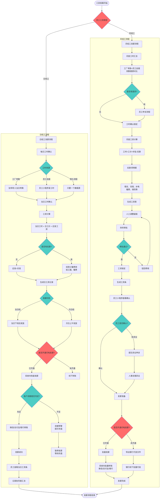

# 劳务中介管理系统 · 业务流程图

本文档包含多个业务流程图，展示系统的关键流程和决策点。

> 2026-10-19 更新：平台模式下，第 1 节（主流程起点）、第 2 节（资金流转）、第 6 节（增值服务开通）、第 7 节（角色关系，缺用工方和平台运营）已过时，新流程见 [requirements-draft-v0.3.md](requirements-draft-v0.3.md) 第三、六节。第 3 节工时、第 5 节和第 8 节返费仍然有效。第 4 节借支和第 9 节发薪的额度、审批、核算规则有效，其中"是否开通"判断和打款、发薪渠道以 v0.3 为准。

---

## 1. 完整业务主流程

```mermaid
graph TB
    Start([企业提出用工需求]) --> A1[项目经理创建项目/岗位]
    A1 --> A2{是否开通<br/>发布岗位功能?}
    A2 -->|已开通| A3[生成职位页和渠道链接]
    A2 -->|未开通| A4[线下招聘]
    A3 --> B1[经纪人/专员转发链接]
    A4 --> B1
    B1 --> B2[求职者在线报名]
    B2 --> B3[系统自动记录渠道来源]
    B3 --> C1{是否撞单?}
    C1 -->|是| C2[撞单规则判定:<br/>先报先得+保护期]
    C1 -->|否| C3[归属当前渠道]
    C2 --> C3
    C3 --> D1[经纪人提报名单]
    D1 --> D2[安排面试]
    D2 --> D3{面试结果}
    D3 -->|通过| E1[办理入职]
    D3 -->|未通过| D4[状态流转:<br/>未通过/未到岗]
    E1 --> E2[建立员工档案]
    E2 --> E3{是否购买保险?}
    E3 -->|未购买| E4[强制购买保险<br/>对接保险接口]
    E3 -->|已购买| F1
    E4 --> F1[分配宿舍签订合同]
    F1 --> F2[入职完成,开始工作]
    
    F2 --> G1[日常工作]
    G1 --> G2[工厂考勤记录]
    G1 --> G3[员工自己录工时]
    G2 --> H1{工时是否一致?}
    G3 --> H1
    H1 -->|一致| H2[工时确认]
    H1 -->|不一致| H3[员工发起工时差异申诉]
    H3 --> H4[驻场核对]
    H4 --> H5[人事审批]
    H5 --> H2
    H2 --> I1[工资核算]
    
    F2 --> J1{员工需要借支?}
    J1 -->|是| J2{是否开通<br/>借支功能?}
    J2 -->|已开通| J3[员工申请借支]
    J2 -->|未开通| J4[线下借支]
    J3 --> J5[驻场初审]
    J5 --> J6[项目经理/财务审批]
    J6 --> J7{审批通过?}
    J7 -->|通过| J8[打款]
    J7 -->|拒绝| J9[拒绝理由]
    J8 --> J10[记录借支金额<br/>预留利息接口]
    
    I1 --> K1[扣除借支和其他费用]
    K1 --> K2{是否开通<br/>闪电发薪?}
    K2 -->|已开通| K3[劳务公司账户充值]
    K2 -->|未开通| K4[导出银行代发文件]
    K3 --> K5[系统内发薪:<br/>微信/支付宝/银行]
    K4 --> K6[线下发薪]
    K5 --> L1[员工查看工资条]
    K6 --> L1
    
    L1 --> M1{员工是否离职?}
    M1 -->|否| G1
    M1 -->|是| M2[办理离职]
    M2 --> M3[借支清算]
    M3 --> M4[返费达标判定]
    M4 --> M5{返费是否达标?}
    M5 -->|达标| M6[计算返费:<br/>人头费/工时费/混合]
    M5 -->|未达标| M7[按规则处理:<br/>不给/按比例给]
    M6 --> M8[返费结算审批]
    M7 --> M8
    M8 --> M9[给经纪人打款]
    M9 --> End([流程结束])
    
    style A2 fill:#ff6b6b
    style C1 fill:#4ecdc4
    style D3 fill:#4ecdc4
    style E3 fill:#ff6b6b
    style H1 fill:#4ecdc4
    style J2 fill:#ff6b6b
    style J7 fill:#4ecdc4
    style K2 fill:#ff6b6b
    style M1 fill:#4ecdc4
    style M5 fill:#4ecdc4
```

---

## 2. 资金流转流程

---

## 3. 工时管理详细流程

---

## 4. 借支管理详细流程

---

## 5. 返费结算详细流程

---

## 6. 增值服务开通流程

---

## 7. 系统架构与角色关系图

---

## 流程图说明

### 颜色标识
- 🔴 红色：增值服务相关决策点（是否开通）
- 🔵 蓝色：业务逻辑决策点（是/否判断）
- 🟡 黄色：关键数据节点（资金、工时等）
- 🟢 绿色：流程终点或确认节点

### 关键决策点说明
1. **增值服务开通决策**：发布岗位、借支、发薪功能需要先开通
2. **撞单判定**：先报先得 + 保护期机制
3. **工时差异处理**：双数据源对比 + 申诉流程
4. **借支额度控制**：多重条件校验
5. **返费达标判定**：多档位配置（3/7/15/30/60/90天）+ 人头费和工时费差异
6. **工资类型区分**：日结工和月结工的不同处理流程

### 使用建议
- 将这些流程图用于需求评审会议
- 与开发团队讨论时，指向具体流程图说明业务逻辑
- 遇到边界情况时，参考流程图中的决策点

---

## 8. 返费达标档次判定流程（新增）

---

## 9. 日结工与月结工的发薪流程（新增）

---

## 10. 日结工与月结工的对比表

| 维度 | 日结工 | 月结工（劳务派遣） |
|---|---|---|
| **发薪周期** | 当日或次日 | 按月（每月固定日期） |
| **工资计算** | 当日工时 × 日工价 | 月度总工时 × 工价 + 补贴 - 扣款 |
| **工时管理** | 简化（可选单数据源） | 严格（双数据源对比+差异申诉） |
| **扣款项** | 简单（少量扣款） | 复杂（借支、住宿、保险等） |
| **借支** | 不允许（或特殊规则） | 允许（正常借支流程） |
| **工资条** | 每日一条 + 月度汇总 | 月度工资条 |
| **发薪频次** | 每天（高频） | 每月1次（批量） |
| **闪电发薪压力** | 高（每天需大量资金） | 中（月度集中发放） |
| **返费规则** | 按天数或工时 | 按天数或工时 |
| **审批流程** | 简化（可自动发放） | 完整（人工审批） |

---

## 流程图说明（更新）
