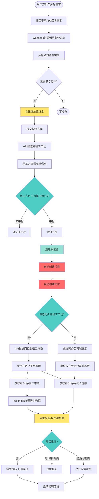

# 外部系统对接需求 - 客户确认结果

## 📋 文档说明

本文档记录与**本地临工市场App**对接需求的客户确认结果。

> 2026-10-19 更新：平台模式下竞标改为平台自有能力（见 [requirements-draft-v0.3.md](requirements-draft-v0.3.md) 第三节）。本文的竞标信息公开规则在 v0.3 中沿用；竞标保证金规则、"增值服务和收费模式"（P0-9、模块 5）需按 v0.3 重新确认；临工市场需求与平台自有需求的关系待定（v0.3 第十二节）。

**确认日期**：2026-10-18  
**确认方式**：客户口述确认  
**确认状态**：✅ P0级问题已全部确认

---

## 一、确认结果汇总

### P0-1：临工市场的接口文档

**✅ 确认结果**：
- 临工市场**已有接口文档，可以提供**
- 待后续获取具体的接口文档链接和详细内容

**后续行动**：
- [ ] 获取接口文档链接
- [ ] 评审接口文档，确认技术可行性
- [ ] 申请测试环境访问权限

---

### P0-2：数据推送方式

**✅ 确认结果**：选择 **选项A：Webhook推送**

**具体说明**：
- 劳务需求推送：Webhook实时推送
- 中标通知推送：Webhook实时推送
- 报名信息推送：Webhook实时推送

**技术实现**：
- 我们需要提供接收接口（POST接口）
- 临工市场推送数据到我们的接口
- 实时性高，无需轮询

---

### P0-3：岗位同步规则

**✅ 确认结果**：选择 **选项B：可选择性同步**

**具体规则**：
1. **发布时**：劳务公司发布岗位时，可以勾选"是否同步到临工市场"
2. **更新时**：岗位信息更新后，**自动同步**到临工市场
3. **下架时**：岗位下架后，**同步下架状态**到临工市场

**功能实现**：
- 岗位发布表单增加"同步到临工市场"开关
- 岗位编辑后自动触发同步
- 岗位下架后自动通知临工市场

---

### P0-4：竞标规则和流程

**✅ 确认结果**：

#### 4.1 竞标保证金
- **需要缴纳保证金**：是
- **缴纳方式**：在线缴纳（支付宝/微信/银行转账）
- **退还时机**：项目中标后退还

#### 4.2 竞标评分规则
- **中标规则**：用工方自主选择（综合考虑价格、资质、方案）
- **不是简单的最低价中标**

#### 4.3 竞标信息公开
- **中标之前**：保密，劳务公司只能看到自己的投标信息
- **中标之后**：可以看到中标信息（中标公司名称、中标金额）
- **未中标公司**：可以看到中标结果，但看不到其他公司的投标详情

**功能实现**：
- 投标页面增加保证金缴纳流程
- 投标列表只显示本公司的投标记录
- 中标后展示中标信息

---

### P0-5：报名渠道归属规则

**✅ 确认结果**：选择 **选项B：按劳务公司规则分配**

**具体说明**：
- 从临工市场报名的员工，渠道归属为"临工市场"这个平台渠道
- **临工市场是一个大渠道**，下面每个区域都有自己的负责人
- 劳务公司可以配置"临工市场渠道"的返费规则
- 每个区域负责人相当于"临工市场的经纪人"

**渠道层级结构**：
```
临工市场（平台渠道）
  ├── 深圳区域负责人（张三）
  ├── 东莞区域负责人（李四）
  └── 广州区域负责人（王五）
```

**功能实现**：
- 报名数据同步时，带上"区域信息"
- 劳务公司可以配置"临工市场渠道"的返费政策
- 返费可以按区域负责人分配

---

### P0-6：报名数据去重规则

**✅ 确认结果**：选择 **选项B：保护期机制**

**具体规则**：
- 第一次报名后，设置**保护期**（建议7天或15天，待配置）
- 保护期内，其他渠道无法重复报名（系统自动拒绝）
- 保护期后，允许其他渠道重新报名
- 以**身份证号**作为唯一标识

**场景举例**：
```
2026-10-18：王小明通过临工市场报名了"流水线工"
           → 归属：临工市场-深圳区域负责人张三
           → 保护期：2026-10-18 至 2026-10-25（7天）

2026-10-20：经纪人李四想提报王小明
           → 系统提示："该求职者已在临工市场报名，保护期内"
           → 拒绝提报

2026-10-26：保护期结束，经纪人李四可以重新提报王小明
           → 系统提示："该求职者曾在临工市场报名，已过保护期"
           → 允许提报，但需人工审核
```

**功能实现**：
- 报名时检查身份证号是否重复
- 计算保护期截止时间
- 保护期内拒绝重复报名，并提示原因
- 保护期天数可在系统配置

---

### P0-7：中标后的自动化处理

**✅ 确认结果**：

**自动执行的操作**：
1. ✅ **自动创建项目**
2. ✅ **自动创建岗位**（基于劳务需求信息）
3. ✅ **自动同步岗位到临工市场**
4. ✅ **自动生成合同模板**

**项目信息来源**：
- 项目名称：直接使用劳务需求的标题
- 项目工价：按投标金额计算（后续可手动调整）
- 返费政策：使用公司默认政策（后续可单独配置）

**功能实现**：
- 中标通知接收后，触发自动创建流程
- 创建完成后通知项目经理
- 项目经理可以手动调整项目和岗位信息

---

### P0-8：数据隔离和隐私保护

**✅ 确认结果**：

#### 可以同步到临工市场的数据：
- ✅ 岗位名称、工种、工作地点
- ✅ 薪资范围（如：5000-6000元）
- ✅ 任职要求、福利待遇
- ✅ **劳务公司的真实名称**
- ✅ 劳务公司联系方式

#### 不可同步到临工市场的数据：
- ❌ 劳务公司给员工的具体工价（内部成本）
- ❌ 劳务公司的利润率
- ❌ 劳务公司与用工方的结算价
- ❌ 返费政策和返费金额
- ❌ **员工身份证号**（不传输）
- ❌ 员工工资明细
- ❌ 员工借支记录

**具体规则**：
- 岗位同步时，显示劳务公司的真实名称（不匿名）
- 薪资展示：范围形式（如：5000-6000元）
- 报名数据同步时，**不包含员工完整身份证号**（或脱敏处理）

**功能实现**：
- 岗位同步API，过滤敏感字段
- 报名数据接收时，身份证号脱敏存储

---

### P0-9：增值服务和收费模式

**✅ 确认结果**：

**需要在系统"三层设置"中新增配置项**：

#### 基础版功能（免费）
- 查看劳务需求列表
- 基础项目和岗位管理

#### 增值服务功能（需开通）
1. **竞标功能**：参与劳务需求竞标（¥待定/年）
2. **岗位同步功能**：将岗位同步到临工市场（¥待定/年 或 ¥待定/岗位）
3. **临工市场报名接收**：接收临工市场的报名数据（¥待定/年）

**三层设置结构**：
```
1. 基础版配置（免费功能）
2. 增值服务配置（付费功能开关）
   ├── 竞标功能（开通/未开通）
   ├── 岗位同步功能（开通/未开通）
   └── 报名接收功能（开通/未开通）
3. 项目/岗位级配置（具体业务配置）
```

**功能实现**：
- 系统配置页面增加"外部对接"模块
- 未开通增值服务时，相关功能不可见或显示"开通提示"
- 开通后，功能可正常使用

---

### P0-10：技术对接和测试环境

**✅ 确认结果**：

- **测试环境**：有，可以提供
- 待后续获取测试环境地址和账号

**后续行动**：
- [ ] 获取测试环境地址
- [ ] 获取测试环境账号和密码
- [ ] 获取API接口文档
- [ ] 安排联调时间
- [ ] 确定双方技术对接人

---

## 二、核心业务流程（已确认）

### 完整流程图



---

## 三、需要新增的功能模块（确认版）

### 模块1：劳务需求管理

**核心功能**：
- 接收临工市场推送的劳务需求（Webhook）
- 劳务需求列表展示
- 劳务需求详情查看
- 劳务需求筛选（按地区、工种、人数）

**数据表**：`labor_demand`（劳务需求表）

---

### 模块2：竞标管理（增值服务）

**核心功能**：
- 在线缴纳保证金（支付宝/微信/银行转账）
- 提交竞标方案（投标金额、方案、资质）
- 竞标状态跟踪（待审核、已提交、已中标、未中标）
- 中标后自动创建项目和岗位
- 中标后自动退还保证金

**数据表**：`bidding_record`（竞标记录表）

**权限控制**：
- 未开通"竞标功能"增值服务，该模块不可见
- 开通后，项目经理和管理员可以使用

---

### 模块3：岗位同步管理（增值服务）

**核心功能**：
- 岗位发布时，可勾选"同步到临工市场"
- 岗位更新后，自动同步到临工市场
- 岗位下架后，自动同步下架状态
- 同步日志查看（成功/失败记录）
- 手动重试同步（失败时）

**数据表**：`job_sync_record`（岗位同步记录表）

**权限控制**：
- 未开通"岗位同步功能"增值服务，该功能不可见
- 开通后，项目经理和招聘专员可以使用

---

### 模块4：报名数据去重（增值服务）

**核心功能**：
- 接收临工市场推送的报名数据（Webhook）
- 自动去重检查（保护期机制）
- 渠道归属识别（临工市场-区域负责人）
- 重复报名提示和处理

**去重规则**：
- 以身份证号为唯一标识
- 保护期内拒绝重复报名
- 保护期外允许但需人工审核
- 保护期天数：系统配置（建议7天或15天）

**权限控制**：
- 未开通"报名接收功能"增值服务，不接收临工市场报名
- 开通后，自动接收并处理

---

### 模块5：增值服务配置

**核心功能**：
- 系统配置页面增加"外部对接"模块
- 增值服务开通/关闭开关
- 功能开通记录和续费提醒

**配置项**：
1. **竞标功能**：开通/未开通
2. **岗位同步功能**：开通/未开通
3. **报名接收功能**：开通/未开通
4. **保护期天数**：7天 / 15天 / 自定义
5. **临工市场渠道返费政策**：配置返费比例

---

## 四、API接口清单（确认版）

### 4.1 我们提供的接口（劳务公司端 → 临工市场）

| 接口 | 方法 | 路径 | 说明 |
|------|------|------|------|
| 提交竞标 | POST | `/api/external/bidding/submit` | 劳务公司提交投标方案 |
| 同步岗位 | POST | `/api/external/job/sync` | 发布岗位后推送到临工市场 |
| 更新岗位 | PUT | `/api/external/job/sync/{jobId}` | 岗位更新后同步 |
| 下架岗位 | DELETE | `/api/external/job/sync/{jobId}` | 岗位下架后同步 |

---

### 4.2 我们接收的接口（临工市场 → 劳务公司端）

| 接口 | 方法 | 路径 | 说明 |
|------|------|------|------|
| 接收劳务需求 | POST | `/api/external/demand/receive` | 临工市场推送劳务需求 |
| 接收中标通知 | POST | `/api/external/bidding/result` | 临工市场推送中标结果 |
| 接收报名信息 | POST | `/api/external/application/receive` | 临工市场推送报名数据 |

**接口安全**：
- API签名验证（防篡改）
- IP白名单（限制访问）
- HTTPS加密传输

---

## 五、数据库设计（确认版）

### 5.1 劳务需求表

```sql
CREATE TABLE labor_demand (
  id BIGSERIAL PRIMARY KEY,
  tenant_id BIGINT NOT NULL,
  
  -- 来源信息
  source_platform VARCHAR(50) NOT NULL DEFAULT '临工市场',
  source_demand_id VARCHAR(50) NOT NULL,
  demand_no VARCHAR(50) NOT NULL,
  
  -- 用工方信息
  employer_name VARCHAR(100) NOT NULL,
  employer_contact VARCHAR(50),
  employer_phone VARCHAR(20),
  
  -- 需求信息
  job_title VARCHAR(100) NOT NULL,
  job_count INTEGER NOT NULL,
  job_description TEXT,
  salary_range VARCHAR(50),
  work_location VARCHAR(200),
  work_period VARCHAR(50),
  requirements TEXT,
  
  -- 竞标信息
  deadline TIMESTAMPTZ,
  
  -- 状态
  status VARCHAR(20) NOT NULL DEFAULT 'open',
  
  -- 时间戳
  publish_time TIMESTAMPTZ,
  sync_time TIMESTAMPTZ,
  created_at TIMESTAMPTZ DEFAULT CURRENT_TIMESTAMP,
  updated_at TIMESTAMPTZ DEFAULT CURRENT_TIMESTAMP,
  deleted_at TIMESTAMPTZ
);

COMMENT ON TABLE labor_demand IS '劳务需求表（从临工市场同步）';
```

---

### 5.2 竞标记录表

```sql
CREATE TABLE bidding_record (
  id BIGSERIAL PRIMARY KEY,
  tenant_id BIGINT NOT NULL,
  demand_id BIGINT NOT NULL,
  
  -- 竞标信息
  bidding_no VARCHAR(50) NOT NULL,
  bid_amount NUMERIC(10,2) NOT NULL,
  service_fee_rate NUMERIC(5,2),
  proposal TEXT,
  
  -- 保证金
  deposit_amount NUMERIC(10,2),
  deposit_status VARCHAR(20),  -- unpaid=未缴纳, paid=已缴纳, refunded=已退还
  deposit_pay_time TIMESTAMPTZ,
  deposit_refund_time TIMESTAMPTZ,
  
  -- 状态
  bid_status VARCHAR(20) NOT NULL DEFAULT 'pending',
  
  -- 结果
  result_reason TEXT,
  project_id BIGINT,
  
  -- 时间
  bid_time TIMESTAMPTZ NOT NULL,
  result_time TIMESTAMPTZ,
  
  created_at TIMESTAMPTZ DEFAULT CURRENT_TIMESTAMP,
  updated_at TIMESTAMPTZ DEFAULT CURRENT_TIMESTAMP,
  deleted_at TIMESTAMPTZ
);

COMMENT ON TABLE bidding_record IS '竞标记录表';
COMMENT ON COLUMN bidding_record.deposit_status IS 'unpaid=未缴纳, paid=已缴纳, refunded=已退还';
```

---

### 5.3 岗位同步记录表

```sql
CREATE TABLE job_sync_record (
  id BIGSERIAL PRIMARY KEY,
  tenant_id BIGINT NOT NULL,
  job_id BIGINT NOT NULL,
  
  -- 同步信息
  target_platform VARCHAR(50) NOT NULL DEFAULT '临工市场',
  target_job_id VARCHAR(50),
  sync_type VARCHAR(20) NOT NULL,  -- create=创建, update=更新, delete=删除
  sync_status VARCHAR(20) NOT NULL,  -- pending=待同步, success=成功, failed=失败
  
  -- 同步数据
  sync_data JSONB,
  error_message TEXT,
  retry_count INTEGER DEFAULT 0,
  
  -- 时间
  sync_time TIMESTAMPTZ,
  created_at TIMESTAMPTZ DEFAULT CURRENT_TIMESTAMP,
  updated_at TIMESTAMPTZ DEFAULT CURRENT_TIMESTAMP
);

COMMENT ON TABLE job_sync_record IS '岗位同步记录表';
```

---

### 5.4 报名表字段补充

```sql
-- 在现有的employee_application表增加字段
ALTER TABLE employee_application ADD COLUMN IF NOT EXISTS 
  source_platform VARCHAR(50);  -- 来源平台：劳务公司端/临工市场

ALTER TABLE employee_application ADD COLUMN IF NOT EXISTS 
  source_application_id VARCHAR(50);  -- 来源平台报名ID

ALTER TABLE employee_application ADD COLUMN IF NOT EXISTS 
  region_code VARCHAR(50);  -- 区域编码（临工市场-深圳/东莞/广州）

ALTER TABLE employee_application ADD COLUMN IF NOT EXISTS 
  protection_deadline TIMESTAMPTZ;  -- 保护期截止时间

COMMENT ON COLUMN employee_application.source_platform IS '来源平台：劳务公司端/临工市场';
COMMENT ON COLUMN employee_application.region_code IS '区域编码（用于临工市场渠道归属）';
COMMENT ON COLUMN employee_application.protection_deadline IS '保护期截止时间';
```

---

## 六、开发排期（更新版）

### 工作量评估

| 模块 | 工作内容 | 工作量（人日） |
|------|---------|---------------|
| **劳务需求管理** | 数据模型、列表、详情、筛选、Webhook接收 | 6-8 |
| **竞标管理** | 保证金缴纳、提交投标、状态跟踪、自动创建项目 | 8-10 |
| **岗位同步** | 可选同步开关、自动同步、状态管理、日志 | 6-8 |
| **报名去重** | 保护期机制、区域归属、去重规则 | 5-7 |
| **增值服务配置** | 三层设置、功能开关、权限控制 | 4-5 |
| **API接口开发** | 提供接口+接收接口+签名验证 | 10-12 |
| **消息队列** | RabbitMQ集成、消费者、失败重试 | 4-5 |
| **安全认证** | 签名验证、IP白名单、HTTPS | 2-3 |
| **对账任务** | 定时任务、数据对比、自动修复 | 3-4 |
| **联调测试** | 接口联调、端到端测试、压力测试 | 6-8 |
| **文档编写** | 接口文档、操作手册、用户指南 | 3-4 |
| **总计** | - | **57-74人日** |

**开发周期**：约 **11-15周**（2.5-3.5个月）

---

### 开发优先级（三阶段）

#### 第一阶段（P0核心功能，5-6周）

1. ✅ 劳务需求接收和展示（Webhook）
2. ✅ 竞标功能（保证金缴纳、提交投标）
3. ✅ 中标通知接收和自动创建项目
4. ✅ 基础API接口（Webhook接收）

#### 第二阶段（P0核心功能，4-5周）

5. ✅ 岗位同步到临工市场（可选开关）
6. ✅ 报名数据接收和去重（保护期机制）
7. ✅ 消息队列集成
8. ✅ 安全认证机制

#### 第三阶段（P1优化功能，2-4周）

9. ✅ 增值服务配置和权限控制
10. ✅ 同步日志和监控
11. ✅ 定时对账任务
12. ✅ 数据看板统计
13. ✅ 完善文档和测试

---

## 七、待办事项

### 立即行动

- [ ] 获取临工市场API接口文档
- [ ] 获取测试环境地址和账号
- [ ] 确定双方技术对接人（姓名、电话、微信）
- [ ] 安排需求评审会议（确认本文档内容）
- [ ] 制定详细的开发计划

### 一周内完成

- [ ] 评审接口文档，确认技术可行性
- [ ] 搭建开发环境和测试环境
- [ ] 设计数据库表结构
- [ ] 设计API接口（请求/响应格式）
- [ ] 搭建消息队列（RabbitMQ）

### 两周内完成

- [ ] 开发第一阶段功能（劳务需求、竞标）
- [ ] 与临工市场开始联调测试
- [ ] 测试Webhook接收功能

---

## 八、风险提示

### 风险1：接口文档可能不完整

**应对方案**：
- 评审接口文档时，列出所有疑问点
- 与临工市场技术团队建立即时沟通渠道（微信群）
- 预留接口适配层，便于后续调整

### 风险2：保证金缴纳流程复杂

**应对方案**：
- 优先支持主流支付方式（支付宝/微信）
- 银行转账作为备选方案
- 与财务确认对账和退款流程

### 风险3：报名数据去重可能有遗漏

**应对方案**：
- 以身份证号为唯一标识（不依赖姓名和手机号）
- 保护期机制明确，减少纠纷
- 记录完整的报名来源和时间
- 提供人工裁定入口

### 风险4：增值服务功能开关复杂

**应对方案**：
- 参考现有的增值服务设计（借支、发薪）
- 统一的权限控制机制
- 清晰的未开通提示

---

## 九、总结

本次外部系统对接需求已经**全部确认**，核心要点：

1. ✅ **Webhook推送**：实时性高，无需轮询
2. ✅ **可选择性同步**：灵活控制岗位同步
3. ✅ **保证金机制**：在线缴纳，中标后退还
4. ✅ **保护期去重**：防止恶意撞单
5. ✅ **自动化处理**：中标后自动创建项目和岗位
6. ✅ **增值服务**：三层设置，功能开关
7. ✅ **数据隔离**：保护商业机密和隐私

**开发周期**：11-15周（2.5-3.5个月）  
**工作量**：57-74人日

下一步：获取接口文档，开始详细设计和开发。

---

**文档维护人**：项目经理  
**下次更新**：获取接口文档后更新API详细设计
