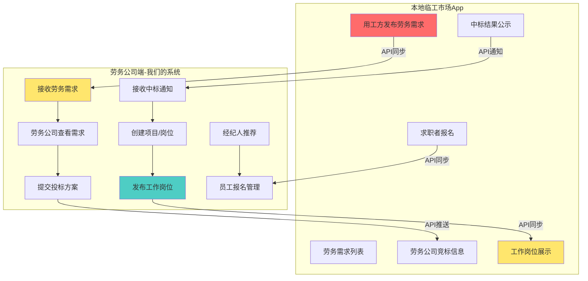

# 外部系统对接需求分析 - 本地临工市场App

## 📋 文档说明

本文档描述劳务公司端（我们的系统）与本地临工市场App（其他公司开发）之间的**双向数据互通**需求。

**更新日期**：2026-10-18  
**状态**：需求分析中

---

## 一、系统关系说明

### 两个系统的定位

| 系统 | 开发方 | 主要用户 | 核心功能 |
|------|--------|---------|---------|
| **本地临工市场App** | 其他公司 | 用工方、求职者、劳务公司 | 用工方发布劳务需求、劳务公司竞标、求职者找工作 |
| **劳务公司端** | 我们 | 劳务公司、经纪人、员工 | 劳务公司接单、发布岗位、招聘管理、工资发放 |

### 核心概念区分

**劳务需求 vs 工作岗位**：

```
劳务需求（Labor Demand）:
- 发布者：用工方（工厂/企业）
- 发布平台：本地临工市场App
- 内容：需要劳务公司承包的用工需求
- 例如："某电子厂需要100名流水线工人，工期3个月"

工作岗位（Job Position）:
- 发布者：劳务公司（中标后）
- 发布平台：劳务公司端（我们的系统）
- 内容：具体的招聘岗位信息
- 例如："流水线装配工，18-45岁，月薪5000-6000元"
```

---

## 二、双向数据互通流程

### 完整业务流程图



### 数据流向详解

#### 数据流1: 劳务需求同步（临工市场 → 劳务公司端）

**触发时机**：用工方在临工市场发布劳务需求

**同步内容**：
```json
{
  "demandId": "D202610180001",
  "demandNo": "需求编号",
  "employerName": "某电子厂",
  "contactPerson": "张经理",
  "contactPhone": "138****5678",
  "jobTitle": "流水线工人",
  "jobCount": 100,
  "jobDescription": "负责电子产品组装",
  "salaryRange": "5000-6000",
  "workLocation": "深圳市宝安区",
  "workPeriod": "3个月",
  "requirements": "18-45岁，能吃苦耐劳",
  "deadline": "2026-10-25T23:59:59Z",
  "attachments": ["需求附件URL"],
  "publishTime": "2026-10-18T10:00:00Z"
}
```

**同步方式**：
- **推荐方案**：Webhook推送（临工市场主动推送到我们系统）
- **备选方案**：定时轮询（我们系统定时拉取新需求）

---

#### 数据流2: 竞标信息同步（劳务公司端 → 临工市场）

**触发时机**：劳务公司在我们系统提交投标方案

**同步内容**：
```json
{
  "demandId": "D202610180001",
  "biddingId": "B202610180001",
  "companyId": "C12345",
  "companyName": "XX劳务公司",
  "bidAmount": 580000,
  "serviceFeeRate": 8.5,
  "proposal": "投标方案详细内容",
  "qualifications": ["资质证书URL"],
  "bidTime": "2026-10-19T14:30:00Z"
}
```

**同步方式**：
- **推荐方案**：实时API推送（提交后立即推送）
- **状态回调**：临工市场返回投标是否成功

---

#### 数据流3: 中标结果通知（临工市场 → 劳务公司端）

**触发时机**：用工方在临工市场选定中标劳务公司

**同步内容**：
```json
{
  "demandId": "D202610180001",
  "biddingId": "B202610180001",
  "result": "won",  // won=中标, lost=未中标
  "winAmount": 580000,
  "contractNo": "C202610200001",
  "notifyTime": "2026-10-20T16:00:00Z",
  "reason": "综合评分最高"
}
```

**后续动作**：
- 中标：自动创建项目，进入岗位发布流程
- 未中标：更新竞标状态，通知劳务公司

---

#### 数据流4: 工作岗位同步（劳务公司端 → 临工市场）

**触发时机**：劳务公司在我们系统发布工作岗位

**同步内容**：
```json
{
  "jobId": "J202610210001",
  "demandId": "D202610180001",  // 关联的劳务需求ID
  "companyId": "C12345",
  "companyName": "XX劳务公司",
  "jobTitle": "流水线装配工",
  "jobCount": 100,
  "salary": "5500",
  "salaryType": "月薪",
  "jobDescription": "负责电子产品组装，工作轻松",
  "requirements": "18-45岁，男女不限",
  "benefits": "包吃包住，缴纳五险",
  "workLocation": "深圳市宝安区XX工业园",
  "workTime": "8:00-20:00，月休4天",
  "contactPerson": "李经理",
  "contactPhone": "139****6789",
  "images": ["岗位图片URL"],
  "publishTime": "2026-10-21T09:00:00Z",
  "status": "recruiting"  // recruiting=招聘中, paused=暂停, closed=已关闭
}
```

**同步方式**：
- **发布时**：实时推送到临工市场
- **更新时**：同步更新岗位信息
- **下架时**：同步下架状态

---

#### 数据流5: 报名信息同步（双向）

**场景1：临工市场报名 → 劳务公司端**

求职者在临工市场App报名，数据同步到我们系统：

```json
{
  "applicationId": "A202610220001",
  "jobId": "J202610210001",
  "source": "临工市场",  // 渠道来源
  "applicantName": "王小明",
  "applicantPhone": "136****1234",
  "idCard": "440***********1234",
  "age": 28,
  "gender": "男",
  "applyTime": "2026-10-22T10:30:00Z",
  "resume": "简历信息"
}
```

**场景2：劳务公司端报名 → 临工市场**

经纪人在我们系统提报名单，同步到临工市场（可选）：

```json
{
  "applicationId": "A202610220002",
  "jobId": "J202610210001",
  "source": "XX劳务公司",
  "channel": "经纪人-张三",
  "applicantName": "李小红",
  "applicantPhone": "137****5678",
  "applyTime": "2026-10-22T11:00:00Z",
  "status": "已提报"
}
```

**数据去重规则**：
- 以身份证号作为唯一标识
- 同一个人在两个平台报名同一岗位，以先报名为准
- 系统自动标记"撞单"，按既定规则处理

---

## 三、需要新增的功能模块

### 模块1: 劳务需求管理

#### 功能清单

| 功能 | 说明 | 优先级 |
|------|------|--------|
| 需求列表 | 展示从临工市场同步的劳务需求 | P0 |
| 需求详情 | 查看需求完整信息 | P0 |
| 需求筛选 | 按地区、工种、人数筛选 | P1 |
| 需求收藏 | 收藏感兴趣的需求 | P2 |

#### 数据库设计

```sql
-- 劳务需求表
CREATE TABLE labor_demand (
  id BIGSERIAL PRIMARY KEY,
  tenant_id BIGINT NOT NULL,                -- 租户ID（系统租户，非劳务公司）
  
  -- 来源信息
  source_platform VARCHAR(50) NOT NULL,     -- 来源平台：临工市场
  source_demand_id VARCHAR(50) NOT NULL,    -- 来源平台需求ID
  demand_no VARCHAR(50) NOT NULL,           -- 需求编号
  
  -- 用工方信息
  employer_name VARCHAR(100) NOT NULL,      -- 用工方名称
  employer_contact VARCHAR(50),             -- 联系人
  employer_phone VARCHAR(20),               -- 联系电话
  
  -- 需求信息
  job_title VARCHAR(100) NOT NULL,          -- 岗位名称
  job_count INTEGER NOT NULL,               -- 需求人数
  job_description TEXT,                     -- 岗位描述
  salary_range VARCHAR(50),                 -- 薪资范围
  work_location VARCHAR(200),               -- 工作地点
  work_period VARCHAR(50),                  -- 工期
  requirements TEXT,                        -- 任职要求
  benefits TEXT,                            -- 福利待遇
  
  -- 竞标信息
  deadline TIMESTAMPTZ,                     -- 竞标截止时间
  min_bid_amount NUMERIC(10,2),             -- 最低投标金额
  max_bid_amount NUMERIC(10,2),             -- 最高投标金额
  
  -- 状态
  status VARCHAR(20) NOT NULL DEFAULT 'open',  -- open=待竞标, bidding=竞标中, closed=已截止, awarded=已中标
  sync_status VARCHAR(20) DEFAULT 'synced',    -- synced=已同步, failed=同步失败
  
  -- 附件
  attachment_urls TEXT[],                   -- 附件URL数组
  
  -- 时间戳
  publish_time TIMESTAMPTZ,                 -- 发布时间（来源平台）
  sync_time TIMESTAMPTZ,                    -- 同步时间（同步到我们系统）
  created_at TIMESTAMPTZ DEFAULT CURRENT_TIMESTAMP,
  updated_at TIMESTAMPTZ DEFAULT CURRENT_TIMESTAMP,
  deleted_at TIMESTAMPTZ
);

-- 索引
CREATE INDEX idx_labor_demand_source ON labor_demand(source_platform, source_demand_id);
CREATE INDEX idx_labor_demand_status ON labor_demand(status);
CREATE INDEX idx_labor_demand_publish_time ON labor_demand(publish_time);

-- 注释
COMMENT ON TABLE labor_demand IS '劳务需求表（从临工市场同步）';
COMMENT ON COLUMN labor_demand.source_demand_id IS '来源平台的需求ID，用于关联';
COMMENT ON COLUMN labor_demand.status IS 'open=待竞标, bidding=竞标中, closed=已截止, awarded=已中标';
```

---

### 模块2: 竞标管理

#### 功能清单

| 功能 | 说明 | 优先级 |
|------|------|--------|
| 提交投标 | 劳务公司提交投标方案 | P0 |
| 投标列表 | 查看本公司的投标记录 | P0 |
| 投标详情 | 查看投标方案和结果 | P0 |
| 投标撤回 | 截止前可撤回投标 | P1 |
| 中标通知 | 接收中标通知，自动创建项目 | P0 |

#### 数据库设计

```sql
-- 竞标记录表
CREATE TABLE bidding_record (
  id BIGSERIAL PRIMARY KEY,
  tenant_id BIGINT NOT NULL,                -- 租户ID（劳务公司）
  demand_id BIGINT NOT NULL,                -- 劳务需求ID
  
  -- 竞标信息
  bidding_no VARCHAR(50) NOT NULL,          -- 竞标编号
  source_bidding_id VARCHAR(50),            -- 来源平台竞标ID
  bid_amount NUMERIC(10,2) NOT NULL,        -- 投标金额
  service_fee_rate NUMERIC(5,2),            -- 服务费率(%)
  proposal TEXT,                            -- 投标方案
  qualification_urls TEXT[],                -- 资质证书URL
  
  -- 状态
  bid_status VARCHAR(20) NOT NULL DEFAULT 'pending',  -- pending=待审核, submitted=已提交, won=已中标, lost=未中标, cancelled=已撤回
  
  -- 结果
  result_reason TEXT,                       -- 结果原因
  contract_no VARCHAR(50),                  -- 合同编号（中标后）
  project_id BIGINT,                        -- 关联的项目ID（中标后自动创建）
  
  -- 时间
  bid_time TIMESTAMPTZ NOT NULL,            -- 投标时间
  submit_time TIMESTAMPTZ,                  -- 提交时间（推送到临工市场）
  result_time TIMESTAMPTZ,                  -- 结果时间
  
  -- 时间戳
  created_at TIMESTAMPTZ DEFAULT CURRENT_TIMESTAMP,
  updated_at TIMESTAMPTZ DEFAULT CURRENT_TIMESTAMP,
  deleted_at TIMESTAMPTZ
);

-- 索引
CREATE INDEX idx_bidding_tenant ON bidding_record(tenant_id);
CREATE INDEX idx_bidding_demand ON bidding_record(demand_id);
CREATE INDEX idx_bidding_status ON bidding_record(bid_status);

-- 外键
ALTER TABLE bidding_record ADD CONSTRAINT fk_bidding_demand 
  FOREIGN KEY (demand_id) REFERENCES labor_demand(id);

-- 注释
COMMENT ON TABLE bidding_record IS '竞标记录表';
COMMENT ON COLUMN bidding_record.bid_status IS 'pending=待审核, submitted=已提交, won=已中标, lost=未中标, cancelled=已撤回';
```

---

### 模块3: 岗位同步管理

#### 功能清单

| 功能 | 说明 | 优先级 |
|------|------|--------|
| 同步设置 | 配置哪些岗位需要同步到临工市场 | P0 |
| 同步状态 | 查看岗位同步状态 | P0 |
| 手动同步 | 手动触发岗位同步 | P1 |
| 同步日志 | 查看同步历史记录 | P1 |

#### 数据库设计

```sql
-- 岗位同步记录表
CREATE TABLE job_sync_record (
  id BIGSERIAL PRIMARY KEY,
  tenant_id BIGINT NOT NULL,                -- 租户ID
  job_id BIGINT NOT NULL,                   -- 岗位ID（我们系统）
  
  -- 同步信息
  target_platform VARCHAR(50) NOT NULL,     -- 目标平台：临工市场
  target_job_id VARCHAR(50),                -- 目标平台岗位ID
  sync_type VARCHAR(20) NOT NULL,           -- create=创建, update=更新, delete=删除
  sync_status VARCHAR(20) NOT NULL,         -- pending=待同步, success=成功, failed=失败
  
  -- 同步数据
  sync_data JSONB,                          -- 同步的数据快照
  error_message TEXT,                       -- 失败原因
  retry_count INTEGER DEFAULT 0,            -- 重试次数
  
  -- 时间
  sync_time TIMESTAMPTZ,                    -- 同步时间
  created_at TIMESTAMPTZ DEFAULT CURRENT_TIMESTAMP,
  updated_at TIMESTAMPTZ DEFAULT CURRENT_TIMESTAMP
);

-- 索引
CREATE INDEX idx_job_sync_job ON job_sync_record(job_id);
CREATE INDEX idx_job_sync_status ON job_sync_record(sync_status);
CREATE INDEX idx_job_sync_time ON job_sync_record(sync_time);

-- 注释
COMMENT ON TABLE job_sync_record IS '岗位同步记录表';
COMMENT ON COLUMN job_sync_record.sync_type IS 'create=创建, update=更新, delete=删除';
COMMENT ON COLUMN job_sync_record.sync_status IS 'pending=待同步, success=成功, failed=失败';
```

---

### 模块4: 报名数据去重

#### 去重规则

```java
/**
 * 报名去重规则
 * 
 * 规则1：以身份证号为唯一标识
 * 规则2：同一个人报名同一岗位，先报先得
 * 规则3：跨平台报名需要标记渠道来源
 * 规则4：保护期内不允许其他渠道重复报名
 */
public class ApplicationDeduplicationRule {
    
    /**
     * 检查是否重复报名
     */
    public DeduplicationResult checkDuplication(ApplicationDTO dto) {
        // 1. 查询该身份证是否已报名该岗位
        Application existing = applicationMapper.findByIdCardAndJobId(
            dto.getIdCard(), dto.getJobId()
        );
        
        if (existing == null) {
            return DeduplicationResult.allow();
        }
        
        // 2. 判断保护期
        LocalDateTime protectionDeadline = existing.getApplyTime()
            .plusDays(PROTECTION_DAYS);
        
        if (LocalDateTime.now().isBefore(protectionDeadline)) {
            return DeduplicationResult.reject(
                "该求职者已在" + existing.getSource() + "报名，保护期内"
            );
        }
        
        // 3. 超过保护期，允许重新报名
        return DeduplicationResult.allowWithWarning(
            "该求职者曾在" + existing.getSource() + "报名，已过保护期"
        );
    }
}
```

#### 数据库设计补充

```sql
-- 在employee_application表增加字段
ALTER TABLE employee_application ADD COLUMN IF NOT EXISTS 
  source_platform VARCHAR(50);  -- 来源平台：劳务公司端/临工市场

ALTER TABLE employee_application ADD COLUMN IF NOT EXISTS 
  source_application_id VARCHAR(50);  -- 来源平台报名ID

COMMENT ON COLUMN employee_application.source_platform IS '来源平台：劳务公司端/临工市场';
COMMENT ON COLUMN employee_application.source_application_id IS '来源平台的报名ID，用于关联';
```

---

## 四、API接口设计

### 4.1 我们提供的接口（劳务公司端 → 临工市场）

#### 接口1: 提交竞标

```java
/**
 * 提交竞标到临工市场
 * POST /api/external/bidding/submit
 */
@PostMapping("/api/external/bidding/submit")
public Result<BiddingSubmitVO> submitBidding(@RequestBody BiddingSubmitDTO dto) {
    // 1. 校验投标数据
    // 2. 保存投标记录
    // 3. 推送到临工市场
    // 4. 返回结果
}
```

**请求参数**：
```json
{
  "demandId": "D202610180001",
  "companyId": "C12345",
  "bidAmount": 580000,
  "serviceFeeRate": 8.5,
  "proposal": "投标方案",
  "qualifications": ["资质证书URL"]
}
```

**响应参数**：
```json
{
  "code": 200,
  "message": "提交成功",
  "data": {
    "biddingId": "B202610180001",
    "status": "submitted"
  }
}
```

---

#### 接口2: 同步岗位到临工市场

```java
/**
 * 同步岗位到临工市场
 * POST /api/external/job/sync
 */
@PostMapping("/api/external/job/sync")
public Result<JobSyncVO> syncJobToMarket(@RequestBody JobSyncDTO dto) {
    // 1. 校验岗位数据
    // 2. 记录同步日志
    // 3. 推送到临工市场
    // 4. 更新同步状态
}
```

**请求参数**：
```json
{
  "jobId": "J202610210001",
  "demandId": "D202610180001",
  "jobTitle": "流水线装配工",
  "jobCount": 100,
  "salary": "5500",
  "jobDescription": "岗位描述",
  "requirements": "任职要求",
  "contactPerson": "李经理",
  "contactPhone": "139****6789"
}
```

**响应参数**：
```json
{
  "code": 200,
  "message": "同步成功",
  "data": {
    "targetJobId": "M202610210001",  // 临工市场的岗位ID
    "syncTime": "2026-10-21T09:00:00Z"
  }
}
```

---

### 4.2 我们接收的接口（临工市场 → 劳务公司端）

#### 接口3: 接收劳务需求

```java
/**
 * 接收临工市场推送的劳务需求
 * POST /api/external/demand/receive
 */
@PostMapping("/api/external/demand/receive")
public Result<Void> receiveDemand(@RequestBody DemandReceiveDTO dto) {
    // 1. 校验签名
    // 2. 保存劳务需求
    // 3. 通知相关劳务公司
    // 4. 返回接收成功
}
```

**请求参数**（临工市场推送）：
```json
{
  "demandId": "D202610180001",
  "demandNo": "需求编号",
  "employerName": "某电子厂",
  "jobTitle": "流水线工人",
  "jobCount": 100,
  "salaryRange": "5000-6000",
  "deadline": "2026-10-25T23:59:59Z"
}
```

**响应参数**：
```json
{
  "code": 200,
  "message": "接收成功"
}
```

---

#### 接口4: 接收中标通知

```java
/**
 * 接收中标结果通知
 * POST /api/external/bidding/result
 */
@PostMapping("/api/external/bidding/result")
public Result<Void> receiveBiddingResult(@RequestBody BiddingResultDTO dto) {
    // 1. 校验签名
    // 2. 更新竞标状态
    // 3. 中标：自动创建项目
    // 4. 通知劳务公司
}
```

**请求参数**（临工市场推送）：
```json
{
  "biddingId": "B202610180001",
  "demandId": "D202610180001",
  "result": "won",
  "winAmount": 580000,
  "contractNo": "C202610200001",
  "reason": "综合评分最高"
}
```

**响应参数**：
```json
{
  "code": 200,
  "message": "接收成功",
  "data": {
    "projectId": "P202610200001"  // 自动创建的项目ID
  }
}
```

---

#### 接口5: 接收报名信息

```java
/**
 * 接收临工市场的报名信息
 * POST /api/external/application/receive
 */
@PostMapping("/api/external/application/receive")
public Result<ApplicationReceiveVO> receiveApplication(@RequestBody ApplicationReceiveDTO dto) {
    // 1. 校验签名
    // 2. 去重检查
    // 3. 保存报名信息
    // 4. 返回结果（接受/拒绝/警告）
}
```

**请求参数**（临工市场推送）：
```json
{
  "applicationId": "A202610220001",
  "jobId": "J202610210001",
  "applicantName": "王小明",
  "applicantPhone": "136****1234",
  "idCard": "440***********1234",
  "applyTime": "2026-10-22T10:30:00Z"
}
```

**响应参数**：
```json
{
  "code": 200,
  "message": "接收成功",
  "data": {
    "accepted": true,
    "reason": "接受报名",
    "channelId": "临工市场"
  }
}
```

---

## 五、技术实现方案

### 5.1 数据同步策略

#### 方案对比

| 方案 | 优点 | 缺点 | 推荐场景 |
|------|------|------|---------|
| **Webhook推送** | 实时性高，减少轮询 | 需要临工市场支持 | 劳务需求、中标通知 |
| **定时轮询** | 实现简单，不依赖对方 | 实时性差，资源浪费 | 备选方案 |
| **消息队列** | 解耦、削峰填谷 | 架构复杂 | 大数据量同步 |

#### 推荐架构

```
┌─────────────────┐         ┌─────────────────┐
│  临工市场App    │◄────────┤  API Gateway    │
│                 │   HTTPS  │  + 签名验证     │
│                 │─────────▶│  + IP白名单     │
└─────────────────┘         └─────────────────┘
                                     │
                                     ▼
                            ┌─────────────────┐
                            │  RabbitMQ       │
                            │  消息队列       │
                            └─────────────────┘
                                     │
              ┌──────────────────────┼──────────────────────┐
              ▼                      ▼                      ▼
    ┌──────────────────┐   ┌──────────────────┐  ┌──────────────────┐
    │  需求同步消费者  │   │  竞标同步消费者  │  │  报名同步消费者  │
    └──────────────────┘   └──────────────────┘  └──────────────────┘
              │                      │                      │
              ▼                      ▼                      ▼
    ┌──────────────────────────────────────────────────────────────┐
    │                     PostgreSQL数据库                          │
    │  labor_demand  │  bidding_record  │  employee_application   │
    └──────────────────────────────────────────────────────────────┘
```

---

### 5.2 接口安全方案

#### API签名验证

```java
/**
 * API签名验证
 */
@Component
public class ApiSignatureValidator {
    
    @Value("${external.api.secret}")
    private String apiSecret;
    
    /**
     * 验证签名
     */
    public boolean validateSignature(String data, String timestamp, String signature) {
        // 1. 检查时间戳（防止重放攻击）
        long requestTime = Long.parseLong(timestamp);
        long currentTime = System.currentTimeMillis();
        if (Math.abs(currentTime - requestTime) > 5 * 60 * 1000) {
            return false;  // 超过5分钟，拒绝
        }
        
        // 2. 计算签名
        String content = data + timestamp + apiSecret;
        String expectedSignature = DigestUtils.md5Hex(content);
        
        // 3. 比对签名
        return expectedSignature.equals(signature);
    }
}
```

#### IP白名单

```yaml
# application.yml
external:
  api:
    secret: "your-secret-key"
    allowed-ips:
      - "120.79.xxx.xxx"  # 临工市场服务器IP
      - "121.40.xxx.xxx"  # 临工市场备用服务器IP
```

---

### 5.3 数据一致性保障

#### 同步失败重试机制

```java
/**
 * 岗位同步服务
 */
@Service
public class JobSyncService {
    
    @Autowired
    private ExternalApiClient externalApiClient;
    
    @Autowired
    private JobSyncRecordMapper syncRecordMapper;
    
    /**
     * 同步岗位到临工市场（带重试）
     */
    @Retryable(
        value = {ExternalApiException.class},
        maxAttempts = 3,
        backoff = @Backoff(delay = 5000, multiplier = 2)
    )
    public void syncJob(Long jobId) {
        // 1. 查询岗位信息
        Job job = jobMapper.selectById(jobId);
        
        // 2. 构建同步数据
        JobSyncDTO dto = buildSyncDTO(job);
        
        // 3. 记录同步日志
        JobSyncRecord record = new JobSyncRecord();
        record.setJobId(jobId);
        record.setSyncType("create");
        record.setSyncStatus("pending");
        syncRecordMapper.insert(record);
        
        try {
            // 4. 调用外部API
            JobSyncResult result = externalApiClient.syncJob(dto);
            
            // 5. 更新同步状态
            record.setTargetJobId(result.getTargetJobId());
            record.setSyncStatus("success");
            record.setSyncTime(LocalDateTime.now());
            syncRecordMapper.updateById(record);
            
        } catch (Exception e) {
            // 6. 记录失败原因
            record.setSyncStatus("failed");
            record.setErrorMessage(e.getMessage());
            record.setRetryCount(record.getRetryCount() + 1);
            syncRecordMapper.updateById(record);
            
            throw new ExternalApiException("岗位同步失败", e);
        }
    }
}
```

#### 定时对账任务

```java
/**
 * 数据对账定时任务
 */
@Component
@Slf4j
public class DataReconciliationJob {
    
    /**
     * 每天凌晨2点对账
     */
    @Scheduled(cron = "0 0 2 * * ?")
    public void reconcileJobs() {
        log.info("开始岗位数据对账...");
        
        // 1. 查询本地岗位数据
        List<Job> localJobs = jobMapper.selectList(
            new LambdaQueryWrapper<Job>()
                .eq(Job::getStatus, "recruiting")
        );
        
        // 2. 调用临工市场API获取岗位列表
        List<ExternalJob> externalJobs = externalApiClient.getJobList();
        
        // 3. 比对数据
        for (Job localJob : localJobs) {
            ExternalJob externalJob = findExternalJob(externalJobs, localJob.getId());
            
            if (externalJob == null) {
                log.warn("岗位 {} 在临工市场不存在，需要重新同步", localJob.getId());
                // 重新同步
                jobSyncService.syncJob(localJob.getId());
            } else if (!dataMatch(localJob, externalJob)) {
                log.warn("岗位 {} 数据不一致，需要更新", localJob.getId());
                // 更新同步
                jobSyncService.updateJob(localJob.getId());
            }
        }
        
        log.info("岗位数据对账完成");
    }
}
```

---

## 六、待确认问题清单

### P0 - 必须确认（阻塞开发）

1. **临工市场的接口文档是否已提供？**
   - [ ] 接口地址、请求格式、响应格式
   - [ ] 认证方式（API Key / OAuth / 签名）
   - [ ] 错误码定义

2. **Webhook推送还是定时轮询？**
   - [ ] 劳务需求推送方式
   - [ ] 中标通知推送方式
   - [ ] 报名信息推送方式

3. **岗位同步规则**
   - [ ] 是否所有岗位都同步？还是可选择性同步？
   - [ ] 岗位更新后是否自动同步？
   - [ ] 岗位下架后如何处理？

4. **竞标规则**
   - [ ] 是否需要缴纳保证金？
   - [ ] 竞标结果如何确定（最低价？综合评分？）
   - [ ] 未中标是否可以看到中标信息？

5. **报名渠道归属**
   - [ ] 临工市场报名算哪个渠道？
   - [ ] 是否给经纪人返费？
   - [ ] 渠道码如何生成和识别？

---

### P1 - 重要确认（影响设计）

6. **数据隔离和安全**
   - [ ] 临工市场能否看到劳务公司的工价、利润？
   - [ ] 员工身份证、工资等隐私数据是否同步？
   - [ ] 数据脱敏规则

7. **增值服务**
   - [ ] 岗位同步到临工市场是否收费？
   - [ ] 竞标功能是否需要开通增值服务？

8. **技术对接**
   - [ ] 是否有测试环境可供联调？
   - [ ] 预计联调时间？
   - [ ] 上线计划？

---

### P2 - 优化确认（后续迭代）

9. **数据统计**
   - [ ] 是否需要统计各平台的报名转化率？
   - [ ] 是否需要看板展示竞标成功率？

10. **消息通知**
    - [ ] 新需求推送时是否通知劳务公司？
    - [ ] 中标后是否短信/微信通知？

---

## 七、开发计划与工作量评估

### 7.1 工作量评估

| 模块 | 工作内容 | 工作量（人日） |
|------|---------|---------------|
| **劳务需求管理** | 数据模型、列表、详情、筛选 | 5-8 |
| **竞标管理** | 提交投标、投标列表、中标处理 | 5-8 |
| **岗位同步** | 同步逻辑、状态管理、日志 | 5-7 |
| **报名去重** | 去重规则、渠道识别 | 3-5 |
| **API接口开发** | 提供接口+接收接口 | 8-10 |
| **消息队列** | RabbitMQ集成、消费者 | 3-5 |
| **安全认证** | 签名验证、IP白名单 | 2-3 |
| **对账任务** | 定时任务、数据对比 | 2-3 |
| **联调测试** | 接口联调、端到端测试 | 5-7 |
| **文档编写** | 接口文档、操作手册 | 2-3 |
| **总计** | - | **40-59人日** |

**开发周期**：约 **8-12周**（2-3个月）

---

### 7.2 开发优先级

#### 第一阶段（P0核心功能，4-5周）

1. 劳务需求接收和展示
2. 竞标提交和状态管理
3. 中标后自动创建项目
4. 基础API接口（Webhook接收）

#### 第二阶段（P0核心功能，3-4周）

5. 岗位同步到临工市场
6. 报名数据接收和去重
7. 消息队列集成
8. 安全认证机制

#### 第三阶段（P1优化功能，2-3周）

9. 同步日志和监控
10. 定时对账任务
11. 数据看板统计
12. 完善文档和测试

---

## 八、风险点与应对方案

### 风险1: 接口文档延迟或不完整

**应对方案**：
- 先按预估的接口格式开发Mock接口
- 预留接口适配层，便于后续调整
- 与临工市场开发团队建立即时沟通渠道

### 风险2: 数据同步延迟或失败

**应对方案**：
- 消息队列异步处理，避免阻塞
- 失败自动重试机制（最多3次）
- 定时对账任务，发现不一致自动修复
- 人工介入处理极端情况

### 风险3: 数据冲突和去重

**应对方案**：
- 以身份证号为唯一标识去重
- 保护期机制，防止恶意撞单
- 记录完整的报名来源和时间
- 冲突时人工裁定，保留操作日志

### 风险4: 安全漏洞

**应对方案**：
- API签名验证，防止数据篡改
- IP白名单，限制访问来源
- HTTPS加密传输
- 敏感数据脱敏
- 定期安全审计

---

## 九、总结

本次对接需求涉及**双向数据互通**，是一个较为复杂的集成项目。核心挑战在于：

1. **数据一致性**：两个系统的岗位、报名数据需要实时同步
2. **去重规则**：同一个人在两个平台报名，需要合理的归属规则
3. **业务流程**：劳务需求 → 竞标 → 中标 → 发布岗位 → 招聘，环环相扣
4. **接口稳定性**：外部系统调用，需要容错和重试机制

**建议下一步行动**：
1. 与客户确认"待确认问题清单"中的P0问题
2. 与临工市场技术团队对接，获取接口文档
3. 搭建测试环境，准备联调
4. 按开发计划分阶段实施

---

**文档维护人**：开发团队  
**下次更新**：确认接口文档后更新API详细设计
