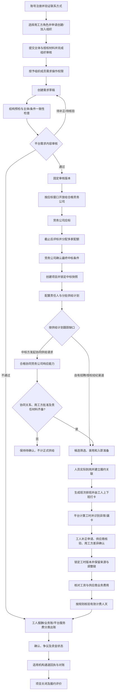

# 劳务供应链交易平台 PRD v0.1

| 项目 | 内容 |
|---|---|
| 编写日期 | 2026-10-20 |
| 文档状态 | 待评审草案，不是已批准开发或对外承诺 |
| 2026-10-24 首项目履约协作采购落地 | 关联[服务清单](../03-账单与资金/首项目履约协作服务清单-v0.1.md)、[采购合同](../03-账单与资金/履约协作服务采购合同条款-v0.1.md)、[验收结算单](../03-账单与资金/首项目履约协作服务验收与结算单-v0.1.md)、[财税会计意见](../03-账单与资金/首项目财税与会计处理意见-v0.1.md)。默认1元销售含税已由用户确认；采购以真实服务及独立验收为基础，销售集合与采购验收集合分开，保留原档位快照；税目、扣除、总净额和客户对价待真实项目签核，不增加已批准费率，不替代G-04／G-05或自动开放资金功能 |
| 2026-10-23 信用档案需求输入 | 用户提出三方维护平台信用、为未来劳务保理准备数据；新增 FR-15 及信用档案专项建议，展示口径、授权和申诉规则待评审，不改变当前收费或批准保理上线 |
| 2026-10-23 平台职责需求输入 | 用户提出平台承担审核和中立监督；新增[平台方审核与中立监督需求](../04-治理信用与增长/平台方审核与中立监督需求-v0.1.md)、FR-16～FR-19 和故事 109～160；同步统一问题定义、产品目标、主流程、权限/状态、验收、指标与依赖章节；岗位、举证复核、执行及自身监督机制为待评审建议，不增加替交易方选标/确认/资金审批权限 |
| 适用背景 | 从客户付费定制转为自主推进 |
| 依据 | 自主推进需求基线 v0.4；用工方入驻与有效需求标准 v0.1；战略与履约补充需求；v0.3/v0.2 明确未被覆盖的细则；配置与流程记录；仓库实现现状 |
| 关联文档 | [需求梳理与现状分析](./需求梳理与现状分析-v0.1.md) |
| 研发交接入口 | [产品设计目录说明](../README.md)、[需求追踪与交接门禁 v0.1](../05-战略与实施/需求追踪与交接门禁-v0.1.md)；后者是工作底稿，不新增批准规则 |
| 2026-10-23 外部激励需求输入 | [人事经理收益与跨企业推荐增长需求 v0.1](../04-治理信用与增长/人事经理收益与跨企业推荐增长需求-v0.1.md)；新增 FR-20～FR-23、故事 161～180，明确贡献与推荐收益路径、真实引荐、实收核算和资格边界；方向已批准但具体支付路径、参数、合同及试点生效待审，不改变收费及已有分账 |
| 用工方源头专项 | [用工方入驻与有效需求标准 v0.1](../01-身份与需求交易/用工方入驻与有效需求标准-v0.1.md)，细化 FR-01、FR-02、FR-03 的组织准入、需求门禁与验收 |
| 需求基线 | [自主推进需求基线 v0.4](../../../01-售前阶段/需求分析/requirements-draft-v0.4.md) |
| 决策标记 | “沿用”指已有材料记录；“建议”须负责人确认；“待定”不得静默取默认值 |
| 发布方式 | 本地 Markdown；本次不创建远程 Issue、不修改标签、不对外发布 |
| 2026-10-24 员工推荐需求输入 | 正式纳入员工直接推荐、一次性／阶段推荐奖励、持续按确认工时计奖及混合奖励；新增 FR-24～FR-25、故事 181～190；详见[员工推荐专项](../04-治理信用与增长/员工推荐与按工时持续奖励需求-v0.1.md)。能力范围已纳入，资格、归属、参数、付款责任及真实启用待评审，不改变客户收费、组织分账或人事经理激励 |
| 2026-10-24 员工分级禁入需求输入 | 用户新增企业内部拉黑及多家累计三次后的平台范围拉黑；新增 FR-26～27、故事 191～198、G-11，详见[分级禁入专项](../04-治理信用与增长/员工行为事件与分级业务禁入需求-v0.1.md)。三次目标保留；三家独立有效事件、平台复核与范围期限为待确认建议，不批准三条投诉自动全局封禁 |
| 2026-10-25 应标与中标开发基线确认 | 用户确认 DP-09/G-02：应标版本与截止、需求暂停/撤回后的已有应标处置、保密与权限、多家配额及取整、供应商独立确认和超时释放、BP-05 快照逐家交接；规则详见[业务包拆解与首批实施清单](../05-战略与实施/业务包拆解与首批实施清单-v0.1.md)第 3.1 节。本次确认规则未批准 BP-04 代码实现或真实业务启用 |
| 2026-10-19 评审结论 | 继续平台模式；不采用内部验证/真实资金的产品范围拆分，不暂缓独立 App；按用工方源头、应标中标、履约、资金流转顺序展开 |
| 入驻前提补充 | 同一平台内用工方、劳务公司两类角色自主注册，审核通过后使用对应业务能力；平台使用和审核免费，本次不重议盈利策略 |
| 入驻专项细化 | [入驻与资质审核需求细化 v0.1](../01-身份与需求交易/入驻与资质审核需求细化-v0.1.md)，具体材料与门禁为待评审建议 |
| 入驻边界确认 | 同一组织角色二选一；用工方支持各类依法设立主体；劳务公司当前仅准入合规外包、按适用规定备案主体；个人经纪人只通过劳务公司提供人员资源，不直接对接用工方 |
| 平台定位补充 | 平台提供互联网信息撮合，不作为具体外包承接方；不据此推导免于适用的信息审核、投诉处理或许可要求；本轮不展开地区及审核运营时限 |
| 2026-10-20 需求表单细化 | 建立“用工方目标—劳务公司逐项承诺—选标—双方确认快照—履约验收与结算”同源数据链；详见待评审表单专项稿 |
| 2026-10-20 用工方源头细化 | 单独形成用工方入驻与有效需求标准，并将组织认证、需求审核设为两个独立门槛；流程、字段门槛和验收规则仍待负责人评审 |
| 2026-10-20 多端与工时闭环补充 | 明确 Web、独立 App、小程序的角色和功能边界；增加工人小程序上下班打卡，并将排班、平台原始打卡、工时计算、复核确认和结算关联纳入闭环，外部考勤不得覆盖平台原始记录 |
| 2026-10-20 战略与履约补充 | 服务费战略计量基数改为经核验且符合合同条件的有效履约人天；增加履约方案、三类人员供给来源、有效人天及供应商履约评价 |
| 2026-10-21 市场调研补充 | 记录用工方采用劳务服务的工资资金安排/账期及供应商保证金价值假设；区分需求发布人与采购决策人；需求可配置保证金及收款账户；个人佣金/分成列为高风险待验证商业假设 |
| 2026-10-21 收费方基线确认 | 确认平台管理费/服务费由履约方承担，用工方原则上不付平台费；用工方主导选择固定费率档位，基准0.5元/人天；当时的超额50%/50%分账已由2026-10-22批准的三档规则替代，现行规则统一以《商业模式与收费标准-v0.1》为准；供应商应标前知悉并纳入经济账 |
| 2026-10-24 人天管理费口径更新 | 已批准费率为0.5–3.0元/有效履约人天、每0.5元一档、模拟器当前默认1元；前0.3元归平台。最终分成方案为超额部分按平台/用工方3/7、2.5/7.5、2/8封顶的边际分段累进，取代单一3/7和此前其他分账方案。具体区间与算法以《商业模式与收费标准-v0.1》为唯一维护来源；统计范围、周期、财税及收取结算实施条件另行确认，规则获批不等于系统已更新或上线。 |
| 2026-10-23 用工方决策链假设 | 将老板/经营决策人作为经济决策角色、人事经理/需求经办人作为业务推动与日常使用角色纳入首轮访谈；两类角色的价值、实际权限、采用门槛及全国供应商带来的性价比假设须通过真实客户与交易验证，不构成市场结论或个人激励批准 |
| 2026-10-20 战略定位升级 | 明确平台不是劳务公司管理 SaaS 的更名；招聘、档案、考勤、工资核算及返费等能力服务于交易和履约，并新增交易飞轮验证与模块价值筛选原则 |
| 2026-10-20 资金与工时流程确认 | 明确平台负责核算、账务与支付指令编排；劳务公司负责资金审批、资金准备及其实际义务；持牌第三方机构按授权管理账户或执行支付并回传回执；补充余额不足处理、现场工时核对与确认权限、不同资金科目分别核算；账户产品和法律结构仍待验证 |
| 补充材料范围处理 | “第一版必须/可分阶段开放”仅作输入材料建议记录；不覆盖负责人已确认的完整平台、全链路、独立 App、履约和资金范围 |

## 1. 问题陈述

用工企业、劳务公司、驻场、经纪人和工人在同一用工项目中协作，却分别依赖聊天、表格和线下转账记录。推荐归属、入职事实、工时、工资、返费和企业结算缺乏共同依据，导致重复核对、规则被事后修改、金额争议以及支付异常难以追踪。平台虽承担主体/需求审核和交易秩序维护，却缺少贯穿审核、履约异常、投诉举证、复核、执行回执及对平台自身处理的可追溯程序时，平台介入容易被误解为偏袒、越权裁决或只留处理结论而没有实际落实。

仅为劳务公司提供内部管理软件，可以改善单家公司的流程，却不能解决真实用工需求从哪里来、如何触达合格供应商、供应商如何竞争并承诺履约、交易如何形成可核验结算依据等网络层问题。因此，产品必须围绕供需交易和履约组织，而不是围绕管理功能清单定义自身。

项目自身还存在两个问题：原定制交付以模块清单为主，需要按完整业务流程重新组织需求和建设依赖；文档中的“已完成”与代码实际状态不一致，容易错误估计后续成本。个人自主推进不是删减履约、资金能力或暂缓独立 App 的依据。

## 2. 解决方案与产品目标

围绕劳动密集型企业的真实劳务供需交易，提供交易组织、标准化履约数据、核验和结算管理基础设施；平台以规则化审核、过程监督和可复核的争议处理维护交易程序可信，让劳务公司以更低成本、更高效率完成合规交易，而非由平台亲自成为劳务交付方或替交易双方作商业决定。

用工方/劳务公司注册与组织审核 → 用工方发布需求并经独立需求审核 → 劳务公司应标 → 用工方选择中标方并确认配额 → 建项目 → 履约方案与供给计划 → 自有/渠道/经批准的协同供给 → 筛选和入职准备 → 实际到岗 → 平台排班与工人上下班打卡 → 工时核算、差异复核与责任方确认 → 工资/供应商费用/平台有效人天分别核算 → 分类账单与对账 → 资金状态记录及机构回执 → 项目关闭与履约评价；平台审核和监督任务、异常分流、投诉举证/复核及执行回执横向贯穿适用环节，并保留参与方申诉和平台自身问责入口。

### 2.1 目标

- 每个项目能追溯至中标条件；每笔费用能追溯至有效政策、人员记录和确认依据。
- 工人能核对本人工时与工资，经纪人能核对本人推荐人员的返费，不靠劳务公司口头解释。
- 员工可用同一账号直接推荐朋友，追踪必要招聘进度，核对一次性或持续工时奖励及支付结果；推荐收益与本人工资、经纪返费和企业引荐奖励分别核算。
- 工时在平台形成从排班、工人上班/下班打卡、工时计算、异常补正、责任方复核到确认和结算引用的可追溯记录；用工方外部考勤不再是唯一工时依据。
- 账单锁定后不可被无痕修改；支付指令不重复执行，未知结果不被误判为失败或成功。
- 多组织协作不突破租户隔离，不泄露未授权报价、工资、身份和利润信息。
- 以用工方源头、劳务公司应标中标、履约及资金流转的完整业务链路验收，不把模块建设顺序误认为范围缩减。
- 平台的准入审核、交易监督、投诉处理和规则治理均有明确权限、证据、理由、回避、复核及执行状态；对交易双方适用一致程序，不因商业价值或付费关系改变事实标准。
- 平台负责规则和程序，不替代用工方选择供应商/确认需求与履约事实，不替代劳务公司审批资金，不以投诉或告警自动认定违约；决定与业务执行、付款到账及案件结案分别留痕。
- 平台围绕真实交易密度、合格供给、可核验履约、复购和单位成本改善创造价值；注册用户数不单独证明平台有效。
- 平台商业模式、收费项目、计费依据和审批状态统一见[《商业模式与收费标准》](../03-账单与资金/商业模式与收费标准-v0.1.md)。本 PRD 不重复维护费率及分配细则；履约方承担平台管理费、用工方原则上不付平台费为已批准基线。

### 2.2 战略定位：交易网络而非管理 SaaS

本产品不是以向单家劳务公司销售管理软件为核心的 SaaS，也不是传统劳务公司替代供应商承接人员交付。它组织用工单位和合规劳务公司在共同规则下完成交易：用工方提出真实需求，供应商竞争性应标并承诺交付，获选供应商组织人员履约，平台关联并核验交易、履约、计费和结算记录。

招聘、档案、考勤、工资核算、返费及项目管理等能力保留为交易基础设施的一部分：只有在它们支撑交易发生、履约成功、数据可信、结算可核验或单位服务成本下降时，才构成平台产品价值。产品路线图不得仅按传统劳务 SaaS 的功能清单扩张。

战略验证遵循以下因果链，而非以注册数或功能上线数替代结果：

**真实用工需求 → 合格供应商参与 → 竞争性选择与中标 → 供给组织及实际履约 → 可核验履约数据 → 计费结算与交易复购 → 交易密度和自动化提升 → 单位服务成本改善。**

上述因果链是需要经营数据验证的飞轮假设，不是已被证明的商业结果。“优先验证真实交易”表示优先检验产品是否解决真实交易问题，不表示仅交付内部闭环、不进入真实业务、不建设资金流转能力或暂缓独立 App。完整业务范围仍按本 PRD 第 3 节和需求基线执行。

新增或扩展产品模块时，需求评审应说明其对以下至少一项的直接贡献：帮助真实交易发生、提高履约成功率、提升交易或履约数据可信度、降低单位服务成本、支持可持续收费。用工方价值主张还应验证责任边界清晰、工资支付与结算账期安排、供应商履约保证等实际动因；这些是合同和市场假设，不是平台担保或对所有交易方的承诺。缺乏清晰贡献路径的传统管理功能不自动获得建设优先级。

项目早期定位为面向劳务中介和经纪人的管理 SaaS，转为劳务供应链交易平台后，核心需求发起方和买方转向用工方；早期调研未能识别这一目标客户，属于客户发现盲区。首轮客户发现将老板/经营决策人作为经济决策角色、人事经理/需求经办人作为业务推动与日常使用角色，验证二者是否分离、各自的实际权限与采用门槛；此为典型角色假设，不预设所有企业组织结构相同。老板可能看重扩大合格供应商范围后可比较的劳务方案、总成本与履约风险，人事经理可能看重需求上线及劳务人员/供应商履约协同带来的管理便利；这些价值均待访谈和真实交易验证，不承诺全国供应商必然带来更低价格或更好履约。平台获客和产品流程应分别支持需求触达、组织授权、需求发布及采购审批，不因持有联系人信息推定营销授权或其个人拥有采购决定权。任何面向客户员工个人的佣金、推荐奖励或从人天服务费中分成均为高风险待验证事项，不进入默认产品规则；需先核实真实服务、组织授权、利益冲突披露、合同和合规要求，禁止以个人利益影响选标。

### 2.3 不作出的承诺

平台不默认成为用工单位、派遣单位、人员工资义务人、劳务交付方、工资垫资方或企业客户融资方；不自营资金池，不因内部账本或已出账状态宣称资金实际到账。平台支持用工方按合同线下支付至劳务公司对公账户，但必须记录应收、账期、回款凭证/流水、核对、短款与逾期，不把线下回款显示为平台已收款。未来若接入平台支付和保理，应按[《未来平台支付与保理资金架构建议》](../05-战略与实施/未来平台支付与保理资金架构建议-v0.1.md)采用平台支付编排、受监管机构执行、保理机构融资的分层架构；平台提供资金通道、工资代发、账户或分账服务需依据具体合同、机构能力、授权和适用要求单独确定。T+0、资质自动核验、保险自动购买和税务自动处理均不能在依赖未验证时对外承诺。

## 3. 范围、业务顺序与商业假设

### 3.1 商业方向

负责人已确认平台管理费/服务费由履约方承担、用工方原则上不付平台费。平台通过履约管理与监督服务支持用工方管理供应商履约；另将人事经理运营贡献、独立服务及跨企业推荐列为可追踪的外部增长与收益需求，详细范围见[收益与推荐专项](../04-治理信用与增长/人事经理收益与跨企业推荐增长需求-v0.1.md)。收费项目、价格、计费依据及客户侧收益分配以[《商业模式与收费标准》](../03-账单与资金/商业模式与收费标准-v0.1.md)为唯一依据；外部奖励必须从独立获批的合格平台收入预算核算，暂缓项目不得配置为正式报价或默认计费规则。

### 3.2 按业务流程组织完整范围

| 业务顺序 | 核心范围 | 形成的业务依据 | 对应需求 |
|---|---|---|---|
| 1：用工方源头 | 用工方来源与触达、企业入驻、需求发布、审核及可见性 | 可被劳务公司承接的有效需求 | FR-01～FR-03；源头运营细则待补充 |
| 2：应标中标 | 劳务公司准入、应标、比较选标、多家配额、中标确认与建项目 | 不可被单方修改的履约条件 | FR-02、FR-04、FR-05 |
| 3：劳务公司履约 | 责任人与供给计划、自有/经纪渠道/员工直接推荐/协同供给、候选入职、排班、工人平台打卡、工时复核、补员、有效人天与供应商评价 | 平台打卡与其他来源可区分、可核对、可追溯的实际履约和计费记录 | FR-06～FR-11、FR-13、FR-24 |
| 4：账单与资金状态 | 工人报酬、员工阶段／持续工时推荐奖励、用工方—劳务公司业务账、平台服务费分别核算；对账、收款及适用的支付/账户集成 | 合同对应的应收应付、真实入账或机构回执及争议状态 | FR-11～FR-13、FR-25 |

FR-01 权限与 FR-14 投递审计贯穿所有环节。以上是业务依赖和需求展开顺序，不是四个缩减交付版本。不得把支付模拟、人工演示或仅完成撮合视为完整平台交付。具体工资付款责任取决于实际安排，不能将企业回款设为延后工人应得报酬的当然依据，也不能因此推定平台承担垫付义务。

### 3.3 多端职责与功能边界

三端的具体角色、功能、权限边界和端间交接关系，统一维护在[《多端功能清单与职责边界 v0.1》](./多端功能清单与职责边界-v0.1.md)中。本 PRD 不重复维护端侧功能表；独立 App 属于完整平台范围，不因 Web 或小程序可以访问部分能力而取消或延后。

工人小程序提供“上班打卡”和“下班打卡”，并将每次事件关联到本人、有效入职/履约关系、项目、岗位、班次和服务日期。平台排班与工人打卡构成平台自己的第一方考勤数据闭环：平台依据排班版本、上下班事件、休息/跨日规则形成工时明细，经过异常处理、必要复核和项目约定的确认后，才进入工资计薪、供应商结算或有效计费人天计算。打卡记录、计算工时、经复核确认的工时、工资计薪量、供应商结算量和平台有效计费人天是不同数据，不可互相替代。

平台打卡是平台自己的第一方原始数据来源，不意味着单次打卡自动证明全部实际工作时间、产生工资或可计费人天。工厂考勤接口/导入、驻场记录及其他获准数据源用于补充和差异核对，不得静默覆盖平台原始记录。定位、照片或其他现场证明按具体业务风险、必要性和隐私规则配置；不在本 PRD 中设为全平台强制项。

移动 Web 可承载分享或辅助访问，但不得作为缩减工人打卡、现场履约或独立 App 范围的理由。

### 3.4 用工方入驻与有效需求

用工方从账号注册、选择组织角色、提交主体与授权资料、组织审核，到需求草拟、结构预检、平台审核并开放合格劳务公司应标，须经过独立门槛。有效需求不只是字段齐全，还须能让供应商理解服务内容、提交可比较承诺，并让双方依据明确口径核验履约和结算。具体门槛与验收见[用工方入驻与有效需求标准](../01-身份与需求交易/用工方入驻与有效需求标准-v0.1.md)。

目标客户的细分、获客渠道、区域、角色分工、需求真实性核验深度及平台如何触达合适供应商仍需继续验证；本标准不代表平台担保需求方付款能力、交易合法性或供应商履约结果，也不虚构获客方案或经营承诺。

新增调研假设：用工方采用劳务派遣/外包，除用工主体与责任边界安排外，可能看重劳务服务方承担合同约定的工资支付及由此形成的结算账期、以及供应商提供履约保证金。需通过客户访谈和真实交易验证账期与保证金对决策的影响；平台不得把付款主体变化表述为法定责任当然转移，也不承诺融资、垫资或供应商必然提供保证金。需求联系人和采购决策角色应分开建模并按组织授权操作。

**用工方购买决策与首轮访谈：**优先覆盖存在近期真实劳务需求的用工方，并分别访谈老板/经营决策人和人事经理/需求经办人；同一人兼任时，分别验证其经济决策与日常执行视角。访谈问题、样本记录和验证方法见[《需求梳理与现状分析》5.1 节](./需求梳理与现状分析-v0.1.md)。首轮重点核实：谁提出需求、发布需求、比较并批准供应商及预算、签约和跟进履约；全国范围合格供应商是否扩大了有效选择及其对总成本/匹配度的实际影响；人事经理上线与持续使用的工作收益、组织支持和实际负担；采购审批、数据/合同审查与试点门槛；账期对采用决策的影响。以近期采购过程、真实需求和经授权的脱敏材料为证据，并继续访谈供应商验证其应标意愿与服务边界。访谈兴趣不等于真实需求或产品市场验证通过。

人事经理的管理便利和由企业正式认可的岗位绩效改善可作为待验证价值；不把个人佣金、回扣或与选标/供应商付费挂钩的个人收益写成平台默认激励。2026-10-23 已接入[人事经理贡献奖励与跨企业渠道推荐奖励管理制度 V1.0](../../../00-项目管理/经营制度/人事经理贡献奖励与跨企业渠道推荐奖励管理制度-v1.0.md)，作为两类外部增长激励的详细来源：方向已批准，具体实施待审。贡献记录不等于现金债权；客户/供应商在职人事经理的个人直接付款默认拦截，平台内部员工绩效另行管理。制度中的收入示例、预算情景和候选期限不自动成为现行收费、个人提成或上线配置。

### 3.5 范围与安全边界

测试、联调和真实资金上线审核是完整平台的工程要求，不构成“先交内部验证版、以后再做资金版”的产品策略。支付机构能力和资质要求应从需求设计开始确认，不到资金模块开发时才启动。未确定的外部接口和历史扩展设想逐项评审，不因本次确认自动全部纳入，也不批量后置。

平台不默认成为外包主承接方或人员工资垫资方；供给协同路径、人员及工资责任、计费和支付责任必须依各方真实合同与授权确定。战略与履约补充细节见[战略与履约流程补充需求整合](../02-供给与履约/战略与履约流程补充需求整合-v0.1.md)。

## 4. 角色与权限

平台审核与中立监督是贯穿完整交易链的职责，不是交易完成后的附属客服：FR-16 支撑准入/发布与复审，FR-17 跟踪履约和到期协作，FR-18 承接各端争议及执行，FR-19 约束平台自身权限与规则。下表为主要岗位边界，专项稿细化程序，不改变原业务确认及资金责任。

| 角色 | 组织/范围 | 核心能力 |
|---|---|---|
| 平台分派/准入/需求审核 | 平台租户、所承办任务及授权材料；使用平台 Web | 核验、补正、复审与版本门禁；销售不能改审核结论，审核不替买方选标 |
| 平台履约监督/风险处置 | 授权交易摘要、异常与措施；使用平台 Web | 监督版本、承诺、确认、到期收付与整改；措施审批及恢复受控，不改原始事实或代资金审批 |
| 平台投诉受理/事实核验/独立复核 | 按案件、争点和字段授权；使用平台 Web | 组织双方举证、调解、规则处理与独立复核；原处理人/利益相关人不得独立复核，处理意见不等于业务执行 |
| 平台规则治理/质量安全审计 | 规则、授权审计、抽检和平台自身投诉；使用平台 Web | 制定与发布分离、利益回避、访问审计、错审更正；自身收费/员工投诉不能由相关经办单独终审 |
| 用工方老板/经营决策人 | 本组织；由组织授权确定决策范围 | 评估供应商方案、总成本、履约风险和采用价值；在授权范围内批准采购、试点或预算，不因职位名称自动获得平台操作权限 |
| 用工方人事经理/需求经办人 | 本组织需求与对应项目；主要使用 Web | 推动需求整理、授权与上线，跟进供应商、人员和履约过程；是否有发布、评标或确认权限由组织单独授权 |
| 用工方管理员/业务 | 本组织需求与对应项目；主要使用 Web | 按授权发需求、评标、配额、查看排班/考勤差异、按约确认履约及结算量、回款对账 |
| 劳务公司管理员 | 本组织 | 人员角色、政策、项目、审批权限配置；按组织授权配置劳务公司资金审批角色 |
| 劳务公司财务/资金审批人 | 授权组织/项目 | 工资及分类账单复核、资金准备状态确认、最终资金审批、支付指令授权、对账；具体金额权限与复核级别由组织授权 |
| 项目经理 | 授权项目；使用 Web 与独立 App | 岗位、招聘、排班编制/发布、供给计划、现场履约及项目账单；可提交现场业务核验，不替代劳务公司最终资金审批 |
| 驻场 | 授权项目或工厂；主要使用独立 App | 入离职、保险凭证、现场排班协同、班次/到岗、打卡异常与漏打卡核验、工时差异、申诉核对、独立来源补录、借支初审及业务依据提交；无默认最终资金审批权 |
| 内部招聘专员 | 授权渠道和人员 | 发布/分享岗位、提报、跟进 |
| 个人经纪人 | 本人及受授权合作关系；使用小程序 | 提报、查询本人归属和返费，不参与应标或考勤 |
| 工人 | 本人及所属入职/履约关系；使用小程序 | 报名、个人资料、查看本人班次、上班/下班打卡、工时、补正申请、工资、申诉和借支；按资格直接推荐朋友、查看必要脱敏进度及本人的阶段／持续工时奖励，不因此取得经纪或审批权限 |

用工方、劳务公司、平台分别属于组织租户；工人与经纪人通过成员关系和业务授权访问，不能获得全租户权限。所有端执行服务端权限检查，不依赖隐藏按钮。

平台中立监督以程序、规则和证据为边界，不等于全库可见、自动认定违约或终局裁决；平台不因买方获客价值或供应商付费而倾斜结果。平台是审核、程序监督、争议组织及规则执行者，不是交易一方、用工事实确认者、资金审批者或法定争议裁决机关。平台岗位可在小团队兼任，但受限的初审/复核/批准行为必须按 D-17 分离；无可用独立人员时升级/待复核，不静默绕过。投诉、告警、负面评价和待核实事项须与已核实事实、平台处理结论及执行状态区分存储和展示；未回应不等于承认，处理决定不等于已执行或已结案。具体岗位及跨端处理流程见[平台方专项](../04-治理信用与增长/平台方审核与中立监督需求-v0.1.md)。

## 5. 用户故事

用户故事按主要执行角色分组；同一功能可能涉及多个角色，故事中的角色表示主要受益者或操作者，不代替 FR 的权限矩阵。分组不是版本优先级或开发顺序。以下故事用于描述用户目标，具体审批、状态、异常与验收仍以对应 FR、专项规则和需求追踪门禁为准；未批准的业务规则仍须评审。

### A. 用工方：老板/经营决策人

1. 作为用工方老板，我希望按统一口径比较供应商报价、履约承诺、供给能力和风险，以便评估引入平台是否改善劳务方案的性价比。（FR-03、FR-04）
2. 作为用工方老板，我希望看到需求到履约、结算的关键指标和异常，以便判断供应商是否达到约定目标。（FR-05、FR-08、FR-11、FR-13）
3. 作为用工方老板，我希望了解平台服务、供应商责任、合同关系和付款安排的边界，以便在批准试点或采购前评估责任风险。（FR-03、FR-11、FR-12）
4. 作为用工方老板，我希望查看采购评审、授权审批和选标依据，以便确认组织按授权流程作出供应商选择。（FR-01、FR-04、FR-14）
5. 作为用工方老板，我希望比较多家供应商的价格、服务范围与可交付能力，而非只看最低报价，以便决定是否分配给一家或多家供应商。（FR-04、FR-05）
6. 作为用工方老板，我希望平台呈现实际供应商覆盖地区与响应情况，以便判断扩大到跨地区供应商是否有价值；系统不得承诺全国范围必然带来低价或更好履约。（FR-03、FR-04、FR-13）
7. 作为用工方老板，我希望看到账期、保证金等方案的适用条件、成本和责任主体，以便在合同和机构能力明确后作出知情决定；未来保理仅为待验证方向，不作为当前融资承诺。（FR-11、FR-12、FR-13）
8. 作为用工方老板，我希望按组织权限授权人事经理发布需求、跟进项目或参与评审，并能撤销授权，以便职责下放同时保留治理边界。（FR-01、FR-14）

### B. 用工方：人事经理/需求经办人/评审人

9. 作为用工方申请人，我希望选择组织角色、提交匹配主体类型的设立及授权资料并跟踪审核结果，以便申请组织使用用工方能力。（FR-01、FR-02）
10. 作为用工方组织管理员，我希望邀请成员加入组织并按需求、项目和操作授予权限，以便让经办、评审和确认职责与组织授权相符。（FR-01）
11. 作为用工方人事经理，我希望保存需求草稿、获得字段完整性和一致性检查并预览供应商可见内容，以便在提交审核前修正缺项或敏感披露。（FR-03、FR-14）
12. 作为用工方需求经办人，我希望以结构化字段描述地点、岗位、人数、时间、服务目标、计价结算和应标条件，以便供应商提交可比较的方案。（FR-03）
13. 作为用工方需求经办人，我希望查看审核意见、逐项补正并保留版本，以便知道需求何时达到可发布条件。（FR-03、FR-14）
14. 作为用工方授权人员，我希望暂停、撤回或关闭需求并说明原因，以便停止新增应标并通知已参与供应商。（FR-03、FR-04、FR-14）
15. 作为用工方人事经理，我希望在一个项目视图中跟进应标、供给计划、到岗、排班、工时差异和待办，以便减少多表重复维护。（FR-04、FR-05A、FR-07、FR-08、FR-13）
16. 作为用工方采购评审人，我希望按预先设定的评审条件比较偏离项、价格、服务方案和履约承诺，并记录意见，以便选标可解释、可追溯且不受未披露个人利益影响。（FR-04、FR-14）
17. 作为用工方采购授权人，我希望按中标规则选择一家或多家供应商并设置配额，以便将采购决定转化为清晰的履约分工。（FR-04、FR-05）
18. 作为用工方人事经理，我希望查看中标条件及其变更记录，以便核对供应商履约时使用的是双方确认的有效版本。（FR-05、FR-14）
19. 作为用工方授权核验人，我希望查看按来源区分的平台打卡、外部考勤和补正记录，并确认无争议量或提出差异，以便结算依据可追溯。（FR-08、FR-11、FR-14）
20. 作为用工方财务/对账人员，我希望查看结算单的确认量、单价、账期、调整和凭证，以便核对应付并记录部分付款、短款或争议。（FR-11、FR-12A）
21. 作为用工方人事经理，我希望查看供应商履约评价所依据的项目、指标和事实，并能提交纠错信息，以便内部管理基于可解释证据。（FR-13、FR-14）
22. 作为用工方联系人，我希望平台说明联系目的、资料用途和授权方式，以便我知道谁能查看我提交的组织或需求信息。（FR-01、FR-14）

### C. 劳务供应商：管理员/应标人

23. 作为劳务公司申请人，我希望提交组织主体、授权关系及适用资质并跟踪审核和补正，以便知道哪些业务能力已获准使用。（FR-01、FR-02）
24. 作为劳务公司管理员，我希望维护证照、有效期、服务地区、岗位能力及组织成员，以便应标前检查组织资格和内部授权。（FR-01、FR-02、FR-04）
25. 作为劳务公司管理员，我希望配置应标、项目、财务和资金审批权限并可撤销，以便职责分离、变更可审计。（FR-01、FR-12、FR-14）
26. 作为符合条件的劳务公司，我希望只接收或查看我有资格且获准可见的需求，并看到截止时间与应标规则，以便判断是否参与。（FR-02、FR-04、FR-14）
27. 作为劳务公司应标人，我希望查看完整需求、附件、责任边界和计量结算条件，以便在提交承诺前评估服务与成本。（FR-03、FR-04）
28. 作为劳务公司应标人，我希望逐项回应需求条件、说明偏离、价格、供给能力和履约方案，以便用工方能公平比较方案。（FR-04、FR-05A）
29. 作为劳务公司应标人，我希望在截止前修订或撤回应标并看到版本记录，以便纠正错误且不覆盖历史承诺。（FR-04、FR-14）
30. 作为劳务公司，我希望对不参与应标记录可选原因，以便反映供给、区域或商务障碍；该记录不应被误解为承诺或违约。（FR-04、FR-13）
31. 作为劳务公司，我希望收到需求变更、评标结果及中标确认事项的通知，以便及时决定是否更新方案或启动履约。（FR-04、FR-05、FR-14）
32. 作为中标劳务公司管理员，我希望核对并确认中标条件快照，以便项目按约定版本执行且变更需有授权记录。（FR-05、FR-14）
33. 作为劳务公司，我希望查看履约评价采用的指标、项目范围和证据，并能对事实错误提出异议，以便评价公平、可解释。（FR-13、FR-14）

### D. 劳务供应商：财务/资金审批人

34. 作为劳务公司财务，我希望按适用规则试算工资、返费及分类账单并查看计算依据，以便复核金额和来源。（FR-09、FR-10、FR-11）
35. 作为劳务公司财务，我希望提交人与复核人职责分离，并在审批时重新校验余额、权限和未结金额，以便减少错发、重复和超额支付。（FR-01、FR-09、FR-12）
36. 作为劳务公司资金审批人，我希望查看支付对象、科目、金额、依据、授权和可用余额后作最终审批，以便支付符合组织授权；平台运营或驻场不得替代该审批。（FR-12）
37. 作为劳务公司财务，我希望区分工资、保险、供应商结算、平台服务费等账单及资金状态，以便不同责任和用途不被净额掩盖。（FR-11、FR-12）
38. 作为劳务公司财务，我希望查看线下对公回款的应收、到期、部分回款、凭证核对、短款和逾期状态，以便逐笔对账；平台记录不能冒充银行到账证明。（FR-12A、FR-14）
39. 作为劳务公司财务，我希望支付结果未知时先查询机构最终状态再决定恢复操作，以便避免重复付款。（FR-12）
40. 作为劳务公司财务，我希望账单行能追溯到中标条件、确认履约量、单价、调整和凭证，并能提交异议，以便快速定位争议。（FR-11、FR-12A）
41. 作为劳务公司财务，我希望借支未实际支付时不产生扣回，实际支付后不重复扣款，并能查看结转余额，以便工资核算真实一致。（FR-09）
42. 作为劳务公司财务，我希望返费政策调整只影响适用的新关系或新权益，并按版本计算增量，以便不追溯覆盖既有权益。（FR-05、FR-10）

### E. 平台：销售/客户成功/运营/审核/财务

43. 作为平台销售/客户成功人员，我希望记录线索来源、联系依据、组织授权、需求成熟度和跟进状态，以便区分可联系线索与已核实需求，不把联系人信息误当成营销授权。（FR-01、FR-02、FR-14）
44. 作为平台客户成功人员，我希望记录用工方老板与人事经理各自的决策职责、价值诉求和采用障碍，以便分别验证经济决策与日常推动假设。（FR-01、FR-03、FR-14）
45. 作为平台审核员，我希望记录组织审核的通过、驳回、补正、待核验依据和处理人，以便准入过程可追溯。（FR-02、FR-14）
46. 作为平台需求审核员，我希望依据主体关系、岗位服务内容、数量时间、计价和履约条件核验需求并记录理由，以便将待核实需求与达到发布门槛的需求区分。（FR-03、FR-14）
47. 作为平台运营人员，我希望处理审核积压、过期资质、同步失败和业务异常队列，以便风险处置有责任人和状态记录。（FR-02、FR-13、FR-14）
48. 作为平台运营人员，我希望施加的新业务限制不阻断存量工时、申诉、核算和应付处理，以便风险控制不制造新的履约损害。（FR-02、FR-13）
49. 作为平台财务，我希望平台服务费账单引用适用合同、经核验的有效计费人天和规则版本，以便计费可复算且收费责任明确。（FR-11）
50. 作为平台财务/运营人员，我希望收费规则在合同、计费口径和收取条件未获批准时保持不可实收状态，以便避免把费率方案误当成收款授权。（FR-11、FR-12）
51. 作为平台支付运营人员，我希望查看授权指令、机构回执、余额不足和对账差异，并按流程处理失败或未知结果，以便资金状态真实且可恢复。（FR-12）
52. 作为平台运营人员，我希望跨组织投递失败可重试、重复消息幂等且保留审计，以便协作双方看到一致版本。（FR-14）
53. 作为平台安全/隐私管理员，我希望按组织、成员、用途和敏感字段实施访问控制并审计敏感读取与导出，以便数据只向获授权对象开放。（FR-01、FR-14）
54. 作为平台运营人员，我希望在处理投诉或争议时导出授权范围内的证据并保留导出审计，以便调查不越权且结果可复核。（FR-13、FR-14）
55. 作为平台产品/运营负责人，我希望观察真实需求发布、合格应标、供应商选择、履约、复购和单位服务成本，而非只看注册数，以便判断双边交易是否产生实际价值。（FR-03、FR-04、FR-11、FR-13）

### F. 驻场人员

56. 作为驻场，我希望按项目批量安排面试并登记结果，以便候选人跟进与现场安排保持一致。（FR-06、FR-07）
57. 作为驻场，我希望在入职前检查必要资料、适用保险凭证和入职前置状态，以便缺少必要条件时能阻止或升级处理。（FR-07）
58. 作为驻场，我希望登记实际入职、离职日期与原因，并为回流人员建立新的入职关系，以便不覆盖历史履约和权益记录。（FR-07、FR-09、FR-10）
59. 作为驻场，我希望查看本人授权项目的排班、到岗和待办，并协助核验漏打卡申请，以便及时处理现场异常；我不能伪造或覆盖工人原始打卡。（FR-01、FR-08、FR-14）
60. 作为驻场，我希望导入用工方考勤并获得逐行校验结果，以便修复错误记录而不影响整批有效数据。（FR-08）
61. 作为驻场，我希望对平台打卡、外部考勤和独立来源补录分别留痕并展示差异，以便提交复核而不把不同来源混成单一事实。（FR-08、FR-14）
62. 作为驻场，我希望查看工人申诉及其证据、记录初审意见和处理理由，以便争议有明确处理轨迹；现场核验不等于最终工时或资金审批。（FR-08、FR-12、FR-14）
63. 作为驻场，我希望提交借支申请的业务依据并查看审批状态，以便协助工人办理而不越权批准或承诺到账。（FR-09、FR-12）
64. 作为驻场，我希望在供应商或项目被限制新增业务时仍可处理存量入离职纠错、工时申诉和发薪相关资料，以便限制措施不阻断存量责任处理。（FR-07、FR-08、FR-13）

### G. 项目经理

65. 作为项目经理，我希望中标确认后由系统生成唯一项目并保留需求、应标和中标来源，以便避免重复建项和条件丢失。（FR-05、FR-14）
66. 作为项目经理，我希望查看中标方案与政策快照并据此制定履约计划，以便后续操作不偏离双方确认条件。（FR-05、FR-05A）
67. 作为项目经理，我希望把中标承诺拆分为分阶段供给计划，分别记录计划、候选、确认能力、到岗和缺口，以便提前发现无法按期交付的风险。（FR-05A、FR-06、FR-07）
68. 作为项目经理，我希望自有供给不足时发起协同供给申请，明确参与组织、人员来源、责任和费用依据，并跟踪审批状态，以便未经必要授权的人员不计入正式交付。（FR-05A、FR-06）
69. 作为项目经理，我希望发布包含工价、计价单位、岗位条件和适用返费政策的招聘岗位，以便招聘信息与中标承诺一致。（FR-05、FR-06、FR-10）
70. 作为项目经理，我希望跟踪渠道提报、候选人报名、面试、录用和到岗状态，以便识别招聘漏斗中的供给缺口。（FR-06、FR-07）
71. 作为项目经理，我希望为回流人员创建新的入职关系，并查看历史关系但不覆盖它，以便人员权益和项目归属可追溯。（FR-07、FR-10）
72. 作为项目经理，我希望编制、发布和调整排班并通知相关人员，以便排班变更可追溯且工人能及时获知。（FR-05A、FR-08、FR-14）
73. 作为项目经理，我希望查看排班、打卡、外部考勤和工时计算之间的差异并提交业务核验，以便按规则确认业务事实而不替代用工方确认或劳务公司资金审批。（FR-08、FR-11、FR-12）
74. 作为项目经理，我希望查看无争议履约量、待核验量和争议量的区分，以便仅将符合条件的数量提交后续计薪、结算和有效人天核算。（FR-08、FR-09、FR-11）
75. 作为项目经理，我希望在供给不足、缺勤、人员流失或阶段目标偏离时收到提醒并记录补员计划，以便采取措施且保留履约过程证据。（FR-05A、FR-13）

### H. 独立劳务经纪人

76. 作为经纪人，我希望通过受授权的劳务公司查看可推荐岗位及其有效条件，以便只向候选人传递准确、仍有效的岗位信息。（FR-01、FR-06）
77. 作为经纪人，我希望在提交候选人前知道必要资料、授权用途和岗位要求，以便取得候选人必要同意后再提交信息。（FR-01、FR-06、FR-14）
78. 作为经纪人，我希望提报候选人后获得可追溯的提交回执和处理状态，以便知道提报是否成功且不重复提交。（FR-06、FR-14）
79. 作为经纪人，我希望在出现重复提报或归属冲突时查看处理状态并提交依据，以便归属按规则裁定而不自行覆盖既有记录。（FR-06、FR-14）
80. 作为经纪人，我希望仅查看本人授权提报人员的招聘进度和必要状态，不访问其他经纪人或劳务公司的完整人员资料，以便保护候选人隐私。（FR-01、FR-06）
81. 作为经纪人，我希望查看适用于本人提报人员的返费政策快照、达标进度、待结算与已结算金额，以便核对权益来源。（FR-10、FR-11）
82. 作为经纪人，我希望在返费金额或归属有差异时提交申诉并查看依据和处理结果，以便争议得到复核而不是被静默改写。（FR-10、FR-13、FR-14）
83. 作为经纪人，我希望看到岗位暂停、关闭或政策变更的通知及适用范围，以便停止传播失效信息且不误认为历史权益被追溯取消。（FR-06、FR-10、FR-14）
84. 作为经纪人，我希望明确平台不代表劳务公司承诺返费或保证赔付，并能查看实际责任主体与规则版本，以便向候选人准确说明权益边界。（FR-10、FR-13）

### I. 工人/候选人

85. 作为候选人，我希望查看岗位、工作地点、工价、工作条件和适用规则后再报名，以便知晓报名对应的具体项目。（FR-06）
86. 作为候选人，我希望知道个人资料将由哪些组织为哪些招聘目的使用，并可按规则更正资料，以便理解和管理个人信息。（FR-01、FR-06、FR-14）
87. 作为工人，我希望查看本人报名、面试、录用和入职状态，以便了解招聘进度和下一步要求。（FR-06、FR-07）
88. 作为工人，我希望查看本人已确认的项目、班次、地点和排班变更，以便按最新安排到岗。（FR-01、FR-08）
89. 作为工人，我希望使用本人账号提交上班和下班打卡并看到记录结果，以便核对原始出勤；重试不能重复生成事件，任何人不得代替我伪造打卡。（FR-01、FR-08、FR-14）
90. 作为工人，我希望为漏卡或异常班次提交说明和证据、查看处理状态及理由，以便差异进入可追溯复核且不覆盖原记录。（FR-08、FR-14）
91. 作为工人，我希望查看本人已确认工时与工资计算明细并就差异申诉，以便区分原始打卡、确认工时和计薪结果。（FR-08、FR-09）
92. 作为月结工人，我希望查看可借额度、借支申请结果和已实际支付的扣回明细，以便理解工资余额且未支付借支不被扣回。（FR-09）
93. 作为工人，我希望查看工资条、预计付款日、支付状态和真实到账信息，以便区分核算完成、指令处理中与实际收款。（FR-09、FR-12）
94. 作为工人，我希望查看离职结算和本人适用返费权益的计算依据，以便核对离职日期、工时和应得金额。（FR-07、FR-09、FR-10）

### J. 平台系统管理员与集成角色

95. 作为平台系统管理员，我希望按组织、成员、项目和字段管理权限，并在权限撤销后使旧会话或链接失效，以便保护跨组织数据。（FR-01、FR-14）
96. 作为平台集成运维人员，我希望对外部考勤、消息投递和支付接口维护独立的请求标识、版本、回执与重试状态，以便定位失败并进行幂等恢复。（FR-08、FR-12、FR-14）
97. 作为平台审计人员，我希望查询组织审核、权限变更、需求版本、选标、工时更正、账单审批、支付和导出操作的审计轨迹，以便调查争议并核实越权操作。（FR-01、FR-14）

### K. 交易信用专项故事：按角色补充（保留既有编号）

#### 用工方

98. 作为用工方老板，我希望查看本组织与平台交易相关的信用档案摘要及其依据，以便判断供应链合作和账期方案；档案不承诺融资结果。（FR-15）
99. 作为用工方人事经理，我希望查看与项目相关的供应商履约、确认协作和争议处理记录，以便持续监督服务质量并及时纠错。（FR-13、FR-15）

#### 劳务供应商

100. 作为劳务供应商管理员，我希望查看本组织的资质、承诺兑现、履约确认、收付核验及整改记录，以便维护可核验的合作档案。（FR-15）
101. 作为劳务供应商财务，我希望查看与本组织相关的到期应收、对账确认、回款凭证核验及争议状态，以便证明交易事实而不把待核验款项误作实收。（FR-12A、FR-15）
102. 作为劳务公司应标人，我希望在合格应标或获授权邀约时查看用工方的需求变更、结算确认及到期付款摘要，以便评估合作条件；看不到其工资、账户和其他供应商报价。（FR-04、FR-15）

#### 独立劳务经纪人

103. 作为独立劳务经纪人，我希望查看本人授权合作关系、有效推荐回执及佣金结算状态，以便维护个人合作记录且不与合作公司的组织档案混同。（FR-15）
104. 作为独立劳务经纪人，我希望对重复归属、授权状态或推荐结果提出异议并查看处理依据，以便争议解决前不被错误标记。（FR-15）
105. 作为独立劳务经纪人，我希望查看授权合作供应商与推荐业务相关的政策变更、返费确认和实付核验摘要，以便评估合作可靠性且不读取用工方或其他经纪人的非必要资料。（FR-10、FR-15）

#### 三方主体与平台

106. 作为参与方档案管理员，我希望查看每条信用事实的来源、口径、核验状态、关联交易和更正轨迹，以便核实并申请纠错。（FR-15）
107. 作为平台审核人员，我希望复核重大不利事实的证据、双方意见和处置依据，以便避免未核实信息形成确定性负面结论。（FR-15）
108. 作为平台数据/合规人员，我希望按主体授权生成限定接收方、用途、字段和期间的交易资料包，并记录访问与撤销，以便为未来机构评估准备可审计证据。（FR-14、FR-15）

### L. 平台审核与中立监督专项故事

#### 平台审核运营、主体/需求审核员

109. 作为平台审核员，我希望在工作台看到本人可处理的待认领、补正、待外部核验和临期任务及下一动作，以便审核不会因缺少负责人被遗漏。（FR-16）
110. 作为平台分派负责人，我希望按对象类型、风险和工作量分派或转交任务并保留理由与总等待时间，以便转派不掩盖积压或责任。（FR-16）
111. 作为平台主体审核员，我希望区分材料齐全与来源已核验，并引用核验结果，以便不因上传完成而误开通业务能力。（FR-02、FR-16）
112. 作为平台需求审核员，我希望逐项列明补正原因、修正方式并引用未变材料，以便申请人一次看懂缺口而不重复上传。（FR-03、FR-16）
113. 作为平台审核员，我希望外部核验故障时保存尝试、失败原因和复查动作，以便保持待核验而不误判造假或自动通过。（FR-16）
114. 作为平台资质复审员，我希望按资质或主体变化发起关联复审并核对受影响能力，以便仅处理必要权限而不破坏存量履约。（FR-02、FR-16）
115. 作为平台审核员，我希望对象版本改变或他人已处理时拒绝陈旧提交并显示冲突，以便同一版本不出现矛盾有效结果。（FR-14、FR-16）
116. 作为平台主体复核员，我希望管理员找回和组织接管申请有独立主体及授权证据，以便申请人不能仅凭营业执照接管他人组织。（FR-01、FR-02、FR-16）
117. 作为平台审核员，我希望通过决定明确角色、能力、条件和版本，并查看门禁执行回执，以便“审核通过”不被误读为无限业务权限。（FR-02、FR-03、FR-16）
118. 作为平台审核质量负责人，我希望不通过和补正结果包含可解释理由、通知与复核入口，以便申请人知道如何纠错且结果可抽检。（FR-16、FR-19）

#### 平台交易/履约监督员

119. 作为平台履约监督员，我希望按授权查看需求到收付的事件时间轴、版本及责任人，以便定位证据缺口而不跨租户浏览全部原始数据。（FR-14、FR-17）
120. 作为平台交易监督员，我希望检查选标流程是否符合已披露规则并请求有权方说明，以便监督采购程序而不替用工方选中供应商。（FR-04、FR-17）
121. 作为平台交易监督员，我希望识别配额冲突、关键条件变更及通知失败，以便催办重新确认而不替交易方接受新条件。（FR-04、FR-05、FR-17）
122. 作为平台履约监督员，我希望分开比较计划、到岗、有效履约及其变更原因，以便核实承诺差异而不把所有人数混算或直接认定欺诈。（FR-05A、FR-17）
123. 作为平台履约监督员，我希望对按约应确认但未确认的工时和账单发起催办或升级，以便减少拖延且不默认任何一方同意。（FR-08、FR-11、FR-17）
124. 作为平台支付监督人员，我希望区分未到期、部分付款、凭证待核验和结果未知，以便按真实依据跟进而不误判逾期、失败或到账。（FR-12、FR-17）
125. 作为平台异常受理员，我希望把同一业务的重复告警关联到原线索并分别记录新增证据，以便不重复立案处罚或遗漏新问题。（FR-17、FR-18）
126. 作为平台履约监督员，我希望为整改建议指定责任方、证据要求及复查动作，并另交有权岗位审批限制措施，以便监督不变成单人随意封禁。（FR-13、FR-17、FR-19）

#### 平台投诉受理、协调与独立复核员

127. 作为平台投诉受理员，我希望核实申请人与历史业务关系并支持受限/已结束合作主体申诉，以便不要求被投诉方代为开通投诉。（FR-01、FR-18）
128. 作为平台案件分流员，我希望把工时、归属、返费或平台费诉求关联既有领域申请并说明受理范围，以便不产生另一套相互矛盾的业务结果。（FR-18）
129. 作为平台案件承办人，我希望分项登记争点、金额/数量及无争议部分，以便案件不会一刀切阻断整个项目的正常办理。（FR-18）
130. 作为平台事实核验员，我希望证据清单标明提交人、来源、时间和关联业务版本，以便区分单方陈述、双方确认和机构回执。（FR-14、FR-18）
131. 作为平台协调员，我希望分别向相关方送达争点和必要的脱敏证据并收集答复，以便各方有解释和反证机会。（FR-18）
132. 作为平台举报保护人员，我希望按必要范围隐藏举报人/证人身份并限制被投诉方访问，以便调查不扩大敏感信息泄露或报复风险。（FR-18、FR-19）
133. 作为平台案件承办人，我希望记录送达失败、补充送达和未回应状态，以便升级处理而不将沉默自动当作承认指控。（FR-18）
134. 作为平台事实核验员，我希望证据不足时能补证或出具未确认说明，以便关单压力不会迫使我把未核实事实认定为违约。（FR-15、FR-18）
135. 作为平台分派负责人，我希望处理当事人的回避申请并验证新承办人的利益关系，以便投诉不会交由相关人员自审。（FR-18、FR-19）
136. 作为平台调解协调员，我希望调解方案只有在相关有权主体明确接受后才记为协议达成，以便单方提案不触发业务或资金执行。（FR-18）
137. 作为平台规则处理人员，我希望处理意见列明事实、采信理由、规则版本、范围和申诉入口，以便当事人理解而非只看到“平台判定”。（FR-18）
138. 作为平台独立复核员，我希望原处理人与利益相关人不能复核该案，且新证据和程序问题可重开，以便错误决定有真实纠正途径。（FR-18、FR-19）

#### 平台处置执行与整改跟踪人员

139. 作为平台执行协同员，我希望把获准处理结果拆为有授权、责任人和完成证据的业务任务，以便决定不被误记为执行完成。（FR-18）
140. 作为平台执行协同员，我希望账单/工时更正和补付回到原领域审批及机构执行流程，以便案件决定不能绕过双方确认或劳务公司资金审批。（FR-08、FR-11、FR-12、FR-18）
141. 作为平台执行运营人员，我希望失败或未知执行显示在途、重试与人工接管状态，以便不能用“已处理”掩盖未完成事项。（FR-18）
142. 作为平台执行运营人员，我希望重复决定投递不产生重复补差/支付，且版本或授权失效时重新校验，以便旧工单不能越权执行。（FR-14、FR-18）
143. 作为平台案件协调员，我希望争议部分单列、无争议部分按原合同和权限继续办理，以便处理争议不制造新的欠付。（FR-11、FR-18）
144. 作为平台信用核验员，我希望改判同步到原事件、摘要、缓存和后续导出并跟踪失败，以便错记不会在合作方侧持续传播。（FR-15、FR-18）
145. 作为平台风险处置审批员，我希望限制措施有依据、范围、复查/到期和恢复记录，以便整改完成后可恢复且不静默无限续期。（FR-13、FR-17、FR-19）
146. 作为平台案件负责人，我希望区分完成型结案与撤回、不受理、证据不足等程序性结束，并保留未解决诉求，以便关单量不冒充实际解决率。（FR-18、FR-19）

#### 平台规则治理、质量与安全监督人员

147. 作为平台工作人员，我希望申报销售、收费、经办或其他利益关系并按规则回避，以便中立性不只依靠个人口头承诺。（FR-19）
148. 作为平台自身投诉复核人员，我希望收费或员工投诉不由相关经办单独终审，并告知内部复核边界及后续渠道，以便平台也受到监督。（FR-11、FR-19）
149. 作为平台权限管理员，我希望初审、独立复核、重大措施批准及发布受服务端职责分离校验，以便超级管理员也不能静默绕过程序。（FR-01、FR-19）
150. 作为平台规则维护人员，我希望草拟、评审、批准和发布分离，记录影响范围、生效时间和通知，以便规则不是运营人员随意修改的参数。（FR-19）
151. 作为平台规则复核人员，我希望历史案件引用当时规则和交易快照，回滚/重开有批准依据，以便新规则不静默改变既有结论和费用。（FR-05、FR-19）
152. 作为平台安全人员，我希望材料访问按任务、角色、用途、字段和时限授权且撤权生效，以便平台岗位不是全库和永久下载通行证。（FR-01、FR-14、FR-19）
153. 作为平台应急处置人员，我希望紧急防护只在批准范围内限时执行并及时复查告知，以便应急理由不变成资金控制或永久封禁权限。（FR-17、FR-19）
154. 作为平台质量抽检员，我希望按批准策略抽检证据、理由、回避、通知及执行，发现错审可重开纠正，以便质量检查能真正改变结果。（FR-16、FR-18、FR-19）
155. 作为平台质量负责人，我希望分别观察积压、总历时、复核改判、执行完成和不同主体反馈，以便不靠快关单、拒收申诉或多处罚提高绩效。（FR-19）
156. 作为平台审计人员，我希望复原分派、证据访问、通知、复核、措施、执行和规则发布链，以便调查平台内部偏袒、越权及证据篡改。（FR-14、FR-19）

#### 参与方：审核与监督的服务对象

157. 作为用工方授权经办人，我希望查看审核缺项、被投诉争点、处理依据和执行进度并能反证/申诉，以便作为平台客户也受一致规则约束。（FR-16、FR-18）
158. 作为劳务供应商，我希望投诉用工方或平台收费时有明确受理和无利益冲突复核，不因我付费而被优待或被迫放弃异议，以便合作建立在对等规则上。（FR-18、FR-19）
159. 作为独立劳务经纪人，我希望合作终止后仍可核验本人历史关系、提交返费/归属投诉并查看答复，以便不依赖被投诉劳务公司代办且不取得用工方联系方式。（FR-01、FR-18）
160. 作为工人，我希望因工时、工资或平台处理提出本人申诉时能直接获得回执、补证和复核入口，以便被限制业务或离场后仍可维权而不获得组织后台权限。（FR-01、FR-08、FR-18）

### M. 人事经理收益与跨企业推荐增长

161. 作为已合作的人事经理，我希望知道贡献记录、雇主内部奖励、独立服务及推荐收入的区别，以便不把参与平台误认为必然获得个人佣金。（FR-20）
162. 作为推荐人，我希望申报雇佣、代理和目标企业职权并提交必要授权，以便平台判断具体服务与收款资格。（FR-20）
163. 作为合规人员，我希望记录资格结论、适用范围、法律意见和复核条件，以便资格不被跨客户或跨服务滥用。（FR-20）
164. 作为客户有权人员，我希望提供适用政策和必要授权而不被系统视为已批准平台付款，以便企业自主奖励与平台支付分开。（FR-20）
165. 作为财务人员，我希望身份或职权变化触发付款前复审，以便旧资格不能绕过当前限制。（FR-20）
166. 作为人事经理，我希望记录上线、培训和运营改善的真实贡献及证明，以便成果可核验。（FR-21）
167. 作为客户运营负责人，我希望核验贡献并查看授权范围内的报告，以便客户可以自行评价员工而不由平台代发奖金。（FR-21）
168. 作为独立运营服务提供者，我希望服务合同、交付成果与验收可关联，以便符合条件的真实服务可以进入结算审核。（FR-21）
169. 作为运营审核员，我希望拒绝重复或虚假贡献并说明理由，以便贡献分不被刷取或直接兑换现金。（FR-21）
170. 作为贡献人，我希望查询核验结果、补证和提出异议，以便错误记录得到纠正。（FR-21）
171. 作为已合作的人事经理，我希望在取得目标企业联系许可后登记实际引荐，以便平台接续商务跟进且不提前承诺佣金。（FR-22）
172. 作为目标企业联系人，我希望了解推荐来源及信息用途并控制授权范围，以便商务接触不泄露内部资料。（FR-22）
173. 作为销售人员，我希望核对已有客户、实质接洽和引荐证据，以便归属不是靠抢先占坑。（FR-22）
174. 作为共同推荐人，我希望合同签署前记录经批准的贡献分配，以便重复推荐和归属争议可处理。（FR-22）
175. 作为推荐人，我希望看到本人相关的 R0～R5 摘要且后续再次推荐独立审核，以便持续合作可追踪而不形成上级抽成。（FR-22）
176. 作为渠道方，我希望奖励只引用奖励期内合格实收收入及批准规则，以便能解释核算结果而不将未回款收入当作到账。（FR-23）
177. 作为财务人员，我希望核验分账排除项、两类预算及重复成果，以便不超预算、不重复支付、不挪用代收资金。（FR-23）
178. 作为审批人，我希望合同、资格、税务、账户及验收缺项时阻止付款，以便审批不能绕过硬性条件。（FR-23）
179. 作为收款人，我希望分别查看税前应付、扣缴、实付、未知及退款调整，以便账单不冒充可自由提现余额。（FR-23）
180. 作为对账及复核人员，我希望重复回执不重复支付、追索有合同依据、异议独立复核，以便异常可恢复且不影响无关工资履约。（FR-23）

本节共 190 条故事，保留既有 1～180 编号，其中 161～180 对应外部收益与推荐增长，下方新增 181～190 对应员工推荐与持续工时奖励。角色可兼任，但实际操作受成员关系、组织授权、项目范围、个人资格和职责分离约束。故事覆盖不等于功能已实现或规则已批准；评审及研发拆解须补齐前置条件、主流程、异常/拒绝、权限与可验证验收并关联门禁。

### N. 员工推荐与持续工时奖励

181. 作为员工，我希望在同一账号查看可推荐岗位和奖励规则、生成分享码，以便无需另建经纪人账号即可推荐朋友。（FR-24）
182. 作为被推荐人，我希望自主查看岗位、确认推荐来源和信息用途后报名，以便扫码不被当作自动报名或授权。（FR-24）
183. 作为员工推荐人，我希望查看归属和必要招聘进度，冲突时能举证申诉，以便员工、经纪人与其他渠道不重复抢占归属。（FR-24、FR-06、FR-18）
184. 作为员工推荐人，我希望明确责任付款方、达标条件、期限与上限，以便理解一次性奖励和持续工时奖励的区别。（FR-25）
185. 作为员工推荐人，我希望按朋友合格确认工时查看周期计奖依据，而非原始扫码或排班，以便复算持续奖励。（FR-25、FR-08）
186. 作为员工推荐人，我希望混合模式的阶段奖励和工时奖励分别核算，以便核对达标、到期与支付且不重复计奖。（FR-25、FR-10）
187. 作为员工推荐人，我希望调动、离职或政策关闭时仍可查看已形成权益和未结事项，以便规则变化不静默清零历史权益。（FR-25）
188. 作为招聘／归属复核人员，我希望员工和经纪人推荐共用去重机制，并保留本人接受的政策版本，以便归属唯一、冲突可核查。（FR-24、FR-06）
189. 作为财务／资金审批人，我希望推荐奖励有独立付款责任、权益、周期明细、预算和收款核验，以便不混入工资或擅自改变平台分账。（FR-25、FR-12）
190. 作为员工推荐人，我希望奖励有异议、更正、部分支付和未知结果处理，以便能追踪实际到账而非只看预计收益。（FR-25、FR-18）

### O. 员工行为与分级业务禁入补充故事（191～198）

191. 作为用工方授权经办人，我希望登记真实关联员工的现场行为及证据，交本企业有权人审核，以便按范围管理本企业未来入场业务。
192. 作为劳务供应商授权经办人，我希望提交员工事件并申请本供应商内部禁入，以便不影响其他企业独立业务选择。
193. 作为企业有权审批人，我希望核验事实、员工答复、范围及期限并留下决定，以便可解释、可复查地执行本企业措施。
194. 作为员工，我希望查看涉及本人的依据、范围和期限，能答复、申诉及纠错，以便错误事件不扩散并保留已有工资和权益。
195. 作为平台事实核验人员，我希望检查身份、组织与事件去重、证据及有效计数资格，以便同一事件或重复上报不能凑成三次。
196. 作为平台独立复核与有权审批人员，我希望在三次候选案件中检查事实、程序和必要范围，以便平台级限制不由企业单方或系统原始计数直接决定。
197. 作为有权业务执行人员，我希望各适用入口按当前有效措施执行和解除并返回回执，以便不漏拦、不误拦、旧版本不恢复已撤销措施。
198. 作为平台安全与质量人员，我希望核查恶意或报复上报、错人、越权查询及恢复同步失败，以便保护员工救济权并追踪处置正确性。

故事 193、195～198 的具体流程为产品建议，须按 G-11 确认，不将原始需求的三次门槛默认为自动化决策已获准上线。

## 6. 核心流程

员工分级禁入作为独立治理支线：企业事件提交→本组织核验及授权审批→本企业未来业务门禁；平台候选核验→有效记录去重计数→达到三次建案→员工答复、独立复核及审批→平台批准范围执行→申诉、重算、复查与恢复。原始三次目标及建议执行机制的差异见[分级禁入专项第 1 节](../04-治理信用与增长/员工行为事件与分级业务禁入需求-v0.1.md#1-需求判断与职责分配)，未确认前不真实自动封禁。

员工推荐是与本人求职、出勤并行的支线：查看获准政策与岗位 → 分享 → 朋友自主确认来源并报名 → 统一归属核查 → 入职到岗 → 阶段达标／合格确认工时 → 独立奖励核算与异议 → 到期和资金审批 → 支付核验；在政策有效期内按周期重复工时计奖。详见[员工推荐专项第 6 节](../04-治理信用与增长/员工推荐与按工时持续奖励需求-v0.1.md#6-主流程与协作)，不要求推荐人先完成本人入职或领薪。

模拟仅用于研发测试，不构成独立交付阶段。模拟与真实通道必须环境隔离，不能在同一业务记录上切换支付模式。平台计费与资金收取分别记录；无真实资金回执不得显示已到账。

## 7. 功能需求与验收

### FR-01：账号、组织、成员与数据权限

- 支持组织账号和个人身份，支持一个人拥有多个经授权的组织成员关系。
- 同一组织当前只能拥有用工方或劳务公司一种业务角色，不提供自由切换或双角色；个人多组织成员关系不改变该约束。
- 切换组织须验证成员身份；后端由已认证上下文确定租户，不接受客户端任意指定租户。
- 角色、项目范围、个人业务归属和字段权限共同决定可见数据。
- 敏感信息默认脱敏；查看完整信息需单独权限、用途和审计。
- 权限收回后，历史登录态和未过期链接也不能继续获得受限数据。

验收：公司 A 的驻场不能通过页面、详情接口、导出、附件或猜测编号读取公司 B、其他项目或非本人授权的记录；无租户或无成员关系请求被拒绝；平台账号不能直接查询其他租户原始业务表。

### FR-02：组织入驻和资质审核

- 已确认：用工方和劳务公司在同一平台自主注册，均需审核；平台使用与审核免费，不以付费、保证金或邀请作为本模块统一准入门槛；同一组织只能选择一种业务角色。
- 账号注册、组织真实性、经办人授权、业务角色与单项业务资质分层管理；未通过仍可登录办理申请、补正及申诉，不得发单、评标或应标。
- 用工方按主体类型提交设立证明、主体识别信息、经办人身份及代表/授权关系；企业法人、个体工商户、事业单位、分支机构及其他依法设立主体均可申请，不将企业字段强加给其他主体类型。
- 对主体进行查重；主体已存在时引导加入、管理员找回或授权复核，不创建重复组织或因上传主体材料直接接管组织。
- 组织认证通过只开通组织级能力；成员关系、需求创建/发布/评标等权限单独授予。组织审核与每份需求审核是两个独立门槛，申请状态、主体状态、组织角色及成员权限分别记录。
- 申请及审核状态包括草稿、已提交/审核中、待补正、待核验/人工核验、通过、不通过及申诉中等可追溯结果；补正、不通过、待核验须记录理由、依据和操作记录。审核免费；不设固定处理时限。
- 普通用工方审核合法主体、经办人身份与授权，不统一要求人力资源服务或劳务派遣许可证；入驻审核不替代具体需求审核。
- 当前劳务公司只准入合规外包、按适用规定备案的主体；备案不替代其他实际需要的资格，不统一要求“两证齐全”，不凭经营范围或“外包”标签放行实际派遣。
- 有效且匹配的资质是对应应标资格前置条件；长期有效证照不要求虚构到期日。历史材料中的独立招聘中介、派遣业务不据此开放，但不删除外包履约所需的合法招聘能力。
- 个人经纪人通过劳务公司授权提供人员资源，不直接对接用工方或独立应标；组织资质不通过不能自动转为个人经纪人，不能以该身份规避许可或风险限制。
- 平台不作为外包承接方；自身适用的审核、投诉处理及许可边界按实际活动核实。本轮不要求确定服务地区、核验渠道和固定处理时限，不将此视为免审依据。
- 证照过期限制相关新业务，但不删除既有项目，不简单阻断工时、申诉、工资和对账；重大风险按受控方案处理。
- 外部核验未接通时明确标记人工核验，不显示为权威系统自动核验。
- 具体主体材料、查重、成员加入及组织审核规则见[入驻专项](../01-身份与需求交易/入驻与资质审核需求细化-v0.1.md)和[用工方入驻与有效需求标准](../01-身份与需求交易/用工方入驻与有效需求标准-v0.1.md)；地区、核验渠道和固定审核/申诉时限不在本需求中设定。

验收：同一组织不能重复取得相反角色；各类依法设立的用工主体可以按匹配材料申请；重复主体进入加入/找回或授权复核而非重复建组织；只有组织审核通过且具备对应成员权限的用户可创建、发布需求；未通过、暂停或权限撤销均阻止发布，不能由其他端、旧会话或接口绕过；未通过或对应资质已失效的劳务公司不能新应标；经纪人不能直接对接用工方；可以免费补正和申诉；更新材料不覆盖原审核版本；审核可追溯到人员/规则、时间、依据、结果及获批能力。

### FR-03：用工需求发布

- 用工方从草拟、结构预检、提交需求审核、补正/复核到发布开放应标的具体门槛，见[用工方入驻与有效需求标准](../01-身份与需求交易/用工方入驻与有效需求标准-v0.1.md)；需求标准中的流程和字段门槛仍为待负责人评审的产品规则建议。
- 详细表单见[招标需求与应标承诺表单设计](../01-身份与需求交易/招标需求与应标承诺表单设计-v0.1.md)：按主体与项目、岗位现场、目标指标、报价结算、应标资格、选标规则、双方责任、附件预览八部分组织，与有效需求门槛共同评审。
- “有效需求”指主体、权限及内容达到平台开放应标条件，不构成平台对需求真实性、支付能力、交易合规性、成交或任何一方履约的担保。
- 需求草稿和审核状态独立于组织认证状态；结构预检只检查资料完整与可检测的一致性，不替代平台对服务范围、相关主体关系、风险线索和披露内容的需求审核。
- 标项分开描述地点、岗位或服务单元、数量、计量和价格；目标、硬限制和允许偏离项分开，不能只用“期望单价”表达限价。
- 影响评标、验收或金额的指标必须声明定义、单位、观测窗口、证据、确认人和用途；金额调整另有触发、归责、公式及上限，未配置不自动扣款。
- 必填：认证用工方及实际服务/签约/付款主体、合规外包服务范围、标项岗位或交付物、地点、服务期、数量单位、至少一个目标或节点、应标截止、计量定义、报价规则、账期起算事件、选标/配额方式及适用资质要求。
- 服务范围、相关主体、岗位/标项、数量单位、目标/节点、应标规则、报价与计量结算等关键内容缺失或互相冲突时，不得开放应标；影响筛选、验收或金额的指标须有定义、方向/阈值、观测窗口、数据来源、证据及确认方。
- 组织主体、实际服务接受方、签约方、付款方不一致时，须披露关系并提供必要授权/依据；附件与结构化条件冲突、服务内容超出当前开放范围或存在待核实风险线索时，转待补正/待核验/不通过，不得以“外包”标签自动放行。
- 审核通过固定需求版本、审核依据和时间；只有组织状态有效、发布人权限有效、预检和需求审核通过且未撤回/暂停的版本可按应标窗口开放给符合准入条件的劳务公司。个人经纪人不得通过公开链接获得独立应标或未经授权的需求方信息。
- 已发布的关键条件不得无痕修改；修改生成新版本并重新执行受影响的预检/审核，记录已有应标所引用版本及其后续处理/通知。撤回、暂停、截止或审核不通过后，服务端拒绝新应标。
- 不再将含义不明的“期望单价”设为通用必填。用工方选择指定单价接受、最高限价内报价或开放报价；预算参考、目标价、硬限价分别表达。账期明确起算事件和日历口径；预算与保量、最低付款义务分开。
- 岗位按实际场景填写工作内容、班次、风险、劳动关系、工资/发薪、保险、食宿与费用责任。相关承诺与岗位展示、工资政策保持可追溯；条件启用字段须完整。
- 当前直接撮合需求仅开放合规外包；基于实际服务内容、交付、现场管理和责任安排判断是否符合当前范围，不只凭“用工形式”下拉项或标签。
- 在应标前向履约方披露由用工方主导选定的平台管理费固定档位、分账规则和计量条件；履约方承担平台费、用工方原则上不付平台费。供应商须将费用纳入项目经济账。平台费与供应商对用工方的业务报价、工人工资分开展示和核算，不默认从用工方回款扣收。具体费率档位及分账公式以[《商业模式与收费标准》](../03-账单与资金/商业模式与收费标准-v0.1.md)为准。
- 需求发布人（经办联系人）与采购/选标决策角色分别配置组织成员、授权范围及审批记录；未经授权不展示个人联系方式，不允许平台销售激励改变选标排序或绕过组织审批。
- 需求启用应标/履约保证金时，须披露金额/计算方式、缴纳主体和时点、经核验收款账户主体、退还/扣划条件、证据及争议流程；需求版本固定账户与规则快照，变更须重新核验、通知并留痕。平台不默认代收、代管、担保或认定上传凭证即到账，保证金与工资、供应商结算和平台服务费分账管理。
- 工资付款方、合同责任主体、工资发放周期及用工方结算账期分字段记录并按合同披露；不得因供应商发薪而推定法律责任已转移或平台负有垫资义务。
- 审核通过版本可立即发布或按已确定的发布时间开放；开始结束日期、应标截止及其相互关系必须有效，服务端按统一规则拒绝截止后应标。
- 截止时间按服务端时间校验；拒绝在已截止页面上迟到提交。

验收：未审核需求不可见；组织未通过/已暂停或发布人无权时，所有端和接口均不能开放应标；主体、服务范围、标项、数量单位、目标、报价、计量结算或应标规则缺失时不能提交发布；启用保证金但金额/阶段/账户授权与核验/退还扣划规则不完整时不能发布；指标定义/单位/口径缺失、报价与结算单位无法转换、数量/配额/日期冲突或附件关键条件冲突时不得开放应标；需求不符合当前开放服务范围或仅有“招工/缺人”描述时不能通过；审核通过仅向合格劳务公司开放；关键条件变更生成新需求版本并通知受影响供应商，旧应标不自动继承且须重新响应；撤回、暂停、审核未通过或截止后由服务端拒绝新增应标，暂停期间只允许供应商撤回已有应标；已撤回关闭的需求不得继续选标或建项目。审核版本、依据、操作者/规则、补正及申诉过程均可追溯。

### FR-04：应标、评标、多家中标与配额

- 应标逐项响应需求指标，保存承诺值、偏离及方案；需求目标、应标承诺和最终接受值分别保存，不用自由附件代替可计算条件。
- 硬门槛不通过不能靠综合分补救；截止后由用工方有权人员人工综合比较，不自动最低价中标。自动评分必须显式配置权重、公式、并列及缺项处理，不作为默认。
- 多家授予时联动标项、容量区间、节点和价格适用范围；不把总目标复制给每家公司，不默认为所有承诺等比例缩放。每家公司须确认完整最终条件后生效。
- 同一公司对同一需求只保留一份有效应标；截止前修订或撤回重提均追加不可变版本并保留历史，截止后禁止新增、修改和撤回。已发布需求关键条件变更生成新版本并重新审核，旧应标不自动继承，供应商须重新响应。
- 应标记录承诺人数、单价、计量单位、账期、付款安排、说明和适用费率版本。
- 承诺工价建议列为必填，但在 D-15 确认前不作为已批准规则；未确定工价时不能发布招聘岗位。
- 中标前，各应标公司只见自己的应标；用工方可查看收到的应标；平台只访问授权监督摘要和审计证据，不查看无关供应商的私密报价、利润或承诺工价。
- 用工方截止后选标，逐项显示偏离，不自动最低价中标。
- 配额分配总和不得超过需求人数；公司最终配额不得超过该公司承诺供给量。需求可不足额成交，但须明确确认。
- 劳务公司须看到完整最终条件后明确确认或拒绝，不默认接受且不允许部分确认；确认期限由需求显式配置，不默认 24 小时。拒绝或超时均视为未确认并释放配额，可重新选标；多个中标方逐家独立确认，确认一家即可逐家交接 BP-05 快照。
- 已确认中标后的公开结果含中标公司与获准公开的价格信息，不公开落标方应标详情、承诺工价或利润。
- 计量型项目无确定总金额时展示单位价格和口径，不能把估算值称为固定中标总额。
- 暂停需求冻结应标修改/重提、选标和双方确认，但允许供应商撤回已有应标；需求撤回/关闭后已有应标不得再选中或建项目。已生成的 BP-05 快照不由需求撤回反向删除。
- 配额按标项核算，总授予量不超过需求剩余量，单家授予量不超过其承诺容量；不作隐式等比例缩放。比例配额须显式配置取整和余数规则，否则阻止发布或选标。

验收：两人并发选标仍不超配；截止后修订失败；重复中标确认不重复占额；未中标公司不能读取他人应标详情。

### FR-05：项目、中标与政策快照

- 每个供应商的中标关系独立确认，确认成功后产生一次幂等 BP-05 快照交接；同一需求中不同公司分别交接、分别履约结算。
- 中标快照至少记录原始需求与应标版本、分配配额、节点/指标承诺、单位价格、计量口径、账期、双方责任、适用合同和确认主体/时间；若有平台服务费规则，按适用协议另存计费对象、规则版本，不推定由某一方承担。
- 招聘工价和返费规则在岗位发布时形成版本；候选人提报绑定该版本，入职再锁定适用工资及发薪安排。
- 中标接受后须指定项目、招聘/供给、现场、工时/履约、费用/对账责任人及用工单位联系人；记录实际用工、合同及工资责任安排。
- “自动建项目”必须幂等；失败可恢复，不能产生两个项目。
- 修改未来政策创建新版本，不追溯覆盖旧人员权益；必要纠错必须审批并留下新旧差异。
- 项目建立后进入履约准备，不直接把应标人数视为已招聘或已交付。
- 不自动跨项目转移在岗人员；若转移，须结束旧关系、清算并建立新入职关系。

验收：重复事件只生成一个项目；公司后调单价不影响既有中标快照；调返费不改变已经提报人员的政策。

### FR-05A：履约方案与供给计划

- 每个中标项目在实际供给前记录履约责任人、供给计划版本、关联标项/岗位、来源类型、供给责任方、负责人、计划人数、分批时间和节点目标。
- 支持三类来源：中标劳务公司自身供给；其授权个人经纪人/招聘渠道；经确认的其他合规劳务公司协同供给。
- 分别记录计划量、供应方确认能力、去重候选量、录用量、到岗量、指定日期在岗量和确认的有效履约/计费量；计划和自报能力不作为实际交付。
- 同一人员出现在多个供给来源时，按可审计的归属与分配记录去重；不泄露其他组织的个人记录。
- 按节点自动呈现目标与去重后实际数的差额；补员恢复原计划不删除原缺口、迟延和未履约事实。
- 中标配额作为项目容量上限；实际人员超配前必须经过用工方及责任方认可的配额调整，并保留变更版本。
- 缺口处理可创建自有招聘任务、经纪人/招聘渠道补员任务、协同供给申请、向用工方申请多家配额调整或申请合同允许的节点变更；每项需有责任方、时间和审批依据。
- 协同供给网络支持中标劳务公司按项目缺口创建请求，向经准入且获授权的其他劳务公司定向征集供给能力；需区分能力响应、主责方选择、用工方必要批准、协同关系生效、人员提名/入职和实际到岗状态。具体字段与建议流程见[《劳务公司协同供给产品流程与规则建议》](../02-供给与履约/劳务公司协同供给产品流程与规则建议-v0.1.md)。
- 用工方直接多家选标与中标劳务公司中标后的协同供给是两类不同业务关系，分别记录中标配额、主责方、协同方、人员实际关系和结算责任，不得用“协同/转包”单一标记代替合同与责任确认。
- 协同公司确认“可供人数”只代表能力响应；组织准入、必要合同/授权和用工方批准未满足前，不计入正式供给或收费依据。候选、批准供给量、录用、到岗、有效履约和可计费量分别跟踪。
- 供给计划状态独立于项目状态，例如草拟、待确认、供给中、部分兑现、已兑现、未完成或取消。

验收：同一候选人同时在经纪渠道和协同公司名单中不重复计入可用供给；计划200、确认能力200、实际到岗180时显示缺口20；项目配额200时未审批的第201人不能进入正式可计费履约；协同公司仅响应能力但未完成必要关系/授权确认时保持待确认，不进入正式供给、有效履约或收费统计。

### FR-06：岗位、渠道、报名与撞单

- 岗位展示组织、项目、地点、工作内容、明确单位的工价、补贴扣项说明、发薪周期、岗位状态和适用版本。
- 岗位关联履约供给计划及供给来源。经纪人/招聘渠道只能看到所属劳务公司授权的任务和必要岗位资料；不直接接触用工单位、不独立应标。
- 渠道分享链接绑定岗位与渠道；批量提报提供模板、预检和逐行错误报告。
- 记录来源、推荐时间、劳务公司归属、候选状态和必要授权；推荐人数、候选人数、录用人数、到岗人数分别统计。经纪佣金/返费与平台有效人天服务费独立记录。
- 身份证作为归属识别依据，但身份证号不得出现在公开链接、查重响应或普通日志中。
- 公司内撞单沿用先报先得与保护期方向；15 天为待复核默认，起算事件和到期动作须由 D-09 决定。
- 存储加密与一致性查重应分别设计；不得仅依赖脱敏值判重。
- 归属争议支持申诉、证据、裁定理由和审计；不自动暴露另一经纪人的联系方式。
- 同一需求跨公司查重暂不启用，须先确认归属规则和跨组织授权；不得把历史“跨租户查重”当作可直接查询其他公司数据的理由。

验收：并发提报不会产生两份有效归属；相同导入批次重复提交不重复建人；查重只返回必要结果，不返回其他公司名单。

### FR-07：招聘、入职、保险核验与离职

- 支持待联系、已联系、待筛选、筛选通过/未通过、待录用确认、待入职、已入职/未入职、实际履约中和已退出等业务动作；岗位相关的面试、技能资格、健康检查或培训按适用要求启用。
- 人员档案与每次入职关系分开，回流人员不覆盖历史工时、工资或返费。
- 到岗记录关联人员、项目、岗位、班次、来源、供给责任方、适用合同/用工安排及确认主体和时间；累计到岗人数与某时点在岗人数分别统计。
- 缺勤、取消、未到岗、资料不全、岗位不匹配、供给承诺未兑现等异常记录原因、责任、证据、补员和恢复状态。
- 替换人员新建人员和入职关系，不修改原人员身份来掩盖离岗；补员不抹除原供给差异。
- 入职校验本人资料、银行卡归属、岗位政策、名额和保险前置条件；具体资料范围按 D-12 批准。
- 保险 API 前期可不接，但必须记录有效凭证、核验人、保险期间和适用岗位；不得用“待补”绕过必需保险。
- 暂按公司承担保险费用的方向设计，不自动从工人工资扣除未批准的保险费用。
- 离职记录生效日期和类型，触发剩余工资、借支余额、返费权益清算；不自动清零已达标返费。
- 禁止仅依据“日结/月结”推断法律上的用工关系。

验收：名额不足或前置条件缺失不能入职；离职后仍能查工资和申诉；再入职产生新关系且不重复使用旧名额。

### FR-08：工时、差异、申诉与确认

- 项目经理或劳务公司授权驻场负责项目现场排班的编制、发布和变更；排班按项目、岗位、服务日期、计划开始/结束时间、休息规则和人员履约关系发布，变更保留版本并通知受影响人员。不得用排班人数或计划工时冒充实际出勤。
- 工人通过小程序对本人有效排班执行上班打卡和下班打卡。打卡事件至少关联工人、入职/履约关系、项目、岗位、班次、服务日期、事件类型、服务端接收时间、客户端发生时间（可获取时）、来源端及事件唯一标识。
- 服务端接收时间作为平台记录的可信排序时间；客户端时间用于辅助判断和展示，不允许用户通过修改设备时间伪造服务端时间。重复提交/网络重试按事件唯一标识防重；更正采用新事件或更正申请，不编辑/删除原始打卡事件。
- 打卡地点、地理围栏、照片、人脸或其他现场证明不得默认全部启用。具体采集方式按项目场景、必要性、告知授权及隐私评估配置；无定位权限或设备异常应进入适用的异常流程，不得无提示伪造打卡成功。
- 平台打卡是平台第一方原始考勤来源之一，应能独立形成平台工时记录；用工方提供的考勤表、外部工厂考勤接口/导入、驻场登记及其他经项目授权的数据源作为独立来源保存并用于逐项核对，不是唯一数据来源，也不得覆盖平台打卡原始事件。
- 系统依据排班版本、上下班打卡、休息/跨日规则及适用工时规则计算班次工时和异常；具体迟到、早退、加班、休息扣除、跨班/跨日、部分出勤及折算规则按项目版本配置，不在 PRD 中硬编码统一阈值。
- 区分打卡事件、计算工时、经复核的确认工时、工资计薪量、供应商业务结算量及平台有效计费人天。计算工时不自动等于确认工时；确认工时也不自动等于工资支付量或平台计费量，分别依据项目合同和规则版本转换。
- 支持缺上班卡、缺下班卡、无有效排班、迟到/早退、班次跨日、重复/乱序事件、人员已退出、超出项目配额、异常地点（如启用）等异常队列。系统提供字段级原因，不静默补齐或将异常当正常出勤。
- 工人可以查看本人班次、上下班事件、每日计算结果和处理状态，并对漏卡、错卡或工时差异发起补正/申诉。补正需记录申请人、理由、必要证据、处理人、处理依据、前后值和时间；原始记录不可覆盖。
- 驻场/项目经理负责现场业务核验、整理工时差异与证据并发起补正或业务确认；用工方可按项目约定核对其考勤数据、确认业务结算量或提出异议。劳务公司授权的复核人负责确认进入工资核算的工时数据，劳务公司财务/资金审批角色负责最终资金审批；现场业务确认不得替代资金审批，也不得直接形成已授权的支付指令。
- 任何单一外部导入记录或单方手工改数均不得静默覆盖平台数据；具体业务确认权、复核层级、时限及争议效力按项目合同和已批准的规则配置。存在差异时进入争议处理，保留双方来源、核对意见、证据、处理结论与操作记录。
- 考勤及工时确认形成带来源和规则版本的不可变快照；锁定后更正以调整记录引用原快照。无争议数量可按适用规则单独确认和结算，争议部分隔离处理；“超时视为确认”仍关闭，未决前仅提醒和升级处理。
- 有效人天计费口径在项目开始前确定，记录日期、人员、供给责任方、计费规则版本、确认出勤、换算/舍入、确认和争议状态；不等于中标人数乘以项目天数。
- 有效工作时长、自然日、有效履约人天、工资计薪量、供应商结算量和平台计费人天是不同单位；从时长换算须有明确阈值、部分出勤、舍入及异常口径，不默认固定小时数等于一个计费人天。
- 重复计费检查覆盖打卡事件、人员、班次、供给来源、主供应商/协同供应商与账单维度；同一有效服务量按适用合同规则唯一计费。

验收：

1. 工人对有效排班分别完成上班、下班打卡后，平台生成两条不可覆盖的原始事件和关联班次工时；重复请求重试不重复生成事件或工时。
2. 工人缺少下班卡时，班次进入异常待处理，不自动按计划结束时间认定完整工时；补正获批后保留原事件/缺失状态及补正前后值、理由和审核轨迹。
3. 平台打卡计算为 8 小时、用工方导入记录为 9 小时时，两种来源均保留并显示差异；未按项目规则复核前，不以任一来源覆盖另一来源或直接当作无争议结算量。
4. 工人、驻场、用工方分别只能查看/操作被授权的数据；工人不能代他人打卡，驻场不能伪装成工人产生原始打卡事件。
5. 跨日班次、重复/乱序事件及排班变更按适用版本处理，历史事件可追溯，不能重复生成工时。
6. 已确认工时发生更正时生成引用原快照的调整；已出工资或结算账单不被原地重写，补差只计新增确认量。
7. 工资计薪量、供应商业务结算量和平台有效计费人天均能追溯到工时确认及其各自规则，系统不把每日打卡时长直接等同于有效计费人天。

### FR-09：工资、工资条与借支

- 分开配置计价单位（小时/天等）与发薪周期（日结/月结）；禁止将每日单价乘小时数。
- 工资由确认量、适用单价、明确加班/补贴规则及有依据的扣项生成，列出来源和政策版本。
- 发薪日期在入职时明确，不能因用工方回款迟延而自动顺延。
- 工资流转建议：草稿试算 → 提交复核 → 审批锁定 → 待支付；驳回需理由。
- 工人能查看工资条和异议入口；个人“确认看过/确认收到”不是机构支付成功的依据。
- 沿用历史配置：日结工不开放借支；月结工依岗位规则允许申请，具体政策经评审启用。
- 借支额度基于确认劳动对应的已赚取工资额度，扣除已支付、未偿借支及审批中占用，比例/上限/次数/入职限制均显式配置。
- 申请与最终批准都校验额度，审批中占用具有取消、拒绝和支付失败释放机制。
- 只有已实际支付的借支计入本金并在工资中扣回；未付或失败申请不得扣工资。
- 工资不足时扣回不得产生负实发，剩余本金结转且可查。

验收：12 小时 × 20 元/小时 = 240 元；1 天 × 200 元/天 = 200 元；本期可用于扣回工资 300 元、未偿借支 500 元时，扣回 300 元，余额 200 元、实发 0 元；同一笔借支不能被工资和回款流程重复扣回。

### FR-10：返费政策、达标与权益

- 支持人头费、工时费及混合模式；两部分独立形成权益与到期日期。
- 人头费支持多档、累加或取最高，默认取最高来自历史记录，需本次评审确认。
- 取最高模式新增计提 = 当前累计应得 − 已计提权益；累加模式每档只触发一次。支付失败不再次计提权益。
- 正常离职或自离仍保留已达标权益；未达档不提前计提。
- 工时费起算默认 30 天可配，但是否回溯起算前工时、停止日期与月份/工时上限必须明确，未明确不得发布政策。
- 日结返费的“在职天数”与“确认出勤天数”存在来源冲突，须 D-08 决策；不按开发者猜测计算。
- 经纪人只看本人推荐人员必要状态、政策、达标、返费及到账，不看员工工资或公司结算价。
- 税费与收款主体规则待专业审查，账单不得用默认零税率掩盖未定问题。

验收：取最高档为满 3 天 50 元、满 7 天 100 元，已计提 50 元，满 7 天只新增 50 元；干满 8 天离职保留 100 元累计权益；混合模式两笔权益独立到期且不相互覆盖。

### FR-11：分类账单、平台服务费与对账

- 招标目标、应标数量与预算不直接作为已履约计费量；按对应标项的中标规则、有效确认量及已确认增减项结算，未约定的绩效扣减不自动生成，更不直接扣工人工资。
- 每个项目按中标快照计算确认数量 × 单价，列明期间、人员汇总、单位、调整项、账期和到期日。
- 工时、自然日、人天、人头必须有各自明确数量定义；不通过不同单位的费率直接换算。
- 平台管理费及线索解锁费的收费对象、价格和计费规则统一遵从[《商业模式与收费标准》](../03-账单与资金/商业模式与收费标准-v0.1.md)；人天费率档位与分账规则已批准，实际收取结算仍需符合获批合同和结算安排。线索解锁价格已批准，但未获收取结算批准前不得实收。
- 工人劳动报酬、社会保险缴费、商业保险保费、用工单位—劳务公司供应商业务结算、平台服务费分别形成独立资金科目或账单/义务视图；可引用同一履约证据，但分别按对应责任主体、合同、收款对象和规则计算，不能合并为笼统“统一结算”。
- 在劳务派遣场景中，按适用法律与实际关系记录派遣单位承担的工资及社会保险相关义务；在劳务外包或其他安排中，依据真实合同及实际用工关系确定责任主体，不由产品名称或平台账务记录推定法律责任。
- 劳务公司现场项目经理/驻场的工时核验、业务审批可以形成经办记录或付款草稿所需的业务依据；涉及劳务公司资金支出的最终审批权属于劳务公司经授权的财务/资金审批角色，系统须区分经办、复核、审批和支付执行，具体岗位映射及金额权限按组织授权配置。
- 平台管理费/服务费战略计量方向是经核验且符合合同计费条件的有效履约人天；保存人员/日期/项目/履约责任方/确认量/计费规则/费率/调整及争议。
- 收费方基线为履约方（中标劳务派遣/外包公司），用工方原则上不付平台费；债权形成时点、账期、部分计费、税务口径和收取渠道由履约方适用的平台服务合同及获批商业规则细化。不得默认从用工方回款扣收。
- 平台负责核算、账务记录与支付指令编排；劳务公司负责资金审批、资金准备，并按实际用工安排承担其相应义务；持牌第三方机构仅在其产品能力、适用合同、明确授权和合规结构支持时管理账户或执行支付，并返回机构回执。平台的账本、审批流或指令状态不等于实际付款/到账，也不使平台当然成为工资、社保或保险责任主体。
- 支持部分确认、部分争议、部分应收/实收、调整及未结余额；真实到账以合法通道记录及对账依据核验，不以任一方单独点击“已付”冒充机构回执。
- 平台管理费/服务费收费标准、用工方费率档位选择、分账、计量和账单规则统一遵从[《商业模式与收费标准》](../03-账单与资金/商业模式与收费标准-v0.1.md)的审批结果；供应商应标前须明确知悉适用费率。
- 回款、调整、冲正均保存来源；结算单已锁定后使用补差，不覆盖历史金额。

验收：确认100小时、中标24元/小时，业务结算基数为2400元；某角色显示应收/应付不因此证明款项实收/已付；实际合法通道核验入账1000元只记收1000元并显示未收余额。有效计费人天100日且其中20日争议时，争议金额按适用服务合同单列，不用业务结算价或未确认日数冒算平台费。

### FR-12：适用支付通道、资金状态、对账与恢复

- 支付、账户、分账、代发和托管按责任合同、机构能力及适用合规要求确定具体通道；平台不得自行吸收、沉淀或划转客户资金。劳务公司资金专户/监管账户及专款专用安排是目标业务设想，账户法律性质、开户/控制主体、资金权属、隔离能力、用途限制及平台可承担的指令角色均待银行/持牌机构与法律专业人员验证，不视为已具备的机构能力或已确认的法律结构。
- 如经验证后接入第三方账户或支付能力，每条授权指令关联独立账单科目及版本、合同定义的实际付款/收款主体、金额、用途、幂等键、劳务公司最终审批记录及机构流水；账户是否项目隔离、资金是否专款专用以机构真实产品能力和生效合同为准，不以平台内部台账或用途标签替代。
- 支付前核验对应账单、劳务公司最终审批、付款授权、账户状态、可用余额、重复操作和未结金额。可用余额不足时，暂停或阻止未经余额覆盖的支付指令，向劳务公司发出补充资金通知；收到第三方机构可核验的到账/可用余额确认后，经劳务公司授权审批重新提交。平台不得自行垫付或用其他项目资金补足。
- 执行、回调和主动查询幂等；支付失败、余额不足、结果未知及每次重试均保留原指令、机构回执、核对结果、操作人、时间与原因。结果未知时先向机构查询最终状态，未核实前不得重新支付；已明确失败的指令须按授权规则修正或重新审批后再提交。
- 支付状态区分未发送、处理中、成功、明确失败、结果未知；账本扣减、指令已提交或用户自行标注都不等于真实到账。
- 工资、社会保险缴费、商业保险保费、劳务公司对供应商/经纪人的应付款、用工方与劳务公司的项目结算、平台服务费分别维护账单与资金状态；是否在同一机构账户体系下处理、是否存在分账或支付顺序，须对应合同、机构产品支持且明确授权后配置，不跨项目套用固定分配顺序。
- 不得将平台定义为默认工资垫资方；各责任方应按其实际义务安排资金。项目回款迟延不自动改变工资责任主体的支付义务。
- 如启用实际账户/通道，重试前核对最终结果；退票、退款、收款主体变化、冲正须重新审核并留痕。

验收：

1. 模拟或待出账记录不显示实际已收款；同一回调重放只更新一笔；通道超时后结果未知先核对、不重复支付。
2. 可用余额不足时，系统暂停或阻止超出可用余额的指令、通知劳务公司补足；未收到机构可核验的余额确认且未完成经授权的重新审批前，不提交支付。
3. 工资、社会保险、商业保险、供应商业务结算及平台服务费分别形成账单/资金状态；无适用合同、机构能力和授权时，不自动合并或分配客户资金。
4. 现场项目经理/驻场的业务确认只能生成付款草稿所需依据；没有劳务公司授权资金审批人的最终审批记录，支付指令不得执行。

### FR-13：提醒、逾期、保证金与风险处置

- 提醒覆盖证照状态、中标确认、履约供给节点与缺口、工时/服务量确认、合同约定工资或其他报酬到期、平台服务费到期及同步/支付异常。
- 预警阈值和天数必须配置且版本化；v0.3 的 3 天、1 天、15 天、30 天均是待评审建议，不是事实标准。
- 风控限制以动作级控制：新应标、新报名、新入职可按批准规则受限，但存量工时、申诉、核算和发薪入口保持可用。
- 网络超时或结果未知先进入支付异常处理，不自动认定劳务公司恶意欠薪。
- 保证金现金、保函、冻结、释放和赔付仅在机构与协议支持时启用；受益人顺序、限额、剩余欠款与补足规则先明确。
- 未批准返费保障方案前，不向经纪人显示“平台保证赔付”等文案。
- 风险提示具备事实依据、异议与人工复核记录，不自动公开未经核实的失信判断。
- 供应商履约评价使用中标承诺、分批实际到岗、人员留存/补充、考勤与对账准确性、响应及已解决的争议等可解释事实；展示适用项目和数据口径，供应商可以查看并提出异议。
- 自动信用分、永久限制或公开失信标签不从单一缺勤或一次争议自动触发，需单独批准规则、证据门槛、人工复核与申诉流程。

验收：劳务公司被暂停新应标后，在岗工人仍能报工时、查工资和申诉，财务仍能补发；未知支付不会立即触发公开风险标签。

### FR-14：跨组织投递、操作审计与导出

- 遵循现有架构：组织拥有本租户原始数据，跨组织协作由投递服务按字段白名单写入接收方收件数据。
- 所有业务查询保持本租户范围；业务服务不得切换上下文或绕过租户过滤器。
- 每类投递定义来源、接收组织、字段、版本、业务键、撤回规则和授权原因；利润、价差、无必要身份明文不投递。
- 投递失败可重试、可告警、可补偿；旧版本消息不能覆盖新版本，重复消息不能重复建项目或计费。
- 接收方看到的数据带来源与版本；不可根据陈旧或已撤回的需求完成应标确认。
- 审计覆盖审核、规则变更、归属裁定、工时更正、账单审批、支付、敏感读取和导出。
- 导出按当前授权重新检查，下载链接不永久公开；保存、删除和备份策略以 D-12 为上线门槛。

验收：应标投递不带劳务公司利润；需求撤回同步后接收方不能继续投标；旧发布事件晚到不复活已撤回需求；重复中标消息只建一个项目。

### FR-15：交易信用档案与融资数据准备（建议待评审）

- 为用工方组织、劳务供应商组织、独立劳务经纪人分别建立主体档案；组织成员操作可追溯但不自动转化为个人信用，经纪人个人记录与其合作供应商关系分开。
- 只沉淀与真实交易相关、可追溯的事实事件：需求/承诺版本、履约确认、工时与账单确认、到期及收付核验、争议和整改；每条记录带来源、口径、时间、关联交易、核验状态和更正链。
- 三类主体可查看与自身有关的档案；交易对手仅查看相关交易所需的摘要字段；主体可查看自身明细、依据和纠错/申诉进度。融资资料包须另行按特定接收方、用途、字段和期间取得明确授权。
- 应标/邀约阶段的摘要查看需验证资格与授权，不要求先成交；经纪人只查看授权合作供应商的推荐及返费相关摘要，不因信用功能开放其直接对接用工方。具体查看矩阵见专项第 4 节。
- 未核实投诉、争议中金额、未到期款项、结果未知、样本不足和来源不完整均不得被呈现为已证实负面事实；更正保留原记录与处理轨迹。
- FR-15 本身不定义综合分、排名、黑名单、融资评级或自动限制交易；不得仅凭档案指标自动拒绝交易或融资。新增员工分级业务禁入另由 FR-26～27 及其专项承接，不扩展为本信用档案的自动处罚功能。任何汇总等级、使用规则及对外展示须另行评审。
- 未来仅为经授权的银行/持牌保理机构提供可核验交易证据；机构独立尽调、授信、定价及融资决定。档案不构成征信结论或融资承诺，不代表保理功能当前上线。

验收：任一主体可查看其权限范围内档案及事实依据并发起纠错；未到期/争议/待核验事实不进入负面统计；未授权资金方不能获取资料包；导出严格限定授权对象、用途、字段、期间并留下审计记录。细节见[交易信用档案与保理数据准备](../04-治理信用与增长/交易信用档案与保理数据准备-v0.1.md)。

### FR-16：平台审核任务、补正与复审闭环（建议待评审）

- 在 FR-02/03 的业务门禁之上建立审核工作流，覆盖组织/授权、资质、需求及变更复审；不另定准入材料或付费审核规则。
- 任务关联业务对象/版本、来源、适用规则、材料引用、处理人、分派历史、来源核验结果、理由、通知及复核入口；材料齐全与真实性核验分别保存。
- 支持分类、认领、转交、补正、待外部核验、复核、结果通知及门禁执行回执。等待须有原因、责任人与下一动作；总历时不因转派归零，时限配置不等于对外承诺，超时不自动通过。
- 同版本任务的认领/决定防并发冲突与重复执行；旧对象版本的迟到审核结果不能开通新版本。关键变化需重审并引用替代关系。
- 独立复核及其适用风险范围按 D-17/18 定稿；销售/客户成功不得改审核结论，付费状态不影响审核资格、优先或结果。

验收：渠道故障停留待核验而非“造假/通过”；补正逐项有依据；重复提交不重复开通；对象变更后旧决定不能绕过重审；审核结果及业务门禁是否执行均可查。具体见[平台方专项](../04-治理信用与增长/平台方审核与中立监督需求-v0.1.md)第 4 节。

### FR-17：平台交易过程监督与整改（建议待评审）

- 以授权投递摘要建立需求、应标、快照、供给、履约确认、账单和到期收付的时间轴；显示责任主体、业务版本、约定期限、待办和相关案件，不新增可编辑交易账本。
- 对规则披露、配额/版本冲突、承诺差异、确认拖延、凭证缺口、部分支付和未知结果产生待核验线索；按原合同/规则核实，不用内部建议期限判对方违约。
- 监督人员可催办、要求说明、关联案件和跟踪整改；不能代选标、代接受条件、代确认工时、改原始事件或审批劳务公司支出。
- 限制措施必须有批准规则、证据、范围、审批、期限/复查、通知和恢复路径；紧急防护仅依专项批准规则执行，不据此授予冻结/扣划资金权限。沿用 FR-13 保护存量必要能力。
- 线索、核验事实、措施与信用结论独立；重复告警关联原事项，不重复记处罚，单方投诉/未回应/未知结果不能自动转负面信用。

验收：监督发现选标或供给异常后只能催办/核验，不能替交易方作决定；到期与未知收付区别显示；措施到期不静默无限续期；整改完成可复查恢复，工人查薪、申诉及必要补发不被一刀切阻断。具体见平台方专项第 5 节。

### FR-18：平台投诉举证、调解、独立复核与执行（建议待评审）

- 各端提供本人/授权业务的受理入口，包括未通过入驻、业务受限或合作结束后的相关申诉；核验身份和历史关系，不要求被投诉方代办，不因此恢复无关业务权限。
- 案件按争点、对象/版本、数量/金额、争议/无争议部分、来源证据、当事方、承办人及复核人组织；关联原领域申诉，重复案件合并引用但保留新增证据和诉求。
- 提供双方答复及必要脱敏反证机会，留送达/未回应和保护材料可见性；证据不足与指控成立分别展示，未回应不默认承认。原处理人/利益相关人不能独立复核，无法回避时升级/待复核。
- 分开记录事实核验意见、调解提案、批准范围内的平台规则决定和外部结果；只有相关有权方明确接受，调解才能记为达成。决定带依据、规则版本、理由、适用范围、通知和申诉/重开入口，不定义平台终局裁决。
- 决定转为执行任务后仍调用原业务权限与审批，保留执行/机构回执、重复防护、失败/未知恢复和更正传播。平台决定不自动构成账单确认、资金审批或扣款授权。
- 完成型结案须具备对应执行证据及通知；撤回、不受理、证据不足等程序性结束须说明未解决事项，不计为履约修复。无争议部分依原流程继续。

验收：原处理人自审申诉被服务端拒绝；单方接受调解不触发执行；无回执的补付/更正仍待执行；重复执行不重复补差或支付；越权证据访问被拒绝；信用改判同步失败保留在途和告警。具体见平台方专项第 6～7 节。

### FR-19：平台中立治理、规则发布与质量监督（建议待评审）

- 明确分派、初审、复核、处置审批、执行、规则发布及安全审计岗位；关键不相容操作由服务端约束，不因兼职或超级管理员身份免除回避。
- 利益关系可申报、回避可申请；买方价值、供应商付费、员工销售/收费关系不能代替核验依据或影响结论。平台收费和员工投诉交无利益冲突路径，原相关经办不能独立终审，告知内部复核的局限。
- 规则维护、评审、批准、发布/回滚分离，记录生效时间、范围和通知；历史业务引用其有效规则及快照，新规则不自动重判历史或重算费用，收费仍以唯一文档为准。
- 敏感材料按任务、岗位、用途、字段和时限授权；举报/证人身份受限披露，平台不能全库任意查询。应急读取/防护有批准范围、到期和复查，不自动获得业务或资金权限。
- 建立抽检、错审重开、纠错同步、平台自身违规调查与全程审计；观察积压、证据理由、复核改判、执行和主体反馈，不用高处罚量、快速关单或低投诉数替代质量。

验收：规则作者不能独自批准发布；被投诉或相关收费经办不能终审自身事项；撤权后旧链接不能读证据；错审能关联重开并同步更正；规则回滚不静默改历史；无可用无冲突人员时不能自动批准高影响处置。具体见平台方专项第 8～12 节。

### FR-20～FR-23 补充到完整平台流程

外部贡献、运营服务及推荐增长需求并入完整平台范围，支撑获客触达、客户成功和可持续收入验证，不是新增收费产品或对参与人的无条件现金承诺。四项功能及验收详见本 PRD 前述 FR-20～FR-23 和[专项需求](../04-治理信用与增长/人事经理收益与跨企业推荐增长需求-v0.1.md)。

该流程可与既有“用工方来源与触达”并行：合格推荐人登记引荐 → 平台核验身份、许可及归属 → 商务接洽和 CRM 转化 → 企业签约及真实履约 → 平台服务收入实收 → 独立奖励资格/预算/财税审批 → 按批准规则结算。上游来源归属与下游奖励资格、实收核算及付款是不同门槛；任一未满足均不得把线索或签约视为已产生个人收入。

### FR-20：收益身份与资格（规则待审）

- 分开管理组织成员权限与个人收款资格，记录推荐人/服务提供者身份、雇佣或代理关系、目标企业职权、利益冲突、必要披露/授权、审查结论、适用范围、依据、期限和复核条件。
- 贡献记录、雇主依自身制度给员工的内部奖励、独立运营服务费、跨企业推荐奖励是不同路径；不得仅凭雇主同意、职位、账号类型或更换收款主体推断个人有权收取平台款项。
- 收款资格变更、雇佣关系/职权变化及每次付款前可触发复核；未获相应合规批准时，允许登记贡献/线索但阻止承诺、确认应付和付款。

验收：在职客户/供应商员工没有适用的具体资格结论和必要审查时，即使客户提供一般授权也不能通过付款校验；资格、范围和复核历史可审计，组织成员权限不能绕过个人资格控制。详细依据见[收益与推荐专项](../04-治理信用与增长/人事经理收益与跨企业推荐增长需求-v0.1.md)及制度 V1.0。

### FR-21：贡献与独立服务成果（规则待审）

- 经客户授权记录平台导入、流程上线、供应商协同、履约数据质量、培训和运营改善等贡献；保存事项、主体/项目、时间、指标、证据来源、核验人、结果和规则版本。
- 贡献可用于运营报告及供雇主自行决定其内部绩效，不自动形成个人现金债权、可提现余额或平台付款义务。
- 对真正独立的运营服务另行记录主体资格、独立合同、约定成果/定价、验收及财税材料；与贡献记录和推荐奖励分开审批、计价和去重。

验收：重复提交不重复计分；贡献核验通过不生成应付奖励；缺少独立关系审核、合同、实际成果或验收材料时，独立服务不能进入可结算状态。不得以虚构咨询、培训或推广服务绕过受限身份。

### FR-22：跨企业推荐与转化（规则待审）

- 支持已合作的人事经理及其他合格推荐人，在必要联系许可下登记真实引荐，记录推荐人身份、目标企业、实际引荐行为及证据、登记时间、既有客户/实质接洽检查、集团关联、归属、共同贡献和争议。
- 推荐线索与收款资格分离：资格未决时可记录线索并由平台跟进，但不得承诺个人佣金；推荐人仅查看授权的本人相关摘要，不因此获取目标企业后台或非必要个人信息。
- 关联 R0 线索登记、R1 有效引荐、R2 签约、R3 有效履约、R4 合格服务收入实收、R5 奖励期内持续合作状态；首个有效且可证明的引荐按评审规则确定归属，共同贡献应在合同签署前明确。
- 后续推荐按新的推荐人/推荐关系独立登记、资格审查和合同管理；不建立上级推荐人对下级团队或下级流水的自动抽成。

验收：公开名单、批量抓取、未经许可的联系方式或仅提交姓名不能成为有效推荐；已有客户/已进入实质接洽客户不能重复认领；并发有效登记不形成双重奖励；签约、注册或有效履约本身不产生可付款奖励。

### FR-23：外部奖励核算与结算（规则待审）

- 仅将实际收到、可归属到合格交易的平台服务收入作为候选核算基础；排除适用税额、退款、代收代付、工资、劳务款、保证金、融资款及其他非平台收入，并先核清现行平台/用工方分账。
- 按经批准的合同、奖励对象、奖励期、费率/单价、封顶、税费及预算规则生成可复算的核算记录；两类外部激励合并校验预算，同一收入、引荐、贡献或人天不得重复计奖。金额参数版本化，历史结果保留原规则快照。
- 付款前核验资格、真实成果、合格实收、合同/验收、预算、财税材料、审批及合同方/收款账户一致性；只从平台合法自有可用资金支付，不动用客户代收、工资或劳务结算资金。
- 支持退款/争议冻结、核算调整、复核、付款失败/未知查询、重复回执幂等及依法依约的冲回/追索。待支付、未知和已到账分别展示，不以钱包余额形式暗示自由提现。

验收：服务费未实收不形成可支付奖励；未知回执不记已付且不盲目重付；同一收入/义务/回执不能重复计奖或支付；并发计算不突破获批预算；退款及追索保留来源、依据、审批和更正记录。1 元、49%、180 天及 12 个月均为示例/候选值，未经批准不得成为现行参数。

### FR-24：员工直接推荐、报名与归属

- 员工端同一账号提供推荐中心和授权岗位分享，无需先建立经纪人账号；参与资格与当前在岗状态分别配置和核验，不自动升级组织权限。
- 分享码绑定岗位、推荐人、政策版本及有效性；朋友自主查看、确认来源与必要信息用途后报名。访问、注册、扫码不直接等于有效推荐。
- 员工、经纪人、招聘和自主报名复用 FR-06 归属查重与申诉；归属确认锁定政策快照，并发冲突不得生成双份有效归属。自荐、已有候选、回流及跨项目／公司规则未明时不得自动计奖。
- 仅开放本人直接推荐的必要脱敏进度及奖励依据，不开放朋友工资、完整考勤、身份和收款材料，不奖励间接下级推荐。

验收：同账号可分享并追踪；朋友未报名或未接受来源不自动生效；跨渠道并发推荐只有一个有效归属或进入争议；推荐人不能代报名、代确认工时或越权查询。

### FR-25：员工推荐奖励与持续工时计奖

- 支持一次性／阶段奖励、持续工时奖励及混合模式，详见[员工推荐专项](../04-治理信用与增长/员工推荐与按工时持续奖励需求-v0.1.md)，复用 FR-10 权益能力但不直接沿用经纪返费的默认参数。
- 阶段奖励按获批达标事件计奖；持续奖励按被推荐人合格确认工时及获批元／小时单价计算；比例分成须另明合格收益基数与资金归属，不默认从工资或平台人天费抽成。
- 政策明确付款主体、资格、起止、等待及回溯、合格工时范围、周期、上限、到期、离职调动与更正规则；缺少关键条件不发布。持续不等于永续。
- 组件权益、预计金额、结算与支付分别记录；确认工时更正只形成差额，重复来源、计算或支付回执不得重复计奖／付款。离职和下架不静默取消已形成权益。
- 奖励独立于本人工资、朋友工资、经纪返费和 FR-20～23 企业增长奖励；不得隐性扣朋友工资或自动占用人事经理奖励预算。具体资金来源、合同财税与审批获批后按 FR-12 支付，平台不默认出资或垫付。

验收：三种模式可复算且各组件独立；只用政策允许的确认工时；调整可追溯；推荐人仅查本人奖励及必要依据；政策停止、部分支付、失败／未知及申诉有闭环。需求纳入不等于奖励费率、付款规则或真实通道已批准。

### FR-26：员工行为事件与企业内部业务禁入（新增需求，规则待审）

- 用工方、劳务供应商可由有权岗位登记与本企业真实业务相关的员工行为事件，提出并按授权审批企业内部业务禁入；详见[员工行为与分级禁入专项](../04-治理信用与增长/员工行为事件与分级业务禁入需求-v0.1.md)。
- 内部禁入仅限制该组织批准范围内的未来招聘、录用、派驻或入场等业务；组织、业务节点、期限、证据、理由、通知及审批独立保存，不能扩散成其他企业的禁令。
- 员工有本人理由查询、答复、申诉、更正与恢复入口；禁入不自动解除劳动关系，不取消既有工时、工资、奖励和尾薪，不阻断必要查证及收款。
- 企业指控与违法认定分开，涉嫌、报案、核验结果分列；行为分类、适用标准、权限、隐私及期限纳入 G-11，不以笼统“不良”直接处罚。

验收：AC-26-01～03 验证单组织隔离、用工方项目门禁、服务端多入口校验、越权拒绝、员工救济与存量权益保留；需求纳入不等于真实限制已获准启用。

### FR-27：跨组织有效记录核验与平台级业务禁入（新增需求，执行机制待确认）

- 保留用户目标：多家用工方／供应商对同一员工累计三次拉黑后实施平台范围禁入；不将企业点击、单方投诉直接当有效行为次数。
- 建议三家独立组织的三条独立有效事件达到门槛后自动建候选案，由平台无冲突岗位核验、告知员工并独立复核，经有权审批后由门禁服务执行；这是对执行机制的待确认建议，不将原始需求默改为已批准算法。
- 独立组织、同事件去重、身份匹配、有效计数资格、观察窗口、申诉及失效口径按专项与 G-11 确认；不默认终身累计、全自动或永久封禁。
- 平台级措施仅在本平台批准的新增业务范围生效，存量在岗／合同责任单独处理，员工登录、查薪、申诉与既有收款保留；不声称可禁止全国线下就业。
- 原记录撤销、更正、申诉改判及期限变化联动计数重算、措施复查与分节点恢复回执；不得将内部名单公开、跨组织全量分享，或把员工记录直接并入 FR-15 三方主体信用评级。

验收：AC-27-01～05 验证去重、三次候选、独立复核、恶意上报、错人纠正、同步恢复、期限及隐私；缺少已批准政策、个人信息处理及影响评估结论时只做模拟，不启用真实全平台禁入。

## 8. 状态与核心不变量

员工行为事件、企业内部决定、计数资格、平台案件与措施、门禁执行及申诉更正分别保存状态，详见[分级禁入专项第 7 节](../04-治理信用与增长/员工行为事件与分级业务禁入需求-v0.1.md#7-状态凭证与异常)。三条原始记录不等于三次有效事件，计数达标不等于平台决定生效，决定也不等于各门禁已经执行。

员工推荐按来源线索、有效关系、政策版本、组件权益、周期结算和支付分别记录状态，详见[员工推荐专项第 7 节](../04-治理信用与增长/员工推荐与按工时持续奖励需求-v0.1.md#7-状态凭证与数据对象)。推荐成功不等于入职、达标、已结算或已到账；推荐人本人离职与其历史奖励状态分离。

以下为建议的业务状态，不是数据库字段设计。

| 对象 | 主要流转 | 必须保持的约束 |
|---|---|---|
| 组织资质 | 草稿 → 待审 → 通过/补充/驳回 → 失效 | 失效限制新增，不破坏存量履约 |
| 用工需求 | 草稿 → 待审 → 已发布 → 已截止 → 选标中 → 完成/流标；允许撤回 | 截止后不可新应标；改关键条件产生新版本 |
| 应标 | 草稿 → 已提交 → 已撤回/落标/待确认中标 → 已确认/放弃/超时 | 一个公司一个有效应标，中标确认受配额约束 |
| 履约供给计划 | 草拟 → 待确认 → 供给中 → 部分兑现 → 已兑现/未完成/取消 | 每项有来源、责任方和节点；实际不足明确显示，不由计划数字覆盖 |
| 招聘记录 | 报名/提报 → 待面试 → 通过/未通过 → 已入职/未到岗/取消 | 同一归属范围内不产生并行有效归属 |
| 入职/履约关系 | 待联系 → 已联系 → 待筛选 → 筛选结果 → 待入职 → 已入职 → 实际履约中 → 已退出 | 到岗与入职分立；历史关系不因替补或回流覆盖 |
| 排班 | 草拟 → 已发布 → 已变更/已取消 → 已完成 | 保留排班版本及通知记录；计划工时不等于实际出勤 |
| 原始打卡事件 | 已接收 → 待处理/异常 → 已关联/已核验 | 只追加不覆盖；按事件唯一标识防重；记录人员、项目、班次、来源和服务端接收时间 |
| 班次工时 | 待计算 → 已计算 → 待补正/待复核/有差异 → 部分确认/已确认 → 调整 | 计算结果引用排班、原始事件和规则版本；更正不删除历史 |
| 有效人天计费 | 待核验 → 待确认/争议 → 已确认 → 已计费/调整 | 引用项目开始前的合同规则与出勤证据 |
| 平台管理费账单 | 待计算 → 待确认 → 已出账 → 待履约方付款 → 部分实收/已收/争议 | 付款方为履约方；“已出账”不等于已收款 |
| 工资/返费账单 | 草稿 → 待审 → 驳回/已锁定 → 未付/部分付/已付 | 审批状态与支付状态独立；锁定后补差而非覆盖 |
| 支付指令 | 待发送 → 处理中 → 成功/明确失败/结果未知 | 结果未知先查证；成功不由人工点击伪造 |
| 申诉 | 已提交 → 核对中 → 待复核 → 通过/驳回 → 已执行 | 通过不等于已调整，需记录执行结果 |
| 平台审核任务 | 待分派 → 已认领 → 核验中 → 补正/待外部核验/待复核 → 已决定 → 待执行/已执行；可被新版本替代 | 业务版本与规则可查；并发/旧决定不能重复开通或绕过重审 |
| 平台案件 | 待受理 → 举证核验 → 待复核 → 决定已通知 → 待执行/执行中 → 完成型结案；另记撤回/不受理/证据不足结束及关联重开 | 核验、决定、申诉、执行状态独立；程序性结束不等于诉求已解决 |
| 平台临时措施 | 提议 → 待批准 → 生效 → 复查 → 解除/获批续期 | 范围/依据/期限及恢复可查，不静默无限延长，不阻断必要申诉 |

跨对象不变量：重复事件不重复建项目；已付本金不再次扣回；部分支付不直接结清；不能仅用劳务公司填写的“已付”替代通道回执；账单审批不等于已到账。平台处理同样遵循幂等和版本约束：投诉/告警不是事实结论，未回应不视为承认；初审、复核、临时措施批准与执行分别留痕；决定不等于执行，程序性结束不等于争议解决；历史关系主体保留核验身份后的相关申诉入口。

## 9. 数据模型与实现决策

### 9.1 核心领域对象

| 对象组 | 主要内容 | 关键关联 |
|---|---|---|
| 身份与组织 | 用户、组织、成员、单一组织业务角色、内部权限、项目授权、资质及审核版本 | 用户与组织多对多；同一组织用工方与劳务公司角色互斥 |
| 撮合 | 组织入驻申请及审核版本、需求及审核版本、应标版本、配额、中标确认和快照 | 入驻审核与需求审核分开留痕；一需求对多中标项目；应标引用明确需求版本 |
| 履约供给 | 项目责任人、供给计划/版本、批次、来源、供给责任方、缺口及协同关系 | 项目配额、用工方多供应商和主供应商协同分别建模 |
| 人员履约 | 岗位版本、渠道、候选、归属、人员档案、入职及到岗/退出关系 | 计划、候选、入职、到岗及在岗数量分别保存 |
| 员工推荐与奖励 | 推荐资格、政策版本、来源线索、有效归属、阶段／工时组件权益、周期结算和调整 | 引用被推荐人自主报名、履约及确认工时快照；受益人、责任付款方、规则和支付关联明确；不另造工时事实或跨渠道重复归属 |
| 排班与考勤 | 排班及版本、平台原始打卡事件、现场补录、外部考勤导入、班次工时计算、差异/补正/申诉、确认快照 | 工人、履约关系、项目、岗位、班次、服务日期、来源和规则版本可追溯；原始事件不可覆盖，重复事件防重 |
| 计费依据 | 确认工时、工资计薪量、供应商结算量、有效履约量、平台有效计费人天及调整 | 各类数量明确区分并引用各自合同、规则版本和确认依据；相同服务量不得重复计费 |
| 费用账单 | 工人报酬、供应商业务结算、履约方平台服务费独立账单 | 分别引用责任合同、规则版本和确认依据；用工方原则上不付平台费 |
| 资金记录 | 合同/授权、适用机构映射、入账/支付流水、指令、机构回执及对账差异 | 平台账本与真实资金状态明确区分；不强制所有项目使用同一账户模式 |
| 供应商履约评价 | 指标定义及版本、批次/项目事实、申诉、处理和展示范围 | 可解释、可追溯；不自动生成不可申诉的信用限制 |
| 三方交易信用档案 | 主体归属、授权关系、来源事件、证据引用、核验/争议/展示状态、统计口径、更正版本、访问与导出授权 | 不跨租户直读；组织与个人分离；事件防重、摘要可重算，更正与撤权同步；未来机构导出另过接入门禁 |
| 平台审核与中立监督 | 审核任务/版本、案件/争点、证据引用与可见性、核验意见/决定、独立复核/回避、执行任务/回执、措施、规则发布与质量审计 | 不另造交易/资金事实；决定不等于执行；关键职责分离、版本与幂等可校验；平台自身可被投诉和复核 |
| 保障与协作 | 保证金记录、风险事件、通知、投递事件、收件数据、审计 | 原始业务记录与投递版本关联 |

### 9.2 关键数据要求

- 数量显式单位，金额显式币种与精度，时间显式业务时区；建议首期人民币与中国业务时区，需评审。
- 人员身份与组织内档案分层，避免跨公司共享完整档案或用全局查重泄露个人记录。
- 排班、平台打卡原始事件、外部考勤、计算工时和确认工时分层保存；每项记录保留来源、业务日期、适用规则版本及修正关系，外部数据不得覆盖平台原始事件。
- 原始上下班打卡事件只追加、不原地编辑或删除；漏卡、错误、现场补录和审核修正通过独立申请/事件形成审计链。
- 工时计算必须可由排班版本、原始打卡/获准补正记录和规则版本复算；计算工时与确认工时、工资计薪量、供应商结算量、有效计费人天分别存储。
- 每次政策变更有生效时间；生效政策与历史快照分开。
- 供给来源、供给责任方、人员劳动/合同安排、项目中标方、费用承担方是不同关联，不得用单一“所属公司”字段替代。
- 有效计费人天记录引用被确认的实际服务与合同条件；平台管理费/服务费账单向履约方出具并标明计费规则，用工方原则上不付平台费。
- 计划量与实际量、出账与实收、标注已付与机构付款回执使用不同状态及数据来源。
- 单据具有计算基数、公式参数、舍入结果、审批版本及未付余额。
- 真实资金不以单个可编辑余额字段作为唯一账务依据，使用可对账流水与分配记录。
- 账务调整、退款和冲正不通过物理删除原记录实现。
- 平台审核任务、案件、争点、双方证据及可见权限、回避/复核、措施期限、规则版本、决定、执行任务和执行回执分层记录；不得以单一“已处理”状态覆盖程序、业务执行和资金结果。
- 证据查看/导出遵循案件必要性、字段最小化、授权及审计；撤销权限后既有链接和缓存访问按受控策略失效，纠错决定可追溯关联原记录并同步相关信用展示。

### 9.3 实施取舍

- 保留现有 Spring Boot、PostgreSQL、MyBatis Plus 方向，采用模块化单体完成首条业务链路；本稿不重新承诺具体版本。
- 复用现有金额、脱敏、异常和上下文能力，但需通过业务测试验证，不能凭公共能力存在推断安全闭环已完成。
- 先补齐可启动工程、认证、业务迁移与测试基础，再分模块纵向交付。
- 支付机构、保险、外部市场使用独立适配边界；研发测试用模拟适配器，不侵入正式支付结果，也不作为相关业务能力的交付替代。
- 跨组织投递的授权、幂等、事件可靠性和白名单先做专项技术评审。
- 本稿约束领域行为，不固化 API 路径、表名或代码文件位置；详细设计另行输出。

## 10. 多端职责边界（引用）

Web、独立 App 和微信小程序的具体功能清单、角色职责、权限边界及端间交接关系，统一维护在[《多端功能清单与职责边界 v0.1》](./多端功能清单与职责边界-v0.1.md)中。

本 PRD 仅保留以下产品级约束：

- 三端共享同一套服务端业务规则、人员/项目/排班/工时记录、权限和审计记录；
- Web 面向组织管理、复杂配置、批量处理和财务工作台；
- 独立 App 面向项目经理、驻场及授权现场人员的现场履约任务和异常处理；
- 微信小程序面向工人个人自助和经纪人供给协作；
- 端侧功能不得形成互相覆盖的业务账本，不能通过页面复用或端间跳转绕过权限边界；
- 原型和详细设计负责页面交互、端间跳转及技术适配；如与多端职责文档冲突，应先评审并更新多端职责文档。

## 11. 费用与敏感数据可见性

员工推荐新增字段仅包括本人奖励、必要脱敏招聘进度与获准的合格计奖工时合计，不扩大下表对他人工资、完整考勤、身份或银行卡的权限。员工推荐奖励与“返费”单独识别，不因员工新增推荐能力就将经纪人全部权限复制给员工。

| 信息 | 用工方 | 劳务公司管理员/财务 | 项目经理 | 驻场 | 经纪人 | 工人 | 平台 |
|---|---|---|---|---|---|---|---|
| 确认工时 | 对应项目 | 授权范围 | 本项目 | 本厂/项目 | 本人推荐人员必要进度，细节待定 | 本人 | 授权投递和异常范围 |
| 中标价格、结算 | 本需求 | 授权范围 | 本项目 | 无 | 无 | 无 | 审核/对账必要范围 |
| 工价 | 招聘公示或核验结果 | 授权范围 | 本项目 | 本项目公示 | 岗位公示 | 本人适用/公示 | 授权风险核验 |
| 工资明细 | 待定，默认仅履约汇总 | 授权范围 | 本项目授权 | 待定，默认不开放完整明细 | 无 | 本人 | 通道及异常处理必要字段 |
| 返费 | 无 | 授权范围 | 本项目 | 无 | 本人 | 无 | 授权结算范围 |
| 平台服务费 | 无 | 按计费/对账职责授权 | 仅适用合同与项目账单范围 | 无 | 无 | 无 | 合同、计费、收付和对账必要范围 |
| 借支 | 无 | 授权范围 | 本项目授权 | 初审所需 | 无 | 本人 | 通道必要字段 |
| 利润、价差 | 无 | 授权范围 | 本项目 | 无 | 无 | 无 | 不投递具体利润，按需看风险结果 |
| 身份与银行卡明文 | 默认无 | 单独授权 | 默认无 | 单独授权必要字段 | 无 | 本人受控查询 | 最小授权，不默认全部可见 |

“待定”字段默认不开放额外权限。真实业务前须用 D-11 完成审批，不把本表当作所有角色已获明文授权。

## 12. 非功能要求

### 12.1 安全与隐私

- 拒绝无认证、无组织身份、越权项目和非本人数据请求；详情、列表、搜索、附件、导出一致。
- 密钥不写入源码，敏感值不写普通日志；加密、脱敏和解密权限分别验证。
- 支付回调和跨组织事件验证来源、防重放并记录业务审计。
- 平台审核、监督和案件操作按任务授权最小化；证据访问、下载、导出、回避、规则发布、复核及执行均记录操作者、时间、依据、对象和结果，平台账号不因此获得全租户任意查询权。
- 争议双方按案件必要范围获得举证、答复、结果通知及申诉入口；证据隔离展示，敏感信息最小化，不向一方暴露另一方无关个人/商业资料。
- 真实个人数据进入前完成收集目的、告知授权、保存期限、删除例外和安全响应方案。

### 12.2 正确性与可靠性

- 金额使用精确定点/十进制计算；定义按行还是按单舍入，并以样例锁定。
- 招聘归属、配额、借支占用、权益计提、入账与支付具有并发保护和幂等键。
- 关键异步操作可查询、可重试、可告警；不得出现前端提示成功但后台无可恢复记录的状态。
- 生产支付故障时可停发新指令并保留查询、回执与对账，不盲目重试。
- 真实试点前执行备份恢复演练；RPO、RTO、容量、可用性和响应时间目标由试点规模确定，不复用历史材料中的未验证数字。

### 12.3 可用性

- 每个失败提示包含原因和后续动作；导入显示逐行错误；未知支付明确提示处理中/核实中。
- 手机端优先支持低步骤的待办处理和个人核对，不把完整后台表单搬到移动端。
- 模拟环境和真实环境持续显示明确标识；通知不带完整身份证、银行卡或不必要工资明细。

## 13. 测试与验收决策

### 13.1 测试边界

以业务对外行为为主，优先使用真实应用 API、测试数据库、跨组织投递和可控支付适配器跑完整场景；少量纯计算测试覆盖舍入、档位和计量。不要只测试内部方法调用顺序。

现有测试仅覆盖部分公共能力，可复用金额、上下文、脱敏等测试风格，尚无可证明核心链路的业务集成测试。本稿提出该测试边界供评审，不代表已取得负责人同意或已执行。

### 13.2 核心场景

| 场景 | 必须观察的结果 | 需求 |
|---|---|---|
| 用工方组织准入门禁 | 联系方式验证或组织申请中不允许发布；依法设立的不同主体可提交匹配材料；同一主体重复申请进入加入/找回或授权复核；组织审核通过也不自动授予所有成员发布权限 | FR-01、FR-02 |
| 组织与需求双重审核 | 已认证组织提交未审核需求不可见；组织或需求审核暂停、发布权限撤销时所有入口和接口均拒绝开放/新增应标 | FR-02、FR-03 |
| 有效需求必填和一致性 | 缺少主体关系、服务范围、标项/数量、目标、报价、计量结算或应标规则，或出现单位/数量/节点/日期矛盾时不能开放应标并能定位问题 | FR-03 |
| 需求补正与重审 | 审核员指出缺项/冲突及依据；用工方补正后生成新提交版本；待核验内容未解决前不得标记审核通过 | FR-03 |
| 需求版本变更 | 已发布关键条件变更生成可追溯新版本并按规则重审；已有应标关联原版本且受影响供应商可获知处理要求 | FR-03、FR-04、FR-14 |
| 需求状态与截止门禁 | 撤回、暂停、审核未通过或已截止需求不接受新应标；迟到请求即使来自旧链接也由服务端拒绝 | FR-03、FR-04 |
| 正常履约 | 需求到工资、返费、结算均追溯至中标和确认依据 | FR-03～FR-12 |
| 平台考勤闭环 | Web 编制并发布排班；工人小程序完成上下班打卡；平台生成可复算工时，独立 App/Web 处理异常与复核；确认结果关联工资/结算和有效人天 | FR-01、FR-05A、FR-08、FR-09、FR-11 |
| 平台与外部考勤不一致 | 平台打卡与用工方导入工时并存、展示差异；在适用规则下完成补正/复核，不覆盖任何原始来源，也不把未确认量作为无争议结算依据 | FR-08、FR-11 |
| 工人漏打卡与补正 | 漏上班卡或下班卡进入异常；工人提交补正、授权人员审核；保留原缺失状态、申请、证据、结论和前后值 | FR-08、FR-14 |
| 打卡重试与权限 | 网络重试不产生重复事件/工时；工人不能为他人打卡，现场人员不能伪造工人原始事件 | FR-01、FR-08、FR-14 |
| 交易信用档案查看与纠错 | 三方仅查看各自档案或相关交易摘要；记录展示来源、期间、样本量和核验状态；争议/未知/未到期项目不计为已证实负面事实，纠错保留前后版本 | FR-13、FR-14、FR-15 |
| 融资资料授权 | 未授权接收方无法导出；已授权资料只含指定主体、用途、字段和期间，访问可审计；不输出平台融资结论 | FR-14、FR-15 |
| 在职人事经理资格与收益路径 | 区分贡献记录、雇主自行奖励、独立服务和推荐收入；缺具体资格/授权/法律审查时允许留档或补正但阻断个人应付及付款；组织同意不自动放行 | FR-20、FR-21 |
| 跨企业推荐归属及转化 | 已合作人事经理取得必要联系许可并完成真实引荐后可进入线索核验；已有客户、无证据、并发归属争议及共同推荐按规则处理，不因签约直接付款 | FR-22 |
| 推荐收入实收、预算与支付异常 | 仅合格平台服务收入实际到账后候选核算；分账/非平台收入排除、双奖励去重、预算并发、退款、未知回执和重复回调结果可审计 | FR-23 |
| 审核补正、并发与版本替代 | 材料齐全不自动通过；并发结论防冲突，补正后的新版本不被旧回调解锁；门禁执行状态可查 | FR-02、FR-03、FR-16 |
| 中立监督不代业务决策 | 平台能催办/建案，不能代选标、接受变更、确认工时或批准劳务公司支出；异常不自动成为负面信用 | FR-04、FR-08、FR-12、FR-15、FR-17 |
| 双方举证与复核回避 | 分别提供必要脱敏证据和答复入口；未回应不默认成立；原处理人/相关利益人员不能独立复核，无法回避则升级 | FR-18、FR-19 |
| 决定与执行分离 | 单方接受调解不算达成；无执行回执保持在途，重复通知不重复补差/支付，程序性结束不冒充解决 | FR-12、FR-14、FR-18 |
| 受限/结束关系仍可申诉 | 工人、经纪人及组织申请人核验本人/授权历史关系后可查相关案件，不需被投诉方代办，不恢复无关能力 | FR-01、FR-18 |
| 平台自身投诉与规则治理 | 原收费/被投诉经办不能独立终审；规则作者不能独自批准发布；历史费用不因规则更新静默变化 | FR-11、FR-19 |
| 临时限制、证据访问与纠错 | 措施到期按规则复查/解除、必要申诉可用；撤权后附件不可访问；改判同步失败仍告警/在途 | FR-13、FR-14、FR-15、FR-17、FR-19 |
| 多家中标 | 500 人分 300/200 不超配，分别建项目和锁价 | FR-04、FR-05 |
| 并发操作 | 竞争配额、重复提报和借支申请不突破约束 | FR-04、FR-06、FR-09 |
| 工时部分争议 | 无争议部分先计费，补差只对新增确认量 | FR-08～FR-11 |
| 现场确认与资金审批隔离 | 项目经理/驻场可核验工时并提交付款草稿依据；无劳务公司授权资金审批人最终审批不得执行支付 | FR-08、FR-11、FR-12 |
| 政策变更 | 新政策不覆盖已提报/入职人员快照 | FR-05、FR-10 |
| 返费升档与离职 | 只新增权益，已达档不因自离清零 | FR-10 |
| 借支未付/工资不足 | 未付不扣回，已付不重复扣，余额可结转 | FR-09 |
| 部分付款或回款 | 按各自账单显示实收、未收和争议金额；未经合同、授权及通道规则确认不得自动分配 | FR-11、FR-12 |
| 余额不足 | 暂停/阻止无余额覆盖的支付指令；通知劳务公司补足；机构确认可用后经授权重新提交，保留失败/未知/重试轨迹 | FR-12 |
| 分类资金科目 | 工资、社会保险、商业保险、供应商结算和平台服务费分账单及状态，不笼统合并为统一结算 | FR-11、FR-12 |
| 支付重复、超时、乱序 | 不重复支付，不把未知当失败，最终可对账 | FR-12 |
| 证照过期与风控限制 | 禁止新增但存量工时、申诉和补发正常 | FR-02、FR-13 |
| 租户、个人、导出越权 | 所有访问路径拒绝未授权数据 | FR-01、FR-14 |
| 事件乱序、撤回、补偿 | 陈旧消息不复活业务，重试不产生双项目 | FR-14 |
| 失败恢复 | 服务重启后在途指令、投递和未付权益可恢复 | FR-12、FR-14 |
| 供给计划差异 | 计划、确认能力、候选、到岗、在岗与有效人天各自保持真实值 | FR-05A～FR-08 |
| 多源重复人员 | 同一人员出现在经纪人和协同供应商名册中时不能重复计入供给或计费 | FR-05A、FR-06、FR-08、FR-11 |
| 主供应商协同未授权 | 缺少用工方批准、关系/责任或资质材料的协同供给不得计入正式项目交付 | FR-05A |
| 服务费争议人天 | 已确认与争议人天分列，不超过合同规则计量，不从业务结算金额反推 | FR-08、FR-11 |
| 账单与资金分离 | 服务费已出账但无付款回执时不显示已收款 | FR-11、FR-12 |
| 履约评价申诉 | 评价引用的项目和数据可查，异议会进入复核且不自动永久禁入 | FR-13 |
| 模拟环境 | 无真实指令、不收资金、不显示真实到账承诺 | 测试环境隔离 |

员工推荐专项补充场景（与既有场景共同验收，不替代原编号）：

| 编号 | 场景与可观察结果 |
| --- | --- |
| AC-24-01 | 员工同账号分享，朋友自主确认来源后报名；扫码未报名、来源未确认不自动生效 |
| AC-24-02 | 员工与经纪渠道并发推荐同人，唯一有效归属或争议留痕；无跨渠道隐私泄露 |
| AC-25-01 | 阶段、工时、混合奖励可复算；未确认工时不直接计奖，重复源不重复形成权益 |
| AC-25-02 | 工时更正形成差额；调动、离职、到期及下架按快照处理，历史权益与未付款保留 |
| AC-25-03 | 奖励与工资分账，责任付款方和审批明确；部分支付、失败、未知、重复回执及申诉可恢复 |

FR-26～27 新增验收按[分级禁入专项第 8 节](../04-治理信用与增长/员工行为事件与分级业务禁入需求-v0.1.md#8-验收场景与启用门禁) AC-26-01～03、AC-27-01～05 执行，覆盖组织隔离、多入口校验、计数去重、三次候选、独立复核、员工救济、存量权益、恶意上报及错案解除同步。缺 G-11 签收不得用真实人员启用高影响限制。

### 13.3 完整平台验收与上线门槛

- 功能验收：用工方源头、应标中标、履约、资金全链路核心场景通过，Web、独立 App、小程序各自承担的任务可完成；不以“页面都有了”验收。
- 平台治理验收：审核门禁、异常分流、双边举证、利益回避、独立复核、决定执行分离、到期措施复查、纠错同步和平台自身投诉均通过场景验收；无独立复核能力时应升级/保持待复核，不得静默放行高影响处置。
- 真实业务开启前：D-03～D-12、D-14 对应的适用阻塞项有明确结论；机构联调、支付异常与恢复演练通过，不以模拟回执代替真实通道验收。
- 运行核验：实际账单与机构流水逐笔可核对，重复支付为零，所有差异有责任人和处理状态。
- 未处理的严重权限泄露、重复支付、错误金额、无法恢复在途账务问题阻止上线；不以试点方口头接受替代修复。

## 14. 指标与验证

员工推荐补充观察：分享后自主报名转化、有效归属率、录用／到岗／留存转化、合格计奖工时、阶段和持续奖励成本、应付与已付、归属争议及结算异常。分享点击量不充当有效推荐数，预计奖励不充当实际支出；指标需按政策版本、项目与责任付款方区分。

平台审核与监督质量按任务/案件类型和主体分别观察：审核积压、总历时与等待原因、证据/理由完整度、回避执行、复核改判/重开、实际执行回执及更正同步。程序性结束与完成型结案分列；不将驳回数、处罚数、关单速度或投诉少作为唯一绩效。先以情境演练和真实脱敏样本验证运营能力，不在本稿承诺固定审核/申诉天数。详细口径和验证问题见[平台方专项](../04-治理信用与增长/平台方审核与中立监督需求-v0.1.md)第 12 节。

信用档案另行观察事实来源可追溯覆盖率、待核验/争议占比、申诉处理时长及更正同步成功率，均展示期间和样本量；无证据的记录不能以追求覆盖率为由标为已核实。越权读取/导出为验收失败项，不是可以增长换取的指标。详细建议口径见信用档案专项；融资获批率不作为当前档案能力的承诺。

| 指标 | 定义 | 用途 |
|---|---|---|
| 闭环完成数 | 完成需求、中标、入职、确认、账单及最终回执的项目周期数 | 核心价值验证 |
| 招聘转化 | 入职人数/有效提报人数，按渠道和项目 | 招聘效果，不含重复提报 |
| 工时处理时长 | 工时提交至最终确认的时间；争议分开统计 | 协作效率 |
| 平台打卡覆盖率 | 适用项目中由工人小程序形成上下班平台打卡事件的班次数/应打卡班次数；按漏卡、补正和外部来源分别观察 | 平台第一方考勤数据完整性 |
| 工时差异与补正率 | 存在平台/外部数据差异或需人工补正的班次数/已计算班次数 | 排班、打卡与现场流程质量 |
| 账单调整率 | 锁定后需纠错的账单数/锁定账单数 | 规则与数据质量 |
| 工资按期足额率 | 到期应付对象中，按机构最终结果足额支付的比例 | 履约风险 |
| 返费兑现率 | 到期返费实际支付金额/到期应付金额 | 经纪人价值 |
| 回款准时率 | 到期应收中按期实收的金额比例 | 用工方风险 |
| 自动对账率 | 无人工干预可匹配的有效流水数/有效流水数 | 资金运营成本 |
| 规则解释成本 | 每周期人工核对与争议处理耗时 | 是否真正比表格省事 |
| 有效计费人天 | 达到双方合同条件且核验确认的计费人天数，争议量单列 | 平台服务费基数与交易规模 |
| 每有效人天服务成本 | 同期获客、核验、履约协作、对账、异常等综合成本/有效计费人天 | 规模经济 |
| 服务费实收与成本 | 按合同服务费实收减综合成本、回款损失 | 商业模式可持续性 |
| 真实需求复购 | 在统计周期内重复发布真实有效需求的用工单位比例 | 需求侧飞轮 |
| 推荐增长转化漏斗 | 分来源跟踪合格推荐登记、有效引荐、商务会谈、签约、首次履约、合格服务费实收及进入可结算奖励的转化率/耗时；按推荐人资格和渠道分层 | 验证已合作人事经理推广是否形成真实业务及可持续收入，不以名单/注册量替代 |
| 外部激励单位经济 | 分类型观察实际奖励/合格平台服务收入、获客成本、退款冲回、无资格拒付及争议；与获批预算对照 | 判断激励效果与可持续性，不以预算上限作为目标支出 |
| 合格供应商应标与复投 | 符合条件的有效应标数、重复参与交易的供应商数 | 供给侧价值 |
| 中标至有效履约转化 | 从中标配额转化为核验有效履约人天的比例及耗时 | 交易交付效率 |
| 账单与争议处理效率 | 分类账单按时确认率、争议解决耗时与调整率 | 平台运营效率 |

首批建立基线后再定业务增长目标；不得将历史市场预测转为确定 KPI。正确金额、零重复支付、平台案件关键操作可审计、职责分离有效和无严重越权属于验收底线，不是可折中的增长指标。

平台注册数不单独表示飞轮成立；核心验证真实需求持续性、供应商参与、实际有效履约、复购、单位人天服务成本和可持续贡献。

## 15. 开发顺序与依赖

1. 可启动基础：认证、组织成员、权限、平台岗位/任务授权、审计事件、数据库迁移、测试与环境隔离；先建立平台账号与业务租户隔离及职责分离的基础。
2. 用工方源头：依据[用工方入驻与有效需求标准](../01-身份与需求交易/用工方入驻与有效需求标准-v0.1.md)实现组织角色选择、主体/授权审核、成员权限、需求结构预检、内容审核、补正、版本和发布交接；客户来源、触达渠道及需求真实性核验深度仍需评审。审核任务、门禁回执和申诉能力与源头流程同建。
3. 应标中标：审核需求 → 劳务公司准入 → 应标 → 用工方选标与配额 → 双方确认 → 幂等建项目与投递；并实现平台异常标记、证据保全及不替代交易方决策的处理路径。
4. 劳务公司履约：岗位快照 → 报名归属 → 保险与入离职 → 工时争议与责任方确认 → 工资、借支、返费及结算核算；监督任务、投诉举证、复核回避、执行反馈与信用纠错随相关领域一并实现。
5. 资金流转：平台负责核算、账务与指令编排，劳务公司负责资金审批和准备，持牌第三方机构按授权管理账户或执行支付并返回回执；账户产品、资金权属/隔离、平台指令角色及法律结构仍待验证。支持余额核验、余额不足通知与暂停、补足后经授权重提、对账、回执及异常恢复；涉及资金的案件决定不得替代劳务公司授权审批或机构执行，测试模拟与真实联调按环境隔离。
6. 完整上线评审：多端角色任务、全链路业务、平台审核监督/投诉复核及自身问责演练、授权与资质、数据保护、备份恢复、风险与运维职责均通过；平台关键程序未闭环不得仅以主交易链可运行作为上线依据。

Web、独立 App、小程序随各环节的角色任务一并设计和实现，不将 App 统一移至链路完成以后。以上顺序表达依赖，不要求所有工作严格串行；支付机构、资质和资金规则应从源头需求设计时启动，以便约束中标与履约条件。不写未经估算的固定周数，也不假设第三方一定支持目标账户结构与 T+0。

## 16. 业务边界与尚未定案的扩展项

平台审核/案件、独立复核和执行回执应随所服务的业务环节一并设计及验收，不统一留到主链完成后补客服页面。平台治理是覆盖所有角色和交易环节的横向能力，但不代表平台可以查看全部租户数据或接管交易方职责；权限、投递、规则版本和既有领域流程是其依赖，不通过新增平台后台绕过。

- 自营支付、平台资金池、默认垫资、工资担保、贷款或借支计息。
- 全功能招投标、复杂自动评分或自动仲裁。
- 自动代扣代缴税务、保理放款、灵活用工税务方案。
- 原定制合同、报价方案重做及对原客户交付承诺。

独立 App、完整履约和资金流转不在排除项中。保险购买方式、电子签、宿舍车辆、外部市场同步、信用看板、跨公司网络和智能匹配等历史设想，应按履约必要性与实际依赖逐项明确具体范围；本稿不再统一标记为暂缓，也不因“基本没有暂缓”而推定所有历史设想已获批准。保险前置核验、必要合同授权和其他应履行的义务必须在对应业务环节落实。

补充材料提出的个人经纪人完整任务分发、劳务公司间供给市场、复杂协同费用处理、自动信用推荐等“第一版开放”建议，不据此删减已确认的完整平台范围；它们仍须作为完整需求的一部分继续定义，具体授权、规则和工程依赖另行细化。

## 17. 待确认事项与文档维护

原有 D 类决策清单见配套需求分析 D-01～D-19；新增员工推荐及分级禁入分别见交接门禁 G-10、G-11，不沿用旧清单假称已经完成决策。优先确认：

1. 已确认继续平台模式；用工方入驻与有效需求已形成专项标准并补入本 PRD，专项中的流程/字段/验收建议待负责人评审；获客渠道、服务地区、真实性核验深度与需求触达策略仍待明确。老板/经营决策人评估经济价值、人事经理/需求经办人推动上线与持续使用作为首轮访谈假设，须验证实际角色、权限、价值及组织采用门槛；全国供应商范围对性价比/匹配度的影响，以及需求联系人与采购决策角色分离、工资账期和保证金对买方决策的影响均仍待验证。
2. 已确认拒绝内部验证/真实资金的范围拆分及暂缓 App，按完整业务顺序推进；Web、独立 App、工人/经纪人小程序的高层职责、上下班打卡、项目经理/驻场业务核验及劳务公司资金最终审批边界已明确，页面交互、端间交接及具体组织岗位授权仍待原型与规则细化。
3. 已确认平台管理费/服务费由履约方承担、用工方原则上不付平台费，且费率档位和分账规则已批准；履约方收费合同、计费/收取时点、有效计费人天口径仍待细化；以及日结计价、返费天数/起算、保护期、确认超时和费用可见性。
4. 目标专户/监管账户的法律性质、开户与控制主体、资金权属和隔离能力、专款专用实现方式、平台指令角色、持牌机构能力与费用、资金授权、保证金及真实资金上线门槛；余额不足后的补足时限和异常责任。
5. 原客户资料及知识产权边界、真实个人数据处理与经纪人参与边界。
6. 履约方平台服务费债权形成时点、有效计费人天定义、费率、账期、税务、收取路径与争议处理；用工方原则上不付平台费，任何例外须另行批准。
7. 劳务派遣、劳务外包及其他实际用工安排下工资、社会保险、商业保险的责任主体与支付路径；第三方工资代发、账户或分账的实际产品能力及平台法律/操作角色。资金职责工作流已确认，但账户产品和法律结构未定，不默认将 v0.3 的资金结构视为既定。
8. 协同供给网络的首期触达范围、响应/审批字段，以及“用工方直接多家中标”与“中标方邀请协同供给”的合同、人员关系、责任及结算边界；有效履约评价的指标展示范围和申诉规则。流程建议见[劳务公司协同供给产品流程与规则建议](../02-供给与履约/劳务公司协同供给产品流程与规则建议-v0.1.md)。
9. 三方档案的事实来源、核验责任、交易对手可见字段、申诉纠错时限、留存期限和融资资料包授权流程；具体口径见 D-16 与信用档案专项稿。
10. 保证金适用范围、类型、金额与核验/退还/扣划流程、收款账户核验责任及平台或第三方是否提供托管/支付服务；完成合同、机构能力和合规审查前不启用平台代收代管。
11. 人事经理/需求联系人的获客渠道及个人信息使用授权；老板/经营决策人与人事经理/需求经办人的实际决策链、不同价值主张及组织内绩效认可方式；[收益与推荐专项](../04-治理信用与增长/人事经理收益与跨企业推荐增长需求-v0.1.md)提出的贡献、雇主内部奖励、独立服务及跨企业推荐路径中，哪些主体在何种具体身份下能由谁付款，以及授权、法律意见、费率/期限、预算基数、合同、税务和试点审批。增长与需求方向已明确，但不保证所有在职人事经理均能取得平台个人收入；不得默认支付与采购/选型决策挂钩的佣金，也不启用仍暂缓的线索解锁奖励。
12. 平台审核与中立监督的岗位/回避、举证复核、临时措施、时钟及结案/重开、业务执行授权、规则发布、平台自身投诉和证据保护；见 D-17～19 与[平台方专项](../04-治理信用与增长/平台方审核与中立监督需求-v0.1.md)。这些规则约束平台权力，不增加代选标、代业务确认、直接扣款或终局裁决能力。

13. 员工推荐 FR-24～25 的参与资格、统一归属、保护期、自荐／回流、政策锁定、阶段与工时奖励参数、工时起止与上限、离职调动续算、付款主体、预算、合同财税及通知／申诉安排；见[员工推荐专项](../04-治理信用与增长/员工推荐与按工时持续奖励需求-v0.1.md)。正式纳入能力范围，不等于批准具体收益承诺或真实支付。

14. 员工行为与分级禁入 FR-26～27：三次目标与三家独立有效事件、平台复核建议的差异，企业／平台权限、行为证明标准、去重和窗口、申诉效力、范围期限、存量关系、个人信息处理及影响评估、错案恢复；统一见[分级禁入专项](../04-治理信用与增长/员工行为事件与分级业务禁入需求-v0.1.md)与 G-11，不从需求纳入推导三次点击可自动永久封禁。

本稿不把历史记录中的法律判断当作已核验结论，也不重复引用未经验证的法条、市场规模或供应商能力。相关问题需另行查证并由适当专业人员审阅。

负责人评审后，将采纳建议、驳回项和决策日期回填本稿，再升级版本；仅对新版本明确覆盖的内容取代旧资料。旧报价和合同保留为历史证据，不批量删除或擅自宣布合同文件全部失效。
