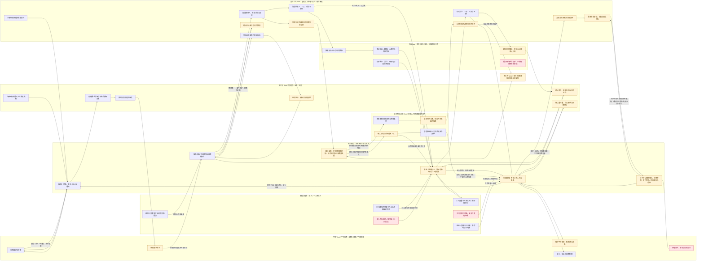

# 劳务供应链交易平台全链路多端参与泳道图 v0.1

- 整理日期：2026-10-23
- 文档状态：产品经理与项目经理的跨端流程蓝图，待产品、技术、测试联合评审。
- 用途：把 Web、独立 App、微信小程序在同一条业务链上的角色、功能和交接串起来，重点显式呈现中标劳务公司供给不足时如何通过协同供应商网络补员。
- 规则来源：[平台 PRD](./PRD-v0.1.md)、[多端功能清单与职责边界](./多端功能清单与职责边界-v0.1.md)、[协同供给产品流程与规则建议](../02-供给与履约/劳务公司协同供给产品流程与规则建议-v0.1.md)、[战略与履约流程补充](../02-供给与履约/战略与履约流程补充需求整合-v0.1.md)、[排班—打卡—考勤核对—资金审批流程](../02-供给与履约/排班-打卡-考勤核对-资金审批流程-v0.1.md)、[资金账户与支付指令流程](../03-账单与资金/资金账户与支付指令流程-v0.1.md)。

## 1. 如何读这张图

- **平台 Web**：平台审核、运营、风控、异常和平台账务，不替交易方确认现场事实，不审批劳务公司的工资或其他业务支出。
- **用工方 Web**：用工方入驻、发需求、评标选标、项目协同、工时/履约/结算确认和回款对账。
- **劳务公司 Web**：劳务公司准入、应标、履约方案、供给、岗位、人员、排班、考勤复核、工资/返费、账单及资金审批。
- **协同劳务公司 Web**：按项目授权收到供给请求、提交能力响应和人员提名、确认协同关系；只访问本组织获授权的协同项目和人员资料。
- **独立 App**：项目经理、驻场和授权现场人员的现场任务、到岗、入离职/保险、异常、工时差异和业务依据提交。
- **微信小程序**：工人只操作本人报名、班次、打卡、补正、工时、工资、借支和申诉；经纪人只操作授权岗位、提报、归属和返费。
- **平台服务/外部机构**：服务端负责权限、状态、版本、审计、计算和幂等；用工方外部考勤及支付机构只作为独立数据/执行来源，不能覆盖平台原始记录或被平台内部状态冒充。

图中“确认”必须区分：**业务确认、用工方确认、劳务公司复核、劳务公司最终资金审批、第三方机构回执**。任何一个不能替代另一个。

## 2. 全链路泳道图

## 3. 按阶段查看端职责

| 阶段 | 平台 Web | 用工方 Web | 劳务公司 Web | 独立 App | 微信小程序 | 关键交接产物 |
| --- | --- | --- | --- | --- | --- | --- |
| 1. 入驻与准入 | 组织/资质审核、补正、申诉 | 提交用工方主体和授权资料 | 提交劳务公司资质、维护有效期 | — | 账号验证；经纪人/工人建立受授权关系 | 组织审核版本、成员关系、能力门禁 |
| 2. 需求发布 | 需求内容审核、风险核验 | 创建、补正、发布需求 | 查看符合准入条件的需求 | — | 经纪人仅查看授权岗位，不获取未授权需求方信息 | 固定需求版本、审核依据、开放窗口 |
| 3. 应标与中标 | 处理异常和审计 | 比较应标、评标、分配多家配额 | 应标、修改/撤回、确认中标条件 | — | 不参与应标 | 中标快照、配额、责任、价格和计量口径 |
| 4. 缺口与协同供给 | 资格、可见范围、请求与响应审计 | 按合同/项目规则批准协同安排 | 识别缺口、创建请求、比较响应并选择协同方 | 查看获准任务与协同人员现场待办 | 经纪人按授权渠道补员 | 协同公司 Web 收到脱敏请求、响应人数/日期/偏离条件、确认关系并提名人员 | 请求版本、协同关系/授权依据、批准供给量与人员来源关系 |
| 5. 供给与入职 | 处理风险、重复投递和投诉 | 查看项目协同结果 | 供给计划、岗位、招聘、政策、人员关系 | 现场面试、入离职、保险核验 | 经纪人提报；工人报名、查看本人关系 | 人员履约关系、岗位快照、供给计划 |
| 6. 排班与现场履约 | 处理同步异常 | 查看排班与项目履约协同 | 编制/发布排班、批量核对 | 到岗、缺勤、现场补录、异常处理 | 工人查看班次并上下班打卡 | 排班版本、不可覆盖原始打卡、现场依据 |
| 7. 工时确认 | 运营审计、异常处理 | 确认用工方差异和履约量 | 复核工时、处理补正、提交确认 | 核验漏卡、差异和申诉材料 | 补正/异议、查看本人工时 | 工时确认快照、争议/无争议分列 |
| 8. 账单与业务确认 | 平台服务费和平台账务 | 确认结算量、查看回款状态 | 工资/返费/供应商账单复核 | 提交现场业务核验依据 | 查看本人工资/借支/返费 | 分类账单、有效计费人天、争议记录；协同结算按合同关系分别记录且不重复计量 |
| 9. 资金与对账 | 线下回款登记核对、机构回执、平台账务、异常和审计 | 查看授权范围内业务对账 | 资金准备、最终审批、支付授权、线下回款凭证/流水关联、对账 | 不审批资金 | 只查看本人结果，不执行支付 | 应收/应付账期、线下回款核对、机构指令状态、对账差异和恢复记录 |
| 10. 关闭与复盘 | 运营指标、风险和审计 | 履约结果与供应商评价 | 结算关闭、履约评价申诉 | 完成现场待办 | 查看历史本人记录 | 项目关闭、评价、审计链和可复核证据 |

## 4. 不能画成“端到端替代”的边界

1. **小程序不能替代 Web**：工人和经纪人不能在小程序完成组织审核、需求发布、应标、评标、排班编制、最终结算或资金审批。
2. **App 不能替代 Web 财务审批**：项目经理、驻场可以提交现场业务核验和付款依据，但没有默认的劳务公司最终资金审批权。
3. **平台 Web 不能替代交易方确认**：平台审核/运营可以处理组织、需求、风险和同步异常，但不能替用工方确认现场事实，也不能替劳务公司审批工资、保险或供应商支出。
4. **平台原始打卡不能被覆盖**：工人小程序打卡、App 补录、用工方外部考勤和人工修正必须分来源保存；补录和差异处理只能产生新记录或确认链。
5. **支付提交不等于付款成功**：劳务公司授权、第三方机构可用余额、机构受理、最终回执和账单对账是不同状态；结果未知不能直接按失败重付。
6. **业务范围不能被图形误读为已开发**：本图是产品交接蓝图，不表示这些端或流程已经实现，也不把所有待评审规则变成默认规则。
7. **协同供给不是默认转派**：直接多家中标与中标方请求协同供应商是不同流程；未完成实际合同关系、必要批准、授权和责任确认前，协同响应不是正式供给。
8. **资金不要求全部经过平台**：用工方可以按合同线下支付到劳务公司对公账户；平台仍需记录应收、到期、回款凭证/流水、核对、短款和逾期，但不得把线下回款显示成平台已收款。

## 5. 端功能拆解的下一步输入

技术和测试应从这张图分别拆出：

- 每个节点对应的角色、组织/项目/人员数据范围和服务端权限；
- 每条箭头对应的事件、状态变化、版本/快照、幂等键和审计记录；
- 每个交接节点的正向、驳回、撤回、重复请求、权限越界、结果未知和恢复用例；
- Web、App、小程序各端的待办、通知、失败重试和离线边界；
- 尚未定案的业务规则，回填到[需求追踪与交接门禁](../05-战略与实施/需求追踪与交接门禁-v0.1.md)，不能在接口或数据库设计中静默决定。

## 6. 关联文档

- [平台 PRD](./PRD-v0.1.md)
- [多端功能清单与职责边界](./多端功能清单与职责边界-v0.1.md)
- [需求追踪与交接门禁](../05-战略与实施/需求追踪与交接门禁-v0.1.md)
- [排班—打卡—考勤核对—资金审批流程](../02-供给与履约/排班-打卡-考勤核对-资金审批流程-v0.1.md)
- [资金账户与支付指令流程](../03-账单与资金/资金账户与支付指令流程-v0.1.md)
