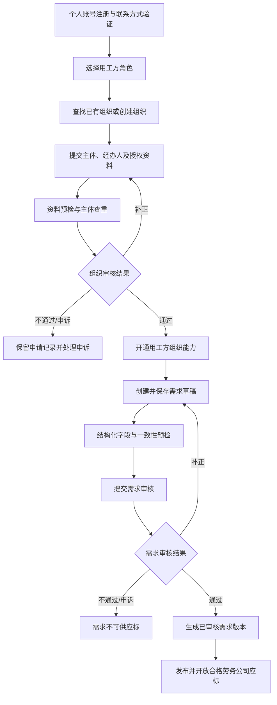

# 用工方入驻与有效需求标准 v0.1

- 日期：2026-10-20
- 状态：完整草案，待负责人评审；已确认方向与建议操作标准分开标注
- 上位文档：[劳务供应链交易平台 PRD](../00-产品全景/PRD-v0.1.md)，对应 FR-01、FR-02、FR-03，并作为需求进入应标环节的前置标准
- 相关专题：[用工方与劳务公司入驻、资质审核需求细化](./入驻与资质审核需求细化-v0.1.md)、[招标需求与应标承诺表单设计](./招标需求与应标承诺表单设计-v0.1.md)
- 适用范围：用工方自主注册、组织认证、需求创建、需求审核、发布及开放劳务公司应标

## 1. 目的与定义

本标准定义用工方从进入平台到形成可供合格劳务公司应标的有效需求，明确阶段门槛、最低信息要求、审核结果和验收条件。

**有效需求**：由审核有效且有权操作的用工方组织发布，经平台完成需求审核，关键信息足以让合格劳务公司理解服务内容、提交可比较方案、确认承诺条件，并使双方能够据约核验履约和结算的需求。

“有效”表示需求达到平台开放应标的产品条件，不表示平台担保需求方履约能力、供应商一定中标或成交，也不代替各方对真实业务、合同关系及适用规则的判断。

## 2. 决策状态与已确认边界

### 2.1 已确认方向

1. 用工方与劳务公司在同一平台自主注册，选择各自业务角色；同一组织当前只能选择一种角色。
2. 用工方支持企业法人、个体工商户、事业单位、分支机构及其他依法设立主体，按主体类型匹配设立证明和授权材料。
3. 组织认证及平台使用免费；未通过认证不得使用已认证用工方的业务能力。
4. 劳务公司直接参与交易的准入范围为合规外包且按适用要求完成备案的主体；个人经纪人通过劳务公司提供人员资源，不直接对接用工方或独立应标。
5. 平台是劳务供应链交易的信息与流程基础设施，不因平台定位或产品文字而推定免除适用的信息审核、投诉处理或其他责任。
6. 业务主线为：用工方源头与有效需求 → 劳务公司应标及中标 → 劳务公司组织履约 → 履约数据与费用确认 → 资金流转、对账和争议处理。

### 2.2 本稿提出的操作规则

以下流程、字段门槛和验收用例是为了把已确认方向转为可执行产品规则的建议，待负责人评审后纳入批准的需求基线。地区范围、地方核验渠道、固定审核时限、复审频率和申诉处理时限不在本稿中设定，也不作为继续定义本标准的前置问题。

## 3. 从注册到开放应标的流程

### 阶段门槛

| 阶段 | 允许操作 | 进入下一阶段的必要条件 |
|---|---|---|
| 账号注册 | 验证账号联系方式、查看规则、开始申请 | 账号可识别；联系方式验证完成 |
| 组织申请 | 选择用工方角色、创建或申请加入组织、填写资料 | 主体类型、主体识别信息、经办人及授权资料已提交 |
| 组织审核 | 补正、查看结果、申诉 | 依法设立主体、提交人身份与组织授权关系完成审核 |
| 用工方能力开通 | 创建需求草稿、保存、预览和提交审核 | 组织审核通过且经办人具有对应权限 |
| 需求审核 | 按审核意见补充、修改并重新提交 | 结构化必填项完整；业务内容、附件及关键条件无待核验阻塞项 |
| 开放应标 | 合格劳务公司查看并响应 | 需求审核通过、发布人权限有效、应标窗口和规则已确定、需求未撤回或暂停 |

组织认证通过只代表主体与组织层准入条件已满足，不代表组织提交的每一份需求真实、合规、完整或自动获准发布。组织审核与需求审核是两个独立门槛。

## 4. 用工方组织入驻标准

### 4.1 申请信息

| 信息 | 最低要求 | 验收要点 |
|---|---|---|
| 个人账号 | 可验证联系方式及账号身份 | 注册成功不等同于组织认证通过 |
| 业务角色 | 选择“用工方” | 同一组织不得通过新账号重复申请劳务公司角色 |
| 主体类型及证明 | 企业、个体工商户、事业单位、分支机构或其他依法设立主体的匹配证明 | 不得把企业营业执照、法定代表人字段强加给所有主体类型 |
| 主体识别信息 | 登记名称及适用的统一社会信用代码或其他登记标识 | 对已有主体进行查重；查重结果不得泄露原管理员个人信息 |
| 经办人身份 | 申请人的必要身份与联系方式信息 | 手机号验证不能代替代表权或组织授权 |
| 组织授权 | 法定代表人、经营者、负责人本人办理，或提交可核验的授权关系；分支机构按适用关系提交依据 | 授权范围覆盖组织认证及相应平台操作 |
| 联系方式 | 组织联系人及经办人联系方式 | 可用于审核补正和业务联系；对外披露需按权限控制 |
| 真实性确认 | 申请人确认有权代表组织、资料真实并承诺重要信息变更时更新 | 保留确认人、时间、版本 |

### 4.2 组织查重、成员加入与角色互斥

- 同一主体重复申请时，引导申请加入已有组织或发起管理员找回/授权复核，不创建第二个组织空间。
- 申请加入已有组织需由有权管理员确认；不能仅凭上传主体证明取得组织管理员权限。
- 组织业务角色在组织层确定；管理员、需求创建人、需求发布人、评标人等为组织内部权限，不构成第二种业务角色。
- 同一主体不能通过多个账号、不同客户端、接口或邀请链接绕过用工方/劳务公司角色互斥。
- 组织审核未通过的申请人不能自动转成个人经纪人，也不能通过经纪人身份取得用工方联系方式、需求发布或供应商应标权限。

### 4.3 审核状态与结果

建议组织申请状态为：

**草稿 → 已提交 → 审核中 → 通过 / 待补正 / 不通过 / 申诉中**

- 通过：记录通过主体、角色、核验时间、核验依据及开通的组织能力。
- 待补正：列出已发现的缺项、原因、需要提供或修改的资料；补正不收费。
- 不通过：说明决定理由及可申诉入口；不以含糊状态代替原因。
- 申诉中：保留原审核结论、申诉材料、复核结果和操作记录。
- 外部核验暂不可用时，标记“待核验/人工核验”，不显示为权威系统已自动核验。
- 本稿不规定各状态的固定处理时限；时限由后续运营规则单独确认。

## 5. 有效需求的准入判定

有效需求须同时满足以下五类条件：

1. **主体与权限清楚**：发单组织审核有效；提交人具有需求创建/发布权限；实际用工或服务接受方、签约主体和付款主体明确。主体不一致时说明其关系并提供必要授权依据。
2. **服务事实清楚**：说明项目背景、实际地点、拟采购的服务范围、交付内容、人员/现场协作方式及双方职责。不能只有“缺人”“招工”或一个“外包”标签。
3. **岗位和目标可理解**：至少有一个结构化标项及岗位/服务单元；数量与单位、时间节点、现场条件明确；至少有一个可供供应商响应或比较的目标/条件。
4. **应标与结算可比较**：应标截止、报价模式、计量定义、选标方法和配额/拆分规则已披露；影响金额或到期日的计价、结算周期、账期起算事件与日历口径明确。
5. **审核与版本可追溯**：平台完成需求内容审核；影响应标、履约验收或金额的条件有清楚定义和证据依据；审核通过版本可锁定，之后的关键变更可追溯并通知受影响供应商。

不得把“平台审核通过”解释为平台对需求方支付能力、劳务公司的履约能力、交易合法性或人员实际用工关系作出担保。平台需按实际运营活动确定适用的审核、投诉处理和合规要求。

## 6. 需求信息最低标准

字段采用“必填、条件必填、选填”三类。条件必填字段仅在启用对应岗位、指标、报价或付款安排时触发；不适用时须允许明确选择“不适用”并记录理由，不能以空值掩盖未决责任。

| 信息区 | 必须明确的内容 | 规则 |
|---|---|---|
| 发单主体 | 已认证用工方、主体类型、组织内发布人及权限 | 由组织认证资料带入，不允许冒用其他主体 |
| 相关主体 | 实际服务接受方/用工主体、签约方、付款方及其关系 | 默认可为同一主体；不一致时说明关系和授权，不默认允许无依据的第三方代签或代付 |
| 项目背景 | 需求名称、项目目的、业务背景、项目联系人 | 联系方式按授权向参与方披露，不向无权个人公开 |
| 服务范围 | 服务内容、交付对象或交付物、服务边界、双方职责及协作方式 | 不能只以岗位名称或“派人/补人”替代服务说明 |
| 服务地点与期限 | 实际工作地点/场地、服务开始及结束时间、服务时段或班次 | 多地点、不同班次或不同服务期限应拆分标项或逐项说明 |
| 岗位/服务单元 | 名称、工作内容、数量、数量单位、到岗或服务节点 | 区分需求人数、同时在岗人数、累计到岗人数、人时、人天及其他成果单位 |
| 岗位条件 | 技能、证书、培训、上岗要求、工作环境、已知风险及安全责任 | 条件必须与工作相关；按适用要求披露，不提供无约束的歧视性筛选条件 |
| 人员安排 | 实际人员组织与管理边界；按实际安排说明劳动关系/合同主体、工资发放责任 | 平台记录各方申报的事实与责任安排，不替代法律关系判断 |
| 保障和配套 | 适用的保险或其他保障、食宿、通勤、餐饮、工装、设备及费用承担方 | 按岗位场景条件必填；必要事项未明确时不得开放相关岗位/标项 |
| 目标与指标 | 至少一项目标、节点或明确的供应商响应条件；定义、单位、目标/阈值、方向、观测窗口、数据来源、确认方、证据和用途 | 区分硬性门槛、评标目标、履约验收项与参考信息；参考信息不能伪装成承诺或扣款条件 |
| 报价规则 | 指定价格接受、限价内报价或开放报价；报价单位、费用包含范围、税费口径及硬限价/目标价/预算的区别 | 不设含义不明的通用“期望单价”；不同单位或税费口径不得直接混排 |
| 应标规则 | 应标截止、供应商条件、人工/评分选标方式、是否允许多家中标、标项拆分和配额规则 | 若启用评分，公布权重、计算、并列及缺项规则；未确认自动评分不得静默使用 |
| 计量与结算 | 结算数量来源、计量单位、周期、确认人、证据、争议处理、账期起算事件及自然日/工作日口径 | 人时、人天、人数、到岗数不可互相默认换算 |
| 保证金 | 启用时明确应标/履约保证金类型、金额或计算方式、缴纳主体及时点、收款账户主体、账户核验、退还/扣划条件和争议流程 | 未启用时标记不适用；平台不默认代收、代管、担保 |
| 金额调整 | 触发事件、责任归属、计算公式、计算基数、金额上限及争议流程 | 未明确的违约金、绩效扣款或工资扣项不得由系统自动产生 |
| 附件与证据 | 支持判断主体授权、服务范围、岗位、安全及履约条件的相关材料 | 附件与结构化字段冲突时须先澄清；无关宣传材料不作为平台背书 |

平台服务费条件属于平台商业合同规则，与用工方采购报价和供应商业务结算价分开管理；按适用合同在应标前向相关方披露，不把费用类型混为一项。

## 7. 结构预检、人工审核与发布门禁

### 7.1 提交前结构预检

系统至少校验：

- 组织及需求发布权限有效，组织审核状态未失效或暂停。
- 主体、服务地点、服务期限、标项、数量单位、至少一个目标/节点、应标截止、报价模式、计量口径、结算周期及选标/配额规则等必填信息齐全。
- 日期顺序成立；应标截止早于最早必须满足的到岗或服务节点，除非需求审核人员确认了明确合理的紧急服务流程。
- 数量、比例、配额上下限、节点数量、价格单位、费用包含范围和账期之间不存在可检测的逻辑冲突。
- 每个影响筛选、验收或金额的指标均包含足够的定义、证据和确认规则。
- 启用保证金时，金额、缴纳阶段、账户主体/授权关系、账户核验状态、退还及扣划条件齐全；账户变更需重新核验和版本留痕。
- 启用的岗位或交易条件所需条件字段已经填写；附件冲突或待核验内容已显式提示。

结构预检通过只表示资料齐备，不替代平台需求内容审核。

### 7.2 平台需求审核

审核人员依据组织及需求记录核验：

1. 发单方、实际服务接受方、签约方、付款方和经办授权关系是否清晰且材料相互一致。
2. 需求描述是否具体到可理解的服务、岗位、地点、数量和时间，是否与附件或公开信息存在明显冲突。
3. 业务是否符合当前平台开放的交易范围；不能仅凭申请人自选标签认定服务模式。
4. 可能影响应标、人员权益、履约验收、结算或金额的条件是否透明、可解释、可留证。
5. 是否存在明显冒用主体、虚假/重复发布、误导性承诺、缺失关键授权或其他需核实的风险线索。
6. 需求对潜在应标方的可见信息是否足够，同时没有暴露未经授权的个人信息或内部敏感资料。

审核是平台基于现有材料和流程的内容审核，不构成对交易各方履约、支付或法律结论的担保。遇到需专业判断或事实未核实事项，应补正、暂停或升级处理，不以产品状态替代专业判断。

### 7.3 审核结果

| 结果 | 处理 |
|---|---|
| 通过 | 固定审核版本、审核人/规则、依据和时间；允许发布或按设定时间开放应标 |
| 待补正 | 列出缺失/冲突字段、原因和需要的材料；允许修改草稿并重新提交 |
| 不通过 | 记录具体原因及适用的申诉入口；需求不得发布或继续应标 |
| 待核验/升级处理 | 明确阻塞事项与当前状态；核实完成前不得显示为审核通过 |

审核时限、复核频率、申诉处理时限和地方核验渠道不在本标准中设定。

### 7.4 发布与可见性

- 只有组织审核有效、发布人权限有效、需求审核通过、结构预检通过且未暂停/撤回的版本才可开放应标。
- 需求审核通过但尚未到设定发布时间的，保持“已审核、未开放应标”；应标截止以服务端时间判断。
- 仅向满足需求公开条件及平台准入/业务资质要求的劳务公司展示可应标需求。
- 需求审核通过或发布不等于为其背书；对外页面明确展示需求状态及必要的条件说明。
- 联系人、个人信息、附件及其他敏感字段按授权和最小必要原则披露，不因需求公开而默认公开。

### 7.5 关键变更、暂停与撤回

- 关键字段包括相关主体/授权、服务内容、地点、时间、数量、岗位条件、目标指标、报价/计量/结算规则、应标资格、选标/拆分/配额条件及适用平台服务费合同信息。
- 已发布需求的关键条件不得无痕原地改写；修改应生成新版本、重新执行受影响的预检/审核，并明确当前应标是否暂停及已提交方案如何处理。
- 系统保留每个版本、审核决定、应标引用版本及通知记录；历史版本不得被新版本覆盖。
- 撤回、暂停、截止和重新开放均需记录操作人、理由、时间及对已提交应标的处理方式。
- 非关键展示信息可按权限更新，但不得借此改变供应商对交易条件的理解。

## 8. 需求状态

建议需求状态为：

**草稿 → 待审核 → 审核中 → 待补正 / 不通过 / 已审核待发布 → 应标中 → 已截止 → 选标中 → 已授予 / 流标 / 已撤回**

- “可供劳务公司应标”只对应状态为“应标中”的有效版本。
- 组织审核失效、需求审核撤销、发现重要风险或关键版本冲突时，可暂停新应标；已提交应标、既有中标和存量履约记录不得静默删除。
- 需求状态与组织认证状态、应标状态、中标项目状态分别管理，不以一个“已通过”字段覆盖多种对象。
- 不设置未经负责人批准的应标时长、中标确认时长、自动确认或自动流标默认值。

## 9. 产品验收标准

下列验收验证用户可观察到的业务结果，不依赖具体页面组件或内部实现。

### 9.1 入驻验收

1. 企业法人、个体工商户、事业单位、分支机构及其他依法设立主体可以按各自主体类型提交相应证明；系统不强制所有类型填写不适用的法定代表人或企业营业执照字段。
2. 账号联系方式验证完成但组织未审核时，申请人可以保存草稿、补正、查询进度和申诉，但不能创建可发布需求或开放应标。
3. 组织认证通过后，只有有组织成员关系且具有需求权限的用户能创建/发布需求；撤销权限后，旧登录态和链接不能继续发布。
4. 同一主体已存在组织时，新申请被引导加入/找回或进入授权复核，不创建第二个组织或取得相反业务角色。
5. 经办人只有手机号但无组织授权证明时，不能代表组织通过认证或发布需求。
6. 实际服务主体、签约主体和付款主体不同且无关系说明/授权依据时，需求进入补正或审核阻塞，不开放应标。

### 9.2 有效需求验收

1. 组织审核未通过、已暂停或发布权限失效时，任何需求不能进入“应标中”，且不能通过接口、其他端或旧链接绕过。
2. 缺少服务范围、工作地点、服务期、标项/岗位、数量单位、目标/节点、报价模式、计量条件、结算安排或应标规则时，提交/发布被阻止并指出具体缺项。
3. 指标缺少定义、单位、阈值/目标、观测窗口、证据来源或确认方，且被用于筛选、验收或计价时，需求不能开放应标。
4. 应标报价单位与结算计量单位不一致且未定义转换规则时，系统不得自动换算或发布可比较报价。
5. 需求总量、可拆分规则、配额下限/上限、节点数量或截止日期互相冲突时，系统阻止提交或将明确冲突交审核员处理。
6. 只有“招工/缺人”或空泛外包标签、没有实际服务内容与责任边界的需求不能通过审核。
7. 平台审核通过的需求只向符合可见及应标准入条件的劳务公司开放；个人经纪人不能由公开链接获得独立应标或未经授权的需求方联系能力。
8. 需求关键条件修改后生成可追溯新版本并触发重新审核；已有应标明确关联原版本，变更通知与响应要求可查。
9. 已撤回、暂停、已截止或审核未通过的需求不再接受新应标；迟到提交由服务端拒绝。
10. 所有审核决定可追溯到提交版本、审核主体/人员或规则、时间、依据、补正和申诉记录。
11. “已审核/已发布”不自动显示为平台担保、付款能力认证或已成交。

## 10. 不在本标准内定案

- 首批服务地区、地方核验渠道、审核及申诉的固定时限、复审频率。
- 真实用工需求的线下获客渠道、供需拓展预算、交易量或市场规模目标。
- 法定采购/招投标程序的法律结论；本平台“应标/选标”是产品交易流程术语。
- 具体评分权重、自动评分、最低价中标、自动推荐和自动仲裁。
- 平台收费标准和商业条款不在本标准定案，统一引用[《商业模式与收费标准》](../03-账单与资金/商业模式与收费标准-v0.1.md)；需求发布只按已批准规则披露适用的平台费用，并与采购报价分开。
- 对需求方支付能力、供应商保证履约或平台代替交易方承担交付责任的担保机制。
- 保证金金额、统一费率、代收代管/第三方托管模式和具体账户产品；未经合同、机构能力与合规评审不视为已批准。
- 人事经理等需求联系人或用工方采购决策人的个人佣金、销售奖励或平台服务费分成；不得默认将组织联系人认定为个人收款人。
- 具体合同模板、监管备案结论及法律意见；实际业务上线前需依业务模式由适当专业人员复核。

## 11. 与相关文档的关系

- 本标准细化用工方从入驻到需求开放应标的准入流程和验收门槛。
- [入驻与资质审核需求细化](./入驻与资质审核需求细化-v0.1.md)继续作为两类组织入驻、组织资质及审核材料的专题记录；与本标准关于用工方需求发布门禁不一致时，本标准适用于“用工方有效需求”部分。
- [招标需求与应标承诺表单设计](./招标需求与应标承诺表单设计-v0.1.md)继续维护招标字段、应标响应、选标与结算同源数据结构；字段明细与本标准不一致时，本标准的有效需求判定门槛优先，表单稿不得自行降低发布门槛。
- [战略与履约流程补充需求整合](../02-供给与履约/战略与履约流程补充需求整合-v0.1.md)记录本轮买方采用动因、需求发布/采购决策双角色及保证金、激励方案的边界；相关商业建议仍待评审。
- 本标准的流程、字段门槛和验收用例仍是待评审建议；本轮已将其作为 PRD FR-02/FR-03 的需求依据同步引用，不代表建议已转为已确认决策。负责人评审后，应记录采纳、调整或驳回项，并同步更新 [自主推进需求基线](../../../01-售前阶段/需求分析/requirements-draft-v0.4.md) 与相关版本记录。
