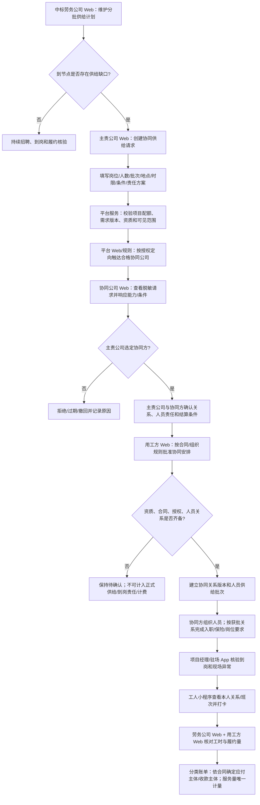

# 劳务公司协同供给产品流程与规则建议 v0.1

- 整理日期：2026-10-23
- 状态：产品决策建议，须项目负责人确认；涉及具体用工模式的合同和法律意见须由专业人员审核。
- 适用范围：中标劳务公司自身/经纪渠道无法满足供给计划时，通过平台网络请求其他合格劳务公司补充人员供给。
- 依据：[PRD FR-05A/FR-06](../00-产品全景/PRD-v0.1.md)、[战略与履约流程补充](./战略与履约流程补充需求整合-v0.1.md)、[全链路多端参与泳道图](../00-产品全景/全链路多端参与泳道图-v0.1.md)。

## 1. 核实结论

这不是泳道图之外的新想法。现有 PRD 已确认供给计划支持三类来源，其中包括“经确认的其他合规劳务公司协同供给”；也要求按节点暴露缺口，并可创建协同供给申请。专项稿已区分“用工方直接选择多家供应商”与“中标劳务公司主承接、其他公司协同供给”两种方式，并明确后者要核验用工方批准、项目合同限制、资质、人员/工资责任和结算关系。

缺口在于：现有产品材料记录了**协同供给来源和风险边界**，但没有定义成可被技术实现的“供给方网络产品流程”——由谁发起缺口、谁能看见、协同公司如何响应、如何选定、需要什么批准、人员关系如何挂接，以及补员何时计入计划和履约。

## 2. 建议作出的产品决策

### 决策建议 D-SUP-01：把“劳务公司间协同供给网络”纳入完整平台产品范围

供给网络是交易网络履约侧的重要能力：当中标劳务公司供给不足时，它可以把**已确认、可计量的项目缺口**转成受控协同供给请求，经授权触达其他符合条件的劳务公司，收集可用能力并形成协同关系，补足指定项目/岗位/批次。

它不是不受限制的人员交易市场，也不是把人员名单直接转售或开放查询。平台应围绕“项目供给请求—公司能力响应—协同关系确认—人员交付进度”建立组织间协作对象，而非创建可搜索的全量个人简历池。

### 决策建议 D-SUP-02：两种合作模式并存，但不能合并成一种模糊的“转单”

1. **用工方直接多家选标**：需求发布时公开/邀请多个供应商独立应标；用工方分别选择，分别形成中标关系、配额、项目履约责任和账单。这是现有 FR-04 的多家中标流程，不属于中标后的协同供给。
2. **中标供应商发起协同供给**：中标方仍是需求和项目上的主责组织，发布明确的供给请求；另一合规劳务公司作为协同供给组织确认自身可交付能力。双方关系及用工方授权、责任/合同安排必须在人员进入正式供给前确认。

平台数据模型必须显式区分“中标供应商/主责方”“协同供给方”“人员实际劳动/合同关系主体”“用工方”“费用承担与结算主体”。“主供应商”这个产品标签不能代替实际合同和法律责任认定。

### 决策建议 D-SUP-03：协同请求获批前只能是意向，不能计入正式供给

协同公司点击接受或填报“可供人数”，仅代表能力响应/意向，不等于人员已落实。**只有组织准入有效、协同关系/必要合同和授权齐备、用工方要求的批准完成、人员已按对应关系建档并同意必要信息使用后**，才可进入已确认协同供给；到岗、有效工时和可计费量仍分别以实际核验与确认记录为准。

### 建议的首期产品边界

首期建议做**项目内、按请求邀请/定向触达的协同供给**，暂不做任何合格供应商都可搜索的全站公开市场、自动推荐/抢单、平台保证交付、自动转包合同或统一垫付/分账。选择定向触达是为了控制项目信息、人员数据、商业条件和供应商资格暴露；此项属于产品设计建议，待负责人评审。

## 3. 端到端业务流程

若实际协议要求另一种审批顺序，应由规则/合同配置具体审批节点；不得因流程图顺序而默认替任何一方确定法律关系。

## 4. 产品状态与对象建议

建议把“请求状态、协同关系状态、人员履约状态、结算状态”分开维护，不用一个协同状态覆盖全生命周期。

| 对象 | 建议状态 | 解释 |
| --- | --- | --- |
| 供给缺口/请求 | 草稿 → 待校验 → 待触达 → 响应中 → 选择中 → 已关闭/已取消/已过期 | 需求包含项目/标项/岗位、批次缺口、响应截止、资格条件、可披露信息和主责人。 |
| 协同方响应 | 已邀请 → 已查看 → 可响应/不可响应 → 主责方选择/未选择 → 撤回/过期 | 响应记录承诺数量、可到岗日期、资质状态和条件版本；承诺量不是实际人数。 |
| 协同关系 | 待双方确认 → 待用工方批准（如要求）→ 待材料/授权 → 生效 → 暂停/终止/争议 | 关系版本明确各方身份、责任、合同/授权依据、可见范围和结算依据。 |
| 人员供给 | 提名 → 待资格/授权核验 → 待入职 → 已入职/未通过 → 已到岗 → 履约中 → 退出 | 每人保留来源组织、实际关系主体、所属项目、必要证明和状态历史；人员不因协同请求自动转入主责方名下。 |
| 履约与结算 | 到岗 → 班次/考勤 → 工时确认 → 分类账单 → 对账/争议 → 关闭 | 实际履约数量由现场证据、工时核验和适用合同决定，不能用响应承诺或供给来源直接计费。 |

这些状态名是供评审使用的领域草案；技术团队应在评审后再转成状态机、接口或数据库枚举。

## 5. 平台应支持的协同请求字段

- 项目、中标快照、标项/岗位、批次和剩余配额；缺口人数、单位、目标到岗日期、作业地点及需求失效时间。
- 岗位技能/资格、工作条件、班次、薪酬/服务价格披露范围、保险/入职前置条件与验收口径。
- 请求发起组织、主责人、邀请范围、信息披露级别、响应截止时间及请求版本。
- 协同方响应的组织、可确认人数、供给日期、偏离条件、资质/证照状态及确认人。
- 用工方是否须批准、批准主体/时间/范围及关联需求或合同；协同关系合同/授权材料的受控引用。
- 对协同人员的组织关系、实际劳动/合同关系责任主体、入职和保险责任、现场管理/考勤核验职责、工资与费用义务、结算路径及争议处理责任的业务确认记录。
- 提名人员的最小必要身份引用、去重结果、授权与隐私告知记录；对其他公司只显示完成协同所需的最小字段。
- 数量逐级区分：请求缺口、协同方意向量、批准量、提名量、合格量、录用量、到岗量、在岗量、确认履约量和已结算量。

## 6. 责任与合规边界

平台的产品功能负责留痕、资格校验、权限控制、信息交接、数量跟踪和账单依据关联；**不替代各方签订合同、判断劳动关系、取得用工/派遣资质、履行雇主义务或承担付款责任**。实际能否采用某种“主承接+协同公司”方案，要按具体业务实质、人员法律关系、岗位性质、合同安排及适用规则专项审查。

尤其需要防止把“劳务派遣”直接视作普通可转包人员池。《劳动合同法》规定经营劳务派遣业务须依法取得行政许可，派遣单位与用工单位需订立派遣协议，并规定用工单位不得将被派遣劳动者再派遣到其他用人单位；派遣也只可在临时性、辅助性或替代性岗位使用。平台不能只凭供应商资质标签或业务界面上的“协同供给”来判定一种人员转移结构合法。具体边界和当前有效文本须由律师/主管部门按实际模式确认。

因此，协同请求须显式选定并审核业务关系类型（例如由用工方另行直接选择协同供应商，或有真实合同支持的主责方协作），不得用单一“转派人员”选项概括。缺少适用资质、合同关系、用工方必要批准、劳动者告知/授权或责任主体的请求，保持待确认/阻断正式供给，不进入正式人员名册、有效履约量或收费依据。

## 7. 计量、去重与收费

1. 供给来源、人员法律关系、项目责任和费用义务分别建模，不用“所属公司”字段互相推导。
2. 同一人员同项目同日的排班、打卡、确认工时及计费人天应按适用规则唯一识别；协同方与主责方不能各自复制一笔有效服务量。
3. 协同方与主责方之间的采购价/服务费、对用工方结算价、工人应得报酬、经纪人返费、平台服务费分别列账。平台不得自动假设由主责方收款后转付，亦不得自行推导加价或分账。
4. 平台服务费只按[《商业模式与收费标准》](../03-账单与资金/商业模式与收费标准-v0.1.md)及适用合同、获批收取安排执行；不能因平台撮合协同公司就自动新增撮合费或增加同一人天收费。
5. 请求数量、承诺能力、批准配额和录用人数都不是可收费履约量；费用依据必须追溯到已确认的有效服务量及唯一有效规则版本。

## 8. 需要负责人确认的决策

| 决策 | 建议默认 | 状态 |
| --- | --- | --- |
| 是否把协同供给网络纳入完整平台范围 | 纳入；这是既有 FR-05A 三类来源的实现补齐 | 建议采纳，待负责人确认 |
| 首期触达模式 | 项目内定向邀请合格供应商，不做全站公开个人/岗位池 | 建议采纳，待负责人确认 |
| 直接多家中标与中标后协同 | 两种模式明确分开，各自生成不同责任/配额记录 | 建议采纳，待负责人确认 |
| 默认人员/合同关系 | 不设平台默认；提交具体项目合同和责任主体后评审 | 必须项目级确认 |
| 未获批准协同申请 | 可留计划和缺口，不能计正式供给、到岗责任或计费 | 作为产品安全不变量建议确认 |
| 协同公司收费/平台撮合费 | 不自动新增；按现行商业模式与独立合同审批 | 维持现行唯一收费规则 |

## 9. 官方依据与产品含义

- [《中华人民共和国劳动合同法》—国家市场监督管理总局公布文本](https://www.samr.gov.cn/zw/zfxxgk/fdzdgknr/bgt/art/2023/art_0abfdd261c03417b949df19d869add8d.html)：第 57 条涉及劳务派遣行政许可，第 58–60 条规定派遣单位/协议及相关义务，第 62 条规定用工单位义务并禁止再派遣，第 66 条规定派遣岗位范围。该法条提示产品需识别业务实质，不能仅凭“协同供给”标签推定合法。
- [《劳务派遣暂行规定》—上海市人力资源和社会保障局公布文本](https://rsj.sh.gov.cn/trlzyhshbzbgz_17256/20240813/t0035_1427021.html)：补充派遣用工范围、比例以及派遣相关责任要求。地区实施、具体业务事实和政策更新应另行核验。

本文是产品流程与风险识别建议，不是法律意见，也不为任何一种外包/派遣/协同供给结构作合法性结论。

## 10. 关联文档

- [全链路多端参与泳道图](../00-产品全景/全链路多端参与泳道图-v0.1.md)
- [平台 PRD](../00-产品全景/PRD-v0.1.md)
- [需求追踪与交接门禁](../05-战略与实施/需求追踪与交接门禁-v0.1.md)
- [战略与履约流程补充需求整合](./战略与履约流程补充需求整合-v0.1.md)
- [多端功能清单与职责边界](../00-产品全景/多端功能清单与职责边界-v0.1.md)
