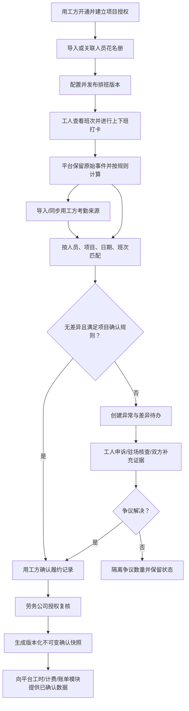

# 合作用工方考勤系统产品与集成设计 v0.1

**文档状态：** 方案草案，待产品、业务与技术评审
**目标：** 为合作用工方免费提供贴合劳务供应链履约的考勤工具，并将经授权、可追溯的考勤结果连接到平台的工时核对、履约计量与账单流程。
**设计边界：** 本系统是排班、打卡、考勤核实和协同工具，不替代用工方或劳务公司的雇佣、工资支付、法定工时认定等责任，也不把单一打卡来源自动视为最终事实。

## 1. 产品定位与设计结论

建议将其建设为平台的“履约考勤协作产品”，而不是独立的人事考勤 SaaS：

- **对合作用工方免费：** 以降低合作接入成本、提升排班执行率、缩短工时对账周期为产品价值；免费不意味着默认授权平台使用其人员数据或向其收费。
- **多方共同确认：** 用工方、劳务公司、驻场与工人分别保有对应权限；同一考勤记录可以有多个来源和状态，不设置平台单方面覆盖。
- **事实与结算分离：** 原始事件、计算工时、已核验工时、工资计薪量、用工方结算量和平台有效计费人天独立建模。
- **移动优先、弱网可用：** 工人侧使用小程序快速打卡；管理侧 Web 批量排班、导入和对账；现场 App/移动 Web 处理异常、核验和待办。
- **按项目协作，按组织隔离：** 用工方可以自主管理其项目与班次，并按项目授权劳务公司查看必要的人员和考勤字段。

## 2. 从项目文档提取的现状与约束

现有设计已经覆盖了主要闭环：项目排班发布 → 工人小程序上下班打卡 → 平台按规则计算 → 导入用工方考勤 → 按人员/日期/班次匹配 → 差异申诉与现场核查 → 双方业务确认 → 劳务公司复核 → 生成不可变确认快照 → 后续账单/工资流程。

需要直接继承的业务原则：

1. 排班计划不等于实际出勤；打卡原始事件不等于最终确认工时。
2. 平台打卡、驻场补录、用工方系统/文件是不同来源；外部数据不得静默覆盖平台事件。
3. 一致匹配只能减少待办，不能替代约定的业务确认；争议数量需隔离，不能无痕进入结算。
4. 考勤确认、工资付款授权是不同权限和流程。
5. 每个项目可有自己的班次、工时、舍入、休息、加班、迟到早退、补录和确认规则；规则应版本化并保留适用期间。
6. 记录需关联组织、项目、人员、供给责任方、服务日期、来源、规则版本、确认依据、操作者和审计历史。

现有产品资料把“工时核对、差异处理、用工方确认、计费人天”列为平台履约能力；因此考勤产品的核心集成不是再建一套孤立的工资系统，而是提供质量更高的履约事实与确认凭证。

## 3. 传统考勤系统能力基准

成熟的考勤/劳动力管理产品通常可归纳为以下能力组。不同厂商的范围不完全相同，以下作为产品基准而非必须一次性全部建设：

| 能力组 | 常见能力 | 对本产品的取舍 |
|---|---|---|
| 人员与组织 | 员工档案、部门/地点、角色、设备或终端 | 复用平台组织、项目、人员关系；仅保留必要字段，不做完整 HR 主数据 |
| 班次与排班 | 班次模板、轮班、周期排班、排班发布、换班 | 必须支持项目/岗位/班组排班、批量排班和版本留痕；换班需审批并同步供给计划 |
| 考勤采集 | Web/移动打卡、设备打卡、位置/围栏、补卡 | 小程序打卡优先；提供位置/时间等必要证据配置；设备接口按客户需求接入，不自建硬件 |
| 工时规则 | 跨日班次、休息扣除、宽限、迟到早退、加班、舍入 | 支持规则配置与版本化；计算结果可解释、可重算，不默认等同工资规则 |
| 异常与审批 | 缺卡、缺勤、补卡、请假、加班申请、审批流 | 提供异常待办、证据、申诉与多方核验；工作流按项目与角色配置但避免过度复杂 |
| 假勤管理 | 请假类型、余额、申请审批、假期政策 | 先支持项目出勤状态及请假/缺勤登记；假期余额和完整休假政策不是首期目标 |
| 对账与报表 | 工时汇总、异常报表、导出、薪资接口 | 重点做平台打卡与用工方数据的双源对账、结算周期汇总及标准导出 |
| 薪资与人事 | 薪资计算、税务、福利、招聘、绩效 | 不纳入免费考勤产品首期；通过确认快照向现有平台工时/资金模块提供数据 |
| 多端与集成 | 手机端、管理端、API、文件导入、审计日志 | 必须具备 CSV/XLSX 模板导入、开放 API 预留、幂等、审计、导出与授权撤销 |

据此，产品的差异化不在“多做 HR 功能”，而在于多主体协同、数据源差异核对、可申诉的证据链，以及从班次到可确认履约量的连续关联。

## 4. 目标用户与主要任务

| 用户 | 关键任务 | 默认数据范围 |
|---|---|---|
| 用工方管理员 | 开通组织、配置项目/地点/班次规则、邀请合作方、查看考勤与确认周期 | 本组织及被授权项目 |
| 用工方现场主管/考勤员 | 发布/调整班次、查看到岗、处理异常、导入工厂考勤、确认履约量 | 被分配项目/班组 |
| 劳务公司项目负责人 | 维护供给人员名单、排班协作、监控到岗缺口、处理差异 | 本组织负责的中标项目和人员 |
| 驻场人员 | 现场签到协助、异常说明、补录申请核验、上传证据 | 授权项目 |
| 工人 | 查看班次、上下班打卡、查看个人工时状态、申请补正/申诉 | 本人记录 |
| 平台运营/客服 | 支持接入、查看授权状态和操作审计、处理技术性导入问题 | 最小必要的支持权限；敏感字段默认遮蔽 |

## 5. 功能范围与优先级

### P0：免费试点闭环（首期）

- 用工方组织开通、项目接入、成员邀请与基于项目的合作授权。
- 人员与项目花名册关联：平台已有人员优先复用；外部人员通过受控映射导入，避免重复建档。
- 项目工时制度登记（标准/综合计算/不定时/其他经核验制度）、适用岗位和人员范围、有效期及审批/备案凭证引用；无凭证或信息不完整时标为“待核验”，不暗示制度已获批准。
- 班次模板、日期/班组排班、批量导入、发布/撤回版本、工人查看本人班次；记录制度周期、休息安排、工作地点及派遣/用工合作关系的业务引用。
- 工人小程序上下班打卡；记录服务端接收时间、设备/客户端信息及配置允许的位置证据；支持重复请求幂等。
- 缺卡、迟到早退、未到岗、跨班次、定位失败、连续工作/超时风险等异常提示；异常本身不自动裁定违规或违法。
- 补卡/工时异议申请、驻场核验、用工方确认、劳务公司复核；保存理由、证据和处理人。
- 用工方考勤 CSV/XLSX 模板导入、字段映射、预览校验、错误行下载、导入批次回滚/作废（不物理删除）。
- 双源匹配与差异工作台：匹配候选、差异类别、批量处置、争议隔离、处理时限提醒。
- 规则版本化的工时计算、项目周期汇总、确认快照、审计记录和标准导出。
- 基础组织隔离、项目级授权、操作审计、数据导出权限、授权撤销和异常访问告警。

### P1：试点验证后扩展

- 工人换班/调班申请与多方审批。
- 请假/缺勤登记、加班申请与用工方审批；仅输出核验状态及规则计算，不自动生成工资承诺。
- 多班次轮转、夜班跨日、休息段和节假日/特殊日历。
- 通过客户授权的 API/SFTP 接入外部考勤；重试、增量同步、回执和数据质量监控。
- 部门/工厂/班组多层视图、考勤趋势、到岗率、缺勤与差异解决时效。
- 设备/门禁数据连接器（按明确客户与厂商接口逐个建设）。

### 不纳入首期

- 完整 HRIS、招聘、绩效、员工自助服务门户。
- 薪资税务、个税申报、法定工资单或代发；与平台已有工资/资金能力通过确认数据衔接。
- 人脸识别、持续定位、隐蔽监控或默认开启的精确轨迹采集。
- 以算法自动判定旷工、违规、工资扣款或劳动争议责任。
- 未经双方确认的自动结算、自动扣费、平台自行修改工时。

## 6. 建议业务流程

项目可配置确认责任方、确认窗口、超时提醒和升级路径，但超时默认只升级或标记待处理，不应默认为同意。

## 7. 与当前项目的对接设计

### 7.1 业务对象映射

| 考勤侧对象 | 平台现有/目标对象 | 对接规则 |
|---|---|---|
| 用工方组织 | 平台组织/租户 | 使用稳定组织 ID；组织成员和组织角色继续由平台身份权限控制 |
| 考勤项目 | 需求/中标项目/履约项目 | 仅已建立合作关系且授权的项目可创建考勤空间 |
| 岗位、班组、地点 | 项目岗位/现场配置 | 采用项目级 ID；地点信息只采集业务必需精度 |
| 工人 | 平台人员/报名/入职关系 | 用平台人员 ID 关联；外部员工号作为组织内映射，不以姓名单字段匹配 |
| 排班班次 | 履约排班 | 发布版本关联人员、日期、岗位、班组和规则版本；变更保留前后版本 |
| 原始打卡 | 考勤事件 | append-only 事件；补正创建新事件/更正记录，原事件保留 |
| 外部考勤 | 外部来源批次及明细 | 原文件/API 响应、映射版本、导入者、时间及校验结果可追溯 |
| 考勤确认 | 工时确认快照 | 锁定本周期的源数据版本、规则版本、处置结论和确认人 |
| 确认工时/履约日 | 平台工时、有效计费人天 | 经映射规则计算后传入；不同业务口径分字段维护，不直接互换 |
| 工资/付款 | 现有资金审批流程 | 只传递已确认依据或草稿输入；考勤确认不触发付款授权 |

### 7.2 集成模式

首期建议在现有平台内以独立“考勤域”建设，复用统一登录、组织、项目、人员、通知、文件存储、权限与审计能力，不先拆成独立 SaaS 或单独用户体系。域间通过应用服务/API 和领域事件集成，保持模块边界：

- 平台项目中标/合作关系建立 → 创建考勤项目空间（幂等）。
- 排班发布/变更 → 通知关联工人、驻场和合作方；产生排班版本事件。
- 打卡事件生成/补正审批/外部批次导入 → 触发工时计算与差异匹配。
- 确认快照生成 → 发送 `AttendancePeriodConfirmed` 类业务事件给工时/计费模块。
- 账单或工资流程读取确认快照 ID、人员/日期明细、规则版本和争议状态；不得只依赖可变的“当前工时”字段。
- 任何跨域命令使用幂等键；事件消费者记录事件 ID 与处理状态，支持重放和失败补偿。

若当前代码架构尚未采用消息队列，首期可用事务内 outbox + 后台任务实现可靠投递，避免数据库提交成功但通知丢失；具体实现应顺应仓库现有技术栈。

### 7.3 最小接口草案

| 方向 | 接口/事件 | 主要字段 |
|---|---|---|
| 平台 → 考勤 | 创建/更新考勤项目 | `projectId`、`organizationId`、`partnerOrganizationId`、合作状态、授权范围 |
| 平台 → 考勤 | 同步项目人员关系 | `personId`、外部员工号映射、项目角色、入/离场日期、关系状态 |
| 考勤 → 平台 | 排班发布事件 | `scheduleVersionId`、`projectId`、班次日期、人员、岗位、规则版本 |
| 考勤 → 平台 | 打卡/异常状态查询 | 仅授权项目和必要字段；个人端只查询本人数据 |
| 平台/用工方 → 考勤 | 导入外部考勤批次 | `sourceSystem`、`batchId`、文件摘要/对象引用、字段映射版本、幂等键 |
| 考勤 → 平台 | 确认周期事件 | `snapshotId`、周期、人员明细引用、确认来源、规则版本、争议汇总、确认时间 |
| 平台 → 考勤 | 确认消费回执 | `snapshotId`、消费模块、消费结果、失败原因/重试状态 |

接口必须具备租户/项目授权校验、调用方身份、幂等、分页、版本、时间戳、审计和敏感字段白名单。文件导入同样视作外部接口，必须记录批次与来源。

### 7.4 关键数据模型建议

- `AttendanceProject`：平台项目 ID、用工方组织、合作劳务组织、授权状态和适用范围。
- `ScheduleVersion` / `ShiftAssignment`：发布状态、人员/班次安排、规则版本、有效期、发布/变更人。
- `PunchEvent`：事件 ID、人员/项目/班次、事件类型、设备端时间、服务端接收时间、来源类型、位置证据引用、幂等键；原始事件不可更新删除。
- `AttendanceSourceBatch` / `AttendanceSourceRecord`：来源系统、批次、文件摘要、映射版本、原始字段、校验状态及处理记录。
- `WorkTimeCalculation`：输入事件集、规则版本、计算版本、应出/实出/休息/加班等拆分量、异常和计算解释。
- `AttendanceDiscrepancy`：匹配的来源记录、差异类型、状态、责任人、证据、意见和解决结论。
- `CorrectionRequest`：申请原因、证据、审批链；通过后形成更正事件，不覆盖原始事件。
- `AttendanceConfirmationSnapshot`：周期、源批次及事件版本、规则版本、确认明细摘要、签署/确认记录、哈希/不可变标记。

时长建议采用整数分钟或统一精度的十进制分钟保存，展示时再格式化；时区按项目地点配置并明确跨日班次归属日，不能仅按服务器时区推算。

## 8. 规则和异常处理

### 工时计算规则

规则以项目/人员适用范围配置版本，且应先绑定经责任方核验的工时制度及其有效期。至少包括：计划班次起止、跨日归属、迟到/早退宽限、休息段及是否扣除、缺卡处理、加班申报与核验、最小计量单位、舍入方式、部分出勤折算、综合计算周期、休息日安排及相关审批凭证引用。规则要区分“计划排班”“原始在场/打卡时长”“实际工作时间计算结果”“加班核验结果”和“合同/业务结算量”。

系统应配置可维护的风险阈值和提示（例如日/周时长、延长工作时间、连续工作、休息安排和综合计算周期累计值），但不能仅凭平台数据自动作出违法认定、工资扣减或法律结论。涉及法定口径、例外情形、当地政策或特殊工时审批有效性的判断，进入人工核验并保存依据。每次计算记录输入版本和解释；修改规则不得追溯改写已确认周期，需重算时生成新版本并显式复核。

### 外部数据匹配

1. 优先按平台人员 ID 或组织内稳定员工号映射；姓名只作辅助候选。
2. 组合项目、人员、日期、班次/时间窗口匹配，处理跨日班次和同日多班次。
3. 差异类别至少包括：平台有、外部无；外部有、平台无；时间偏差超阈值；重复记录；人员无法映射；班次不匹配；规则/数据格式错误。
4. 自动匹配只形成建议状态；只有项目规则明确允许且责任方确认后，才可批量确认无争议记录。
5. 导入批次作废后重放需保留前一批次和影响范围，避免静默改变已确认快照。

## 9. 安全、隐私与免费模式

- 以项目合作授权作为数据访问前提；授权用途、字段、期限、导出权限和撤销机制可查。
- 位置证据按最小必要采集：优先仅在打卡时采集必要位置/围栏判断，不进行持续定位；位置失败应有可申诉的替代核验方式。
- 生物识别不纳入首期；不得默认要求人脸数据。其他敏感数据的处理、保存期限和告知机制应由业务与合规评审后确定。
- 角色权限在 API、列表、详情、搜索、导出、通知与审计端统一执行；跨组织查询必须有项目关系和字段白名单。
- 原始打卡、补正、外部批次、确认快照及管理员访问均有审计；应用日志避免记录不必要的身份证明或位置明文。
- 免费商业模式需明确免费范围、合理用量、存储期限、支持边界、数据导出、停用后的数据处置及是否存在增值服务；不要以免费名义默认为取得二次使用权。
- 数据保留与删除策略、劳动用工告知、电子确认有效性及各方责任需由适用地区的专业顾问确认；本设计不构成法律意见。

## 10. 成功指标

- 合作方开通到首个项目发布排班的转化率与耗时。
- 排班覆盖率、按班次到岗率、缺卡率及异常核验时长。
- 外部数据导入成功率、自动匹配建议准确率、差异率及差异解决时长。
- 每个结算周期按期确认率、确认后更正率、争议工时占比。
- 工时快照被平台账单/工资流程成功消费的比例及对账返工量。
- 合作方活跃率、工人打卡完成率、免费服务成本与每个有效履约人天的运营成本。

指标只用于产品改进，不应未经规则和授权直接变成个人处罚或供应商永久评级。

## 11. 建议实施阶段

1. **设计验证：** 访谈 2–3 家典型用工方及劳务公司，确认现有考勤文件格式、班次复杂度、确认角色、争议窗口与位置采集接受度。
2. **平台内试点：** 选择一个组织、一到两个项目，交付项目授权、排班、小程序打卡、文件导入、差异台、确认快照和平台工时模块对接。
3. **试点复盘：** 用真实周期验证导入质量、匹配规则、工人操作负担、确认耗时与免费运营成本；先修正规则和流程再扩大。
4. **连接器扩展：** 基于实际客户覆盖率和接口授权情况，逐个增加考勤厂商 API/设备连接器；保持文件导入作为兜底路径。

阶段顺序是风险控制建议，不缩减平台完整业务目标；具体排期需结合仓库现有架构和试点约束制定。

## 12. 评审待确认事项

1. “免费”覆盖的用户数、项目数、保存期限、支持服务及超量/增值边界。
2. 用工方、劳务公司、平台分别对人员、排班、工时和证据拥有什么查看/更正/确认权限。
3. 位置围栏是否启用、采集精度与保存期限、失败时的替代流程；首期建议可配置且默认最小化。
4. 工时口径、跨日/休息/加班/舍入/部分出勤规则及是否允许项目级差异。
5. 确认窗口、异议期、超时升级、部分确认和争议量隔离规则；超时不默认同意。
6. 对接当前项目的身份、组织、项目、人员和工时模块接口，以及是否已有事件总线/outbox。
7. 首批外部考勤模板、人员匹配键、数据导入责任方和接口授权方式。
8. 试点地区适用的数据告知、留存、电子确认、纠错及劳动用工合规审查要求。

## 13. 参考资料

本基准参考成熟企业级劳动力管理产品公开文档中常见的时间记录、时间卡、排班/工时规则、异常修正、审批与集成概念。具体厂商功能会随版本和地区变化，设计时以概念基准而非厂商功能承诺为准：

- Microsoft Learn：Dynamics 365 Human Resources 时间与出勤管理文档。
- Oracle Help Center：Oracle Fusion Cloud HCM Time and Labor 文档。
- SAP Help Portal：SAP SuccessFactors Time Tracking 文档。

正式立项前建议按试点行业、用工方现有系统和具体地区再做一次厂商/接口清单核实。

## 14. 中国劳务派遣工时制度与产品落地

### 14.1 法律制度对产品设计的影响

本节用于产品需求识别，不构成法律意见。法规及地方审批实践可能变化，正式上线前应由适用地区的劳动用工专业顾问核验。

1. **派遣关系不是普通外包关系。**《劳务派遣暂行规定》适用于劳务派遣单位经营派遣、用工单位使用被派遣劳动者的情形。劳务派遣协议内容应涉及工作时间和休息休假；派遣单位有依法支付劳动报酬等义务，实际用工单位依法承担相应的用工现场管理责任。产品因此需要分别记录派遣单位、用工单位、劳动者、派遣协议/项目关系及双方确认动作，不能将“客户账号”直接等同于雇主身份或劳动责任结论。
2. **标准工时以每日 8 小时、每周 40 小时为基线。**国务院《关于职工工作时间的规定》规定职工每日工作 8 小时、每周工作 40 小时；因工作性质或生产特点限制不能实行标准工时的，须依据国家有关规定采用其他工作和休息办法。系统应按工人、岗位、项目和生效期间记录适用制度，不应把一个项目的班次模板自动套用到所有人员。
3. **延长工时与休息安排不能只算“班次差”。**《劳动法》关于延长工作时间设有协商、一般每日延长不超过 1 小时、特殊原因每日不超过 3 小时且每月不超过 36 小时等规则，并规定休息日、法定休假日安排工作的报酬要求。产品应记录计划与实际工作、加班申请/安排、核验主体、日期类型及适用规则；将超阈值作为风险提示和核查待办，而不是自动认定违法或自动计算应付工资。具体加班工资计算还需结合适用制度、工资基数、地方规定和个案确认。
4. **综合计算工时与不定时工作制不是普通可选配置。**原劳动部审批办法规定这类制度适用于符合条件的岗位，并需按规定审批；综合计算工时按周、月、季、年等周期计算，平均日/周工作时间应与法定标准基本相同。地方企业审批办法由地方制定。系统必须记录制度类型、适用岗位/人员、审批机关、批文编号/文件引用、批准期限、综合计算周期及休息安排；未核验审批资料时不得默认允许特殊工时计算，更不能用“企业已选择”替代审批。
5. **工时制度、现场考勤、工资计薪与客户结算是不同口径。**打卡只提供考勤证据，不自动决定实际工作时间、加班性质、工资应付或劳务公司对用工方的合同结算量。差异、补卡、工休、停线待工、换班和争议均须保留源记录、事实认定与责任方确认路径。

### 14.2 法规要求转化为产品字段与校验

| 业务要求 | 产品数据/校验 | 失败或缺失时行为 |
|---|---|---|
| 确认用工关系与责任主体 | 派遣单位、用工单位、劳动者、工作岗位/地点、项目、派遣期限、协议引用 | 不允许进入正式考勤结算确认；允许保存草稿并提示补齐 |
| 标准工时作为默认参考而非唯一制度 | 工时制度、适用对象、有效期、配置来源、责任人确认时间 | 默认只显示标准制度风险基线；不得推定特殊制度已获批准 |
| 特殊工时的审批和适用范围可追溯 | 批准机关、批文编号/文件、岗位范围、起止日期、综合计算周期、内部实施方案/公示记录引用 | 过期、缺失或范围不匹配时标红待核验，暂停该制度下的自动规则计算/确认 |
| 工作与休息、加班记录完整 | 班次计划、打卡原始事件、休息段、加班安排/申请、核验记录、法定节假日历版本 | 生成缺失数据或阈值风险待办；不自动归责、不自动扣款 |
| 计算结果可解释 | 规则版本、输入记录引用、计算步骤/拆分量、人工改正和理由 | 无法解释的计算不得进入确认快照 |
| 纠错与异议保留证据 | 工人异议、驻场意见、双方确认、来源文件/证据、前后版本 | 争议数量隔离；快照更正只能通过新版本和显式审批 |

### 14.3 结合成熟系统后的取舍

成熟企业级系统通常将原始打卡/登记、工作时间配置、异常计算、审批、转移/薪资接口分成不同步骤，并提供计算组/审批组、缺卡异常、批量审批、修正或冲销等能力。可借鉴其“可配置规则 + 异常队列 + 审批后转移”的流程，但本项目需要增加派遣双方协作与多来源事实核对：

- **借鉴：** 工作时间配置文件、排班与打卡事件分离、计算校验、分组权限、异常纠正、审批工作流、周期时间单、已批准数据再转移。
- **本项目特有：** 用工方与劳务公司双主体授权；工人申诉；驻场核验；工厂设备/文件数据作为独立来源；同一确认结果分别供工资核算、项目履约结算和有效计费人天使用。
- **明确不照搬：** 传统 HR 系统中直接把考勤结果转入单一企业工资单的默认路径。平台只向已有工时/账单模块交付经确认的快照与明确数据口径，不越权替派遣单位或用工单位确定劳动关系、工资责任或支付授权。
- **首期优先顺序：** 项目与派遣人员映射 → 工时制度与审批凭证建档 → 班次及休息安排 → 小程序打卡/工厂考勤导入 → 双源核对与风险待办 → 工人异议和双方核验 → 周期确认快照 → 平台既有工时/计费模块消费。

### 14.4 法规与产品参考来源

- 《国务院关于职工工作时间的规定》，国家行政法规库：[https://xzfg.moj.gov.cn/front/law/detail?LawID=629](https://xzfg.moj.gov.cn/front/law/detail?LawID=629)
- 《中华人民共和国劳动法》，人力资源和社会保障部：[https://www.mohrss.gov.cn/xxgk2020/fdzdgknr/zcfg/fl/202011/t20201102_394625.html](https://www.mohrss.gov.cn/xxgk2020/fdzdgknr/zcfg/fl/202011/t20201102_394625.html)
- 《劳务派遣暂行规定》，上海市人力资源和社会保障局法规转载：[https://rsj.sh.gov.cn/trlzyhshbzbgz_17256/20240813/t0035_1427021.html](https://rsj.sh.gov.cn/trlzyhshbzbgz_17256/20240813/t0035_1427021.html)
- 《关于企业实行不定时工作制和综合计算工时工作制的审批办法》，中国政府网办事指南所载依据及条文：[https://www.gov.cn/banshi/2012-11/30/content_2279407.htm](https://www.gov.cn/banshi/2012-11/30/content_2279407.htm)
- 《国务院关于职工工作时间的规定》问题解答，中国就业网（人社系统网站）：[https://chinajob.mohrss.gov.cn/h5/c/2010-09-20/32597.shtml](https://chinajob.mohrss.gov.cn/h5/c/2010-09-20/32597.shtml)
- Microsoft Dynamics 365：登记计算、审批与转移流程：[https://learn.microsoft.com/en-us/dynamics365/human-resources/hr-about-calculate-approve-transfer-registrations](https://learn.microsoft.com/en-us/dynamics365/human-resources/hr-about-calculate-approve-transfer-registrations)
- SAP SuccessFactors Time Tracking：单条考勤申请与审批流程：[https://help.sap.com/docs/successfactors-time-tracking/manage-time-tracking-test-script/single-record-approval](https://help.sap.com/docs/successfactors-time-tracking/manage-time-tracking-test-script/single-record-approval)
- Oracle Fusion Cloud HCM Time and Labor 实施指南：[https://docs.oracle.com/en/cloud/saas/human-resources/faitl/implementing-time-and-labor.pdf](https://docs.oracle.com/en/cloud/saas/human-resources/faitl/implementing-time-and-labor.pdf)

法律适用还取决于地区、劳动关系事实、合同安排、岗位、审批有效期及最新政策。上列国家层面规则不能替代首批试点地区的地方审批规则和专业法律核验。
