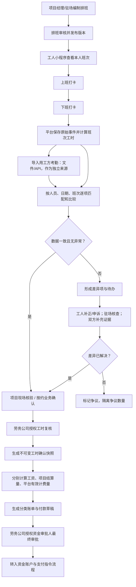
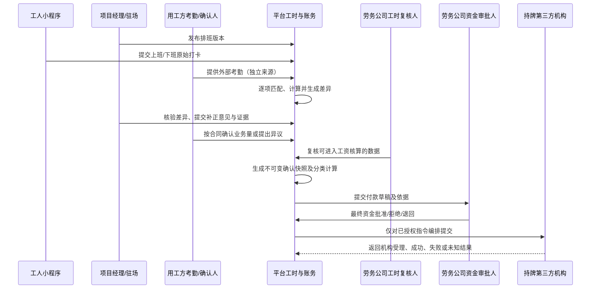

# 排班—打卡—考勤核对—资金审批流程 v0.1

**文档状态：** 业务流程蓝图，待评审
**适用范围：** 已中标项目从班次安排、工人打卡、外部考勤核对、工时确认到工资/相关资金付款草稿与最终资金审批
**重要说明：** 本文规定平台业务记录与权限流程；不预设某一种考勤来源单独决定全部法律或结算责任。

## 1. 目标与设计原则

建立平台内可复算、可追溯的工时闭环，同时与用工方现有考勤系统核对：

**项目排班 → 工人小程序上下班打卡 → 平台计算工时 → 导入用工方考勤 → 逐项核对 → 差异处理 → 确认快照 → 分类业务量/工资核算 → 付款草稿 → 劳务公司资金审批**

必须始终区分：

- 排班计划不等于实际出勤。
- 工人打卡原始事件不等于最终确认工时。
- 用工方考勤数据是独立来源，不覆盖平台原始打卡。
- 现场核验或用工方业务量确认不等于工资付款授权。
- 确认工时、工资计薪量、用工方与劳务公司结算量、平台有效计费人天分别按各自规则计算，不能相互替代。

## 2. 角色与权限

| 角色 | 可执行事项 | 关键限制 |
|---|---|---|
| 项目经理 | 编制/审核/发布项目排班；查看供给与到岗；核查异常并提交业务核验 | 不得删除或伪造工人原始打卡；不拥有默认资金最终审批权 |
| 驻场 | 现场协助排班、查看人员班次；核验迟到早退、缺卡、到岗与考勤差异；提交补正意见和证据 | 补录/核验必须注明来源、理由与操作者；现场确认不可直接付款 |
| 工人 | 在小程序查看本人班次、完成上班/下班打卡、查看工时结果、提出漏卡补正或异议 | 只能为本人提交事件，不可修改已保存的原始事件 |
| 用工方考勤/业务确认人 | 提供/导入外部考勤；核对项目约定的履约量并提出异议 | 外部文件不能覆盖平台记录；业务确认不等于劳务公司资金审批 |
| 劳务公司工时复核人 | 按组织授权复核进入工资核算的工时数据及补正结论 | 不因此自动具有最终资金审批权，除非另有有效授权 |
| 劳务公司财务/资金审批人 | 复核分类付款依据、金额、付款对象和资金准备情况，最终审批资金支付 | 不得仅依靠未确认考勤或现场口头确认批准；按组织授权执行 |
| 平台系统 | 版本化排班与规则，保存原始数据，计算工时，辅助匹配差异，生成快照与付款草稿依据 | 不替任一业务方做事实判断；不把计算结果自动变成支付授权 |

业务核验和资金授权可以由组织配置给不同成员；同一成员是否可兼任，由劳务公司授权策略及后续控制设计决定，平台不得默认越权。

## 3. 端与数据来源

| 端/来源 | 主要职责 | 写入/导入的数据 |
|---|---|---|
| Web | 组织与项目管理、批量排班、规则配置、外部考勤导入、批量差异处理、对账与管理报表 | 排班版本、规则版本、外部文件及导入批次、批量核对结果 |
| 独立 App | 项目经理/驻场现场待办、人员与班次核查、异常说明、补正核验、业务确认 | 现场核验意见、补正审批意见、现场证据及操作记录 |
| 工人小程序 | 本人班次、上班/下班打卡、本人工时状态、补正/申诉 | 不可覆盖的打卡原始事件、补正申请、工人异议 |
| 用工方考勤系统/文件 | 提供用工方侧独立出勤记录 | 原始导入文件/API 数据、来源标识、批次、字段映射与导入时间 |
| 平台服务端 | 统一身份权限、事件保存、工时计算、差异匹配、审批流与快照 | 计算结果、审计轨迹、匹配结果、确认快照、付款草稿依据 |

平台打卡、驻场补录、用工方/工厂导入必须以不同来源类型保存。外部来源只作为核对依据，任何单一来源均不应静默覆盖其他来源。

## 4. 端到端主流程

## 5. 详细步骤、输入与输出

| 步骤 | 责任角色 | 输入 | 输出/门槛 |
|---|---|---|---|
| 1. 排班编制 | 项目经理/授权驻场 | 项目、岗位、有效人员/履约关系、日期、班次、计划开始/结束、休息规则、人数 | 草稿排班；需检查人员资格、项目配额与班次冲突 |
| 2. 排班发布 | 项目经理或有权复核人 | 已检查排班草稿及规则版本 | 新排班版本；通知受影响工人；已发布版本不可被静默覆盖 |
| 3. 上下班打卡 | 工人小程序 | 本人有效排班、本人身份、事件类型和提交事件 | 服务端接收的上班/下班原始事件；记录服务器接收时间、客户端时间（可用时）、事件唯一标识及来源 |
| 4. 工时计算 | 平台服务端 | 排班版本、打卡事件、适用休息/跨日/工时规则 | 可复算的计算工时及异常标签；不完整或冲突记录进入待处理 |
| 5. 外部考勤导入 | 用工方授权操作人/劳务公司授权人员 | 用工方文件/API 数据、项目、周期、字段映射 | 原始导入批次、文件/接口来源、导入人、时间、校验结果；保留原件或受控引用 |
| 6. 逐项核对 | 平台自动匹配，项目人员复核 | 平台排班/打卡/计算结果与外部记录 | 每个匹配项的双方数值、差异类型、匹配置信度/人工确认状态 |
| 7. 差异核查 | 驻场、项目经理、工人、用工方确认人 | 差异项、补正申请、排班变更、现场材料 | 已解决/待补充/争议中的处理记录；原始数据保持不变 |
| 8. 工时业务复核与确认 | 劳务公司授权复核人；用工方按约确认业务量 | 已核对数据、解决结论、合同/项目规则 | 按来源和用途形成确认结果；争议部分可与无争议部分分开 |
| 9. 生成确认快照 | 平台服务端，在授权业务确认完成后 | 排班版本、全部来源事件、计算规则版本、差异结论及审批记录 | 不可变快照编号、确认范围、明确的未决项/争议量 |
| 10. 分类核算及资金审批 | 平台核算；劳务公司财务/资金审批人最终审批 | 快照、工资/结算规则、保险等独立账单依据 | 分类账单和付款草稿；最终资金授权后才可进入机构支付流程 |

## 6. 排班、打卡与核对规则

### 6.1 排班版本

- 排班最少关联项目、岗位、服务日期、计划开始/结束、休息规则、人员履约关系、编制人、发布时间及适用规则版本。
- 排班发布后如需变更，新增版本并保存变更前后值、原因、生效时间、操作人和通知结果；已经发生的打卡仍关联原始排班版本。
- 临时换班、跨日班、加班或项目临时增员使用明确的变更/补充记录，不通过改写历史排班掩盖事实。
- 超出供应商配额或人员无有效项目关系时，系统提示并进入审批/异常路径；不得自动算入已确认履约量。

### 6.2 工人上下班打卡

- 工人只能对本人有效班次提交上班或下班打卡；服务端记录接收时间，设备时间仅作辅助。
- 每个打卡事件具有唯一标识；网络重试不得重复生成事件或重复工时。
- 漏卡、错卡、设备/网络异常通过补正申请或经授权的来源记录处理，不编辑或删除原始事件。
- 地理位置、围栏、照片、人脸等验证方式不在本蓝图中默认启用，需按具体场景、必要性、告知授权和隐私评估单独决定。
- 只有上班卡没有下班卡时，不得直接以排班结束时间补齐为完整工时；应进入异常待核验。

### 6.3 外部考勤逐项匹配

建议匹配优先级由项目配置并保留人工确认：

1. 稳定人员标识与项目/组织关系。
2. 服务日期及班次标识；若外部系统无班次标识，按双方确认的字段映射与时间窗口辅助匹配。
3. 上下班时间及异常代码。
4. 多条、重复、缺失或歧义记录进入人工处理，不自动择一删除。

核对结果至少区分：一致、平台有/外部无、外部有/平台无、上下班时间差异、人员/日期/班次不匹配、重复记录、数据格式错误、待人工匹配。

匹配键、时间容差和差异阈值由项目规则确定；不得在平台范围内默认为所有工厂采用统一值。导入错误应能定位到批次、文件行/接口记录和字段。

## 7. 差异、补正、争议与确认快照

### 7.1 差异处理

1. 平台展示平台打卡/计算值和用工方外部值及其来源，不覆盖任一原始数据。
2. 工人可对本人记录提出漏卡补正或异议；驻场/项目经理可补充现场核查意见；用工方可确认或提出业务差异。
3. 每次补正/核验记录申请人、处理人、理由、证据引用、原值、新建议值、决定、时间及适用规则版本。
4. 劳务公司授权工时复核人根据业务规则确认进入工资核算的数据；用工方按照项目合同确认其应确认的业务结算量。
5. 无争议部分可按合同和项目规则单独确认；争议部分单独标注并留待处理，不混入已确认数量。
6. 争议无法解决时，保留双方意见和升级/申诉状态；平台不以超时或单方修改自动判定任一方正确。

### 7.2 确认快照

快照至少包含：

- 项目、岗位、服务周期、人员及班次范围。
- 排班版本及实际发生的版本变更。
- 平台原始打卡事件标识、平台计算结果、驻场补录/核验来源。
- 用工方导入批次与匹配记录；如有争议，列出争议项和未确认数量。
- 工时计算、舍入、休息扣除、跨日及异常规则版本。
- 工人补正、现场复核、劳务公司工时复核及用工方业务确认的主体、结论和时间。
- 快照生成时间、生成者/系统、版本号及关联调整记录。

快照生成后不可原位修改。后续发现错误时，新增调整快照或更正记录，引用原快照并说明差异；历史工资、结算或服务费计算结果应能重放和解释。

## 8. 从确认工时到资金审批的权限链

### 8.1 业务审批与资金审批的分界

| 决策/动作 | 可由项目经理/驻场执行 | 还需劳务公司授权复核/资金审批 |
|---|---|---|
| 编制、发布或变更排班 | 是，限项目授权范围 | 涉及组织政策或超配时按项目/组织规则额外审批 |
| 核查打卡异常、现场到岗、补充证据 | 是 | 工时进入工资核算前由授权工时复核人确认 |
| 对比用工方考勤、整理差异 | 是 | 业务结算量由合同约定的确认方确认 |
| 提交已确认数据作为付款草稿依据 | 可以提交或发起 | 不等于资金授权 |
| 修改已确认金额、付款对象或账单类型 | 不可直接改变已确认历史 | 需形成调整版本并重新复核/审批 |
| 批准工资、社保、保险等真实资金支付 | 否，除非另有独立且明确的组织资金授权；本流程不默认赋权 | 劳务公司授权资金审批人最终审批 |
| 指令提交第三方机构 | 仅平台按有效授权和机构规则编排 | 必须具备有效最终资金审批记录 |

付款草稿可能由已确认的工时快照计算形成，但考勤确认本身不会自动提交支付。余额检查、机构处理、回执和对账遵循《资金账户与支付指令流程 v0.1》。

## 9. 状态模型

### 排班状态

`草稿 → 待复核（如配置）→ 已发布 → 已变更（新版本）/已结束/已取消`

已发布排班的修改生成新版本；取消或结束不删除历史版本。

### 班次工时状态

`待打卡 → 部分打卡/已打卡 → 待计算 → 已计算 → 待核验 → 待确认 → 已确认`

可并行标记异常状态：`缺卡、迟到/早退待核验、时间冲突、外部差异、补正中、争议中、已驳回、已撤回`。异常标签不可通过改成“已确认”而丢失。

### 差异状态

`待匹配 → 一致/有差异 → 待补充 → 核验中 → 已解决/部分解决/争议中 → 已确认或关闭`

### 确认与资金状态

考勤/业务快照、分类账单、支付指令分别维护状态。建议链路：

`确认快照 → 分类核算 → 付款草稿 → 劳务公司待审批 → 已授权/已拒绝/退回 → 待机构余额确认 → 已提交/处理中/结果未知 → 成功/失败/部分成功 → 已对账`

不允许通过一个笼统的“项目已结算”状态代替上述阶段。

## 10. 异常路径与控制

| 异常 | 系统处理 | 权限/审计要求 |
|---|---|---|
| 漏上班卡或下班卡 | 进入缺卡队列，允许工人申请补正；未核验前不按计划时间推定完整工时 | 保留缺失状态、申请证据、审核意见与前后值 |
| 重复打卡或网络重试 | 按事件唯一标识防重；确有二次打卡时作为独立事件供核验 | 不静默删除；保留服务端接收时间 |
| 无有效排班、人员退出、超项目配额 | 进入身份/项目关系异常，不直接记为已确认服务量 | 需有权人员补充合法业务依据或调整配额 |
| 排班临时变更 | 新增排班版本并通知受影响人员；历史班次继续关联原版 | 保存变更原因、时间和操作者 |
| 外部考勤文件重复/格式错误 | 导入批次校验失败或重复标记；不覆盖既有数据 | 留存文件/批次引用、错误行和重导记录 |
| 平台与用工方数据不一致 | 生成逐项差异；按约核对，无争议量与争议量分开 | 双方来源、意见、证据和结论可追溯 |
| 工人提出异议 | 对本人相关数据创建补正/申诉任务 | 不因提出异议而改写原始打卡或自动判其无效 |
| 驻场补录或修正 | 以补充来源/调整记录写入，不伪造工人原始打卡 | 强制理由、依据、时间、操作者，必要时复核 |
| 部分差异解决 | 只确认已解决范围，未决部分继续隔离 | 快照标明确认范围和争议余量 |
| 确认后发现错误 | 新增更正快照，链接原快照及受影响账单/指令 | 原快照不可删除；重算结果有版本差异 |
| 资金审批被拒/退回 | 付款草稿退回修订；关键字段变化后重新复核 | 保存拒绝/退回理由及版本 |
| 机构支付未知/失败/部分成功 | 转入支付查询、对账或补偿流程，不修改考勤快照 | 遵循资金蓝图防重复支付与回执审计规则 |

## 11. 关键验收场景

1. 项目经理/驻场发布排班后，工人仅可查看和打卡本人有效班次；修改排班生成新版本且历史可查。
2. 工人分别完成上班、下班打卡后，系统保存两条不可覆盖的原始事件，依据排班和规则版本生成可复算工时。
3. 工人缺少下班卡时，工时进入异常，不自动按排班结束时间补足；补正获批后原记录与补正轨迹仍可查。
4. 同一打卡请求因网络重试多次提交时，只形成一条有效原始事件；不同事件乱序时，按服务端接收记录保留并进入必要核验。
5. 导入用工方考勤后，系统按人员、日期、班次等规则逐项匹配；导入数据和平台记录均保留来源，不发生覆盖。
6. 平台计算 8 小时、用工方考勤为 9 小时的记录显示双方数值与 1 小时差异；在按项目规则核验前，不生成无争议的完整确认量。
7. 工人补正、驻场核验或用工方提出异议时，系统保留原始数据、理由、证据、处理人和处理结果；争议与无争议部分可分开处理。
8. 确认快照记录排班版本、打卡来源、外部导入批次、规则版本、确认人和争议范围；快照生成后不可被原位覆盖。
9. 确认工时分别按规则生成工资计薪量、项目结算量和平台有效计费量，不把小时数、自然日和计费人天混为同一单位。
10. 项目经理/驻场完成现场确认后只能形成付款草稿依据；未获得劳务公司授权资金审批人批准时，不得提交支付指令。
11. 资金审批后若付款对象或金额变化，旧授权不可复用；新版本需按组织授权规则重新审批。
12. 机构余额不足、回执未知或支付失败时，考勤快照保持不变；资金异常按资金蓝图处理，不通过修改考勤数据平账。
13. 非授权用户无法读取其他项目的排班、个人打卡、考勤明细、薪资或审批记录；导出与附件同样受权限控制。

## 12. 尚待项目规则确认

- 项目排班发布前是否需要复核、哪些变更需重新通知或批准。
- 班次容差、迟到/早退、休息扣除、跨日、跨班、加班及部分出勤计算规则。
- 地理围栏、定位、照片或其他打卡证明是否启用，以及其必要性、告知授权和数据保留安排。
- 用工方考勤接口/文件格式、人员匹配标识、字段映射、周期、差异阈值及确认期限。
- 工人漏卡补正所需证据、受理时限、审批层级及超期升级机制。
- 用工方对项目履约量的确认范围，劳务公司工资工时复核人与业务结算确认人的具体权限。
- 无争议量与争议量是否可分批确认、计薪及付款，以及争议金额如何处理。
- 确认快照锁定时点、调整周期、历史账单重算和更正通知规则。
- 工时到工资、保险、用工方项目结算及平台有效计费人天的各自转换规则与责任主体。
- 劳务公司资金审批角色、金额阈值、复核/双人授权和紧急授权规则；实际资金和机构处理依《资金账户与支付指令流程 v0.1》待验证事项执行。
