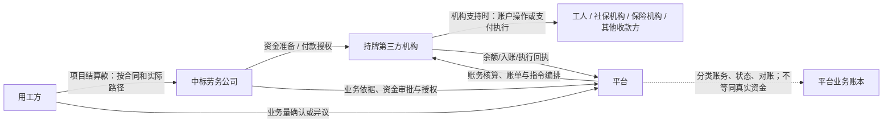
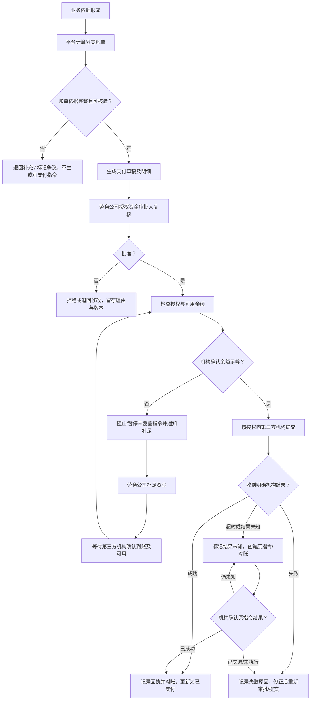

# 资金账户与支付指令流程 v0.1

**文档状态：** 业务流程蓝图，待评审
**适用范围：** 劳务供应链交易平台的分类账单、应收应付账期、线下回款核对、资金准备、支付授权、第三方机构执行及结果对账
**重要说明：** 本文描述已确认的业务职责与产品流程，不代表目标账户产品、资金托管/监管安排或法律结构已经落实。

## 1. 目标与边界

本蓝图定义平台如何把已核验的业务依据转化为分类账单、应收应付账期、线下回款记录和支付指令，并在劳务公司授权、资金准备、持牌第三方机构执行或线下对公回款之间形成可追溯闭环。

> 本文支持“钱不经过平台”的正式业务模式：用工方可以按合同将项目款线下支付至劳务公司对公账户，平台不控制该账户，但必须记录应收账单、到期日、付款凭证/流水、核对结果、部分回款、短款和逾期状态。线下回款不等于不可见，也不等于平台已代收。

已确认的业务职责：

- **平台：** 汇总核验依据、计算金额、维护账务记录、编排支付指令、跟踪状态并进行对账；不因记录账务或编排指令而自动成为资金所有人、债务人或支付审批人。
- **劳务公司：** 按实际合同及责任安排承担相应义务，准备应付资金，并由其授权的资金审批人作出最终支付授权。
- **持牌第三方机构：** 在其实际提供的产品能力、账户授权和合规安排范围内管理账户或执行支付，并向平台返回处理回执。
- **用工方：** 按与劳务公司的实际合同及确认结果承担相应业务结算义务；用工方对业务量的确认不替代劳务公司的资金审批。

产品必须区分**业务账务记录**与**真实资金状态**。账单已生成、内部账本已记账、付款草稿已审批，均不等于资金已到账或支付已成功。

## 2. 角色、权限与职责边界

| 角色 | 可执行事项 | 不可替代的职责 |
|---|---|---|
| 平台账务/运营 | 按规则生成账单与计算明细；核验必需字段；编排待审批或已授权指令；查询、对账、异常跟踪 | 不得代替劳务公司承担付款义务或最终审批；不得把系统状态当作机构资金回执 |
| 劳务公司业务负责人/项目经理/驻场 | 提交业务依据、确认现场履约数据、补充项目材料；在授权范围内发起或复核付款草稿依据 | 现场业务确认不构成最终资金授权 |
| 劳务公司资金审批人 | 审核付款对象、分类、金额、依据、资金准备情况并最终授权；按组织授权复核或拒绝 | 授权必须来自劳务公司有效组织权限；平台运营人员不能代批 |
| 劳务公司出纳/资金准备人员 | 按组织流程安排资金准备，查看待补足金额与机构到账状态 | 资金“已安排”不等于第三方机构已确认可用 |
| 持牌第三方机构 | 按授权执行账户查询、入账确认、支付、退回或冲正等实际支持的操作，并返回机构流水/状态 | 平台不得假定机构支持某种账户结构、实时余额、撤销或代发能力 |
| 用工方确认人 | 按合同确认项目业务量、对账数据或提出异议 | 业务量确认不等于劳务公司付款审批，也不等于实际资金到账 |
| 劳务公司/授权财务 | 登记用工方线下回款、上传银行回单或关联对公账户流水、处理待核对/短款 | 回款登记不等于平台已收款；凭证不足或无法匹配时不得标记为已核对 |

具体组织岗位名称、金额权限、双人复核要求及授权有效期由劳务公司组织授权配置；尚未确定的授权规则不得由系统默认推定。

## 3. 分类账单与资金科目

以下项目必须分开建账、分开追踪支付/收款状态，不得合并为笼统的“统一结算”。每个账单及指令应有唯一业务类型、合同/规则依据和责任主体。

| 账单/资金科目 | 常见业务依据 | 责任与付款方向 | 产品处理原则 |
|---|---|---|---|
| 工人收入/工资及其他个人应付款 | 已确认工时、适用工价、工资规则、合同或协议 | 按具体用工与合同安排确定；本平台业务设想中由相应劳务公司准备资金并承担其实际义务 | 独立账单和人员明细；按授权提交代发或支付指令；不得与其他费用净额掩盖 |
| 社会保险缴费 | 适用人员、缴费期间、核定金额及责任安排 | 按适用安排确定责任主体和收款对象 | 单独科目、期间、对象与回执；代缴能力及路径待验证 |
| 商业保险费用 | 保单/投保清单、人员及保障期间、保费依据 | 按实际投保和合同安排确定 | 与工资、社保分别计账；记录保单或投保关联、付款状态 |
| 用工方—劳务公司项目结算 | 中标条件、合同约定、双方确认的履约量、调整项 | 通常为用工方向中标劳务公司结算，最终方向以合同为准 | 独立应收/应付对账单；不得因平台记录而默认平台代收或代付 |
| 平台管理费/服务费 | 按[《商业模式与收费标准》](./商业模式与收费标准-v0.1.md)已批准的用工方档位选择、有效履约人天及分账规则，并关联履约方服务合同和调整记录 | 由履约方承担；用工方原则上不付平台费 | 独立的履约方应收账单及平台/用工方分配明细；实际收取结算按获批合同及结算安排执行，不默认从用工方回款扣收 |

员工推荐新增独立科目（FR-24～25）：按[员工推荐专项](../04-治理信用与增长/员工推荐与按工时持续奖励需求-v0.1.md)记录阶段／持续工时奖励的受益人、责任付款方、政策快照、组件权益、周期结算与调整。付款方和资金来源须逐政策批准，不默认平台垫付，不从朋友工资扣取，不自动计入人事经理激励预算。员工奖励与工人工资、经纪返费和平台费分账；复用授权、账户核验、支付未知查询、幂等、部分支付及回执核销流程。需求正式纳入不等于具体合同财税和真实支付已获批准。

每笔账单至少记录：组织/项目、资金科目、账期、责任主体、付款方与收款方、币种和金额、计算依据、适用规则版本、确认/争议状态、关联凭证、调整记录及账单状态。

除支付指令外，项目结算账单还应记录业务期间、履约确认日、出账日、约定付款到期日、实际付款/收款日、付款方式（线下对公/第三方机构/其他获批方式）、银行回单或机构流水引用、核对状态、部分回款金额、短款金额、逾期起算日和催收/争议记录。用工方项目应收与工人、经纪人、协同供应商及平台服务费应付不得合并为一个项目余额。

## 4. 账户关系蓝图与待验证边界

逻辑上，系统需要分别记录各业务主体、账单、支付来源、收款对象和机构处理记录；真实账户如何开立、由谁持有或控制、资金如何隔离，必须由后续机构能力核验和专业审查决定。

图中箭头表示待按实际合同和机构产品能力配置的业务关系，不表示平台资金池、监管账户或专户已经存在。

## 5. 支付指令主流程

### 5.1 逐步输入与输出

| 步骤 | 责任角色 | 输入 | 输出/完成条件 |
|---|---|---|---|
| 1. 业务依据形成 | 项目人员、用工方确认人、相应责任方 | 已确认工时快照、保险清单、合同规则、对账确认等 | 可追溯的业务依据；争议量与无争议量分开 |
| 2. 分类核算 | 平台 | 业务依据、规则版本、费率/工价、已发生调整 | 分类账单及逐项计算明细，可复算 |
| 3. 生成付款草稿 | 平台或劳务公司授权操作人 | 已核验账单、收款对象、支付用途、期间 | 待审批草稿；尚未产生对外支付 |
| 4. 最终资金审批 | 劳务公司授权资金审批人 | 草稿、依据、金额、对象、余额/资金准备信息 | 明确批准、拒绝或退回；记录身份、权限、时间、意见和版本 |
| 5. 余额确认 | 第三方机构通过可用产品能力返回；平台展示 | 已授权草稿、账户/资金引用 | 明确“可用/不足/查询失败/未知”；不可仅用平台预计余额代替机构确认 |
| 6. 指令提交与执行 | 平台按授权编排；机构执行 | 授权记录、指令明细、幂等标识 | 机构受理/处理中/结果回执；提交不等于成功 |
| 7. 对账与关闭 | 平台及相关组织财务 | 机构流水、账单、回执、退款/退回记录 | 每笔明细匹配、差异待处理或完成；保留原始记录 |

### 5.2 支付指令必要字段

- 指令唯一编号、账单编号、资金科目、项目/账期及业务依据快照编号。
- 付款组织、收款对象及必要的机构侧账户引用；敏感账户信息按最小权限展示。
- 金额、币种、用途、拆分明细及适用计算规则版本。
- 发起人、劳务公司最终审批人、授权范围、审批时间、审批意见及审批所依据的草稿版本。
- 机构名称/产品标识、提交时间、幂等键、机构请求/流水编号、最新回执与回执原文的受控存档引用。
- 资金状态、账单状态、失败原因、未知结果查询、重试/补偿、退款/退回、人工核对及操作审计记录。

## 6. 支付指令状态

指令状态与账单状态、机构状态分别保存；不同维度不得互相覆盖。

| 状态 | 含义 | 允许的后续动作 |
|---|---|---|
| 草稿 | 依据尚未完成核验或待补充 | 编辑、撤回、补充依据 |
| 待审批 | 账单依据已核验，等待劳务公司最终资金审批 | 批准、拒绝、退回 |
| 已拒绝/待修改 | 审批未通过或依据需修订 | 修订后生成新版本并重新审批 |
| 已授权待余额核验 | 劳务公司已授权，尚未由机构确认资金可用性 | 查询余额或资金可用状态 |
| 余额不足已阻止 | 当前资金不足，未提交未被覆盖的支付指令 | 通知补足；待机构确认可用后重新进入授权检查 |
| 待重新授权 | 余额补足后，需要按组织授权规则确认或重新授权 | 获授权后再次提交 |
| 已提交/处理中 | 机构已受理或执行中 | 查询同一机构指令；不得盲目创建新指令 |
| 结果未知 | 超时、断连或回执不确定，不能判断成功或失败 | 查询原指令、机构对账或人工核实 |
| 部分成功 | 批量/拆分指令仅部分明细完成 | 成功明细对账；未完成明细独立处理，不重复支付已成功项 |
| 已成功待对账 | 收到机构成功回执，尚未完成账单/流水匹配 | 自动或人工对账 |
| 已对账/已完成 | 账单、指令和机构结果匹配 | 关闭；后续更正通过调整、退款或冲正记录 |
| 已失败/已退回 | 机构明确拒绝、支付失败或款项退回 | 记录原因；修改或重新审批后产生新指令 |

除机构明确支持且业务状态允许外，已提交指令不能被平台标记为“已撤销”。未知结果必须先查明，不得将其直接按失败重新付款。

## 7. 余额不足、失败与结果未知处理

### 7.1 余额不足

1. 机构余额/可用资金查询返回不足，平台将当前指令标记为“余额不足已阻止”，不提交超出已确认可用资金的指令。
2. 平台通知劳务公司指定资金准备人与审批人，说明科目、金额、缺口、项目/账期及指令状态。
3. 劳务公司按实际账户安排补足资金；平台仅记录补足状态，不自行认定到账。
4. 等待第三方机构返回入账及可用状态确认。未收到确认前不得继续提交。
5. 机构确认可用后，按组织授权政策进入“待重新授权”或相应审批环节；授权有效性、金额和收款对象需重新核验。
6. 重新提交时使用受控的新尝试记录并保留与原指令/草稿的关联；原被阻止记录不删除。

### 7.2 失败、超时和重试

- **明确失败：** 保存机构失败码/说明；检查是否需修正账户、金额或业务依据；变更关键字段时生成新版本并重新审批。
- **结果未知：** 保持资金状态未知，优先查询原机构流水或开展对账；在机构确认“未执行/失败”前禁止对同一业务明细再次付款。
- **重试：** 使用幂等键或机构提供的原指令查询/重试能力；每次尝试均有独立时间、结果和原因，不覆盖前次记录。
- **部分成功：** 按收款明细拆分状态；只对未成功且确认未支付的部分发起后续流程。
- **退款、退回或冲正：** 新增反向资金记录并关联原付款，不删除或改写成功回执；对应账单更新为部分退回、已退回或待处理。
- **机构暂不可用：** 队列保留待处理状态并告警；不得因重试而绕过资金审批、重复创建指令或显示支付成功。
- **人工处理：** 需记录操作人、核对材料、判断依据、时间、影响金额及复核人；人工状态修改不能伪装成第三方回执。

## 8. 账单、回款、指令与对账规则

- 一张账单可按支付对象/期间/机构限制拆分为多条指令；每条指令必须可追溯至原账单明细，拆分金额之和可核验。
- 多类资金科目不得因同一账户或同一付款批次被合并成一个无明细的支付项目。
- 机构扣款、手续费、税费或退款应单独记录其依据和承担方，不得静默改变原账单金额。
- 部分付款时分别显示已支付、待支付、失败及争议金额；不得将部分回执标记为整单结清。
- 用工方项目结算、劳务公司支付工人/机构费用及平台服务费分别对账；不自动抵扣或轧差。
- 平台内部“应收/应付/待支付/处理中”仅为业务账务状态；只有获得机构回执并完成必要核对后，才按相应规则更新真实资金结果。
- 线下回款支持“未出账、已出账、待付款、部分回款、已回款待核对、已核对、逾期、争议/短款、退款/冲正（如适用）”等状态；银行回单或对公流水登记不等于平台已收款，必须完成付款方、收款方、金额、日期、流水号和账单匹配。
- 用工方项目结算到期日、工人工资/个人应付款日、经纪/协同结算到期日和平台服务费债权形成/付款日分别记录，不因用工方账期较长而自动顺延工资或其他责任主体的到期义务。
- 允许劳务公司用自有资金先行支付工资或其他应付款；平台记录应付、实付和资金来源/凭证状态，但不因此成为垫资方。资金缺口是风险/融资协同信息，不是平台应付款。
- 账单与支付指令、线下回款记录分别维护；同一回款不得重复核销多个账单，短款、跨项目付款和无法匹配的款项进入待核对，不得通过修改原账单消除差异。

## 9. 关键验收场景

1. **分类建账：** 分别生成工资、社保、商业保险、项目结算和平台服务费账单；任何账单均可独立追溯依据、责任方、金额和状态。
2. **线下回款闭环：** 用工方直接向劳务公司对公账户付款后，授权财务可登记回款并上传凭证；平台能区分待核对、部分回款、已核对、短款和逾期，且不显示平台已代收。
2. **职责隔离：** 项目经理/驻场完成业务确认后，只能形成或补充付款草稿依据；没有劳务公司授权资金审批人的有效授权，机构指令不能提交。
3. **审批版本：** 审批后若收款方、科目或金额等关键字段改变，旧审批不得沿用，系统要求新版本复核/授权并保留差异。
4. **余额不足：** 余额不足时指令未提交，相关人员收到补足通知；只在机构确认补足可用后进入规定的重新授权流程。
5. **未知结果防重：** 模拟机构受理后网络超时，指令显示结果未知；系统查询同一原指令，在查明结果前不会创建重复付款。
6. **部分成功：** 批量指令部分成功时，成功明细与失败明细分开；后续只处理确认未支付的明细。
7. **失败与重试审计：** 明确失败后修正并重提，前次失败回执、修改版本、审批和新尝试均可追踪。
8. **回执与账本分离：** 平台账本显示待支付而无机构成功回执时，不显示已支付；收到回执但账单金额不匹配时进入对账异常。
9. **退款/退回：** 退款以关联原付款的反向记录呈现，原成功回执保持不变，净额及未结金额可复算。
10. **权限与隐私：** 非授权成员不能查看完整账户信息、支付凭证或跨组织付款数据；敏感字段访问留审计记录。

## 10. 尚待验证事项

以下均为上线前的外部验证/决策事项，不视为已确定产品事实：

- 账户法律性质、账户开立主体、资金所有权、控制权及各方可操作权限。
- 是否存在符合目标业务的专户、监管/托管或其他资金隔离安排；“专款专用”由什么机制实现及如何证明。
- 持牌第三方机构具体资质范围、产品能力、可服务地区、资金进出路径、支付对象、限额、费用、到账时效、余额查询和对账接口。
- 机构是否支持工资/社保/商业保险等不同类型代付、批量支付、部分成功查询、幂等、防重、撤回、退回、冲正及未知结果核验。
- 平台在账户关系中的法律与操作角色、可被授权的指令类型、信息处理边界及相应协议安排。
- 用工方项目款、劳务公司自有资金、个人应付款和平台服务费的实际资金路径；是否允许任何抵扣或轧差。
- 劳务公司资金审批组织模型、审批金额阈值、复核要求、授权变更/撤销及紧急处理规则。
- 资金不足的通知对象、补足时限、逾期影响、工资等到期义务的异常升级机制。
- 各类账单开票、税务处理、支付凭证及档案留存要求。

在上述事项核验完成前，产品设计和测试可使用模拟机构适配器；模拟结果必须明确标记为测试数据，不产生真实资金指令或到账承诺。
