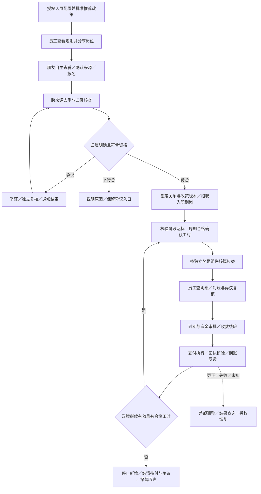

# 员工推荐与按工时持续奖励需求 v0.1

**需求来源／日期：** 2026-10-24，负责人提出员工端也可推荐人员，取得推荐奖励或持续按工时分成奖励
**需求状态：** 正式纳入产品需求范围；具体归属、资格、金额、期限、付款责任、合同财税及真实启用规则待评审
**PRD 映射：** FR-24 员工推荐与归属；FR-25 员工推荐奖励与持续工时计奖；复用 FR-01、FR-06～FR-08、FR-10～FR-14、FR-18
**文档职责：** 员工推荐业务规则的详细维护入口；不改变客户收费、平台／用工方已有分账或人事经理外部激励制度

关联：[员工端全流程](../06-角色与流程/员工端角色功能与全流程-v0.1.md)、[PRD](../00-产品全景/PRD-v0.1.md)、[收费唯一入口](../03-账单与资金/商业模式与收费标准-v0.1.md)、[支付流程](../03-账单与资金/资金账户与支付指令流程-v0.1.md)、[交接门禁](../05-战略与实施/需求追踪与交接门禁-v0.1.md)。

## 1. 角色与业务目标

员工可以在同一账号中推荐朋友报名授权岗位并核对自己的奖励，不必先注册独立经纪人账号。推荐资格是附加业务能力，不自动授予组织成员、专业经纪合作、用工方联系或审批权限。

“可推荐人”与“当前在岗”分开记录：是否允许待入职人员、已离职人员或其他项目员工参加，由具体政策明示；不默认离职后丧失历史权益或无限期取得新奖励。

目标是形成“分享岗位 → 朋友自主确认并报名 → 归属确认 → 入职到岗 → 达标／确认工时 → 核算奖励 → 对账与支付 → 异议处理”的闭环，而不是只新增一个分享按钮。

仅支持本人直接推荐的真实人员；不因被推荐人继续推荐他人，给上一级推荐者增加奖励，不收取取得推荐资格的入门费。不承诺永久收益、固定回报或平台兜底付款。

## 2. 员工端功能与最小信息范围

| 功能 | 需求 |
| --- | --- |
| 推荐中心 | 展示本人可参加的政策、授权岗位、有效时间、责任付款方、奖励方式、达标条件、期限与上限、排除事项及异议入口 |
| 分享岗位 | 生成绑定岗位、推荐人、政策版本及有效性的二维码／链接；不在公开链接中携带身份证、银行卡等敏感明文 |
| 朋友接受推荐 | 朋友自主查看岗位及推荐关系说明，登录并确认推荐来源后正式报名；扫码、打开或注册均不等于有效推荐 |
| 推荐记录 | 查看本人直接推荐的必要脱敏标识、受理、归属、招聘、入职到岗及奖励资格进度；归属冲突显示待核查而非另一推荐人的隐私 |
| 奖励明细 | 区分预计、已形成权益、待结算、争议／冻结、待支付、支付中、结果未知、已到账和调整；显示依据、适用版本和周期 |
| 工时计奖明细 | 展示与本人奖励相关的合格工时合计、计奖期间、单价／比例、封顶和调整原因；不开放朋友完整考勤、工资、扣款、身份证或银行卡 |
| 申诉与历史 | 就归属、达标、金额或支付提交异议与证据，跟踪复核；本人离职、岗位关闭后保留历史和未结事项入口 |

奖励账与本人工资账分开。即便付款渠道最终相同，也应能分别核对奖励依据、责任主体、税费、支付分配和回执，不能把奖励余额设计成可自由提现的钱包。

## 3. 归属与政策快照

1. 分享访问只记录来源线索。有效推荐需绑定真实候选人的自主报名、必要同意、目标岗位／劳务公司及有效政策。
2. 员工推荐、经纪渠道、招聘专员、自主报名使用同一归属核查机制；不能另建员工推荐池绕过原归属。FR-06 的保护期仍待审，不继承历史天数为生效参数。
3. 同一候选人重复注册、重复扫码、跨链接报名不重复建立同一业务归属；并发冲突先进入待核查，不能产生双份有效归属和重复奖励。
4. 已有候选、老员工回流、跨岗位／项目／公司、保护期内改推荐人、自我推荐的资格和归属按政策明确；未明确不得自动转归属或计奖。跨组织核查只返回授权的必要结果。
5. 分享时保存条件版本，报名时记录来源及本人接受的条件。若分享后政策变化，应明确提示差异；不可静默套用新条件。归属确认时形成有效政策快照，记录受益人、责任付款方、范围及生效期间。
6. 后续政策调整不无痕追溯取消已确认权益；更正、争议冻结或追回必须有依据、复核、通知和可追溯记录。

## 4. 奖励模式与计算依据

### 4.1 模式

| 模式 | 达标及计奖方式 | 必须明确 |
| --- | --- | --- |
| 一次性／阶段推荐奖励 | 被推荐人达到入职、到岗或指定留岗／确认出勤等条件后形成权益 | 使用哪个事实和日期，多档累加或取最高、每档去重、金额与到期日 |
| 持续工时奖励 | 在约定有效期内，按被推荐人合格确认工时周期计奖 | 起止事件、等待期、是否回溯、合格工时口径、周期、单价／基数、舍入及上限 |
| 混合奖励 | 一次性／阶段奖励与持续工时奖励并存 | 两个独立权益组件与各自条件，明确允许叠加的范围，不重复发放同一组件 |

不将“持续”解释为永续；政策缺少结束条件、计奖基数或付款责任时不得发布为可参加政策。

### 4.2 计算约定

- 按小时固定单价模式：周期金额 = 合格确认工时 × 已批准的元／小时单价，再按政策执行封顶、舍入及调整。
- 若采用比例分成：周期金额 = 明确定义且可追溯的合格收益基数 × 已批准比例。必须说明收益属于谁、是否按工时分摊、税费及调整顺序，不以“按工时分成”推定为从朋友工资抽成或从平台人天费切分。
- 合格工时来自 FR-08 已确认记录及政策允许的筛选，不直接采用排班、单次扫码或未解决的争议工时；它不等于平台有效计费人天。
- 计算关联推荐关系、被推荐人的本次履约关系、政策版本、周期和确认工时快照；同一权益组件与来源量只能计入一次。
- 后续工时更正重新计算差额并形成调整记录，不能对全量工时重复计奖；已支付差额的追偿另走有依据的流程，不直接扣朋友或推荐人的工资。
- 预计金额仅供解释进度，不是已确认权益或可支付承诺；已确认权益、结算到期、审批和到账分别记录。

### 4.3 停止、调动与离职

| 事件 | 处理原则 |
| --- | --- |
| 被推荐人未入职或未达标 | 按条件记录未达标，不因报名自动取得奖励 |
| 被推荐人请假或无合格工时 | 该期间不凭计划工时计奖；保底等特殊规则须另批 |
| 被推荐人离职、奖励期届满或达到上限 | 按政策停止新增计奖，保留已形成权益和待付记录 |
| 被推荐人调动、换劳务公司或再次入职 | 明确原政策是否续算及范围；不自动跨关系续算或重复发放入职奖 |
| 推荐人本人调动或离职 | 与推荐关系、奖励状态分别处理；能否继续新增计奖按原政策明确，不自动清零既得权益 |
| 岗位关闭或政策下架 | 停止新的参与，历史关系按有效快照执行；不直接等于取消待结算金额 |

## 5. 核算、付款与责任

- 每个政策明确发布主体、责任付款方、受益人、资金来源、合同／规则依据、审批角色和收款核验要求；推荐分享者不是审批人。
- 劳务公司招聘支出、平台自行承担的获客支出或其他安排必须分别批准，不默认由平台出资、垫付或代管。
- 劳务公司承担的奖励按其已批准政策与责任履行，不套用 FR-23“平台服务费合格实收”的核算前提；若平台出资，应单独批准预算和资金来源，也不自动纳入人事经理激励预算。
- 推荐奖励独立建账，不从被推荐人工资、借支或个人应付款中隐性扣取，不改变客户收费和现有组织分账。
- 付款前完成权益与争议复核、到期条件、责任主体及组织授权、收款账户、必要合同财税材料和资金准备核验。所得性质、代扣代缴和凭证方式由专业审查确认，不假定税率或净到手金额。
- 支付复用现有资金流程：审批通过不等于到账，失败可处理，未知结果先查询，重复请求／回执不得重复支付。
- 归属、金额与付款争议分别定位，由原业务责任人核查；涉及本人或利益关系的复核须回避，员工可按 FR-18 升级申诉。

## 6. 主流程与协作

| 协作方 | 责任与反馈 |
| --- | --- |
| 员工推荐人 | 分享、查本人推荐与奖励、提交异议；不修改朋友报名、考勤或工资 |
| 被推荐人 | 自主报名与确认来源，按正常员工流程入职、工作；不因接受推荐授予推荐人全面资料访问 |
| 招聘专员／项目经理 | 接收与跟进候选、核查归属、反馈必要招聘结果；有本人收益关联时不得独立终审归属争议 |
| 驻场／授权工时复核人 | 核验到岗及工时事实，不因推荐关系改变工时，也无默认奖励付款权 |
| 政策责任方／财务与资金审批人 | 批准政策、核算和复核、确认资金责任、付款及对账；权限按主体分别校验 |
| 平台治理岗位 | 按案件授权组织证据、复核与执行跟踪，不替业务方认定所有事实或批准资金 |

## 7. 状态、凭证与数据对象

推荐线索、有效推荐关系、奖励组件权益、周期结算单和支付记录分别建模，不用一个“推荐成功”状态代表全链路。

| 对象 | 主要状态／依据 |
| --- | --- |
| 推荐政策及版本 | 草稿、待批准、生效、暂停、到期／关闭；保留批准主体、付款方、参数及适用范围 |
| 来源线索与推荐关系 | 已分享／待报名、待核查、争议中、有效、无效、停止新增；关联自主报名、必要同意、归属证据及快照 |
| 达标与工时依据 | 待达标、待确认、符合、不符合、争议／更正中；保留入职到岗、确认工时及计算来源 |
| 奖励权益与结算 | 预计、待核验、已形成权益、待到期／待结算、争议／冻结、已结算、已调整；保留组件、期间、基数、参数、税费和差额 |
| 支付与核销 | 待审批、待支付、支付中、成功、失败、结果未知、部分支付；保留指令、回执、分配核销与未付余额 |

推荐进度与奖励状态分别展示；权益“已结算”不等于款项“已到账”。付款完成或推荐关系停止，不删除归属、更正、申诉和历史查询依据。

## 8. 验收与待决门禁

### 8.1 最小验收

1. 员工同一账号可推荐且无需建立经纪人账号；只能访问授权岗位、本人直接推荐及本人奖励。
2. 扫码未报名、不同意来源、自我推荐或已有归属待核查时，不自动生成有效推荐或奖励；错误原因可追踪。
3. 员工与经纪人并发推荐同一候选时，形成唯一有效归属或待争议记录，不重复计奖、不泄露另一渠道信息。
4. 一次性、持续工时、混合模式可分别复算；混合两组件独立，重复工时导入、重复计算和重复回执均不重复计奖／付款。
5. 以虚构政策的 100 个合格确认小时、2 元／小时为测试夹具，应计 200 元；后续确认减少 10 小时，仅形成 -20 元调整。以上仅测试数据，不是现行费率。
6. 工时争议不直接计为无争议奖励；离职、换项目、政策关闭按快照停止／延续，历史权益不被静默清零。
7. 推荐人看不到朋友工资、完整考勤及敏感资料；不能确认朋友工时、代报名或审批自己的奖励。
8. 部分支付、失败、未知结果、冻结、差额更正和升级申诉有可观察状态，支付未知不盲目重付。

### 8.2 上线前待决

由产品负责人组织招聘／项目责任人、财务、技术、测试及必要专业审查确认：参与资格、推荐归属与保护期、回流和自荐规则、政策锁定时点、奖励模式与参数、工时范围与起止／封顶、调动离职后续算、付款主体与预算、合同财税、数据授权和申诉时限。

这些待决事项不删除已纳入范围的一次性及持续工时奖励能力，但在对应规则获批前，不得对外发布具体收益承诺、自动形成正式应付或启用真实付款。
