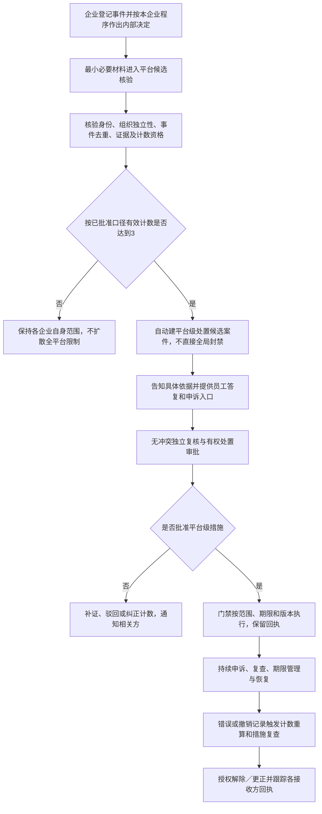

# 员工行为事件与分级业务禁入需求 v0.1

- **更新日期：** 2026-10-24
- **需求来源：** 用户明确新增：用工方或劳务供应商可将存在不良行为甚至违法行为的员工拉黑，先只影响本企业未来业务；多家企业累计三次后在整个劳务供应链拉黑。
- **状态：** 需求正式纳入；执行职责与安全机制为产品建议待评审。用户提出的“三次”保留，不表示已批准机械累计、全自动封禁或永久禁入。
- **对应 PRD：** FR-26 企业内部业务禁入；FR-27 跨组织记录核验与平台级禁入。
- **依赖：** FR-01、FR-06～09、FR-13～19；[交接门禁](../05-战略与实施/需求追踪与交接门禁-v0.1.md) G-11。
- **唯一细化入口：** 本文维护员工行为事件、企业禁入、计数资格、平台级禁入、申诉与恢复规则；角色、信用档案及多端文档引用本文，不复制阈值算法。

## 1. 需求判断与职责分配

### 1.1 谁执行更合适

**建议企业决定本企业未来合作，平台负责跨企业核验及平台级措施；系统执行已获批准的门禁，不自行判定员工违法。**

| 事项 | 谁提出 | 谁审核／决定 | 谁执行 |
| --- | --- | --- | --- |
| 行为事件登记 | 有真实关联的用工方／供应商授权项目、现场或人事人员 | 本组织有权行为处理岗位核验、员工有答复入口 | 记录服务保存证据、来源与版本 |
| 企业内部禁入 | 企业授权经办人 | 本企业有权审批岗位；建议与提出人分离 | 组织范围门禁服务，仅影响该组织明确范围 |
| 记录能否纳入跨组织计数 | 企业提交必要材料，系统识别候选 | 平台无冲突事实核验岗位，必要独立复核 | 计数服务维护有效记录及去重依据 |
| 达到三次的候选案件 | 系统自动聚合候选并建案 | 平台独立复核与有权风险处置审批岗位 | 审批后由平台门禁服务按范围及期限执行 |
| 申诉、更正、撤销与恢复 | 员工本人、原企业或有权核查岗位 | 本企业原记录按授权复查；跨组织及平台措施由无冲突平台岗位复核 | 原记录、有效计数、平台措施及各门禁同步纠错 |
| 涉嫌违法线索 | 相关当事方／企业提交 | 有权机关依法处理；平台仅在自身权限内核验来源、组织协作 | 不默认平台具备移送接口、执法或强制执行能力 |

上述分工是建议方案；具体企业岗位、平台复核与审批矩阵由 G-11 和 G-08 联合确认。企业管理员身份不自动取得本项审批权，平台销售和收费岗位不参与有利益冲突的终审。

### 1.2 原始需求与建议之间的差异

| 层次 | 内容 | 当前认定 |
| --- | --- | --- |
| 用户明确目标 | 单家企业只拉黑自己未来业务；多家拉黑累计三次后全供应链拉黑 | 已记录为新增需求，不删除、不改成任意阈值 |
| 建议的计数单位 | 三家不同组织主体、各一条独立且经核验符合规则的有效事件；买卖双方合计，不是每类各三家 | 待用户及规则评审确认；不能把“三次点击”直接等同“三次有效事件” |
| 建议的执行机制 | 达到三次自动触发平台案件，经核验、告知答复、无冲突复核和审批后实施平台级禁入 | 对原始自动联动思路的安全细化建议，尚未批准全自动封禁 |
| 建议的全局范围 | 仅指本平台内各组织的规定新增业务，不是全国行业、其他平台或线下所有就业机会 | 边界建议待确认；平台不能声称有平台外封禁能力 |
| 实施状态 | 规则、期限、个人信息处理基础、适用性及影响评估通过后才能启用真实限制 | G-11 阻断；原型与虚构测试可先行 |

在上述差异未确认前，不上线“三条企业拉黑记录直接全局封禁”，也不将建议写成已获批规则。

## 2. 对象与范围

- **行为事件**：发生于具体组织、项目、时间和真实业务关系的行为事实及指控，记录所涉人员、来源、证据和核验状态；登记不等于成立。
- **企业内部业务禁入（俗称企业拉黑）**：某企业对未来与该员工开展特定业务的限制决定，具有组织、适用业务、理由、期限、审批及通知。
- **有效计数记录**：通过身份匹配、组织去重、事件去重、证据核验及政策资格审查后，可进入平台级门槛计算的记录；不同于企业内部禁入条数。
- **平台级业务禁入（俗称平台拉黑）**：平台依已批准规则作出的跨组织新增业务限制，有独立案件、审批、范围、期限、申诉与恢复；不是账户注销或个人社会信用结论。

员工身份使用经核验的内部人员标识关联，不以姓名、手机号或未验证身份证号直接合并，也不向企业提供身份证批量查人／查黑名单能力。账号更换不应绕过有效措施，但不因同名、共用电话误伤他人。

用工方内部禁入拟在本用工方关联岗位、项目的新增派驻／入场校验生效，供应商内部禁入拟在本供应商新增招聘／录用／派驻校验生效。**具体拦截节点、已有待入场安排及边界待评审**；不能把某供应商的内部禁入传播为对其他供应商的禁令。用工方换供应商不能绕过该用工方仍有效的内部措施。

企业集团、分支、关联公司、同一实际控制主体如何计算为独立组织，须明确后才能开启跨组织计数；不得靠重复组织账号、项目、门店或批量拉黑凑数。

## 3. 行为标准、证据与防滥用

需先批准行为分类、严重程度、适用事实标准和处理范围，不能以笼统“不良员工”标签作为跨组织处置依据。

| 情形 | 产品处理要求 |
| --- | --- |
| 企业提出违反现场安全、暴力威胁、损坏财物等指控 | 作为待核验事件登记；列行为、时间、关联关系、直接材料和员工答复，不因分类名称直接认定成立 |
| 涉嫌盗窃、诈骗等违法行为 | 标明“涉嫌／待核实”；区分企业指控、报案／受理回执与经核验外部处理结果；报案不等于违法成立 |
| 工时、工资、请假或正常离职争议 | 先走原业务流程，不能仅因员工提出异议、索薪或投诉就作为惩罚性拉黑依据 |
| 单纯低评分、不适岗、转化差或未接受岗位 | 与双方业务匹配分开；是否允许企业内部拒绝未来合作及理由须评审，不自动纳入平台三次计数 |
| 健康、残障、民族、性别等敏感属性或无关个人背景 | 不作为任意禁入或计数标签；适用岗位条件须走单独合规审查 |
| 虚假、串通、报复性上报或篡改证据 | 由平台独立建案核查举报企业和经办人；有权纠错，不因上报人多就免核验 |

证据记录来源、提交人、发生／提交时间、原始引用、所涉版本、可见范围、采信与不采信理由。员工能获知足以答复的行为事实和处理依据；举报人保护、第三人隐私和必要反证材料按分级权限处理，不承诺绝对匿名。

涉及紧急人身或现场安全风险时，企业按自身已批准现场安全程序处理，平台仅按另经批准的临时保护规则执行最小必要措施。紧急保护与三次计数、违法认定及最终禁入分别记录，不借紧急状态自动永久封禁。

## 4. 企业内部禁入流程（FR-26）

1. 授权人员选择有真实关系的员工，登记事件、证据、诉求与建议范围，不允许全库任意搜索拉黑。
2. 企业有权岗位核验关系、理由、行为规则、拟限制范围和期限，提供员工告知与答复入口。
3. 按批准程序作出通过、驳回、补证或其他处理，保留审批及送达记录；具体答复与生效先后及期限待审。
4. 门禁服务接收有效决定，按组织和业务节点执行并返回回执；界面、接口、批量导入和其他招聘入口一致校验。
5. 其他企业不接收该企业的内部黑名单及证据；是否提交为平台候选记录另行核验处理基础和资格。
6. 员工可申诉、更正；企业撤销、期限届满或复查恢复形成新版本，原始记录保留审计而非继续公开负面标签。

企业内部决定不替代解除劳动关系、辞退、停工、撤场或合同处理；在岗安全事件转相应有权流程。不得因未来业务禁入取消已发生工时、既得工资、已形成奖励、尾薪及申诉权。

## 5. 三次门槛与平台级禁入流程（FR-27）

### 5.1 建议计数规则（待确认）

- 门槛固定保留用户提出的 **3**；按建议口径是三家独立组织的三条独立有效事件合计，非三次点击、三份投诉或三个项目。
- 同一组织对同一员工反复禁入、撤销再拉黑、换项目上报只算该组织符合条件的贡献，不无限累加。
- 同一事件由用工方及供应商同时上报，关联同一事实主记录，不重复充作多次独立行为；三家共同举报同一件事不自动视作三件事。
- 未核验、被驳回、撤销／纠正、身份不明、证据不足或不符合政策的事件不算有效计数。正在申诉的记录是否暂停计数、已到期内部禁入的历史事件是否仍可计数须明确配置，不暗设默认。
- 计数观察窗口、事件失效、独立组织认定、跨年度及政策版本迁移待审；不默认终身累计。
- 系统保存原始条数、去重后候选、有效计数、排除原因和所用政策快照，核验状态变化实时触发重算。

### 5.2 平台处理主流程

平台级措施只约束本平台内批准的新增报名、招聘、录用、派驻／入场等节点，**精确范围待审**；不能简单注销登录账号。既有在岗安排、待入职承诺及合同责任须逐项处理，不因全局措施自动失业、离职、撤场或没收权益。

一次严重事件若需紧急保护，可走批准的临时安全程序，不伪造另外两次来凑门槛；是否存在独立于三次门槛的其他长期措施须另审，不在本新增需求中默认授权。

## 6. 告知、隐私、申诉与恢复

- 企业只见本企业授权事实及当前业务节点的最小门禁结果；其他企业不得看到上报企业名单、原始证据、违法指控详情或员工个人黑名单全集。平台级结果查询须存在当前真实业务目的并留审计，不建设可公开搜索的个人榜。
- 员工见本人事件、处理理由、范围、期限、状态和足以行使异议权的依据；受限或离职仍能经身份核验查历史、查薪、确认／争议工时工资、申诉和收取既有应付款。
- 原经办人、利益相关人不能独立复核；无可用人员进入升级／待复核，不自行让高影响措施生效。申诉是否暂停有效措施按批准政策处理，不机械全撤或全维持。
- 企业只能解除本企业决定，不能直接解除平台级措施；原记录纠正须触发有效计数及平台措施复查。计数不足或依据失效时按批准恢复规则及时处理，不能继续仅凭旧计数维持限制。
- 恢复记录范围、理由、授权人、版本、接收门禁和通知回执；传播失败保留在途、告警和人工接管，不能宣称已全部解除。在线缓存、已导出资料的停止使用／更正通知分别跟踪。
- 员工请求查阅、更正、删除与证据保存义务需专业评审，区分停止业务使用、到期删除／匿名化和依法保留的受限审计副本，不承诺无条件删除全部历史。
- 上线前由法务及数据安全确认个人信息处理基础、告知、跨组织提供条件、敏感信息与犯罪指控材料、自动化决策影响、保护影响评估、期限及救济。不得把“勾选同意”当万能处理依据或免除审核责任。

本节是合规审查清单而非法律意见。审查时核对现行《个人信息保护法》等适用规则及真实业务地区，不在产品稿中宣称“三次拉黑即当然合法”。

## 7. 状态、凭证与异常

| 对象 | 独立状态／分支 | 完成凭证 |
| --- | --- | --- |
| 行为事件 | 已提交、待核验、补证、已确认／争议／不足、驳回、更正／撤销 | 事实、来源、答复、核验理由及版本 |
| 企业内部决定 | 待审批、驳回、待执行、生效、申诉／复查、到期／撤销、恢复 | 企业授权审批、范围期限、通知与门禁回执 |
| 计数资格 | 候选、去重关联、待核验、符合／排除、变更重算 | 身份关联、独立组织／事件依据、政策快照及重算结果 |
| 平台级案件与措施 | 候选、举证答复、待独立复核／审批、待执行、生效、复查、解除／恢复 | 无冲突处理、批准范围期限、通知、分节点执行结果 |
| 申诉与纠错投递 | 待受理、复核、维持／改判、待同步、部分失败／完成 | 原案关联、复核理由、各接收方及缓存更正回执 |

名单命中、决定生效、计数达标和门禁执行是四件事。未知回执不得标已限制／已恢复；并发上报、重试及旧版本回调不能重复计数、重复执行或覆盖新的解除决定。误匹配须停止对错误身份的使用、独立纠正及通知，不让员工自己联系每家企业解除。

## 8. 验收场景与启用门禁

| 编号 | 最小可观察结果 |
| --- | --- |
| AC-26-01 | A 供应商内部禁入只阻断其批准范围，B 供应商仍可按自身规则办理；不得泄露 A 的名单／证据 |
| AC-26-02 | 用工方有效禁入在其关联项目对不同供应商入口一致校验，其他用工方不受影响；越权／批量入口不能绕过 |
| AC-26-03 | 员工仍可登录查本人依据、工时工资、申诉及领取既有款项；内部禁入不自动修改入离职或劳动合同 |
| AC-27-01 | 同企业多项目、同事件多方、关联组织和重复消息按获批口径去重；两条有效加一条未核验不达标 |
| AC-27-02 | 三条独立有效记录触发一次候选案；未复核批准不执行全平台限制，审批人冲突则升级 |
| AC-27-03 | 错误身份、原记录撤销、更正或申诉改判触发重算与措施复查；解除同步失败可查、可恢复，无旧回调复活 |
| AC-27-04 | 外部报案不显示违法成立；恶意／报复上报可被核查；第三方不能枚举个人名单或读取其他企业证据 |
| AC-27-05 | 期限届满、观察窗口、待入职／在岗影响及紧急措施按批准政策验证；缺配置阻止真实启用，不默认为永久 |

**G-11 阻断项：** 原始三次规则与建议口径的确认、行为目录与证明标准、企业／平台权限、独立主体及事件去重、计数时间窗口、申诉中记录效力、已有关系处理、期限复查恢复、通知及隐私合规、各端服务端门禁及误伤恢复。责任由产品／业务负责人、法务与数据安全、平台治理、技术及测试共同签收；未满足时仅设计和虚构验证，不真实自动封禁。
