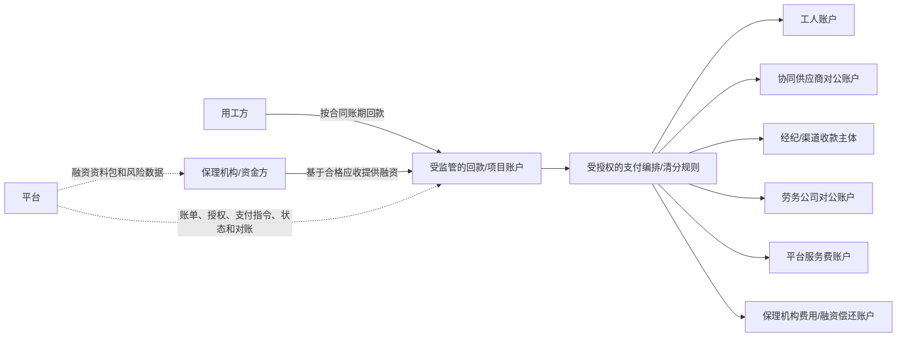

# 未来平台支付与保理资金架构建议 v0.1

- 分析日期：2026-10-23
- 文档状态：中长期资金产品决策建议，待负责人、财务、技术、合作银行/支付机构及法律专业人员评审。
- 目标：在保理或其他合规融资介入后，逐步实现由平台统一编排、向工人、经纪人、协同供应商、劳务公司及其他收款方自动支付，同时不把平台普通运营主体误变成资金池、放款方、保理商或工资债务人。
- 关联分析：[资金流转闭环与账期模型分析](../03-账单与资金/资金流转闭环与账期模型分析-v0.1.md)、[产品战略路线与可选增值渠道 v0.2](./产品战略路线与可选增值渠道-v0.2.md)、[资金账户与支付指令流程](../03-账单与资金/资金账户与支付指令流程-v0.1.md)。

## 1. 最终判断

你希望达成的目标可以拆成两种不同含义：

1. **产品体验目标：** 各方在平台看到统一账单、统一支付状态，并由一个平台入口发起或触发工资、协同结算、供应商结算和平台服务费的支付。这个目标建议实现。
2. **法律/资金主体目标：** 钱先进入平台普通运营公司的账户，再由平台把钱分给所有人。这个目标不建议作为默认架构，也不能仅靠软件功能实现。

推荐的最终形态是：

> **平台统一编排业务和支付指令；银行/持牌支付机构提供收款账户、备付/结算和代付能力；保理机构提供对合格应收账款的融资；实际责任主体按合同授权完成工资、供应商和其他款项支付。**

因此，用户感受到的是“平台支付给各方”，但资金法律上应从**受监管的项目/客户资金账户或支付机构账户**流向各收款方，而不是从平台普通运营账户流出。

## 2. 推荐的最终资金链条

### 2.1 业务形成

1. 用工方发布需求，平台记录合同主体、付款方、账期和履约条件。
2. 劳务公司中标，必要时通过协同供给网络补足人员；主供应商、协同供应商、工人/个人和经纪人的责任关系分别记录。
3. 平台通过排班、打卡、外部考勤核对和用工方确认形成不可抵赖的履约快照。
4. 平台按不同责任链生成分类账单：用工方项目结算应收、工人工资/个人应付款、协同供应商结算、经纪费用、保险/社保（如适用）和平台服务费。

### 2.2 保理融资

5. 平台只把满足条件的项目应收账款提交给合作保理机构/资金方：真实合同、真实履约、用工方确认、无重复转让/融资、可核验付款方和合法授权。
6. 保理机构独立完成准入、尽调、债权确认/受让、融资定价、额度、放款和风险决策；平台只提供授权数据和状态协同。
7. 融资款进入劳务公司指定的受监管账户或合作机构账户，不进入平台普通运营账户。
8. 应收账款回款按合同和通知安排进入保理机构/指定回款账户；回款用于偿还融资和费用后，剩余可用资金按约释放。

### 2.3 统一支付

9. 平台根据已确认账单、责任主体、支付优先级、资金可用状态和授权规则生成支付批次。
10. 劳务公司授权资金审批人确认工资、协同供应商、经纪人或其他业务付款；用工方确认只负责其合同范围内的业务量/账单，不替劳务公司批准工资。
11. 持牌银行/支付机构按授权从指定项目/客户资金账户执行批量代付：
   - 工人工资及其他个人应付款 → 工人收款账户；
   - 协同供应商结算 → 协同劳务公司对公账户；
   - 经纪费用/返费 → 经授权的收款主体；
   - 劳务公司应得结算余额 → 劳务公司对公账户；
   - 平台服务费 → 平台收款账户；
   - 保理本金、利息、服务费及其他约定费用 → 保理机构/资金方指定账户。
12. 银行/支付机构返回受理、处理中、成功、失败、退回、部分成功或结果未知等机构状态；平台据此做账单核销和异常恢复，不以自己数据库的“已支付”替代机构回执。

### 2.4 现金流方向示意



平台的虚线不是资金流，而是业务和支付控制流。平台不应把客户资金先收进自己的普通运营账户再自行分配。

## 3. 三种架构比较

| 架构 | 钱经过哪里 | 平台体验 | 主要优点 | 主要问题 | 决策 |
| --- | --- | --- | --- | --- | --- |
| A. 平台普通公司自收自付 | 平台运营账户 | 最像“平台支付” | 产品直观、开发简单 | 资金主体、支付、托管、放款和工资责任混在一起，合规与挪用风险高 | 不采用 |
| B. 平台 + 银行/持牌支付机构 | 银行/支付机构的客户/项目账户 | 平台统一下单和查状态 | 可保留平台体验，资金由受监管机构处理，适合工资和批量代付 | 需要机构接入、账户/授权/合同、实名和反洗钱能力 | **首选目标架构** |
| C. 平台自建金融/支付主体 | 关联合规主体账户 | 平台控制力最强 | 可深度定制资金、融资、清分和风控 | 需要独立主体、许可/备案、资本、风控、审计、合规和长期运营能力 | 三阶段后评估 |

## 4. 保理与平台支付的正确关系

保理解决的是“谁先为合格应收账款提供资金、谁承担信用和回款风险”；支付机构解决的是“资金如何在授权账户之间收付”；平台解决的是“交易是否真实、账单是否正确、谁有权批准、哪些金额可以支付以及支付结果如何对账”。三者不能互相替代。

不能把保理融资款简单理解为“平台拿到一笔钱，然后平台自由给所有人付款”。融资款的用途、债权范围、回款路径、资金控制、优先偿还、可支付对象和异常处置必须由融资合同、账户安排和支付授权共同确定。

推荐先支持两类支付批次：

1. **工资/人员应付款批次**：以已确认工时、工资规则、责任主体和工资周期为依据；由责任主体最终授权，机构执行。
2. **供应链结算批次**：以已确认项目结算、协同供给合同和应付账单为依据；可以在融资可用资金和回款瀑布规则下执行。

平台服务费、保理费用和其他费用应独立列示，不以净额隐藏工资或供应商应付款。

### 4.1 远期构想：用工企业作为自身业务的专项资金合作方

在“先交易、再数据、后金融”的长期路线下，可以研究一种客户与资金来源相互绑定的劳务保理合作模式：

- 用工企业继续是自身劳务需求的提出方、履约确认方和应收账款债务人；
- 在另行通过法律与监管审核的前提下，同一家用工企业可以作为其自身相关劳务交易的专项资金合作方，为合格应收账款融资提供资金来源；
- 该企业提供的资金、风险保障和可融资业务原则上只对应本企业相关的劳务交易，形成独立的业务台账和资金归属；
- 用工企业按照真实、有效且获批准的合同安排取得约定收益；它不会因为提供资金而自动成为保理主体的股东；
- 平台负责交易组织、履约核验、结算数据和状态协同，独立保理主体负责债权、融资、回款和风险管理。

概念上的业务循环是：用工企业产生真实劳务需求 → 劳务供应商履约并形成可核验应收账款 → 独立保理主体在审查合格后使用该用工企业的专项资金向相关供应商提供融资 → 用工企业按基础交易和债权安排向指定回款路径清偿 → 保理主体按约归还专项资金并结算收益、费用和风险损失 → 在新的真实交易和风险评估通过后续作。这样，资金来源与应收业务在经济上形成同一客户的循环，但每次融资仍须以真实交易、合格债权和独立审批为前提。

这个构想的商业价值在于让客户关系和资金关系相互强化：用工企业既有持续使用平台和劳务供应链服务的业务需求，又可能为本企业相关资产提供持续的资金来源；资金使用围绕该企业自身交易循环，便于形成可复用的授信、履约和回款数据。这里的“长期锁定资金和业务”只能理解为通过专属业务、持续数据和续作安排提高合作黏性，不能承诺排他、固定期限、保本或无条件续作。

这四种关系必须分开建模和签约：用工方对应基础交易的应付款、用工方另行提供的专项资金、专项风险保障，以及保理主体基于合格应收账款提供的融资。它们不能通过“保证金”“预付款”或“服务费”等名称混成平台资金池，也不能将同一笔款项同时记作应收清偿和融资资金。

当前仅保留为远期商业构想。非股东用工企业能否向保理主体提供有偿资金、收益如何安排、是否触及吸收资金或变相资金归集、专项账簿或账户能否形成法律上有效的资产隔离、单一债务人集中度如何满足，均须由注册地律师、金融监管专业人士及合作机构逐项确认。在完成确认前，平台不得募集、归集、投放或承诺该类资金，也不得把这段构想写成产品已支持的身份或功能。

### 4.2 合理性推导（不等同于合法性判断）

这个模式的经济推导可以从一个明确的资金缺口开始：劳务供应商需要先支付工资、招工渠道费用和其他履约成本，用工企业则通常按验收和合同账期付款。只要两者之间存在时间差，就存在“真实交易已经发生，但供应商现金尚未回收”的融资需求。

设用工企业为 `E`，劳务供应商为 `S`，独立保理主体为 `F`，平台为 `P`：

1. `E` 产生真实劳务需求，`S` 完成履约，形成经确认的合格应收账款 `A`；
2. `E` 另行承诺一笔仅服务自身相关交易的专项资金 `K`，交由 `F` 按约管理；
3. `F` 根据合格应收账款、融资比例和风险条件，向 `S` 提供融资 `L`，其中 `L ≤ A` 且受 `K` 和风险限额约束；
4. `E` 到期向指定回款路径清偿 `A`；
5. `F` 按约向 `E` 返还专项资金本金并结算收益、费用和已约定的风险损失，再决定是否对新的真实交易续作。

在这个循环中，`E` 同时获得三类回报：劳务供应连续性、供应商履约稳定性和资金安排产生的预期收益。`S` 获得提前回款，减少工资先行支付形成的现金压力。`F` 获得持续且来源明确的业务资产和资金来源。`P` 则有机会围绕真实交易、履约、结算和回款持续提供系统与数据服务。

客户与资金绑定的合理性来自三个相互强化的关系：

- `E` 的资金只对应 `E` 自己的业务，资金用途和交易结果更容易被解释、监控和对账；
- `E` 的业务量越稳定，专项资金的使用频率越高，重复核验和续作成本越低；
- 资金能够改善 `S` 的履约能力，履约更稳定又会提高 `E` 持续使用平台和维持资金安排的意愿。

这说明该模式在经济上可以形成闭环，但还不能证明它一定优于用工企业直接预付款、供应商自有资金、银行授信或普通第三方保理。必须继续回答：`F` 提供的账户、债权管理、风险控制和结算服务是否创造了足以覆盖其成本的增量价值；资金收益由谁实际承担；用工企业获得的财务收益与供应稳定性是否超过其资金机会成本；供应商是否愿意承担融资费用或接受相应的结算价格。

推导成立至少需要以下条件：

- 存在稳定、可核验且可持续的劳务交易和应收账款；
- 供应商确实存在先履约、后回款的现金缺口；
- 专项资金的可用余额、融资比例、期限、费用和风险损失能够形成可计算的现金流；
- 用工企业的收益来源清楚，不能只在账面上把自己的资金循环一周就宣称产生收益；
- 发生履约争议、应收不足、提前终止或用工企业自身流动性紧张时，能够说明谁承担损失、谁有权暂停续作；
- 对每个用工企业分别核算资金使用、应收账款、回款、费用和收益，能够证明没有用一个客户的资金补贴另一个客户。

这个模式也有明确的证伪条件：如果用工企业直接预付款的成本更低、手续更少且风险相同，保理主体的增量价值就不足；如果资金收益没有清晰支付来源，或供应商无法承受融资成本，资金循环就无法成立；如果交易量不足导致资金长期闲置，或单一用工企业的风险集中度过高，持续续作也不具备经济基础。

因此，当前可以得出的结论是：**“用工方既是自身业务客户，又是自身业务专项资金来源”在经济逻辑上是自洽且值得建模的候选结构；“长期锁定资金和业务”可以作为客户黏性与重复交易的商业假设；这些结论都不等于该结构已经盈利、可规模化或合法可实施。** 合法性应在商业现金流、责任分配和替代方案比较完成后，由专业人士对主体资格、资金来源、保理监管、债权转让、账户安排、税务会计和关联交易逐项审查。

### 4.3 推导后的业务验证顺序

业务验证应验证假设是否成立，不应先把方案包装成产品承诺。建议按以下顺序推进：

1. **现金流事实验证**：选取真实且可脱敏的劳务项目，核对工资/履约支出发生日、应收账款确认日、用工方付款到期日、实际回款日、争议和坏账，确认资金缺口是否持续存在；
2. **客户意愿验证**：分别访谈用工企业负责人、财务和供应商，确认用工方是否愿意为自身业务提供专项资金、期望获得什么回报、愿意承担哪些风险，以及供应商是否愿意接受该融资安排；
3. **替代方案比较**：用同一组业务数据比较直接预付款、供应商自有资金、银行授信、普通第三方保理和专项资金模式的总成本、到账速度、管理复杂度和风险承担；
4. **非资金流演练**：先用历史数据或模拟数据演练合格应收筛选、专项台账、融资比例、回款分配、争议暂停和终止续作，不募集、不归集、不投放真实资金；
5. **受控试点门槛**：只有当现金流、客户意愿、替代方案和责任分配均有证据，并完成专项法律与监管审查后，才讨论真实资金试点。

首轮验证应至少形成五项证据：供应商真实资金缺口、用工方资金意愿、资金收益的实际支付来源、保理主体相对直接预付款的增量价值、以及发生逾期或争议时的损失分配结果。

### 4.4 数学模型：融资替代是否产生经济价值

定义：

| 符号 | 含义 |
| --- | --- |
| `A` | 经核验的合格应收账款本金 |
| `a` | 融资比例，`0 < a ≤ 1` |
| `L = aA` | 实际融资本金 |
| `T` | 从融资到应收回款的天数 |
| `r_ext` | 外部保理全口径年化成本，当前假设为 `4%–6%` |
| `r_E` | 用工方资金的有效年化成本；不能默认按 0 计算 |
| `r_P` | 平台及融资流程服务费的年化等价成本 |
| `r_O` | 账户、核验、催收、支付、管理等运营成本的年化等价成本 |
| `q_T` | 本周期预期损失率，含逾期、争议、坏账、无法回收、资金撤回和关联风险 |
| `π₀` | 劳务供应商融资前的项目利润 |
| `V_E` | 用工方因供应稳定、减少停工/换供应商等获得的经营价值 |

外部保理的周期成本为：

```text
C_ext = L × r_ext × T / 365 + L × f_ext
```

其中 `f_ext` 是外部保理的按笔费用、管理费或其他非年化费用。

用工方专项资金模式的周期成本为：

```text
C_spec = L × (r_E + r_P + r_O) × T / 365 + L × q_T
```

相对于外部保理的成本节约为：

```text
ΔC = C_ext - C_spec
```

因此，你提出的判断应写成更完整的必要条件：

```text
ΔC > 0
```

在忽略按笔费用和周期损失时，它简化为：

```text
r_E + r_P + r_O < r_ext
```

如果把风险损失年化，仍须把风险损失加入左侧：

```text
r_E + r_P + r_O + r_loss < r_ext
```

这说明“用工方资金成本 + 平台服务费低于 4%–6%”是成本优势的必要条件，但还不充分。还必须扣除运营成本、流动性占用、税费、风险准备和融资失败成本。

当用工方既是应收账款债务人又是资金提供方时，`q_T` 不能直接套用普通外部保理的历史坏账率，至少应拆为：

```text
q_T = q_AR + q_withdrawal + q_correlation + q_other
```

其中：

- `q_AR`：基础交易、应收账款或回款失败造成的损失；
- `q_withdrawal`：用工方提前撤回专项资金或停止续作造成的流动性损失；
- `q_correlation`：用工方经营恶化同时影响应收回款和专项资金稳定性的关联损失；
- `q_other`：争议、操作、账户、欺诈和其他无法归入前述项目的损失。

这个关联风险可能使专项模式的风险成本高于普通第三方资金。平台费由用工方、供应商或保理主体中的哪一方承担，会改变各方的利润分配，但不会改变系统层面的总成本，计算时必须避免重复计入。

劳务供应商的融资后利润为：

```text
π₁ = π₀ - C_supplier
```

其中 `C_supplier` 是实际由供应商承担的利息、折价、平台费和其他融资费用。如果融资让供应商能够承接更多真实项目，还应比较增量利润：

```text
π_increment = π₁ - π_without_financing
```

至少需要满足：

```text
π₁ > 0
```

更有意义的商业条件是：

```text
π_increment > 0
```

也就是融资成本扣除后，供应商因为获得资金而新增的可持续利润为正；仅仅“扣息后仍未亏损”不足以证明供应商愿意长期使用。

用工方是否愿意成为资金来源，需要单独满足：

```text
B_E = V_E + R_E - C_opportunity - E_loss - C_liquidity > 0
```

其中：

- `R_E` 是专项资金取得的实际收益；
- `C_opportunity` 是用工方放弃其他用途的资金机会成本；
- `E_loss` 是预期承担的信用、争议和回收损失；
- `C_liquidity` 是为保证资金可用而保留流动性产生的成本。

保理主体和平台也不能只看资金利差：

```text
B_F = 收取的融资/管理费用 - 资金成本 - 运营成本 - 预期损失 > 0
B_P = 平台服务收入 - 数据/系统/运营成本 - 合规与争议成本 > 0
```

整个模式只有在以下条件同时成立时，才具备初步经济可行性：

```text
ΔC > 0
π_increment > 0
B_E > 0
B_F > 0
B_P > 0
```

### 4.5 单个周期的示例

假设：

```text
A = 10,000,000 元
a = 80%
L = 8,000,000 元
T = 90 天
r_ext = 5.0%
r_E = 2.5%
r_P + r_O = 0.8%
q_T = 0.05%
```

外部保理成本：

```text
C_ext = 8,000,000 × 5.0% × 90 / 365
      ≈ 98,630 元
```

专项资金模式成本：

```text
C_spec = 8,000,000 × 3.3% × 90 / 365 + 8,000,000 × 0.05%
       ≈ 69,096 元
```

单周期理论节约：

```text
ΔC ≈ 29,534 元
```

这个结果只说明在给定假设下存在成本差额。若把这 `29,534` 元全部用于资金方收益、平台收入、保理主体利润、额外风险准备和其他成本，节约空间会迅速减少；任何一个关键变量变化，都可能使 `ΔC ≤ 0`。

对于用工方个人法人，数学结构相同，只需将 `r_E` 替换为：

```text
r_person = 个人资金机会成本 + 税费 + 流动性溢价 + 资金管理成本 + 额外风险溢价
```

因此，“资金来自用工方公司”还是“来自用工方法人个人”不是数学上的核心区别；核心是资金的真实机会成本、风险损失、可持续额度和收益来源是否能满足上述不等式。

## 5. 资金释放和支付优先级

不建议现在直接确定一个跨项目的固定“工资优先/平台优先/保理优先”顺序。推荐采用**项目级资金瀑布模板**，由合同、融资协议和适用规则共同生成：

1. 账户与资金来源确认；
2. 已批准、已到期且无争议的工资/个人应付款（如该责任主体和协议要求优先）；
3. 已确认的协同供应商和必要履约成本；
4. 用工方项目结算或劳务公司结算的其他约定款项；
5. 保理本金、利息、费用或准备金安排；
6. 平台服务费及其他合法、已获批准费用；
7. 余额释放给合同约定的责任主体。

上面是产品设计的候选模板，不是默认法律顺序。最终顺序必须由实际合同、融资协议、账户产品和专业意见确认，系统保存版本，不能由管理员随意修改。

## 6. 为什么“平台支付给各方”必须拆成两个主体

为了满足平台体验，同时不混同责任，建议将系统中的两个概念分开：

- **平台支付编排层**：在产品上统一生成支付批次、校验账单、收集审批、提交指令、展示状态和处理对账；属于平台产品能力。
- **资金执行主体**：持有账户、接受资金、执行代付、处理退款/退回、返回机构流水；应由银行、持牌支付机构或未来独立合规主体承担。

这样可以让用户看到“在平台发起支付并由平台完成支付流程”，但不会误导为“平台普通公司承诺用自有资金支付”。

## 7. 分阶段落地建议

### 阶段 0：当前线下混合模式

- 平台做应收应付、账期、账单、线下回款登记、凭证核对和逾期管理；
- 工资、协同结算和平台费按责任主体线下支付；
- 平台不代收、不代付、不垫资。

### 阶段 1：支付编排，不改变资金主体

- 接入银行/支付机构的客户账户、虚拟子账户或项目账户能力；
- 平台提供收款信息、付款批次、审批、代付指令、回执和对账；
- 先从劳务公司自有资金代付和工资批次开始，不把保理作为支付上线前提；
- 线下回款继续保留，线上和线下共存。

### 阶段 2：保理协同与受控资金释放

- 对合格应收账款提供数据包和融资申请；
- 融资款进入合作机构受控账户；
- 依据合同和融资协议执行项目级资金瀑布和支付白名单；
- 记录债权转让/通知、融资状态、回款、优先偿还和可释放余额。

### 阶段 3：独立合规金融/支付主体评估

- 若业务规模足够，再评估关联合规主体承担更深的账户、保理或金融协同职责；
- 必须独立评估许可、资本、风控、审计、数据、反洗钱、消费者/劳动者保护和关联交易要求；
- 在此之前，不在产品文案中承诺“平台自营支付”“平台保证工资”或“平台保理放款”。

## 8. 必须新增的产品对象

未来架构至少需要以下对象，不应只在现有“支付指令”上叠加字段：

- `资金来源`：劳务公司自有资金、用工方项目回款、保理融资、其他获批来源；
- `受监管账户/项目账户`：账户主体、机构、用途、项目/组织范围、授权和状态；
- `应收账款融资记录`：原始账单、可融资金额、融资金额、受让/通知状态、融资机构、费用和回款；
- `资金瀑布版本`：顺序、优先级、适用项目、合同/融资依据和审批记录；
- `支付批次`：支付对象、账单、资金来源、总额、授权、执行机构和批次状态；
- `清分/释放记录`：每一笔拆分金额、收款方、依据、机构流水和对账状态；
- `回款分配记录`：回款流水、对应应收、融资偿还、费用、可释放余额和争议；
- `资金限制`：冻结、白名单、余额不足、用途限制、重复融资/重复转让和异常处置。

## 9. 最终产品决策建议

| 决策项 | 建议 |
| --- | --- |
| 是否追求“平台支付给各方”的用户体验 | 是 |
| 是否让平台普通运营公司直接持有和划转客户资金 | 否 |
| 未来资金执行主体 | 优先银行或持牌支付机构；关联合规主体后置评估 |
| 保理在体系中的作用 | 为合格应收提供融资并参与回款/风险安排，不替代支付执行 |
| 平台的核心角色 | 交易真实性、履约数据、账单、授权、支付编排、回款对账和风险控制 |
| 工资是否由平台承担 | 否；平台可编排和触发代付，但责任主体仍按实际关系和合同确定 |
| 是否允许线下回款继续存在 | 是；线上支付是新增通道，不是强制替代 |
| 是否现在开发自营资金池/保理放款 | 否；先做机构接入和数据/账务基础设施 |

## 10. 必须先决的评审事项

- 具体人员关系是劳务派遣、劳务外包还是其他用工安排；
- 工资、社保、保险、协同供应商和经纪费用的实际责任主体；
- 用工方付款方、签约方、收款方和应收账款债权人是否一致；
- 保理是有追索还是无追索，债权是否真实转让，是否需要通知/确认用工方；
- 融资款是否允许用于工资、协同结算、平台服务费及其他费用；
- 受监管账户的开户/控制主体、资金权属、支付授权、回款路径和冻结/释放规则；
- 平台服务费、保理费用、支付费用和税费的收取对象与优先级；
- 机构是否支持批量代付、虚拟子账户、回款识别、余额查询、幂等、部分成功和结果未知处理；
- 劳动者/经纪人/协同供应商的收款信息授权、隐私、实名和错误付款纠正流程。

本文是产品和项目架构建议，不是法律、会计、支付或保理业务许可意见。任何真实资金上线前，应让合作银行/支付机构、保理机构、律师、会计/税务顾问共同审查实际合同和业务流程。

## 11. 外部依据提示

《中华人民共和国劳动合同法》要求用人单位依法、及时足额支付劳动报酬，并对劳务派遣的主体、协议和用工责任作出专门规定；因此，平台可以编排工资支付，但不能仅凭“平台代付”界面把工资责任转移给平台，也不能用保理融资替代实际用工关系和工资义务。具体适用取决于人员关系、合同和业务实质，应在上线前由专业人员确认。

- [《中华人民共和国劳动合同法》—国家市场监督管理总局公布文本](https://www.samr.gov.cn/zw/zfxxgk/fdzdgknr/bgt/art/2023/art_0abfdd261c03417b949df19d869add8d.html)
