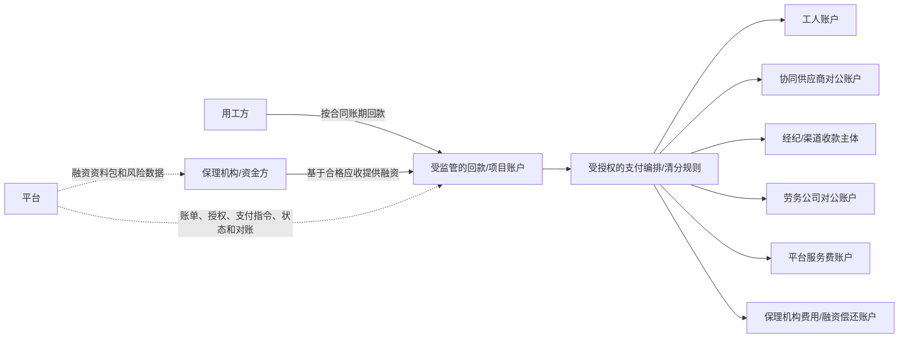

# 未来平台支付与保理资金架构建议 v0.1

- 分析日期：2026-10-23
- 文档状态：中长期资金产品决策建议，待负责人、财务、技术、合作银行/支付机构及法律专业人员评审。
- 目标：在保理或其他合规融资介入后，逐步实现由平台统一编排、向工人、经纪人、协同供应商、劳务公司及其他收款方自动支付，同时不把平台普通运营主体误变成资金池、放款方、保理商或工资债务人。
- 关联分析：[资金流转闭环与账期模型分析](../03-账单与资金/资金流转闭环与账期模型分析-v0.1.md)、[产品战略路线与可选增值渠道](./产品战略路线与可选增值渠道-v0.1.md)、[资金账户与支付指令流程](../03-账单与资金/资金账户与支付指令流程-v0.1.md)。

## 1. 最终判断

你希望达成的目标可以拆成两种不同含义：

1. **产品体验目标：** 各方在平台看到统一账单、统一支付状态，并由一个平台入口发起或触发工资、协同结算、供应商结算和平台服务费的支付。这个目标建议实现。
2. **法律/资金主体目标：** 钱先进入平台普通运营公司的账户，再由平台把钱分给所有人。这个目标不建议作为默认架构，也不能仅靠软件功能实现。

推荐的最终形态是：

> **平台统一编排业务和支付指令；银行/持牌支付机构提供收款账户、备付/结算和代付能力；保理机构提供对合格应收账款的融资；实际责任主体按合同授权完成工资、供应商和其他款项支付。**

因此，用户感受到的是“平台支付给各方”，但资金法律上应从**受监管的项目/客户资金账户或支付机构账户**流向各收款方，而不是从平台普通运营账户流出。

## 2. 推荐的最终资金链条

### 2.1 业务形成

1. 用工方发布需求，平台记录合同主体、付款方、账期和履约条件。
2. 劳务公司中标，必要时通过协同供给网络补足人员；主供应商、协同供应商、工人/个人和经纪人的责任关系分别记录。
3. 平台通过排班、打卡、外部考勤核对和用工方确认形成不可抵赖的履约快照。
4. 平台按不同责任链生成分类账单：用工方项目结算应收、工人工资/个人应付款、协同供应商结算、经纪费用、保险/社保（如适用）和平台服务费。

### 2.2 保理融资

5. 平台只把满足条件的项目应收账款提交给合作保理机构/资金方：真实合同、真实履约、用工方确认、无重复转让/融资、可核验付款方和合法授权。
6. 保理机构独立完成准入、尽调、债权确认/受让、融资定价、额度、放款和风险决策；平台只提供授权数据和状态协同。
7. 融资款进入劳务公司指定的受监管账户或合作机构账户，不进入平台普通运营账户。
8. 应收账款回款按合同和通知安排进入保理机构/指定回款账户；回款用于偿还融资和费用后，剩余可用资金按约释放。

### 2.3 统一支付

9. 平台根据已确认账单、责任主体、支付优先级、资金可用状态和授权规则生成支付批次。
10. 劳务公司授权资金审批人确认工资、协同供应商、经纪人或其他业务付款；用工方确认只负责其合同范围内的业务量/账单，不替劳务公司批准工资。
11. 持牌银行/支付机构按授权从指定项目/客户资金账户执行批量代付：
   - 工人工资及其他个人应付款 → 工人收款账户；
   - 协同供应商结算 → 协同劳务公司对公账户；
   - 经纪费用/返费 → 经授权的收款主体；
   - 劳务公司应得结算余额 → 劳务公司对公账户；
   - 平台服务费 → 平台收款账户；
   - 保理本金、利息、服务费及其他约定费用 → 保理机构/资金方指定账户。
12. 银行/支付机构返回受理、处理中、成功、失败、退回、部分成功或结果未知等机构状态；平台据此做账单核销和异常恢复，不以自己数据库的“已支付”替代机构回执。

### 2.4 现金流方向示意

平台的虚线不是资金流，而是业务和支付控制流。平台不应把客户资金先收进自己的普通运营账户再自行分配。

## 3. 三种架构比较

| 架构 | 钱经过哪里 | 平台体验 | 主要优点 | 主要问题 | 决策 |
| --- | --- | --- | --- | --- | --- |
| A. 平台普通公司自收自付 | 平台运营账户 | 最像“平台支付” | 产品直观、开发简单 | 资金主体、支付、托管、放款和工资责任混在一起，合规与挪用风险高 | 不采用 |
| B. 平台 + 银行/持牌支付机构 | 银行/支付机构的客户/项目账户 | 平台统一下单和查状态 | 可保留平台体验，资金由受监管机构处理，适合工资和批量代付 | 需要机构接入、账户/授权/合同、实名和反洗钱能力 | **首选目标架构** |
| C. 平台自建金融/支付主体 | 关联合规主体账户 | 平台控制力最强 | 可深度定制资金、融资、清分和风控 | 需要独立主体、许可/备案、资本、风控、审计、合规和长期运营能力 | 三阶段后评估 |

## 4. 保理与平台支付的正确关系

保理解决的是“谁先为合格应收账款提供资金、谁承担信用和回款风险”；支付机构解决的是“资金如何在授权账户之间收付”；平台解决的是“交易是否真实、账单是否正确、谁有权批准、哪些金额可以支付以及支付结果如何对账”。三者不能互相替代。

不能把保理融资款简单理解为“平台拿到一笔钱，然后平台自由给所有人付款”。融资款的用途、债权范围、回款路径、资金控制、优先偿还、可支付对象和异常处置必须由融资合同、账户安排和支付授权共同确定。

推荐先支持两类支付批次：

1. **工资/人员应付款批次**：以已确认工时、工资规则、责任主体和工资周期为依据；由责任主体最终授权，机构执行。
2. **供应链结算批次**：以已确认项目结算、协同供给合同和应付账单为依据；可以在融资可用资金和回款瀑布规则下执行。

平台服务费、保理费用和其他费用应独立列示，不以净额隐藏工资或供应商应付款。

## 5. 资金释放和支付优先级

不建议现在直接确定一个跨项目的固定“工资优先/平台优先/保理优先”顺序。推荐采用**项目级资金瀑布模板**，由合同、融资协议和适用规则共同生成：

1. 账户与资金来源确认；
2. 已批准、已到期且无争议的工资/个人应付款（如该责任主体和协议要求优先）；
3. 已确认的协同供应商和必要履约成本；
4. 用工方项目结算或劳务公司结算的其他约定款项；
5. 保理本金、利息、费用或准备金安排；
6. 平台服务费及其他合法、已获批准费用；
7. 余额释放给合同约定的责任主体。

上面是产品设计的候选模板，不是默认法律顺序。最终顺序必须由实际合同、融资协议、账户产品和专业意见确认，系统保存版本，不能由管理员随意修改。

## 6. 为什么“平台支付给各方”必须拆成两个主体

为了满足平台体验，同时不混同责任，建议将系统中的两个概念分开：

- **平台支付编排层**：在产品上统一生成支付批次、校验账单、收集审批、提交指令、展示状态和处理对账；属于平台产品能力。
- **资金执行主体**：持有账户、接受资金、执行代付、处理退款/退回、返回机构流水；应由银行、持牌支付机构或未来独立合规主体承担。

这样可以让用户看到“在平台发起支付并由平台完成支付流程”，但不会误导为“平台普通公司承诺用自有资金支付”。

## 7. 分阶段落地建议

### 阶段 0：当前线下混合模式

- 平台做应收应付、账期、账单、线下回款登记、凭证核对和逾期管理；
- 工资、协同结算和平台费按责任主体线下支付；
- 平台不代收、不代付、不垫资。

### 阶段 1：支付编排，不改变资金主体

- 接入银行/支付机构的客户账户、虚拟子账户或项目账户能力；
- 平台提供收款信息、付款批次、审批、代付指令、回执和对账；
- 先从劳务公司自有资金代付和工资批次开始，不把保理作为支付上线前提；
- 线下回款继续保留，线上和线下共存。

### 阶段 2：保理协同与受控资金释放

- 对合格应收账款提供数据包和融资申请；
- 融资款进入合作机构受控账户；
- 依据合同和融资协议执行项目级资金瀑布和支付白名单；
- 记录债权转让/通知、融资状态、回款、优先偿还和可释放余额。

### 阶段 3：独立合规金融/支付主体评估

- 若业务规模足够，再评估关联合规主体承担更深的账户、保理或金融协同职责；
- 必须独立评估许可、资本、风控、审计、数据、反洗钱、消费者/劳动者保护和关联交易要求；
- 在此之前，不在产品文案中承诺“平台自营支付”“平台保证工资”或“平台保理放款”。

## 8. 必须新增的产品对象

未来架构至少需要以下对象，不应只在现有“支付指令”上叠加字段：

- `资金来源`：劳务公司自有资金、用工方项目回款、保理融资、其他获批来源；
- `受监管账户/项目账户`：账户主体、机构、用途、项目/组织范围、授权和状态；
- `应收账款融资记录`：原始账单、可融资金额、融资金额、受让/通知状态、融资机构、费用和回款；
- `资金瀑布版本`：顺序、优先级、适用项目、合同/融资依据和审批记录；
- `支付批次`：支付对象、账单、资金来源、总额、授权、执行机构和批次状态；
- `清分/释放记录`：每一笔拆分金额、收款方、依据、机构流水和对账状态；
- `回款分配记录`：回款流水、对应应收、融资偿还、费用、可释放余额和争议；
- `资金限制`：冻结、白名单、余额不足、用途限制、重复融资/重复转让和异常处置。

## 9. 最终产品决策建议

| 决策项 | 建议 |
| --- | --- |
| 是否追求“平台支付给各方”的用户体验 | 是 |
| 是否让平台普通运营公司直接持有和划转客户资金 | 否 |
| 未来资金执行主体 | 优先银行或持牌支付机构；关联合规主体后置评估 |
| 保理在体系中的作用 | 为合格应收提供融资并参与回款/风险安排，不替代支付执行 |
| 平台的核心角色 | 交易真实性、履约数据、账单、授权、支付编排、回款对账和风险控制 |
| 工资是否由平台承担 | 否；平台可编排和触发代付，但责任主体仍按实际关系和合同确定 |
| 是否允许线下回款继续存在 | 是；线上支付是新增通道，不是强制替代 |
| 是否现在开发自营资金池/保理放款 | 否；先做机构接入和数据/账务基础设施 |

## 10. 必须先决的评审事项

- 具体人员关系是劳务派遣、劳务外包还是其他用工安排；
- 工资、社保、保险、协同供应商和经纪费用的实际责任主体；
- 用工方付款方、签约方、收款方和应收账款债权人是否一致；
- 保理是有追索还是无追索，债权是否真实转让，是否需要通知/确认用工方；
- 融资款是否允许用于工资、协同结算、平台服务费及其他费用；
- 受监管账户的开户/控制主体、资金权属、支付授权、回款路径和冻结/释放规则；
- 平台服务费、保理费用、支付费用和税费的收取对象与优先级；
- 机构是否支持批量代付、虚拟子账户、回款识别、余额查询、幂等、部分成功和结果未知处理；
- 劳动者/经纪人/协同供应商的收款信息授权、隐私、实名和错误付款纠正流程。

本文是产品和项目架构建议，不是法律、会计、支付或保理业务许可意见。任何真实资金上线前，应让合作银行/支付机构、保理机构、律师、会计/税务顾问共同审查实际合同和业务流程。

## 11. 外部依据提示

《中华人民共和国劳动合同法》要求用人单位依法、及时足额支付劳动报酬，并对劳务派遣的主体、协议和用工责任作出专门规定；因此，平台可以编排工资支付，但不能仅凭“平台代付”界面把工资责任转移给平台，也不能用保理融资替代实际用工关系和工资义务。具体适用取决于人员关系、合同和业务实质，应在上线前由专业人员确认。

- [《中华人民共和国劳动合同法》—国家市场监督管理总局公布文本](https://www.samr.gov.cn/zw/zfxxgk/fdzdgknr/bgt/art/2023/art_0abfdd261c03417b949df19d869add8d.html)
