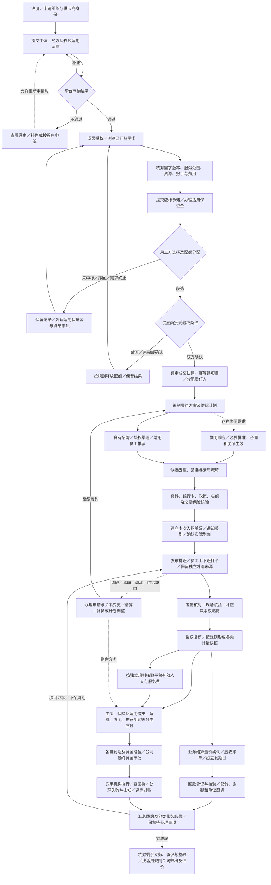
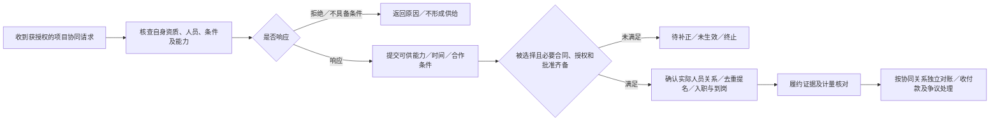

# 劳务供应商角色功能与全流程 v0.1

**文档状态：** 基于现有文档整理的组织侧角色蓝图，待评审；不新增业务规则，不代表规则批准、功能完成或真实启用
**适用端：** 劳务公司 Web；项目经理、驻场及授权现场人员的独立 App
**适用范围：** 组织准入、需求应标、成交建项、供给履约、人员管理、分类账单、收付款及对账、争议与履约评价；同时覆盖主供应商和协同供应商两种参与方式
**角色粒度：** 本文的“劳务供应商”是组织侧业务参与方，不是一个拥有全部权限的操作账号；实际操作须落到组织、项目及事项授权岗位
**更新日期：** 2026-10-24

**关联来源与引用编号：**

| 编号 | 现有文档 | 本文使用范围 |
| --- | --- | --- |
| S01 | [平台 PRD](../00-产品全景/PRD-v0.1.md) | FR-01～14、FR-05A、FR-15～19、FR-24～25及全链路边界 |
| S02 | [全局术语表](../../../TERMINOLOGY.md) | 组织、角色、供给、计量、账单与资金的共同语言 |
| S03 | [多端功能清单与职责边界](../00-产品全景/多端功能清单与职责边界-v0.1.md) | Web、App及各岗位权限和交接 |
| S04 | [入驻与资质审核需求细化](../01-身份与需求交易/入驻与资质审核需求细化-v0.1.md) | 主体、资质、授权、补正、复审及能力限制 |
| S05 | [招标需求与应标承诺表单设计](../01-身份与需求交易/招标需求与应标承诺表单设计-v0.1.md) | 需求版本、报价、承诺、保证金和双方中标确认 |
| S06 | [战略与履约流程补充需求整合](../02-供给与履约/战略与履约流程补充需求整合-v0.1.md) | 履约方案、供给来源及计划与实际的差异 |
| S07 | [劳务公司协同供给产品流程与规则建议](../02-供给与履约/劳务公司协同供给产品流程与规则建议-v0.1.md) | 主责方与协同方、能力响应、关系生效及交付；具体方案保留建议状态 |
| S08 | [排班—打卡—考勤核对—资金审批流程](../02-供给与履约/排班-打卡-考勤核对-资金审批流程-v0.1.md) | 排班、原始考勤、差异核验、分层确认及资金交接 |
| S09 | [资金流转闭环与账期模型分析](../03-账单与资金/资金流转闭环与账期模型分析-v0.1.md) | 分类债权债务、独立账期、线下回款及资金准备 |
| S10 | [资金账户与支付指令流程](../03-账单与资金/资金账户与支付指令流程-v0.1.md) | 支付草稿、最终授权、机构执行、回执及对账恢复 |
| S11 | [商业模式与收费标准](../03-账单与资金/商业模式与收费标准-v0.1.md) | 收费对象、费用类别及批准边界；费率和分账算法的唯一详细维护入口 |
| S12 | [平台方审核与中立监督需求](../04-治理信用与增长/平台方审核与中立监督需求-v0.1.md) | 审核、举证、复核、执行与平台自身约束；保留原文待评审状态 |
| S13 | [交易信用档案与保理数据准备](../04-治理信用与增长/交易信用档案与保理数据准备-v0.1.md) | 组织履约摘要、来源、纠错及授权；不表示金融启用 |
| S14 | [员工推荐与按工时持续奖励需求](../04-治理信用与增长/员工推荐与按工时持续奖励需求-v0.1.md) | 员工直接推荐、归属、阶段／持续奖励及责任付款方 |
| S15 | [需求追踪与交接门禁](../05-战略与实施/需求追踪与交接门禁-v0.1.md) | 现有待决事项和实施、收费、资金、治理、推荐门禁 |
| S16 | [员工端角色功能与全流程](员工端角色功能与全流程-v0.1.md) | 员工侧申请及接收反馈；其中尚未明确的办理规则仍为设计建议 |

本文只把上述来源重组为供应商视角。来源中的“建议、待决、部分批准、暂缓收取”等状态保持不变；不从图示、举例或岗位名称推导新增权限和强制门禁。冲突按[产品设计文档地图](../README.md#四文档职责与冲突处理)处理。

## 1. 角色边界

### 1.1 代表谁，负责什么

| 项目 | 内容 |
| --- | --- |
| 代表谁／服务谁 | 经准入的劳务供应商组织；向用工方交付约定服务，与员工、授权经纪渠道及协同公司建立各自真实的业务关系。 |
| 负责什么 | 对本组织的应标承诺、履约组织、人员关系与现场协作、数据核验、分类账务、资金准备及本组织实际承担的合同和付款义务负责。 |
| 可以访问什么 | 本组织及本人获授权项目、人员、渠道、账单、审批和案件数据；交易对手仅看授权摘要与合作所需材料，不因同属一个项目而取得对方全部数据。 |
| 不能做什么 | 不能替用工方选标或代其确认结算事实，不能改写员工原始打卡、冒用员工确认、越权读取其他供应商报价，不能把平台记录当作付款或免责依据。 |
| 与平台的区别 | 平台提供交易、证据、账务编排和程序监督，不自动成为供人方、用人单位、工资垫付方或供应商资金审批人。 |
| 与协同方的区别 | 主供应商承接的中标责任与协同公司的实际责任分别按合同和必要批准确定，发出协同请求不会自动转移主责；同一公司可在另一合作中作为协同方。 |
| 与经纪人的区别 | 经纪人是获授权的招聘供给渠道，不是直接对接用工方的应标主体；员工直接推荐也不自动取得经纪人权限。 |

准入与经营边界引用 S04：当前组织业务身份选择用工方或劳务供应商，不能自行切换或通过重复建组织绕过限制；供应商直接服务范围按合规外包及适用资质核验，不能把劳务派遣或独立招聘中介服务视为当然获准。实际用工、合同、工资与保险责任须分别记录，不能仅凭公司名称、日结／月结或产品中的“入职”状态推定。

### 1.2 组织内岗位及权限分离

| 授权岗位／职责集合 | 主要负责 | 不因岗位名称自动取得 |
| --- | --- | --- |
| 组织管理员 | 组织资料、成员加入、岗位及项目授权、审批配置和责任人安排 | 全部项目数据、最终资金审批、独立复核或接管其他组织的权力 |
| 应标经办／授权应标人 | 查需求、报价与承诺、偏离说明、应标提交和中标接受 | 用工方选标权、擅自修改已锁定条件或他人应标的权限 |
| 招聘／供给经办人 | 岗位及政策版本、渠道合作、候选人筛选、来源归属和补员任务 | 任意覆盖归属、代员工报名确认、查看无关组织人员的权限 |
| 项目经理 | 履约方案、供给进度、现场协作、项目异常及业务对账 | 代员工打卡、代用工方确认或最终批准付款的权限 |
| 驻场／现场授权人员 | 到岗、资料与保险核验、入离职办理、排班、漏卡核验和借支初审等现场事项 | 覆盖原始考勤、直接锁定全部工时或最终资金审批权 |
| 工时／履约授权复核人 | 核验来源和差异，确认本组织进入工资核算的工时，形成确认版本 | 把己方确认当作用工方结算确认，或代替资金审批 |
| 财务／费用核算人 | 工资、借支、返费、协同费用、服务费、应收回款、资金草稿及对账 | 仅因负责核算就自动拥有最终授权或把未知结果改成已付款的权限 |
| 最终资金审批人 | 在授权组织、项目、科目、金额及有效期内批准相应支出与支付指令 | 越授权范围批准、越过业务依据、机构可用资金核验和执行结果 |

依据 S01、S03、S08、S10、S12、S14。上表是已有职责的归类，不要求每类独立设人或新增固定岗位；兼任须保留事项授权、必要复核及利益冲突回避，不能独立终审本人有收益或被投诉的事项。

## 2. 业务目标

| 业务目标 | 完成判断 |
| --- | --- |
| 获得与维持交易资格 | 组织、材料和适用能力审核有结果，成员有授权，资质有效期与补正／复审可追踪；提交申请不等于准入。 |
| 取得可执行的成交关系 | 对有效需求版本应标，用工方选定且供应商接受最终配额和条件，形成双方确认快照及唯一项目。 |
| 将承诺转化为实际服务 | 有责任明确的供给计划，人员合法关系与前置条件可核验，实际到岗、在岗和履约量分别记录，缺口有人处理。 |
| 形成可核验的分类计量 | 原始证据与争议保留，确认工时、计薪量、业务结算量及平台有效人天各有来源和适用规则。 |
| 履行本组织付款责任 | 工资、保险及适用的借支、渠道返费、协同费用、员工推荐奖励和平台费用分别核算、审批、履行并对账，不因客户未回款自动延期。 |
| 取得并核对业务回款 | 应收有合同、量价、账期和对账依据，实际收款有核验记录，短款、部分付款、逾期和争议分别可查。 |
| 形成可追溯的合作结果 | 项目履约、剩余义务、整改、申诉和信用纠错可追踪；人员离职、账单确认或一次付款不直接等于项目整体关闭。 |

上述判断用于角色业务结果梳理，不另设绩效阈值或项目关闭审批规则。依据 S01、S06、S08～S15。

## 3. 功能清单

下表的“可审批”均指对应授权岗位，并非所有供应商成员可审批；“确认”也不表示已付款。需要专业审查、合同或配置的规则仍回到源文档确认。

| 阶段 | 查看 | 提交／办理 | 确认 | 审批及权限限制 | 规则来源／待决项 |
| --- | --- | --- | --- | --- | --- |
| 注册与组织准入 | 主体匹配、材料要求、审核及能力状态 | 注册、组织申请、授权材料、资质、补正及复审 | 经办身份、材料和授权关系 | 平台审核；供应商不能自审通过、重复建组织或接管现有组织 | S01、S04；入驻审核免费 |
| 组织与成员管理 | 本组织成员、项目权限及责任岗位 | 邀请／维护成员、分配岗位和项目、变更授权 | 人员与责任范围 | 管理员按授权办理；资金授权单独核验 | S01、S03、S04 |
| 需求发现与评估 | 获准开放的需求、版本、条件、必要交易对手摘要 | 查询需求、评估自身资源及报价经济账 | 适用需求与费用披露 | 未审需求不进入正式应标；不读取他方私密报价 | S01、S05、S11、S13 |
| 条件性线索解锁 | 获授权线索、有效性及解锁条件 | 按商业专项办理适用解锁事项 | 线索及费用依据 | 价格批准不等于可实收；收取与结算机制仍暂缓，不承诺中标 | S11；不作为所有应标的必经付款门槛 |
| 应标及保证金 | 自己的应标、配额、时点、报价口径和保证金条件 | 填报价、资源／节点承诺及偏离；按规则修订、撤回；提交适用保证金凭证 | 需求版本、承诺内容、保证金核验结果 | 授权人提交；保证金付款按资金授权；上传不等于到账，平台不默认代管 | S01、S05；时限、字段和保证金条件按源规则 |
| 中标接受与建项 | 用工方选择、最终标项、配额及条款差异 | 接受或放弃，建立项目和责任分工 | 双方确认的最终成交条件 | 不替用工方选标；确认幂等；有差异须明确接受，不默认最低价中标 | S01 FR-04～05、S05 |
| 履约方案与供给计划 | 承诺量、各阶段实际量、节点缺口及项目容量 | 编制计划，安排自有／渠道／协同任务，发起补员与调整 | 来源责任、计划版本与供给能力 | 超配或合同／节点调整按责任方和用工方必要批准，不擅自扩大容量 | S01 FR-05A、S06 |
| 发起协同／作为协同方响应 | 获授权的缺口、协同条件及自身合作范围 | 发起请求、响应能力、选择合作方、提名人员及交付 | 主责、实际人员关系、合同、价格及必要批准 | 响应人数不是正式供给；无自动责任转移或额外撮合收费 | S01 FR-05A、S07；具体方案仍待评审 |
| 岗位、渠道与招聘 | 岗位版本、候选进度、授权渠道及归属结果 | 发布明确工价的岗位、渠道授权、筛选和录用流转、撞单举证 | 适用工资／返费政策、人员来源及接受条件 | 归属按可审计规则处理；不泄露跨组织候选名单或他方政策 | S01 FR-06～07、S14 |
| 入职与到岗 | 本人资料完整性、银行卡归属、资格、保险、名额及到岗状态 | 通知报到、核验材料和必需保险、办理入职、记录实际到岗及缺勤 | 本次人员关系、岗位政策、发薪安排及到岗事实 | 缺必要前置条件不入职；具体材料依 D-12；不能将报名或入职等同到岗 | S01 FR-07、S06 |
| 在岗、请假与退出 | 班次、员工申请、在岗及离职记录 | 受理请假／换班等申请、协调排班、办理退出与补员 | 申请处理结果、退出生效日期及清算范围 | 请假审批链等按项目授权待细化，不推定所有申请都由驻场终批 | S01 FR-07～08、S16；保留角色稿建议状态 |
| 排班与原始考勤 | 班次版本、员工原始事件、外部来源和异常队列 | 编制／发布／变更排班，导入外部考勤，登记独立现场证据 | 来源映射、导入核对、漏卡事实与补正意见 | 不代员工打卡、不覆盖原始事件；定位／照片／人脸不默认启用 | S01 FR-08、S08 |
| 工时与履约量确认 | 计算量、复核意见、争议与各类确认快照 | 发起核对、补正、提交业务结算量及处理异议 | 公司授权人确认计薪工时，用工方按约确认业务结算量 | 不能超时默认同意；争议量隔离；现场核验不替代复核和付款审批 | S01 FR-08、S08 |
| 工资、借支与保险义务 | 工资明细、到期日、借支可用额度、保险费用与凭证 | 核算工资、受理借支、业务初审及生成分类待付依据 | 计薪量、单价、调整、实际借支及余额 | 最终支出由资金授权人批准；日结借支不开启沿用历史配置，具体政策评审启用 | S01 FR-07、FR-09、FR-11；不得自动扣未批准保险费用 |
| 渠道返费与协同费用 | 政策、达标、账期、应付／实付及争议 | 计提独立权益、出具明细、处理异议与差额 | 返费达标依据、协同交付量与对应价格 | 已达标权益不因离职清零；来源冲突和历史默认参数不能自行定案 | S01 FR-10、S07、S09 |
| 员工直接推荐及奖励 | 本组织适用政策、去重结果、达标和合格确认工时 | 授权人员配置／提审政策、归属核查、阶段／持续／混合奖励核算 | 受益人、政策快照、责任付款方与独立权益组件 | 本组织仅承担经批准属于自己的义务；本人有利益须回避，不扣朋友工资、不设多级返利 | S01 FR-24～25、S14；资格、参数及启用待评审 |
| 业务应收与平台费用 | 合同、分类账单、到期、回款、费用依据及争议 | 业务对账、登记并核验线下回款、催办、提交费用异议 | 双方业务量价及核实收款；平台人天费另核 | 不能用工资量替代业务量或平台计费人天；收费按合同及实收门禁 | S01 FR-11～13、S09、S11 |
| 资金准备、付款与对账 | 草稿、授权、机构资金状态、指令、明细回执和差异 | 准备资金、提交审批、核查未知结果、处理未成功明细及退款／冲正 | 最终资金授权、机构回执及账单流水匹配 | 机构能力及合同获准才启用通道；平台不垫款；未知先查，不重复付款 | S01 FR-12、S09、S10 |
| 监督、申诉、档案与收尾 | 本组织任务、案件、履约档案及必要摘要 | 补正、举证、整改、申请独立复核、信用纠错、授权范围内导出 | 整改及执行结果、履约评价依据和剩余事项 | 平台决定不替代业务／资金授权；未核实投诉不是失信；融资资料不默认外发 | S01 FR-13～19、S12～S15 |

### 新增：本企业员工行为处理与内部禁入（FR-26～27）

依据[分级禁入专项](../04-治理信用与增长/员工行为事件与分级业务禁入需求-v0.1.md)，授权经办人可登记真实关联员工的行为、证据及建议范围；本供应商有权审批岗位核验并决定自身未来业务禁入，招聘／派驻服务执行，员工获知依据及申诉入口。经办、审批、范围期限、通知和执行分别留痕；不因主供应商身份取得协同企业名单或处置权。

主流程为登记→核验与员工答复→企业授权审批→本组织门禁回执→复查／申诉／解除。材料不足补证、错人或恶意上报转核查、更正与恢复；涉嫌违法不等于已成立。跨组织计数由平台核验，供应商不能靠多项目重复拉黑凑三次，不能直接批准全平台措施。禁入不自动辞退、不扣工资或取消既有奖励；具体范围、计数及期限由 G-11 确认。

## 4. 主流程与异常流程

### 4.1 直接应标成为主供应商

- 这是一张业务衔接图，不代表所有项目都必经保证金、协同、借支或推荐奖励，也不新增统一审批顺序。
- **应收回款与本组织应付款是并行责任链**。图中没有“客户先回款才能发工资”的门槛；到期条件及责任分别按适用合同和规则核验。
- 工资、渠道返费、协同款、推荐奖励、保险和平台服务费保持独立科目、计量与状态；图中合并展示不等于统一净额或固定分配顺序。
- 履约来源、关系生效及到岗不等于确认可计费。人员退出后仍进入剩余工资、实际借支、已达标权益与争议清算，必要历史查询和申诉持续保留。
- 保证金缴付阶段和处置按具体需求／合同；收费和机构执行只在各自门禁通过后启用。项目关闭条件尚未统一定案，不因图示自动关账或消灭义务。

### 4.2 作为协同供应商的参与支线

依据 S01 FR-05A、S07。用工方直接多家中标时，各供应商独立持有中标配额和项目，不走此支线替代直接成交。协同方不当然取得主供应商全部报价、其他渠道人员或用工方结算资料；对接及结算对象按真实合作关系记录。首批邀请方式等具体方案仍是源文档建议，不在此批准。

### 4.3 异常流程

| 异常场景 | 当前角色可以做什么 | 谁处理 | 结果与恢复路径 |
| --- | --- | --- | --- |
| 主体重复、经办无授权、材料不全或资质过期 | 核实已有组织、补授权／材料、续证或申诉 | 组织授权人、平台审核岗位 | 未满足条件不开放相关新业务；历史证据及必要清算、查账、申诉保留；重大风险按受控措施处理（S04）。 |
| 需求撤回、关键条件变更或应标提交失败 | 查看新版本、重新评估、按规则修订／撤回，查询原请求 | 应标人、用工方及必要平台审核岗位 | 保留旧版本及通知；不悄改承诺，不因重试重复占额（S01、S05）。 |
| 未中标、拒绝最终条款或中标确认失效 | 查看结果、确认放弃及保证金相关事项 | 用工方与供应商授权经办人 | 不建立有效履约项目，配额按规则释放；保留记录，不把落标认定为负面信用（S01、S05、S13）。 |
| 保证金到账不明、退还／扣除有争议 | 提交流水及合同依据、申请核对或举证 | 实际收款方、双方授权财务及适用复核岗位 | 凭证不等于到账，扣退有依据和独立记录，不默认由平台划扣（S05、S10）。 |
| 中标后建项目失败或重复请求 | 查询原确认和创建结果、受控恢复 | 授权经办人与系统恢复流程 | 同一确认关系只生成一个项目，不重复占配额（S01 FR-05）。 |
| 供给不足、未到岗、延误或超配 | 登记差额、补员、协同请求、申请节点／配额调整 | 项目经理、来源责任人、用工方必要授权人 | 各阶段实际量分列；批准前不超配，不以补员抹除原缺口（S01 FR-05A、S06）。 |
| 协同方仅报人数、资质或合同条件不齐 | 补材料、重新选择或终止，不能提前记交付 | 主供应商、协同方及必要用工方授权人 | 未生效不进入正式供给和收费；保留能力响应与终止原因（S07）。 |
| 撞单、重复名单或推荐归属争议 | 提交本人授权来源及政策证据、暂停争议归属计奖 | 招聘归属处理人、必要独立复核人 | 去重且不泄露他方名单；归属确定后绑定快照，不双重计量（S01 FR-06、S14）。 |
| 资料、银行卡归属、资格或必需保险不合格 | 通知本人补正、核实有效凭证，暂不办理不符合条件的入职 | 员工、招聘／驻场及授权核验人 | 补齐后重新核验；不伪造证件、不以“待补”绕过必需保险（S01 FR-07）。 |
| 漏卡、乱序、无有效排班或外部考勤不一致 | 登记异常、收集现场证据、发起补正和复核 | 员工、驻场、公司复核人及必要用工方联系人 | 原始来源不覆盖；未刷下班卡不自动补满工时，差异有处理版本（S08）。 |
| 工时、工资或业务结算量有异议 | 拆出争议，提交来源和计算依据 | 公司复核／财务、员工或用工方相应授权人 | 按合同规则处理无争议部分；无超时默认同意，不强迫员工确认后才发薪（S01、S08、S16）。 |
| 请假、离职、调动或再次入职 | 办理有效日期及关系变化、排班调整、补员与清算 | 员工、现场／项目及授权办理岗位 | 旧关系及已形成权益保留；再次入职建新关系，跨项目不自动转人或延续奖励（S01、S14、S16）。 |
| 借支超额、并发占用、撤销或失败 | 重新核验已赚取额度及占用，按状态释放占用 | 初审人、财务、最终资金审批人 | 未实际付出的借支不记本金、不扣工资；不足扣回的本金保留，不生成负实发（S01 FR-09）。 |
| 客户未回款、短款、逾期或回款来源不明 | 分类登记、核验银行引用及匹配关系、催办并准备自身到期资金 | 业务对账人、双方财务、公司资金责任人 | 不把上传截图当实收；不自动顺延工资，不触发平台垫款／保理（S09）。 |
| 余额不足、支付失败、未知、部分成功或退回 | 补足并等待核验；查原指令；仅对确认未付明细后续处理 | 公司资金授权人、适用机构、对账岗位 | 必要时重新授权；成功不重付，未知不当失败，反向款另记关联记录（S10）。 |
| 返费／推荐奖励政策变化、工时更正或达标争议 | 查原快照、核算差额、提交异议与证据 | 政策责任人、归属／权益复核人、授权财务 | 不静默追溯取消既得权益，不全量重复计提，不隐扣员工工资；有利益者回避（S01 FR-10、S14）。 |
| 投诉、限制措施、错误评价或平台收费争议 | 举证、答复、整改、申请独立复核与信用纠错 | 相关业务责任方、平台受理及独立复核岗位 | 未核实不记失信；决定、业务执行、资金结果、结案分开，必要查账申诉不因限制而消失（S12、S13）。 |

## 5. 协作关系

| 事项／触发条件 | 提交方 | 接收／处理方 | 返回给当前角色的结果 |
| --- | --- | --- | --- |
| 组织准入、续证与补正 | 组织授权经办人 | 平台主体／资质审核岗位 | 材料核验、原因、补正项、复审及获准能力，不是履约担保 |
| 需求与应标 | 供应商授权应标人 | 用工方选标授权人；平台只按职责审核／监督 | 入围／未选、最终配额与条款；需要供应商再明确接受 |
| 项目建立与内部分工 | 中标接受人、管理员 | 招聘、项目、驻场、工时复核、财务及资金授权人 | 各自任务、数据范围、责任人和有效授权，不是全员全权限 |
| 自有及渠道招聘 | 招聘专员、授权经纪人／渠道 | 员工本人、招聘及归属处理人 | 自主报名、资料授权、筛选录用及归属结果；渠道只收必要进度 |
| 员工直接推荐 | 员工分享、朋友自主报名 | 招聘／归属岗位、政策责任人及必要复核人 | 归属及适用快照；推荐人仅看必要脱敏进度和本人权益 |
| 跨公司协同 | 主供应商发请求、协同公司响应 | 双方授权岗位、必要用工方审批人 | 响应、选择、必要批准、关系生效和后续交付，不能以响应替代到岗 |
| 入职、保险与报到 | 员工、招聘经办人 | 驻场／项目及授权核验岗位 | 前置条件结果、本次关系、报到位置及实际到岗状态 |
| 请假、调动与退出 | 员工或本组织授权经办人 | 现场／项目和按授权承担办理的岗位 | 受理及处理意见、生效日期、排班和清算结果；审批链未定部分回源评审 |
| 工时补正与工资基础 | 员工、驻场／项目经理 | 公司工时授权复核人 | 核验结果、确认快照、争议及更正记录，反馈员工和核算岗位 |
| 业务履约量及应收 | 供应商业务对账人 | 用工方业务／结算授权人、双方财务 | 独立业务量价确认、异议、应收到期及核实回款，不取得公司工资审批权 |
| 借支、工资、返费、协同及奖励支出 | 各业务经办／核算岗位 | 本组织相应最终资金审批人 | 批准／拒绝／退回、所依据版本与额度；结果反馈经办及必要受益人 |
| 支付执行与恢复 | 已获授权的适用指令 | 适用第三方机构；平台按已批准安排编排 | 可用资金状态、受理、明细回执、查询与对账结果，不是提交即成功 |
| 平台费用与保证金事项 | 供应商授权财务 | 平台费用岗位或保证金实际责任／收款方 | 各自费用依据、核验、异议和收退结果；不混淆收款方或账户权属 |
| 争议、整改及档案纠错 | 相关业务方及供应商授权成员 | 业务责任人、平台案件及独立复核岗位 | 有依据的意见、复核结果、执行回执及纠错传播，不是自动裁决或扣款 |

依据 S01、S03～S14。交接按组织、项目、人员关系、账期、单据和案件限定范围；敏感证件、账号、工资、利润及其他报价不随交接默认共享。通知送达、业务确认、审批、执行和到账分别留痕。

## 6. 状态与凭证

**新增 FR-26～27：** 企业事件、内部决定、跨组织计数资格与平台措施分开；企业仅复查／解除本组织决定，不能直接改平台结果。员工答复与企业核验交本企业有权岗位，平台候选及申诉交平台无冲突核验／复核岗位，结果返回员工和必要业务门禁。完成凭证为授权决定、事实与规则版本、通知、执行及解除回执；跨组织传播失败不算全部恢复。详细状态及 G-11 见[分级禁入专项](../04-治理信用与增长/员工行为事件与分级业务禁入需求-v0.1.md)。

以下是依据来源归纳的业务状态语义，不是新增数据库枚举；正式状态迁移和审批配置仍按对应专项及门禁确认。

| 业务对象 | 主要状态／分支 | 记录与凭证 | 完成条件／变更责任 |
| --- | --- | --- | --- |
| 组织准入与业务能力 | 草稿、已提交、核验、补正、通过／不通过、复审、相关能力受限 | 材料及版本、经办授权、核验来源、审核人／时间／原因、能力范围 | 平台授权审核岗位给出能力结果；不能用单一“账号已注册”代替准入（S04）。 |
| 成员与权限 | 待加入、有效授权、变更、失效 | 组织／项目、岗位、事项／金额边界、有效期和变更日志 | 组织授权人配置，操作时仍校验权限；不因曾任岗位永久有效（S01、S03）。 |
| 应标 | 草拟、已提交、修订／撤回、截止、获选／未选 | 需求版本、报价及单位、资源承诺、偏离、提交人和时间 | 提交只完成应标动作；用工方选择与供应商接受另记（S05）。 |
| 保证金 | 适用／不适用、待缴、凭证待核、已核实、待退／扣、争议、退扣结果 | 类型、责任方／收款账户、合同、期限、流水、扣退依据及申诉记录 | 实际责任方与授权财务核验，退扣另有依据，不用截图直接认定完成（S05）。 |
| 中标关系与项目 | 待接受、双方确认、放弃／失效；履约准备、履约中及收尾事项 | 双方确认、最终配额及条件、合同／价格／账期快照、唯一项目和责任人 | 双方有效确认后幂等建项；整体关闭另核对义务，统一条件仍待细化（S01）。 |
| 履约计划与缺口 | 草拟、待确认、供给中、部分兑现、已兑现、未完成／取消 | 来源、责任人、分批时间、目标、各阶段去重实数、差额及调整版本 | 计划兑现依据对应节点的实际结果；补员不覆盖历史缺口（S01 FR-05A、S06）。 |
| 协同关系 | 请求、能力响应、选择、待批准／签约、生效、交付及结束／终止 | 双方资格、范围、合同授权、必要批准、实际人员责任、计量和价格依据 | 必要条件满足后才生效；生效不等于人员已到岗，交付另核验（S07）。 |
| 岗位政策与招聘归属 | 政策草稿／发布／新版；报名、待核查、归属明确／争议 | 工价与返费版本、员工接受的条件、来源授权、去重证据及归属快照 | 授权岗位按规则处理；新政策不静默覆盖旧权益，撞单结果可追溯（S01、S14）。 |
| 人员本次入职及到岗 | 待筛选、录用流转、待入职、已入职／未入职、履约中、退出 | 本次关系、资料／银行卡核验、保险期间和凭证、岗位、来源、合同安排、到岗确认 | 录用、入职、到岗及某日在岗分开；驻场等授权人记录事实，再入职新建关系（S01 FR-07）。 |
| 请假、调动与离职申请 | 已提交、待办理、补正／拒绝、处理生效／撤销等适用分支 | 申请、理由、受理／办理人、生效时间、排班变化和清算关联 | 按项目批准规则办理；状态和审批链尚待细化，不以员工退出清零债务（S01、S16）。 |
| 排班、原始打卡及外部来源 | 排班发布／新版；原始事件已接收、导入成功／异常、待映射 | 班次版本、人员关系、事件唯一号、服务端时间、来源及导入行级结果 | 原始记录接收不等于工时确认；追加补正，不覆盖历史（S08）。 |
| 工时与分类计量 | 已计算、异常、待复核、争议、已确认、调整版本 | 双方独立来源、核验意见、确认主体与时间、计薪／业务量／人天各自规则快照 | 各授权方只确认其有权事项，锁定后更正留新版本，不能一项确认替代全部（S08）。 |
| 工资及保险分类义务 | 核算草稿、待复核、异议、锁定待付、部分／全部支付、差异／退回 | 确认量、政策、补贴／有据扣项、工资条、保险义务凭证、账期及付款记录 | 责任主体明确、金额和到期可核验；确认单／审批不替代实际履行及对账（S01、S09、S10）。 |
| 借支 | 申请、占用、初审／终批、拒绝／撤销、待付、已付、失败、扣回／余额 | 已赚取额度、各类扣减、占用、审批、实际付款及工资扣回记录 | 实付才形成借支本金；未偿余额持续记录，同一笔不得重复扣回（S01 FR-09）。 |
| 渠道返费与协同应付款 | 待达标／待确认、权益形成、到期、争议、待付、实付及调整 | 归属、政策／合同、有效量、独立权益、到期、账单及资金记录 | 本组织实际义务逐项核验；达标、计提、到期、审批、到账分开（S01 FR-10、S07）。 |
| 员工推荐关系及奖励 | 待归属、有效／争议、预计、阶段达标／周期计提、停止新增、待付、已付、调整 | 自主报名、直接归属、政策快照、受益人和付款方、权益组件、合格确认工时及周期 | 授权人复核，资金另审；离职或到期不清零既得权益，不与渠道费或工资混账（S14）。 |
| 业务应收与回款 | 待核对、确认、未到期、到期未付、部分付、逾期、争议、已核实匹配 | 合同、业务量价、账单、到期日、银行引用、回款来源及分配关系 | 双方业务授权人对账，财务核验实收；未到期、争议和未知不当作恶意欠款（S09、S13）。 |
| 平台服务费 | 待核量、已核量、账单／异议、待收付及核实结果 | 合同、独立有效人天、收费规则版本、账单与资金凭证 | 按 S11 唯一口径及收取结算批准办理，不以规则批准直接触发真实收款。 |
| 支付指令与对账 | 草稿、待审批、已授权、余额不足、待重新授权、处理中、未知、部分成功、成功待对账、完成／失败／退回 | 账单及草稿版本、最终授权、机构资金核验、幂等键、机构流水／回执、明细匹配及反向记录 | 最终资金授权人批准，机构执行，财务核对；未知先查，确认账单和流水匹配后完成对应明细（S10）。 |
| 投诉、整改与信用纠错 | 受理、举证、核验、意见、独立复核、执行待回执、结案／重开、纠错传播 | 双方材料、回避、决定理由、业务／资金执行授权、回执和历史版本 | 平台及原业务授权方按职责完成；结论、执行、到账、结案分别认定，不因单方投诉产生失信（S12、S13）。 |

### 待评审事项与使用边界

1. **组织与准入**：材料门槛、审核分工、能力范围及资质异常处置按 S04、S15 的 G-01确认；本文不将建议材料变成新增强制门槛。
2. **应标与成交**：D-15 承诺工价字段、报价与偏离规则、确认时限、保证金配置及配额变更依 S05、G-02；不新增默认确认小时数或默认最低价中标。
3. **供给与现场**：协同关系、必要批准、人员责任及结算链依 S07；D-12 入职资料、请假／换班办理链、具体工时规则与项目关闭条件等未定部分回源确认，不自动认定所有项目适用同一路径。
4. **计量与返费**：确认权限、争议效力、有效人天及 D-08 日结返费计量冲突依 S01、S08、G-03。历史返费档位、起算天数等不能在此升级为新批准默认值。
5. **收费与资金**：费率与分账细节只维护在 S11；线索费收取及结算机制仍暂缓。G-04～05 的合同、机构、账户权属、授权、回执和上线条件独立满足，不默认账户托管、自动分账、平台垫付或保理融资已开放。
6. **治理与信用**：D-16～19、G-07～08 的摘要范围、样本隐私、回避、措施及案件程序依 S12～S15，不把角色图当作裁决权、冻结权或向资金机构共享的授权。
7. **员工推荐**：FR-24～25 与 G-10 已承接需求，但资格、归属、单价／比例、基数、有效期、封顶、实际付款方、合同财税及启用仍须审批；不默认所有奖励都由供应商承担。人事经理贡献及跨企业引荐另循 FR-20～23、G-09，不并入员工或渠道返费。

角色初稿为现有需求的投影视图，不独立定义规则。2026-10-24 已同步承接正式新增的员工行为与分级禁入 FR-26～27／G-11，详见本文新增功能及状态说明；该补充不重写收费规则或改变原专项的批准状态。
