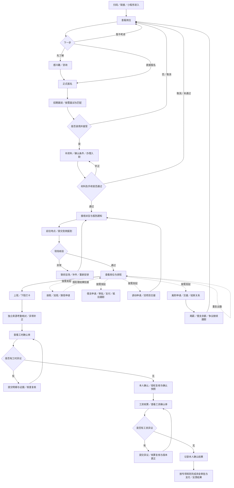
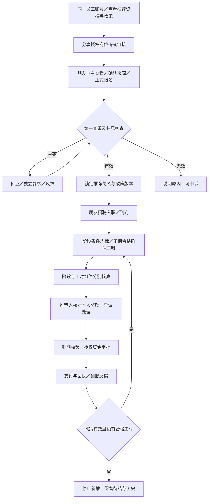

# 员工端角色功能与全流程 v0.1

**文档状态：** 按业务讨论整理的角色流程蓝图，具体规则待评审；不代表功能已开发或真实启用
**适用端：** 工人小程序／员工端
**适用范围：** 从进入平台、求职报名、入职派驻、到岗工作，到工时工资确认、离职及再次求职
**更新日期：** 2026-10-24
**本轮补充：** 员工推荐朋友、一次性／阶段奖励、持续按确认工时计奖及混合模式已正式纳入需求；PRD FR-24～25，具体规则与支付启用待评审
**结构约定：** 后续角色统一采用角色边界、业务目标、功能清单、主流程与异常流程、协作关系、状态与凭证六项模板

**关联来源：**
- [全局术语表](../../../TERMINOLOGY.md)
- [平台 PRD](../00-产品全景/PRD-v0.1.md)
- [多端功能清单与职责边界](../00-产品全景/多端功能清单与职责边界-v0.1.md)
- [战略与履约流程补充需求整合](../02-供给与履约/战略与履约流程补充需求整合-v0.1.md)
- [排班—打卡—考勤核对—资金审批流程](../02-供给与履约/排班-打卡-考勤核对-资金审批流程-v0.1.md)
- [资金账户与支付指令流程](../03-账单与资金/资金账户与支付指令流程-v0.1.md)
- [平台方审核与中立监督需求](../04-治理信用与增长/平台方审核与中立监督需求-v0.1.md)
- [员工推荐与按工时持续奖励需求](../04-治理信用与增长/员工推荐与按工时持续奖励需求-v0.1.md)：推荐业务详细规则入口，与本人工资、经纪返费及企业引荐奖励分开

本文是上述业务域的员工视角，不替代专项规则。此前未明确的申请、期限、材料和审批条件均为设计建议，不由本稿自动批准。

## 1. 角色边界

### 1.1 角色定义

员工端面向在平台求职、入职和参与项目工作的自然人。业务上沿用“工人／求职者”，界面可以称“员工”；该称谓本身不认定与任何组织的法律关系。

同一个人可先后处于求职、报名、待入职、在岗、已离职和再次求职等业务阶段；这些阶段可能按不同报名或派驻关系并存，不应设计成全平台唯一且互斥的身份。

| 关系 | 作用 | 边界 |
| --- | --- | --- |
| 平台账号与个人身份 | 登录、身份核验、联系方式、账号找回 | 换公司、换项目、离职不要求重新注册；重复账号归并另行设计 |
| 劳务公司入职／服务关系 | 记录接收方、办理事项、协议及相关责任 | 依据真实业务约定记录；不因渠道推荐或扫码自动建立 |
| 用工项目派驻关系 | 记录实际用工地点、岗位、班组、班次和派驻期间 | 与劳务公司关系分开；项目调动不必然等于离职 |

### 1.2 职责与限制

- 为本人提供必要资料，表达求职意向、报名并办理入职和报到。
- 查看本人相关岗位条件、协议、排班、原始打卡、工时、工资和支付结果。
- 为本人提交打卡、请假、补正、借支、调动、离职和异议等申请。
- 同一账号按政策资格直接推荐朋友，查看必要脱敏进度及本人的推荐奖励；无需先注册独立经纪人，但不自动取得专业经纪合作或审批权限。
- 确认本人的业务单据，或对具体明细提出异议；确认动作不等于批准组织付款。
- 不得查看其他工人的身份、银行卡、工时和工资，不得代他人打卡或确认。
- 推荐场景仅可查看获准的招聘状态和用于本人计奖的合格工时合计，不开放朋友完整考勤、工资或敏感资料；不因朋友再推荐他人获得间接层级奖励。
- 不得修改已保存的原始打卡、审批结果或已确认单据；更正通过留痕流程办理。
- 无劳务公司业务审批、资金最终审批、用工方履约确认或平台争议裁决权限。
- 离职后仍可按授权查询本人历史和未结事项，但不继续获得原项目内部信息。

## 2. 业务目标

| 目标 | 员工视角的完成判断 |
| --- | --- |
| 找到适合的工作 | 能理解岗位条件、表达意向、报名，并收到明确进度或结果 |
| 办成入职 | 知道缺什么材料、接受什么条件、由谁办理，并取得办理结果 |
| 顺利到岗 | 知道何时去哪里、联系谁，现场报到有核验结果和后续安排 |
| 正常工作 | 能查排班、记录上下班，遇到异常有补正与反馈渠道 |
| 核清工时 | 能查看计算明细，确认无异议部分或提交具体争议并跟踪处理 |
| 看懂工资、跟踪收款 | 能核对工资组成、借支抵扣、支付进度和到账结果 |
| 办理在岗事项 | 请假、借支等申请有受理人、处理状态和反馈 |
| 推荐朋友并核清收益 | 可分享授权岗位，朋友自主报名，归属、达标与持续工时计奖有依据，支付和异议可追踪 |
| 完成调动或离职 | 旧关系有结束依据，新安排或尾薪、争议仍可追踪 |

扫码是入口或操作方式，不是业务目标；员工端必须解释扫码对应的岗位、报到、活动或考勤事项。

## 3. 功能清单

下表为设计清单，不是已实现清单。员工只能确认本人事项，不能审批本人申请；其他角色的审批按组织授权及专项规则执行。

| 阶段 | 查看 | 提交／办理 | 本人确认及关键限制 |
| --- | --- | --- | --- |
| 进入平台与个人资料 | 入口对应事项、信息使用说明、资料完整度及核验结果 | 手机号验证、登录与找回；维护联系方式；按需补齐身份资料及核验；绑定或变更收款账户 | 完成必要告知与授权；不因进入平台自动同意岗位或建立入职关系 |
| 找工作与报名 | 岗位内容、地点、班次、计薪与发薪安排、食宿交通、条件版本、联系人和进度 | 扫码识岗、浏览搜索、收藏分享、感兴趣、咨询、正式报名、取消报名、补充材料、预约面试 | 感兴趣不等于正式报名；报名不等于录用；条件变更需提示 |
| 录用与入职 | 录用结果、材料清单、协议和岗位条件、体检培训等任务、办理进度 | 接受或拒绝录用、补件、按需签署、申请延期或取消 | 接受本人本次条件；提交资料、签署、入职审核完成分别留痕，不等于实际到岗 |
| 派驻与到岗报到 | 工厂、岗位、报到时间地点、联系人、材料、导航及现场安排 | 确认行程、延期反馈、扫码报到；按项目办理住宿、工牌、培训等任务 | 扫码报到是本人提交，到岗结果由现场授权人员核验 |
| 排班与出勤 | 本人排班与变更、地点、打卡结果、原始记录及异常 | 上下班打卡、缺卡补正、打卡失败反馈；按项目规则申请加班、换班或调班 | 打卡不直接等于计薪工时；计划、实际出勤和最终确认量分别展示 |
| 请假及在岗服务 | 请假进度、现场通知、驻场联系方式 | 请假、撤销申请、问题反馈、投诉与申诉 | 提交不等于获批；已生效申请的撤销或变更须按规则处理 |
| 工时确认 | 周期明细、正常与加班工时、休息扣除、异常、核查结果及历史版本 | 按日期或明细提交异议、补证、跟踪处理 | 确认指定周期和版本；有争议时不强制确认整单 |
| 工资与收款 | 工时与单价依据、补贴奖励扣款、借支抵扣、工资单、支付及到账状态 | 工资异议、支付异常反馈、历史工资单查看与下载 | 工资确认不等于已付款；收到支付成功结果不要求用“确认工资”动作代替 |
| 借支 | 适用规则、可申请额度及依据、审批、到账、历史和抵扣 | 借支申请、补件、按规则撤销 | 不预设额度、费率或自动放款；审批通过不等于已到账 |
| 项目调动 | 新旧地点、岗位、条件、时间、交接和处理进度 | 调动申请、反馈、办理旧项目交接与新项目报到 | 确认新条件；调动不自动结束劳务公司关系，旧项目工时工资仍可查询 |
| 离职与再次求职 | 离职进度、最后出勤、交接、尾薪、借支余额、争议及历史材料 | 离职申请、按规则变更或撤销、物品和住宿交接、再次报名 | 离职办理完成不等于尾薪已付或争议已结；不以放弃异议作为查询历史的条件 |
| 推荐朋友 | 可推荐岗位、政策版本、资格、付款方、阶段条件与持续计奖期限、本人推荐必要进度 | 分享专属岗位码／链接、归属异议及证据 | 朋友自主确认来源并报名；扫码不自动建立归属，不代朋友办理报名 |
| 推荐奖励 | 本人阶段与持续工时奖励明细、合格计奖工时合计、预计／已形成权益、结算和到账 | 奖励对账、金额异议、收款异常反馈 | 支持一次性、持续工时及混合；不审批本人奖励，不从朋友工资抽成或默认分享平台费 |

推荐能力与本人求职、工作并行，不强制先入职、先领工资或转换为经纪人。可参与阶段、归属和奖励条件以获批政策为准；推荐人本人离职不自动清零已形成权益。

### 3.1 资料按需完善

- 浏览岗位尽量不设置身份和银行卡资料门槛。
- 感兴趣或报名阶段收集必要联系方式、求职信息；具体必填项待评审。
- 办理入职阶段按真实业务需要收集身份信息与岗位材料，明确接收方和用途。
- 收款准备阶段完善并校验收款账户；身份证号、银行卡号展示脱敏，访问受控。
- 收款账户变更独立留痕，注明校验、生效范围及待支付指令处理结果，不静默覆盖历史付款依据。

### 3.2 页面组织建议

功能可组织为“找工作、我的工作、打卡与工时、工资与借支、办事与服务、我的”六个功能区，不强制对应六个底部导航。“推荐有奖／推荐中心”作为首页或“我的”中的独立入口，包含推荐记录和奖励账，不混入工资余额。

首页优先展示当前待办：补资料、报到、今日班次、打卡异常、工时／工资待确认及申请处理结果。通知需能回到具体业务单据，而非只显示一条无法追踪的消息。
推荐待办补充归属需补证、奖励待核对、支付异常及政策变更提示；对外展示明确条件和期限，不承诺永续收益。

### 新增：本人行为事件与禁入救济（FR-26～27）

依据[分级禁入专项](../04-治理信用与增长/员工行为事件与分级业务禁入需求-v0.1.md)，员工可查本人被涉及事件、企业／平台措施依据、范围期限、状态及必要证据，提交答复、反证、申诉及更正／恢复申请；不能代企业审批或直接删除原始事件。企业内部结果交本企业有权岗位复查，跨组织及平台结果交无冲突平台岗位复核；记录提交、复核、改判与恢复回执。

禁入只按获批未来业务范围生效，不自动离职，不取消既有工资、工时、尾薪或奖励；受限及离职仍可登录必要查证、申诉与收款。错人、报复上报、证据不足及同步未恢复可提出异议，平台不得要求本人逐家联系企业才能纠错。用户三次目标及建议执行机制均见专项，未审不自动全局封禁。

## 4. 主流程与异常流程

### 4.1 主流程

流程图展示业务衔接，不代表每个项目都必须面试、培训或采用同一审批顺序。工资确认与支付的先后门禁由专项规则评审，不得从图示推导为“未点击确认就不能发薪”。

在岗出勤、周期工时工资、借支、请假及离职可并行推进；不必等待一次工资支付结束才能继续上班、提出离职或投诉。争议可保留待处理分支，不能强行回到“无异议”；无争议部分如何继续确认和支付待专项规则确定。

### 4.2 扫码场景边界

| 扫码场景 | 形成的业务动作 | 不代表什么 |
| --- | --- | --- |
| 员工端入口码 | 进入或登录员工端 | 不自动报名、入职或同意协议 |
| 岗位码 | 识别并查看指定岗位 | 不自动表达意向或正式报名 |
| 员工推荐岗位码 | 识别岗位和推荐来源，由朋友自主确认后报名 | 不因打开、注册或扫码自动形成有效推荐、奖励或个人信息全面授权 |
| 到岗报到码 | 提交本次到岗记录，等待现场核验 | 不直接认定已上班或开始计薪 |
| 培训／集合签到码 | 按需记录活动参与情况 | 不替代日常考勤 |
| 上班／下班码 | 提交本人对应班次的原始打卡事件 | 不直接生成最终确认工时 |

扫码前后均应明确项目、地点、操作类型和结果；失效码、错误项目、重复提交和身份不匹配需有明确反馈，不能把扫到任意现场码视为办理成功。

### 4.3 异常与恢复

| 场景 | 员工动作 | 处理方 | 结果与恢复路径 |
| --- | --- | --- | --- |
| 岗位失效、满员或条件变更 | 查看提示、咨询、选择其他岗位 | 招聘专员／项目经理 | 保留原报名条件；重新选择或确认变更，不静默改约定 |
| 多岗位报名或时间冲突 | 查看各报名记录，选择接受的安排 | 招聘专员／项目经理 | 报名分别跟踪，确定入职派驻时校验冲突 |
| 身份／收款资料核验失败 | 按原因补正或申请协助 | 授权资料核验人员／财务等 | 返回可理解的原因和下一步；不得向无关人员暴露完整资料 |
| 已报名或接受录用后取消 | 取消或说明原因 | 招聘专员／入职经办人 | 关闭对应流程并反馈，保留记录 |
| 无法报到、现场地点或岗位不符 | 申请延期、联系驻场、提交证据 | 驻场／项目经理 | 重新安排、补正或取消；与原条件差异留痕 |
| 无网络、无设备、扫码失败 | 反馈并请求现场协助 | 驻场／授权补录人员 | 使用受控补录或后续补正，注明实际来源，不伪造本人打卡 |
| 缺卡、重复扫码、跨天夜班 | 查原始记录，申请补正 | 驻场核查／授权工时复核人 | 按班次核对，保留原事件和调整依据 |
| 请假、换班或加班被退回 | 查看原因、补件、重提或取消 | 对应授权审批人 | 通知结果，按生效安排衔接排班，不默认已获批 |
| 工时或工资部分有争议 | 选具体明细、提交证据 | 驻场／工时复核人／工资核算人员 | 标记争议范围、反馈复核结果；是否分批确认支付按专项规则 |
| 已确认后发现错误 | 发起更正或申诉 | 对应复核人员 | 新增更正版本、调整依据及通知，不覆盖原单 |
| 借支或工资支付失败／结果未知 | 查看提示、补正账户或反馈 | 财务／资金审批与支付经办人员 | 核对支付回执后反馈；结果未知不得直接认定失败并重复付款 |
| 离职后尾薪、借支或争议未结 | 继续查询、补证和反馈 | 原责任劳务公司／相关经办人 | 关系结束与资金、争议状态分别跟踪 |
| 投诉长期未处理或涉及原经办人 | 申请升级或独立复核 | 平台授权投诉／复核岗位 | 按案件范围受理并反馈；平台处理不替代业务付款或法定裁决 |
| 员工、经纪人重复推荐或已有归属 | 查看核查状态、提交依据 | 招聘归属人员／独立复核人 | 复用统一归属规则，不双重计奖、不暴露另一渠道隐私 |
| 推荐奖励不符、工时更正或支付异常 | 核对本人奖励明细、提交异议 | 政策责任方／财务／资金审批人 | 保留原权益与差额；未知支付先查询，不擅自扣朋友或推荐人工资 |
| 推荐人离职、朋友调动或政策到期 | 查询适用快照、待付和历史 | 政策责任方／招聘与财务 | 依政策决定新增计奖范围，保留已形成权益与申诉入口 |

### 4.4 推荐朋友与持续奖励支线

具体参数、比例分成基数、工时起止、上限、离职调动及付款责任统一引用[员工推荐专项](../04-治理信用与增长/员工推荐与按工时持续奖励需求-v0.1.md)，不在角色稿复制费率或默认期限。

## 5. 协作关系

人员可以兼任，但职责和授权必须分别记录；现场核验不等于工时最终复核，更不等于付款批准。

| 事项 | 员工提交给谁 | 谁处理／执行 | 返回员工的结果 |
| --- | --- | --- | --- |
| 感兴趣、咨询、正式报名 | 岗位指定招聘联系人 | 招聘专员，必要时项目经理协调 | 已受理、待联系、面试安排、录用／未录用或取消结果 |
| 资料与入职手续 | 劳务公司入职经办人 | 授权核验人员及必要的协议办理方 | 缺件、退回原因、核验与手续结果、适用条件版本 |
| 派驻与到岗 | 项目经理／驻场 | 项目经理安排，驻场或授权现场人员核验 | 报到地点、时间、联系人、核验和岗位班次安排 |
| 日常打卡与补正 | 原始事件进入系统；补正交驻场 | 系统保存事件；驻场核查；授权工时人员复核 | 打卡结果、异常原因、补正处理与工时变化 |
| 请假、加班、换班、调动 | 项目指定受理人 | 按组织授权审批，必要时与用工方协调 | 受理、补件、批准／拒绝、具体生效安排 |
| 工时确认及异议 | 驻场／工时复核人 | 核查双方独立来源，必要时用工方提供核对依据；劳务公司授权复核 | 明细、争议状态、复核结论及确认版本 |
| 工资确认及异议 | 工资核算／财务人员 | 按依据核算和复核；涉及工时则回到工时核查 | 工资组成、异议结果、修订版本与发薪安排 |
| 借支及收款异常 | 借支受理人／财务 | 驻场可按授权初审；资金审批人最终审批，支付经办与机构执行 | 审批结果、实际支付状态、失败处理和抵扣记录 |
| 离职与交接 | 驻场／入职离职经办人 | 按授权办理，项目与财务分别处理交接和尾薪 | 最后出勤、交接、关系结束结果；尾薪与争议独立反馈 |
| 投诉与升级复核 | 原业务处理渠道或平台案件入口 | 相关业务责任人处理；平台按授权组织核验、调解和独立复核 | 受理、补证、处理意见、执行进度及复核途径 |
| 推荐归属与招聘进度 | 岗位指定招聘人员；朋友自主报名 | 招聘人员核查、项目人员跟进；利益相关人员回避终审 | 受理、归属、必要脱敏招聘进度和异议结果 |
| 推荐奖励与支付 | 政策责任方／财务 | 按已确认事实核算，责任主体授权审批与付款；平台不默认垫付 | 阶段达标、合格工时合计、本人奖励明细、结算及实际支付结果 |

## 6. 状态与凭证

### 6.1 按业务对象记录状态

以下为评审用状态建议，不是数据库枚举或已批准的完整状态机。同一个人可同时有多笔报名、不同周期工时单和不同处理状态的工资、借支记录。

| 业务对象 | 主要状态／分支 | 记录与凭证 | 完成条件／变更责任 |
| --- | --- | --- | --- |
| 个人资料与身份核验 | 待完善、待核验、通过、退回、待更正 | 本人提交、必要授权、核验结果、变更历史 | 指定用途资料通过核验；后续更正留痕，不替代入职结果 |
| 收款账户 | 待校验、可用、变更待处理、异常 | 绑定与校验记录、变更申请、生效范围 | 授权流程完成校验和生效；历史付款保留原收款依据 |
| 求职意向 | 已提交、待联系、已跟进、关闭 | 对应岗位版本、本人意向、跟进记录 | 招聘人员反馈或本人关闭；不自动转换正式报名 |
| 正式报名 | 已提交、处理中、待补充、录用、未录用、取消 | 报名快照、沟通／面试、结果通知 | 指定报名有明确结果；录用不等于已接受或已入职 |
| 入职办理 | 待接受、待补件、审核中、退回、完成、取消 | 接受录用、条件版本、材料、适用协议及核验结果 | 授权经办确认该关系的手续完成；不推导实际到岗 |
| 项目派驻与报到 | 待安排、待报到、已提交报到、异常、已核验到岗、派驻结束 | 派驻通知、报到提交、现场核验、起止日期及变更依据 | 现场授权核验形成到岗结果；结束派驻不必然等于离职 |
| 排班与原始打卡 | 排班待发布／已发布／已变更；打卡已接收／异常待核查 | 班次版本、时间与来源等必要打卡信息、事件接收结果 | 原始事件保存成功只表示接收；补正新增记录，不覆盖原始事件 |
| 请假等申请 | 草稿、已提交、待补充、批准、拒绝、撤销、变更处理中 | 申请、审批意见、影响日期班次、生效及撤销依据 | 授权审批结果及生效范围明确；批准与实际执行分开记录 |
| 工时确认单 | 待核对、待本人确认、异议中、已复核、已形成确认快照、更正中 | 双方独立考勤来源、计算依据、本人意见、复核及快照版本 | 按专项规则完成相应确认和授权复核；本人确认与组织复核分别留痕 |
| 工资确认单 | 待核算、待本人确认、异议中、已确认、更正中 | 工时引用、适用单价、增减项、借支抵扣、本人意见及版本 | 核算与本人确认结果明确，不推导已支付或已到账 |
| 借支申请及余额 | 待审批、待补件、批准、拒绝、撤销；另记支付与抵扣状态 | 申请依据、审批记录、支付回执、抵扣明细及余额 | 批准仅结束审批环节；支付与后续抵扣分别形成依据 |
| 工资／借支支付 | 待支付、处理中、成功、失败、结果待核验 | 付款依据、授权记录、支付指令、机构回执及对账结果 | 依据支付专项核验结果；提交指令不等于到账，未知结果需查询核对 |
| 项目调动 | 已申请、待协调、批准、拒绝、交接中、已生效、取消 | 新条件确认、旧派驻结束、新派驻生效与交接记录 | 授权安排完成且新旧关系衔接明确；未结工时工资继续跟踪 |
| 离职办理 | 已申请、处理中、待交接、办理完成、撤销／变更处理中 | 申请、最后出勤依据、交接清单、关系结束结果 | 本次关系结束及交接结果明确；尾薪、借支和争议不随之自动结清 |
| 异议／投诉 | 已提交、已受理、待补证、核查中、待执行、复核中、已结案 | 争议对象及版本、证据、处理与复核意见、执行记录 | 按专项结案条件处理；未回应不等于承认，处理意见不等于执行完成 |
| 推荐来源与关系 | 待报名、待核查、争议中、有效、无效、停止新增 | 朋友自主报名及必要同意、统一归属证据、政策快照 | 归属核查通过才有效；关系有效不等于达标或奖励到账 |
| 推荐奖励与周期结算 | 预计、待核验、已形成权益、待结算、争议／冻结、已结算、已调整 | 阶段事实、合格确认工时、组件及周期、参数、差额、审批与独立支付记录 | 按专项形成权益和结算；与本人工资分账，支付成功及核销分别记录 |

### 6.2 共同留痕要求

- 业务记录关联本人、组织／项目、业务单号、适用期间、条件或规则版本。
- 申请、确认、审核、支付等动作分别记录操作人、时间、意见及结果；系统代算结果不得冒充本人确认。
- 确认单展示确认对象和版本，允许查看明细及提出异议，不用无法解释的汇总数替代依据。
- 更正关联原记录，保留变更原因、前后版本与通知结果；附件和导入数据保留来源。
- 对本人提供必要查询与凭证访问，对身份和收款材料执行最小权限和脱敏展示；留存与下载规则另行评审。
- 超期未响应不自动表示工时、工资或处理意见已被本人接受。

### 6.3 行为事件与禁入状态补充

本人事件核验、企业内部措施、平台案件、申诉与恢复分别展示；提交申诉不等于已改判，通知解除不等于各门禁已同步。完成依据为对应有权结论、本人通知及必要执行回执。行为标准、三次计数、期限、申诉效力、已有关系与隐私按 FR-26～27／G-11 待审，不推导永久封禁。

### 6.4 待评审事项

| 待决事项 | 影响范围 |
| --- | --- |
| 各阶段资料必填项、身份及收款核验方式、授权与留存规则 | 浏览门槛、报名、入职、收款与资料安全 |
| 多报名、多劳务关系和多项目安排的允许范围及时间冲突规则 | 报名、入职和派驻；不预设同一人只能有一个全局在岗状态 |
| 感兴趣与正式报名的转换、招聘跟进时限和撤销条件 | 招聘闭环和通知 |
| 入职、到岗、培训、住宿与工牌等任务的必需条件和办理责任 | 各项目实际入场门禁 |
| 动态码、定位核验、离线失败与现场补录规则，跨天班次匹配 | 考勤真实性、可用性及补正 |
| 请假、加班、换班、调动、离职的受理人、审批权限、生效与撤销条件 | 在岗申请和关系变化 |
| 工时／工资确认时限、争议隔离、更正及支付衔接 | 不得从本稿推导“员工未确认就不支付”或“超时自动同意” |
| 借支资格、额度依据、审批层级、支付和抵扣规则 | 不以示例或本稿新增自动放款、扣款规则 |
| 离职后的尾薪、借支余额、资料查询和未结争议处理 | 关系结束后的服务闭环 |
| 失败通知、超期提醒、投诉升级与独立复核安排 | 各角色交接责任与案件闭环 |
| 推荐资格、跨渠道归属、回流与自荐、政策快照、阶段／工时奖励、起止上限、付款责任及合同财税 | FR-24～25 能力正式纳入，具体参数和真实支付启用待审；不套用经纪历史默认值或人事经理奖励预算 |
