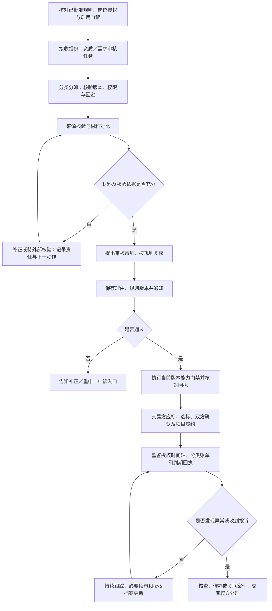
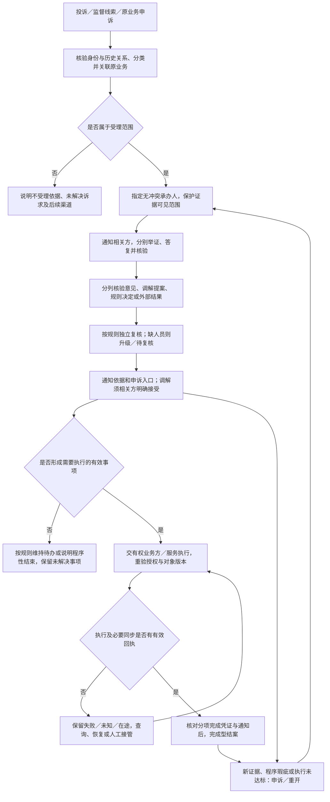

# 平台方角色功能与全流程 v0.1

**文档状态：** 基于现有文档整理的平台侧角色蓝图，待评审；不新增业务规则，不代表规则批准、功能完成或真实启用
**适用端：** 平台 Web；参与方在各自 Web、App、小程序接收补正、答复、确认、执行进度和申诉，不要求进入平台后台；平台人员移动审批另行评审
**适用范围：** 权限与规则治理、主体和需求审核、交易过程监督、投诉举证与独立复核、授权执行协同、收费与支付运营、信用纠错、增长奖励协同、平台自身监督
**角色粒度：** “平台方”是平台运营与治理组织，不是一个拥有跨租户全部数据、业务审批和资金权限的管理员账号
**更新日期：** 2026-10-24

**关联来源与引用编号：**

| 编号 | 现有文档 | 本文使用范围 |
| --- | --- | --- |
| S01 | [平台 PRD](../00-产品全景/PRD-v0.1.md) | 平台故事、FR-01～19及 FR-20～25 的跨域边界 |
| S02 | [全局术语表](../../../TERMINOLOGY.md) | 组织、交易、履约、计量、资金与证据共同语言 |
| S03 | [多端功能清单与职责边界](../00-产品全景/多端功能清单与职责边界-v0.1.md) | 平台 Web 与参与方各端的功能交接 |
| S04 | [入驻与资质审核需求细化](../01-身份与需求交易/入驻与资质审核需求细化-v0.1.md) | 组织身份、授权材料、资质与能力门禁 |
| S05 | [用工方入驻与有效需求标准](../01-身份与需求交易/用工方入驻与有效需求标准-v0.1.md) | 组织与需求双重审核、变更与有效版本 |
| S06 | [招标需求与应标承诺表单设计](../01-身份与需求交易/招标需求与应标承诺表单设计-v0.1.md) | 应标、配额、选标、双方确认及交易快照 |
| S07 | [劳务公司协同供给流程与规则建议](../02-供给与履约/劳务公司协同供给产品流程与规则建议-v0.1.md) | 主供应商、协同方、供给计划与履约责任 |
| S08 | [排班—打卡—考勤核对—资金审批流程](../02-供给与履约/排班-打卡-考勤核对-资金审批流程-v0.1.md) | 原始事件、确认工时、分类计量及资金审批 |
| S09 | [合作用工方考勤系统产品与集成设计](../02-供给与履约/合作用工方考勤系统产品与集成设计-v0.1.md) | 外部考勤来源、比对、授权和集成异常 |
| S10 | [资金流转闭环与账期模型分析](../03-账单与资金/资金流转闭环与账期模型分析-v0.1.md) | 分类应收应付、账期、线下收款与对账 |
| S11 | [资金账户与支付指令流程](../03-账单与资金/资金账户与支付指令流程-v0.1.md) | 资金授权、机构执行、余额校验和回执恢复 |
| S12 | [商业模式与收费标准](../03-账单与资金/商业模式与收费标准-v0.1.md) | 收费与已有分账规则唯一详细来源；批准与暂缓边界 |
| S13 | [平台方审核与中立监督需求](../04-治理信用与增长/平台方审核与中立监督需求-v0.1.md) | FR-16～19；平台岗位、审核、监督、案件、执行和自我监督主来源 |
| S14 | [交易信用档案与保理数据准备](../04-治理信用与增长/交易信用档案与保理数据准备-v0.1.md) | 信用事实、授权摘要、更正投递及未来金融数据门禁 |
| S15 | [人事经理收益与跨企业推荐增长需求](../04-治理信用与增长/人事经理收益与跨企业推荐增长需求-v0.1.md) | 贡献／引荐资格、归因、预算、复核与付款前置条件 |
| S16 | [员工推荐与按工时持续奖励需求](../04-治理信用与增长/员工推荐与按工时持续奖励需求-v0.1.md) | 直接推荐、阶段／持续工时奖励、付款责任与隐私 |
| S17 | [需求追踪与交接门禁](../05-战略与实施/需求追踪与交接门禁-v0.1.md) | G-01～10；规则批准、开发、联调和真实启用分离 |

本文是现有规则的角色视图，不另建审核标准、费率、审批权限或案件时限。平台治理专项及 FR-16～19 为建议待评审，岗位分配、可用措施和时钟须经 D-17～19／G-08 确认。收费中已批准部分与暂缓收取部分分别按 S12 使用；引用某项能力不代表可以上线执行。

## 1. 角色边界

### 1.1 代表谁、负责什么

平台方代表劳务供应链交易平台，承担**交易规则的执行与程序监督、交易事实核验协作、争议处理组织**职责。它服务用工方、劳务供应商、经纪人和员工，也接受针对平台自身及其人员的投诉，不代表其中一方的采购、用工或资金利益。

平台负责把“申请由谁审核、事实凭什么确认、异常由谁处理、决定由谁执行、结果如何送达和纠错”串成可追溯流程。销售拓客、客户成功、收费运营与中立审核是不同职责，付费额和客户重要性不能改变审核资格、优先或结论。

### 1.2 平台内部岗位与权限

以下是平台组织内的职责拆分，不表示已批准最终岗位编制或权限矩阵；具体映射由 D-17 确认。

| 内部岗位 | 主要负责 | 不能因为该岗位自动获得 |
| --- | --- | --- |
| 审核运营／分派负责人 | 分类、分派、认领协调、转派、升级、积压及下一动作管理 | 全部证据阅读权、按商业价值插队或改结论 |
| 主体／资质审核员 | 经办授权和材料核验、补正、审核意见与复审 | 代管组织、任意授予能力或删除审核依据 |
| 需求审核员 | 需求真实性线索、字段及有效版本核验、补正和重审 | 改商业条款、替用工方选供应商 |
| 履约监督员 | 授权时间轴、异常核查、催办、建案和整改跟进 | 改原始打卡、工时、合同、锁定账单或支付结果 |
| 投诉受理／协调员 | 核实关系、拆分争点、收集双方证据、协调及调解提案 | 独立复核自己办理或存在利益关系的案件 |
| 事实核验／独立复核员 | 核验事实、检查证据理由与程序、退回补证及复核 | 把调解建议写成已同意协议或外部裁决 |
| 风险处置审批员 | 按批准规则审查临时措施、影响范围、复查与恢复 | 默认冻结资金、永久封禁或关闭必要个人申诉 |
| 业务执行协同员 | 将获准动作交给有权人员／服务，跟踪回执、更正与恢复 | 绕过业务授权改库、代确认工时或手工标记已付款 |
| 规则维护／发布岗位 | 草案、影响分析、评审、批准后发布、版本与回滚 | 作者自行批准发布或静默追溯修改历史 |
| 平台财务／支付运营 | 核对本平台收费依据、分类账单、机构回执和差异 | 终审自身收费投诉、审批供应商工资等支出 |
| 安全审计／质量监督 | 分级访问审计、抽检、平台人员违规核查及纠正 | 自我授权、删除投诉降指标或直接改变业务事实 |
| 销售／客户成功 | 合法触达、材料协助、产品使用和授权进度跟进 | 承诺审核通过、现金奖励或付费加速，干预独立复核 |

同一人可以依法依规兼岗，但不能取消回避：原处理人不能独立复核对自己的申诉；利益相关人不能独立终审；被投诉人员不能阅读受保护举报材料；规则作者不能独自批准发布；重大限制措施的提出人不能自行批准。缺少无冲突人员时升级或待复核，不以“超级管理员”绕过。

### 1.3 明确不做什么

- 不自动成为劳动关系主体、实际履约供应商、工资支付义务人、担保方、资金托管方或融资方。
- 不替用工方选标，不替交易双方接受变更，不替员工确认本人单据，不替企业完成资金终审。
- 不把材料齐全当真实核验，不把计划、招聘、入职、到岗、确认工时与有效履约量相互替代。
- 不把单方声明、上传凭证、平台决定或支付指令当实际到账；不因立案默认冻结整个项目资金。
- 不把投诉、逾期提醒或证据不足直接写成失信，不宣称平台意见等同司法、行政、仲裁或金融机构结论。
- 不因平台租户身份全库读取；权限受限、未入驻成功或合作结束不自动剥夺经核验的历史查证与申诉入口。

## 2. 业务目标

| 目标 | 平台方最终要完成什么 | 不是完成依据 |
| --- | --- | --- |
| 可信准入 | 有来源、有理由地核验主体和需求，将结论落实到正确对象版本的门禁 | 材料上传齐、审核员点击通过 |
| 中立交易 | 保证已批准交易规则、配额与双方确认程序可追溯，不取代商业选择 | 自动最低价中标、付费客户优先通过 |
| 可核验履约 | 发现计划与实际、工时与计量、账单与回执的差异并交还有权方处理 | 平台自行填满工时或单方面改结算量 |
| 可执行纠纷处理 | 双方能举证，复核可回避，决定有依据，授权执行有结果 | 只通知意见、关闭工单或单方接受调解 |
| 分类清晰的资金协同 | 收费有适用规则，付款有授权与真实回执，异常不重付 | 账面预计收入、付款截图或机构结果未知 |
| 可持续治理 | 错误可更正，规则有版本，平台自身受监督，增长奖励有资格和付款门禁 | 投诉少、关单快、处罚多或销售额高 |

审核、案件和执行均需可见负责人、累计等待、暂停原因及下一动作；不在本角色稿新增固定小时数、天数、达标率或自动结案期限。

## 3. 功能清单

“确认”仅指岗位有权确认的核验事实或处理结果，不等于交易方业务确认或资金批准。

| 阶段 | 查看 | 提交／办理 | 确认 | 审批及权限限制 | 规则来源／待决项 |
| --- | --- | --- | --- | --- | --- |
| 工作台与权限 | 本人任务、授权字段、回避及积压 | 分类、认领、转派、升级、权限申请 | 负责人、授权和下一动作 | 分派不自带证据全读；转派不重置总等待 | S01、S03、S13；D-17 |
| 组织准入 | 主体身份、代表授权、申请角色及材料版本 | 核验来源、补正、通过／不通过意见 | 核验范围、理由和通知 | 入驻、使用、审核补正及续审免费；组织不能自动兼任或切换买卖身份 | S04、S05、S13 |
| 资质与续审 | 资质范围、有效期和已核验记录 | 外部核验、复审、到期提醒 | 适用能力及有效版本 | 不自动批准派遣／独立招聘等未获准范围；到期限制按适用规则保留必要存量办理 | S04、S13 |
| 需求审核 | 发布授权、需求字段、变更对比和版本 | 补正、核验、关键变更重审 | 可开放对象与版本 | 组织审核和需求审核分别通过；旧审核回调不解锁新版 | S05、S06、S13 |
| 交易程序监督 | 应标承诺、配额、截止时间与操作记录 | 核查异常、要求说明、催办或建案 | 规则是否正确执行 | 不替用工方选标，不把报价提交当双方成交 | S06、S13 |
| 成交交接 | 双方确认、最终条款、交易快照与项目交付状态 | 跟踪投递、重试和失败接管 | 快照与生成项目的关联回执 | 不自行接受条件变化；重复交付不重复建项目 | S01、S06、S13 |
| 协同供给监督 | 主供应商、协同方、供给计划和实际交付摘要 | 核查偏差、请求解释、跟踪整改 | 责任及变更是否有必要确认 | 主供应商责任不自动转移；计划不等于候选、入职、到岗或履约 | S07、S13 |
| 考勤与工时监督 | 授权排班、打卡来源、核对及争议摘要 | 集成排障、催确认、协调差异 | 来源、版本和既有确认是否完整 | 不改原始事件，不缺下班卡补满班；工资量、业务结算量和计费人天分开 | S08、S09、S13 |
| 分类账单监督 | 工资、借支、社保商保、业务款、渠道及奖励、平台费各自状态 | 对账差异、到期核查和补正协同 | 无争议／争议部分及真实到期情况 | 用工方未付款不自动顺延供应商工资义务；不代企业审批 | S08、S10、S13 |
| 平台收费与分享 | 已适用费率档位、有效计费依据、项目约定及账单 | 披露、核算、对账及授权收取流程 | 平台收入、用工方组织分享及其他应付款分别核对 | 仅按唯一商业规则来源；费率与分账批准不等于实际收取结算获准，不追溯改单 | S12；G-04 |
| 联系人线索运营 | 联系人授权、平台核验及有效性 | 核查线索、处理失效和争议 | 可披露范围及前置条件 | 价格已批准但收取结算机制暂缓，不据此收费或承诺奖励／中标 | S12 |
| 支付指令与回执 | 获授权指令、余额核验、机构结果及对账 | 编排、查询、提醒补足、按授权恢复 | 经核实收付及分笔结果 | 企业有权人资金终审；机构执行；未知先查原单，部分成功不重复支付 | S10、S11；G-05 |
| 信用档案与更正 | 用工方、供应商、经纪人的授权事实／摘要 | 核验、纠错、投递跟踪和失败补送 | 原事实、新版本及接收方同步结果 | 不以投诉自动定性；融资数据另取授权和机构／合同门禁 | S14；G-07 |
| 投诉受理与举证 | 关联历史、分项诉求、必要证据与送达 | 核验关系、分类建案、分别收证和答复 | 已确认、争议及证据不足事项 | 个人不需被投诉企业同意；保护举报人及无关隐私 | S13；D-18、D-19 |
| 调解与独立复核 | 争点、采信理由、规则及利益冲突 | 调解提案、核验意见、规则处置、申诉复核 | 各方有权接受结果与复核结论 | 四类意见分开；未回应非默认承认，无复核人员升级 | S13；D-17～19 |
| 临时措施与整改 | 必要性、范围、依据、影响及到期条件 | 申请／审批措施、整改、复查与恢复 | 生效／解除回执和通知 | 仅批准规则允许措施；不默认资金冻结、永久封禁或无限续期 | S13；D-18 |
| 决定执行与结案 | 执行任务、授权、版本和分项回执 | 转有权业务方／服务执行、更正、重试、重开 | 执行完成或程序性结束类型 | 决定不等于改账／扣款；无真实执行证据不作完成型结案 | S11、S13、S14 |
| 人事贡献与企业引荐 | 本人资格、冲突申报、证据、归因和合格收入依据 | 资格核验、归因争议、预算／财税／法务及付款协同 | 有权复核后的资格与应付依据 | 本企业人事是贡献报告，不默认个人采购佣金；不将组织分享当个人奖励 | S12、S15；G-09 |
| 员工直接推荐奖励 | 政策、付款责任、统一归因及允许使用的确认工时 | 推荐归因核验、奖励核对、争议及支付跟进 | 阶段／持续工时／混合组件各自条件 | 供应商奖励不默认平台兜底；平台自有获客预算单独批准，不多层分销、不侵占工资 | S16；G-10 |
| 规则发布与平台自查 | 规则版本、影响分析、平台自身案件和访问审计 | 评审、批准后发布／回滚、抽检、错审纠正 | 生效版本、送达及纠错效果 | 作者不能自批；收费经办不能独立终审自身投诉；不以销量替代中立核验 | S12、S13；D-19 |

推荐人仅查看本人奖励及必要进度，不获得被推荐人的完整考勤、工资或银行卡信息。销售人员协助贡献／推荐登记不产生奖励资格、归因终审或付款权。

### 新增：跨组织行为核验与平台级禁入（FR-26～27）

依据[分级禁入专项](../04-治理信用与增长/员工行为事件与分级业务禁入需求-v0.1.md)，企业仅决定自身范围，平台核验身份、独立组织和事件、证据及计数资格；达到用户三次门槛按建议先建候选案，告知员工、无冲突独立复核及有权风险审批后，由门禁服务执行。三家独立有效事件及人工复核是待确认细化，不直接按三条投诉自动全局封禁。

核验、复核、风险审批、执行协同和安全审计分岗，销售不干预，缺无冲突人员升级。企业事件撤销、员工改判、身份纠正、到期或计数不足触发重算与措施复查、授权恢复和分接收方回执；企业不能自行解除平台措施。异常沿用双方举证、证据保护及执行失败接管，不改工资、劳动关系或既有奖励，不扩展到平台外行业禁令。具体标准、范围、期限及数据合规由 G-11 联合 G-08 确认。

## 4. 主流程与异常流程

### 4.1 主流程：规则与授权准备 → 审核放行 → 持续监督

平台不是所有业务的串行审批节点。组织和需求审核按各自门禁处理，正常交易由参与方执行；平台持续读取已授权投递摘要，在有依据的任务、异常或案件中介入。

审核结果、门禁执行和通知分别记录。审核通过但门禁回执失败时保持执行异常，不宣称业务能力已开通；缺少已批准时限配置时显示待配置／人工队列，不自行设定超时通过或无限隐藏等待。

### 4.2 争议闭环：受理 → 举证 → 复核 → 授权执行 → 结案／重开

范围最小的安全防护或临时限制是按批准规则运行的独立分支，须单独审批、记录期限和复查，不等于案件成立。申诉不自动撤销必要措施，措施也不能阻断必要查薪、补发、历史对账或申诉。

### 4.3 关键异常与处理方式

| 异常 | 平台如何处理 | 不允许的简化 |
| --- | --- | --- |
| 材料缺失、来源无法核验 | 列明补正项或待外部核验，保留来源、暂停依据及下一动作 | 上传齐就通过；接口故障就判造假 |
| 新版申请到达、多人并发认领或重复回调 | 校验对象版本、任务归属、结论冲突及幂等键 | 旧通过解锁新版；重复开通能力 |
| 资质到期或新增能力受限 | 按适用范围阻断新增业务，保留历史核对及必要办理 | 清空历史或一刀切断工资、投诉入口 |
| 付费客户、销售要求插队或修改结论 | 记录干预并交无冲突授权岗位核查 | 付费通过、按客户金额评判证据 |
| 配额、截止时间、中标或项目交付异常 | 查规则、快照、日志与投递回执，要求说明和恢复 | 平台另选中标人或重复建项目 |
| 供给不足、协同方变化或现场数量不符 | 查计划与实际、合同责任和必要确认，催办／建案 | 计划当到岗；协同即免责；偏差即欺诈 |
| 打卡缺失、外部系统与本系统记录冲突 | 保留各来源原始记录、版本和核对链，交领域授权人处理 | 覆盖原记录、补满班或静默择一 |
| 工时、工资或业务账单迟迟未确认 | 查约定期限、送达和争议点，提醒、升级及协调 | 沉默即同意；平台代员工或企业确认 |
| 未到期、部分到账、付款未知 | 分列到期与争议金额，核验真实回执；未知先查原指令 | 未到期算欠款；未知算失败并全额重付 |
| 余额不足或支付执行中授权撤销 | 阻止无余额覆盖指令，通知补足；确认可用及现行授权后恢复 | 平台垫付或沿用已撤销授权执行 |
| 单方不答复、重复投诉或新增证据 | 记录送达／未回应；关联主案但保留新证据和不同诉求 | 默认认罪；重复计数处罚；直接丢弃 |
| 举报材料含身份、工资或无关商业数据 | 按任务和字段分级访问，交换必要脱敏摘要及反证 | 向被投诉人开放举报原件或全部工资 |
| 原处理人涉案、无无冲突复核人 | 回避、升级或待复核；高影响措施不自动生效 | 人员少就自己复核自己 |
| 调解仅一方接受、规则依据不足 | 明确尚未达成或待补证，保留未解决诉求及后续入口 | 标记已和解、违约成立或终局裁决 |
| 临时措施到期、整改完成或未完成 | 按批准策略解除／复查；复核恢复条件并留通知 | 无限续期、自动永久封禁或恢复即删历史 |
| 决定已通知但执行失败、更正未送达 | 保留待执行／未知及分接收方同步状态，重试或人工接管 | 决定代替扣款；源端改完就宣称全部纠正 |
| 平台收费／人员被投诉 | 独立工单与无冲突复核；说明内部复核局限及外部渠道 | 原收费经办独立终审，限制申诉催缴费用 |
| 收费、奖励或金融接口尚未满足门禁 | 保持待批准／待启用，区分测算与真实收付 | 价格批准即收费；归因即付款；数据准备即放款 |

## 5. 协作关系

| 事项／触发条件 | 提交方 | 接收／处理方 | 返回给相关方的结果 |
| --- | --- | --- | --- |
| 平台权限与治理规则准备 | 规则维护人／岗位负责人 | 授权审批、规则评审发布及安全岗位 | 适用范围、有效版本、权限与审计结果；不是作者自批 |
| 入驻、资质、续审与需求申请 | 用工方／供应商授权经办人 | 分派负责人及对应审核员 | 补正、待核验、理由化结论、门禁回执及申诉入口 |
| 正常选标与成交 | 用工方、供应商各自授权人员 | 交易双方及既有交易服务；平台监督异常 | 双方确认快照与项目交付回执；平台不代选标 |
| 供给、现场、工时和业务量差异 | 主／协同供应商、驻场、员工、用工方授权人员 | 原业务授权岗位；履约监督员协调 | 解释、必要确认、更正／补差记录及通知 |
| 工资、借支、返费和业务款办理 | 义务方业务／财务人员 | 该义务方资金审批人、获授权支付机构 | 分项授权、真实回执、余额／失败／未知处理；平台跟踪不代批 |
| 平台收费与组织分享 | 平台财务、履约供应商、适用用工方 | 各自授权对账与财务岗位 | 收费依据、分类账单、对账及门禁允许的真实收付结果 |
| 投诉、举证和申诉 | 员工、经纪人、组织授权人或经核验历史关系人 | 受理协调、事实核验及无冲突复核岗位 | 受理范围、双方答复、依据、处理类型、执行进度及申诉 |
| 临时措施、整改与恢复 | 监督员／案件承办人 | 有权风险审批人、执行服务及复核人 | 范围、时点、生效／解除回执及参与方通知 |
| 工时、归属、账单、支付结果纠错 | 案件有权处理岗位／原业务人员 | 既有领域有权人员、服务或获授权机构 | 原事件关联的新版本／调整及必要确认，不覆盖旧事实 |
| 信用事实更正 | 当事方／案件复核岗位 | 授权信用核验人员及投递链 | 更正依据、摘要新版本、各接收方及缓存同步结果 |
| 个人贡献、企业引荐及员工推荐 | 符合入口资格的本人／政策责任主体 | 资格、归因、无冲突复核及财务／法务授权岗位 | 资格和归因结论、奖励核对、付款门禁与回执；非销售承诺 |
| 数据泄露、越权或平台自身投诉 | 任一受理入口／安全线索 | 无冲突案件、安全审计与质量监督岗位 | 保护措施、独立处理、纠错和审计；保留外部渠道说明 |
| 超出平台能力的处理 | 当事人提出外部申请或补交外部结果 | 有权外部渠道；平台仅在自身权限内核验、关联 | 渠道说明、材料及已核验外部结果，不承诺自动移送或强制执行 |

跨组织协作只传递任务必要、用途明确且获授权的数据。平台案件关联原工时、返费等申诉编号，不复制另一套业务结果；人员退出或组织关系结束后，历史访问需再次核验身份与关系，不自动恢复无关业务能力。

## 6. 状态与凭证

**新增 FR-26～27：** 原始事件、企业决定、计数资格、平台案件、措施审批与执行／恢复状态分开保存。计数达标只触发候选，完成以无冲突复核、授权审批、告知及门禁回执认定；错案解除需跟踪必要接收方和缓存同步，不以源端改完作全部完成。记录与 G-11 统一见[分级禁入专项](../04-治理信用与增长/员工行为事件与分级业务禁入需求-v0.1.md)。

### 6.1 按对象分别记录状态

下表描述来源中的主要状态与分支，不新增最终数据库枚举；每个对象独立流转，技术设计再细化。

| 业务对象 | 主要状态／分支 | 记录与凭证 | 完成条件／变更责任 |
| --- | --- | --- | --- |
| 规则版本与岗位授权 | 草案、评审、批准、发布生效、回滚；授权及撤销 | 影响分析、审批、作者／发布人、适用范围、时间及审计 | 经有权批准并有发布／授权回执；不等于真实业务启用 |
| 审核任务 | 待分派／认领、处理中、补正、待外部核验、待复核、结论与通知 | 对象版本、材料来源、理由、经办链、时钟及回避记录 | 结论对应当前版本且完成所需复核、通知；门禁另记 |
| 业务能力门禁 | 待执行、生效、失败／未知、受限、解除／恢复 | 审核／措施依据、能力范围、版本和生效／解除回执 | 对应授权服务确认实际结果；不因审核点击自动完成 |
| 交易与监督线索 | 交易各自状态；异常待核查、催办、关联案件或说明结束 | 交易快照、已授权时间轴、异常来源、责任方及关联编号 | 原业务由有权方完成；监督记录不改交易状态 |
| 证据与核验意见 | 待核验、已确认、争议、证据不足、关联更正 | 提交人、来源、时间、对象版本、访问轨迹及采信理由 | 有权核验人说明范围；不足不等于造假或违约成立 |
| 案件与分项诉求 | 受理核验、举证答复、待复核、结果通知、待执行、程序性结束、完成型结案、重开 | 争点、金额／数量、双方答复、规则版本、通知、原案及执行关联 | 完成型须有分项执行和通知证据；程序性结束列未解决事项 |
| 调解／规则决定／外部结果 | 提案待接受、接受情况；决定待复核／已通知；外部结果待核验／已核验 | 意见类型、各方有权接受记录、复核理由及外部来源 | 按各类型分别认定，不以单方接受替代协议或授权 |
| 临时措施与整改 | 待审批、生效、整改／复查、到期解除或待复查、恢复 | 必要性、范围、审批、起止／复查时点、证据及通知 | 授权执行并核对回执；恢复留历史，无自动永久封禁 |
| 执行任务与业务更正 | 待授权／执行、在途、部分完成、失败／未知、完成 | 唯一业务键、现行权限、版本、分项回执及补差关联 | 原业务有权方确认实际执行；重复任务不得重复改账／付款 |
| 付款指令与真实收付 | 待审批／执行、余额不足、处理中、部分成功、失败／未知、成功及另记退回 | 义务方授权、机构流水／核实凭证、分笔回执和对账 | 真实资金结果按 S11 认定；指令、截图、平台决定均不能代替 |
| 收费、组织分享及个人奖励 | 规则适用／待启用、测算、核对、待批准／支付及真实结果 | 计费量、档位、合同；奖励政策、资格、归因、预算财税和付款依据 | 收取结算门禁与真实回执分别满足；不同款项不合并认定 |
| 信用事实与纠错投递 | 待核验、有效、争议、更正版本、投递在途／失败／完成 | 原事实、新版本、用途授权及接收方／摘要／缓存结果 | 来源更正和必要接收方同步分别完成，失败继续跟踪 |
| 平台自身投诉与质量审计 | 受理、回避分派、核查复核、纠正执行、抽检／重开 | 平台利益关系、保护访问、结论依据、纠错及审计轨迹 | 无冲突处理、必要执行和通知；不因内部工单关闭视为外部认可 |

### 6.2 完成认定与保留的待决事项

- **审核完成不等于能力已生效**；**意见通知不等于协议达成**；**决定不等于业务执行**；**账单确认／资金审批不等于到账**；**源端更正不等于全部接收方已同步**；**程序性结束不等于诉求解决**。
- D-17／G-08：岗位权限矩阵、分派与认领、利益冲突申报、独立复核人员及人员不足时的升级路径仍需确认，不在本文默认双人审核所有事项或授予全能账号。
- D-18／G-08：受理范围、举证答复、时钟与暂停、申诉、临时措施、整改恢复、执行授权、结案重开及外部渠道待评审；不新增固定时限、默认同意、直接扣款或永久封禁。
- D-19／G-08：规则审批发布、平台自身投诉、保护证据的分级访问与保留、质量抽检和纠错投递待确认；不承诺绝对匿名或已接入独立第三方处理。
- G-03～05：确认工时、业务结算量、有效计费人天、收费合同与收取结算细则、资金授权及真实机构通道按各专项门禁确认；S12 已批准的档位与分账不在本文重写，线索费收取结算暂缓状态保持不变。
- G-07、G-09、G-10：信用授权与纠错、个人贡献／企业引荐、员工直接推荐奖励分别评审；奖励资格、归因、测算、应付与实付分开，未来融资数据准备不构成融资能力启用。
- 来源出现冲突时，记录规则、双方来源、影响、决策责任人与阻断范围，按[产品设计文档地图](../README.md#四文档职责与冲突处理)处理，不以新文件、示例或后台现状默默覆盖原规则。
