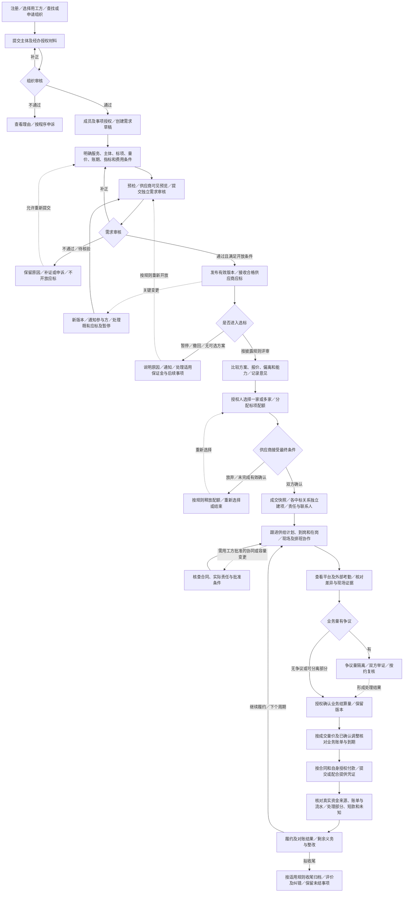

# 用工方角色功能与全流程 v0.1

**文档状态：** 基于现有文档整理的组织侧角色蓝图，待评审；不新增业务规则，不代表规则批准、功能完成或真实启用
**适用端：** 用工方 Web；现场协作及人事经理本人贡献／引荐入口按多端专项与实际授权适用，不据此新增端或扩大 App 权限
**适用范围：** 组织准入、需求创建与审核、发布与选标、双方成交、项目履约协作、考勤与业务量确认、业务对账付款、适用组织分享、投诉及档案纠错
**角色粒度：** “用工方”是组织侧业务参与方，不是拥有全部权限的单一账号；组织身份、成员岗位、项目授权及个人收益资格分别处理
**更新日期：** 2026-10-24

**关联来源与引用编号：**

| 编号 | 现有文档 | 本文使用范围 |
| --- | --- | --- |
| S01 | [平台 PRD](../00-产品全景/PRD-v0.1.md) | 用工方故事 1～22，FR-01～14、FR-05A及治理、信用、贡献与推荐需求 |
| S02 | [全局术语表](../../../TERMINOLOGY.md) | 组织、实际服务接受方、交易、计量和资金共同语言 |
| S03 | [多端功能清单与职责边界](../00-产品全景/多端功能清单与职责边界-v0.1.md) | 用工方 Web、现场协作及其他端职责 |
| S04 | [入驻与资质审核需求细化](../01-身份与需求交易/入驻与资质审核需求细化-v0.1.md) | 主体类型、经办授权、组织能力、补正与复审 |
| S05 | [用工方入驻与有效需求标准](../01-身份与需求交易/用工方入驻与有效需求标准-v0.1.md) | 独立组织／需求门禁、字段、审核版本、发布与撤回；操作标准保留草案状态 |
| S06 | [招标需求与应标承诺表单设计](../01-身份与需求交易/招标需求与应标承诺表单设计-v0.1.md) | 标项、报价、比较、配额、保证金及最终确认；字段与指标建议不自动批准 |
| S07 | [劳务公司协同供给产品流程与规则建议](../02-供给与履约/劳务公司协同供给产品流程与规则建议-v0.1.md) | 直接多家中标与中标后协同的区别、必要批准与责任 |
| S08 | [排班—打卡—考勤核对—资金审批流程](../02-供给与履约/排班-打卡-考勤核对-资金审批流程-v0.1.md) | 来源、差异、业务确认、工时复核和资金审批分离 |
| S09 | [合作用工方考勤系统产品与集成设计](../02-供给与履约/合作用工方考勤系统产品与集成设计-v0.1.md) | 免费考勤协作方案、用工方班次管理建议、导入及扩展；不代表已上线 |
| S10 | [资金流转闭环与账期模型分析](../03-账单与资金/资金流转闭环与账期模型分析-v0.1.md) | 独立账期、业务结算、线下对公回款及核验 |
| S11 | [资金账户与支付指令流程](../03-账单与资金/资金账户与支付指令流程-v0.1.md) | 分类账单、授权、适用机构执行、凭证和对账恢复 |
| S12 | [商业模式与收费标准](../03-账单与资金/商业模式与收费标准-v0.1.md) | 用工方档位选择、费用披露、组织分享与实收门禁；费率／分账唯一详细维护入口 |
| S13 | [平台方审核与中立监督需求](../04-治理信用与增长/平台方审核与中立监督需求-v0.1.md) | 双方举证、回避、独立复核、执行及平台自身问责；保留待评审状态 |
| S14 | [交易信用档案与保理数据准备](../04-治理信用与增长/交易信用档案与保理数据准备-v0.1.md) | 主体档案、交易对手摘要、纠错及授权，不表示金融启用 |
| S15 | [人事经理收益与跨企业推荐增长需求](../04-治理信用与增长/人事经理收益与跨企业推荐增长需求-v0.1.md) | 组织授权、贡献报告与个人收益资格分离；保留支付及规则待审状态 |
| S16 | [需求追踪与交接门禁](../05-战略与实施/需求追踪与交接门禁-v0.1.md) | G-01～09等既有准入、交易、计量、资金及治理门禁 |
| S17 | [劳务供应商角色功能与全流程](劳务供应商角色功能与全流程-v0.1.md) | 与供应商视图的责任及交接核对，不取代对应业务域规则 |

本文是现有规则的用工方投影视图，不修改 PRD、不新增 FR，也不把“建议、暂缓、待决、部分批准”变成正式启用。冲突按[产品设计文档地图](../README.md#四文档职责与冲突处理)处理，不以本文或较新时间戳自动覆盖专项。

## 1. 角色边界

### 1.1 代表谁，负责什么

| 项目 | 内容 |
| --- | --- |
| 代表谁／服务谁 | 经审核开通用工方能力的组织，表达真实服务需求，采购并接收约定服务；支持的主体类型按 S04、S05 核验，不限于企业法人。 |
| 负责什么 | 需求与授权信息、采购规则及选标、合同约定的现场协作、业务履约核验、项目对账及本方实际付款义务；按事实记录并处理变更、差异和投诉。 |
| 相关主体 | 发单组织、实际服务接受方、签约方与付款方可以一致；不一致时必须说明关系及必要授权，不能默认第三方可代签或代付。 |
| 可访问范围 | 本组织获授权需求、应标、项目、业务量及结算记录；合作方只访问合作所需信息和授权摘要。人员证件、账号、工资、供应商利润及其他客户合同不默认可见。 |
| 不能做什么 | 不代供应商接受中标，不篡改员工原始打卡，不冒用员工工时／工资确认，不代劳务公司最终资金审批，不因未达绩效目标自动抹除实际服务或扣工人工资。 |
| 与劳务供应商区别 | 用工方提出需求、选供应商并按约确认业务量；供应商组织供给及履约，承担自身实际义务。实际人员管理、用工、工资和保险责任按真实安排分别记录，不能由产品称谓推定。 |
| 与平台区别 | 平台负责相应审核和程序监督，不替用工方选标、证明未见现场事实或担保供应商交付；用工方作为获客对象或分享参与方不获得有利裁决。 |
| 与个人收益身份区别 | 组织分享不是人事经理个人佣金；人事经理能发布需求、参与评审或引荐企业，不等于获准领取个人奖励。 |

组织审核与需求审核是两个独立门槛；注册或组织认证通过均不使每个需求自动开放应标。同一组织当前选择用工方或供应商一种业务身份，不通过重复建组织绕过。组织认证、平台使用及审核补正免费；免费不意味着默认取得数据使用授权。依据 S01～S05、S09、S12～S15。

### 1.2 组织内岗位与授权

| 岗位／职责集合 | 负责事项 | 权限限制 |
| --- | --- | --- |
| 老板／经营决策人 | 评估成本、资源与责任边界，查看交易履约及异常，按实际授权作出采购／试点决策和职责下放 | 是业务决策视角，不因称为“老板”就免授权、自动拥有全部敏感数据或取得个人收益 |
| 组织管理员 | 组织材料、成员加入、需求／项目／操作授权及撤销 | 不自动拥有采购终审、所有项目确认或付款授权，不凭营业材料接管既有组织 |
| 人事经理／需求经办人 | 草拟需求、补正、发布流转、联系协作、跟进供给和项目待办 | 发布、评审、选标、量确认需分别授权；不能因负责经办自动终审全部事项 |
| 采购评审人 | 比较应标报价、偏离、服务方案与承诺，记录评审意见 | 比较限本组织收到的应标；不把未披露的个人利益纳入选标，不默认意见即最终选择 |
| 采购／选标授权人 | 依据披露规则选一家或多家供应商、分配配额，处理获选方未接受等事项 | 不超需求容量或供应商承诺量，不代表供应商接受最终条件 |
| 现场联系人／主管／考勤协作人员 | 提供现场信息，按项目协作排班、到岗及外部考勤，核查差异和证据 | S09 的用工方自主班次发布等是方案建议；具体排班权先明确，不能覆盖供应商或员工原始记录 |
| 业务履约／结算量确认人 | 按合同确认可结算业务量、提出异议，形成版本与证据 | 本方业务量确认不等于公司计薪工时复核、员工工资确认或供应商资金审批 |
| 财务／对账及实际付款授权岗位 | 核对本方项目应付、到期与凭证，按自身有效授权履行付款并配合对账 | 现有资金审批专项主要细化劳务公司支出；不能复制为已批准的用工方站内付款审批链 |

依据 S01、S03、S05、S08～S11。上表按已有职责归类，不要求每个职责单独配人；兼任仍须按事项鉴权。个人贡献／引荐资格另外核验，涉及本人利益或被投诉事项按治理规则回避。

## 2. 业务目标

| 业务目标 | 完成判断 |
| --- | --- |
| 形成真实且可比较的采购需求 | 主体及权限有效，服务、地点、标项、数量单位、时点、评价与量价账期清楚，独立需求审核通过并开放有效版本。 |
| 选择能执行的供应商方案 | 按披露规则比较价格、偏离、供给能力及承诺；最终标项、配额、责任和价格经双方确认，而非仅点击“选中”。 |
| 让承诺落实为实际服务 | 能对照节点查看计划、能力响应、到岗、在岗和确认履约量，缺口、补员、调整及责任可追踪，不把计划当实绩。 |
| 形成可信业务结算依据 | 原始平台及外部来源独立、差异有证据、确认有授权和版本；业务量与工资量、平台人天分开。 |
| 履行本方结算责任 | 合同到期、应付、实付、收款核验及未结差额分别可查；线下对公付款纳入正式对账闭环。 |
| 持续评价合作并处理争议 | 评价有指标与事实来源，投诉、整改、复核、执行和档案纠错有反馈；项目收尾不消灭未结义务。 |
| 在明确边界内管理适用收益 | 费率选择和组织分享按商业专项及合同核对；个人贡献和引荐另审资格，不以采购权换奖励，不保证现金收益。 |

依据 S01、S05～S16。性价比改善、全国供应商响应及账期价值是待真实客户与交易验证的价值假设，不是平台低价、足额交付、融资或付款保证。

## 3. 功能清单

“审批”只指相应有效授权岗位；本方内部经营决策、平台审核、对手方接受、业务确认和实际付款不是同一动作。

| 阶段 | 查看 | 提交／办理 | 确认 | 审批及权限限制 | 规则来源／待决项 |
| --- | --- | --- | --- | --- | --- |
| 账号与组织准入 | 主体类型、材料、审核及补正进度 | 注册、选择身份、查找／创建组织、提交授权及补正、申诉 | 经办与组织关系、材料版本 | 平台审核；不自审、重复建组织或冒用已有组织 | S01、S04～05；入驻审核免费 |
| 成员与项目授权 | 成员、需求／项目及操作范围 | 邀请成员、授予／变更／撤销权限 | 接收人、职责及有效范围 | 管理岗位按组织授权；个人引荐资格与组织权限独立 | S01 FR-01、FR-14，S15 |
| 需求草拟与预检 | 草稿、必填／条件字段、供应商可见预览 | 填写服务内容、真实主体、地点、标项、数量、时间、保障与责任 | 需求事实、相关主体授权及附件一致性 | 预检不替代内容审核；条件字段不机械要求所有项目填满 | S05～06；操作标准待评审 |
| 报价、指标及账期条件 | 单位、含税口径、目标／硬限制、量价和账期 | 设报价模式、目标及证据、选标／配额规则、预付款等适用条件 | 计量定义、确认方、账期起算和付款主体 | 不默认预算等于限价或保量；未定义指标不自动评分、扣款 | S01 FR-03，S05～06 |
| 平台费档位与披露 | 商业规则、档位、承担方及适用分享条件 | 按规则选择固定档位，随需求向供应商披露 | 供应商应标前可知悉的费用条件 | 不在中标后追溯提高；不将组织分享发给个人，不自动开启实收 | S12 唯一详细来源；G-04 |
| 保证金配置 | 适用类型、金额、阶段、期限、收款主体与账户核验 | 按需约定缴纳、退还、扣除、争议及账户变更 | 合同依据与核实到账／退扣结果 | 非必经项；上传不等于到账，平台不默认收管，不自动扣款 | S05～06、S11 |
| 需求审核与发布 | 平台逐项意见、版本、开放窗口 | 提交审核、补正、发布／设定开放时间 | 通过版本与当前有效状态 | 组织、权限、需求审核及开放条件分别通过；无付费加速 | S01 FR-02～03、S05、S13 |
| 变更、暂停及撤回 | 历史条件、已参与供应商、投递与通知 | 新建变更版本、暂停／撤回／关闭需求、说明原因 | 新旧版本关系及既有应标处理方式 | 关键条件变更须重审，旧应标不自动继承；暂停只允许供应商撤回应标；撤回关闭后已有应标不得继续选标或建快照；已确认快照不因撤回而删除 | S05～06、S01 FR-14、DP-09 |
| 应标比较与评审 | 本组织收到的方案、报价、偏离、承诺及授权档案摘要 | 按已披露条件比较、记录评审意见 | 单位、税费与服务范围是否可比 | 不默认最低价中标或自动评分；选标/采购权限独立于编辑和发布；不对外泄露他方私密方案 | S01 FR-04、S06、S14 |
| 选标与配额 | 需求容量、供应商承诺及获选接受情况 | 选一家／多家、分配标项配额、处理放弃或失效配额 | 最终实际成交条件、差异及不足额成交安排 | 并发不超配；比例配额显式配置取整和余数；确认时限按需求配置；供应商逐家确认，拒绝/超时释放配额并逐家交接 BP-05 快照 | S01 FR-04～05、S06、DP-09 |
| 成交与项目 | 双方快照、价格／账期、责任及联系人 | 对接项目、确认有权处理的变更与责任安排 | 双方最终确认条件及项目关联 | 同一中标关系幂等建项；多家中标各自项目与结算 | S01 FR-05、S06 |
| 履约监督与补员协作 | 节点目标、各阶段实数、缺口和整改 | 提出差异／服务问题，处理需本方认可的配额／节点调整 | 实际履约事实和约定变更 | 不把供给计划、候选或累计到岗当当前在岗；补员不抹原缺口 | S01 FR-05A、FR-07 |
| 中标后协同事项 | 获授权的协同关系、人员实际责任与交付 | 提供按合同需要的批准、补正或异议 | 必要批准、范围和责任安排 | 与直接多家中标分开；不自动转移主供应商责任，不将能力响应计交付 | S07；具体方案待评审 |
| 现场接入与排班协作 | 人员必要花名册、班次、现场及保障安排 | 按约协调现场、提供规则和班次信息；适用考勤方案下配置／发布 | 项目、人员映射与班次版本 | 用工方直接发布权限及多方协作方式依 S09 评审，不新增单方覆盖权 | S03、S08～09 |
| 考勤导入及差异核查 | 平台事件、独立外部来源、映射、导入错误及异常 | 按授权导入文件、提交证据、核验差异、配合员工补正 | 来源、人员／日期／班次映射及核验意见 | 不改原始打卡；API／设备连接为方案扩展，非现有接通事实 | S01 FR-08、S08～09 |
| 请假、换班及加班协作 | 本项目相关申请和出勤影响 | 按实际授权办理／反馈、协调现场及班次 | 核验状态、班次调整和适用处理意见 | 不默认所有员工申请由用工方终批；方案不自动生成工资承诺 | S09；扩展与审批链待评审 |
| 业务履约量确认 | 计算、争议、服务成果及证据、历史确认 | 核对、提出异议、按约确认无争议量、补差 | 本方有权确认的业务结算量及版本 | 不代公司复核工资量，不替员工确认；超时不默认同意，争议隔离 | S01 FR-08、FR-11，S08 |
| 业务对账与付款协作 | 分类应付、单价、调整、账期、到期和余额 | 业务对账、按实际合同与自身授权安排付款，配合凭证补正 | 账单与实际资金来源的匹配 | 不从项目款默认扣平台费、工资或保证金；本站内付款审批链待细化 | S10～11；G-05 |
| 适用组织分享 | 获授权范围内计量、费用、分配依据和结果 | 核对适用主体与合同、提出分配异议 | 商业口径与实际收付状态 | 不是采购折扣或个人余额；不自动抵业务应付款，结算条件另审 | S12；不复制费率算法 |
| 贡献及跨企业引荐 | 本人资格、贡献报告、直接引荐摘要和异议结果 | 授权人确认组织成果；本人另行申报身份、贡献／真实引荐 | 组织授权及事实；资格、金额、付款另审 | 不因人事岗位或雇主同意承诺佣金，不设多级分销、不向联系人自动分成 | S01 FR-20～23、S15；G-09 |
| 投诉、履约评价与收尾 | 任务、双方争点、整改、档案依据与剩余义务 | 举证、答复、复核申请、信用纠错、授权导出及收尾协作 | 处理及执行结果、评价事实依据 | 不把投诉当违约、决定当执行；不以关闭需求替代项目清算 | S01 FR-13～19、S13～14 |

### 新增：本企业员工行为处理与未来入场禁入（FR-26～27）

依据[分级禁入专项](../04-治理信用与增长/员工行为事件与分级业务禁入需求-v0.1.md)，用工方授权现场／项目／人事人员可提交关联员工行为及证据，由本组织有权岗位核验、告知员工并审批本企业未来规定业务范围；门禁拟对本用工方关联岗位／项目的各供应商新增派驻入场一致校验，不能扩大到其他用工方。

主流程为登记→核验与员工答复→本企业审批→关联项目门禁回执→申诉／复查／解除。供应商换主体不得绕过该用工方有效措施，但同事件不能由双方上报重复凑三次；跨组织资格及平台限制交平台独立核验复核。证据不足补证、身份错误纠正，涉嫌违法不等于违法成立。已有在岗、安全及合同另走有权流程，不能因此自动要求供应商辞退或扣薪；G-11 通过前不真实启用。

## 4. 主流程与异常流程

### 4.1 用工方主流程

- 图示不是所有项目必须采用的审批链，也不规定选标时限、统一审核期限或先确认全部争议才能处理无争议部分。
- 供应商工时复核、工资核算及其最终资金审批是独立责任链，不由用工方业务量确认替代。用工方未付款不使供应商工资到期日自动顺延；实际各方责任仍按真实合同与安排确定。
- 线下对公付款是正式支持路径，不要求所有项目款经过平台。付款登记、银行凭证、收款核验和对账结果分开；供应商已发工资也不能证明用工方项目款已付。
- 组织分享及个人贡献／引荐属于条件性旁支，不是选标、确认履约或付款的前置门槛；平台服务费也不默认从业务款中扣收。
- 关闭／撤回需求停止新增应标，不直接解除已成交项目义务；人员退出、服务结束、单张账单确认或一次付款都不自动代表项目全部关闭。

### 4.2 三类容易混淆的支线

| 场景 | 流程与用工方动作 | 不能混同的结果 |
| --- | --- | --- |
| 直接多家中标 | 用工方按披露规则选择多家 → 分配各自配额 → 各供应商接受 → 分别建项、履约、对账 | 各家是直接中标关系，不是主供应商的协同渠道；容量总和不得超需求。 |
| 中标后协同供给 | 主供应商发起缺口请求 → 其他供应商响应 → 核查必要合同／授权 → 用工方按需批准 → 实际人员关系、入职到岗及计量 | 可供人数不是正式交付；批准不自动让协同方成为直接中标方，也不免除主责。 |
| 组织分享与个人贡献／引荐 | 组织分享按 S12 的合同、有效量及结算条件核对；贡献先记授权与成果，引荐另行核验本人资格、真实引荐、实收映射和必要审批 | 两种收益不共用余额或资格；个人不能因选择供应商、影响本企业采购或提交联系方式就取得佣金。 |

依据 S01 FR-04～05A、S07、S12、S15；个人资格不通过、需补材料或仅记录贡献都是合法的产品结果，不承诺每位人事经理都有现金收益路径。

### 4.3 异常流程

| 异常场景 | 当前角色可以做什么 | 谁处理 | 结果与恢复路径 |
| --- | --- | --- | --- |
| 重复组织、身份或经办授权不明 | 查找既有组织、补材料／授权、申请加入或申诉 | 组织有权人、平台主体审核岗位 | 不接管他人组织、不开放未核验能力；外部渠道故障记待核验，不冒充已核实（S04～05）。 |
| 发单、服务接受、签约与付款主体不一致 | 说明关系、补授权和合同依据 | 需求经办人、各主体有权人及平台审核岗位 | 澄清前不把第三方代签／代付认定为合法有效安排（S05～06）。 |
| 需求缺项、附件冲突或范围不适用 | 按字段补正、修改并重新提交，必要时升级 | 需求经办人、平台需求审核岗位 | 预检通过仍需内容审核；待核验或未通过不得开放应标（S05）。 |
| 关键条件变更、暂停／撤回或旧消息迟到 | 新建版本，说明受影响条件，通知并处理原应标 | 用工方有权人、平台受影响审核及投递流程 | 历史版本保留；旧审核／消息不复活撤回需求，不静默改变承诺（S01 FR-14、S05）。 |
| 无应标、方案不可比或无可选供应商 | 查看实际响应、澄清单位及费用口径，按规则变更／重新开放或结束 | 需求经办、采购及平台必要复审岗位 | 不虚构供应商覆盖、不强制成交；重新开放按有效版本门禁，不能保证低价（S01、S06）。 |
| 并发超配、不足额成交或供应商放弃 | 检查需求上限及承诺量、明确不足额接受，按规则释放和重选 | 采购授权人、相关供应商 | 不超配、不代供应商接受；时限待审，重复确认不重复占额（S01 FR-04～05）。 |
| 最终条件有差异或建项失败 | 明确差异并请双方重新确认，查询原建项请求 | 双方成交授权人、系统恢复流程 | 未共同接受不静默成交；同一确认幂等生成唯一项目（S01、S06）。 |
| 保证金未核实、账户变化或退扣争议 | 补核验、提供合同及流水证据、提出异议 | 实际收款／退扣责任方、双方授权财务及适用复核岗位 | 账户变化重核验，上传不当实收，扣退有独立依据，不默认平台托管（S06、S11）。 |
| 供给延误、缺岗、人员替换或超配 | 核查阶段实数、请求整改、处理必要配额／节点调整 | 主供应商、项目负责人、用工方授权人 | 补员不能抹除原缺口和原批次留任事实；未批准不将超配量计为正式履约（S01 FR-05A、S06）。 |
| 协同关系未生效或责任不清 | 要求补充合同、授权、实际人员安排并给出必要批准／异议 | 主责与协同公司、必要用工方授权人 | 未满足前不把能力响应计入正式供给；不自动将主合同变成协同方直接合同（S07）。 |
| 排班冲突、导入失败、映射不明或漏卡 | 提供独立来源、修正导入映射、逐项核验并协调班次 | 现场考勤协作人、供应商驻场／项目及工时复核人 | 原始数据不覆盖，错误行有反馈；无下班卡不自动补满，缺席不自动判违约（S08～09）。 |
| 工时、服务质量或业务结算量争议 | 记录争点与双方证据，确认有权且可分离的无争议量 | 双方确认岗位、必要平台协调／复核岗位 | 不超时默认同意；未达绩效不自动抹除已发生有效量，更不能直接扣员工工资（S06、S08、S13）。 |
| 请假、加班、换班或人员退出影响现场 | 按实际项目权限反馈核验、调整协作及补员 | 员工、供应商现场／项目和相应用工方授权人 | 不默认用工方有全部终批权；输出核验状态不自动承诺工资（S09）。 |
| 账单量价、税费、调整或账期不符 | 提交明细异议，按快照及合同核对，锁定后形成补差 | 双方业务确认与财务岗位 | 各类日期独立，不默认以发票日替代确认日；无依据调整不自动入账（S06、S10～11）。 |
| 部分付款、短款、逾期、未知或重复凭证 | 提供实际流水／付款依据、说明关联、核查原交易 | 用工方付款授权人、供应商财务及适用机构 | 只按核实金额对账，未知先查不盲目重付；登记不代表收款，原始记录不改写（S10～11）。 |
| 组织分享或个人贡献／引荐有争议 | 分别提供合同、授权、事实及实收映射，申请复核 | 商业规则责任人、平台财务／合规及独立复核岗位 | 不把分享当个人提成，不因雇主同意绕过资格；争议部分隔离且不冻结无关业务（S12、S15）。 |
| 投诉、限制、错误评价或平台自身争议 | 举证、答复、整改、申请独立复核和档案纠错 | 原业务责任方、平台受理及独立复核岗位 | 双方有反馈与申诉，未核实不记失信，结论／执行／到账／结案分别留痕（S13～14）。 |

## 5. 协作关系

| 事项／触发条件 | 提交方 | 接收／处理方 | 返回给当前角色的结果 |
| --- | --- | --- | --- |
| 组织与经办授权核验 | 用工方申请人／组织有权人 | 平台主体审核岗位 | 核验、补正／拒绝理由、复审及开通能力，不是支付或履约担保 |
| 组织内分工 | 管理员或其他有效授权人 | 需求、评审、选标、现场、确认及财务岗位 | 可执行事项与数据范围；岗位名称不等于全部权限 |
| 需求预检、审核与发布 | 需求经办／发布授权人 | 系统预检、平台需求审核岗位 | 字段意见、版本及可开放状态；内部采购批准不能替代平台审核 |
| 应标评审与最终成交 | 供应商提交应标、用工方授权选标 | 本方评审／采购人、供应商接受授权人 | 最终标项配额、价格、责任、快照与双方结果 |
| 供给、报到与现场保障 | 供应商项目／供给责任人、用工方联系人 | 各实际保障责任方与现场授权人 | 实际到岗及缺口、场地／食宿／安全等约定协作结果，不默认全部由某一方承担 |
| 中标后协同或配额调整 | 主供应商及必要协同方 | 用工方必要授权人和合同责任方 | 批准、补正或异议及责任版本，不是自动换供应商 |
| 排班与考勤接入 | 本方现场考勤岗位、供应商现场岗位 | 按项目确定的排班责任人及授权数据接收方 | 有效班次版本、来源与导入反馈；不能由任一方静默覆盖他方 |
| 工时差异及业务量确认 | 员工／驻场提供证据、供应商提交核对 | 本方业务量确认人、供应商工时复核人 | 各自有权确认的量、异议及快照；本方确认不产生供应商付款授权 |
| 项目账单及本方付款 | 双方业务／财务经办、实际付款授权人 | 双方对账岗位及适用银行／机构 | 量价、到期、实际付款、收款核验和差额状态，不因本方点击即认定到账 |
| 组织费用选择与适用分享 | 用工方授权经办／财务 | 平台商业及费用岗位、供应商相关授权人 | 应标前披露、适用计量与分配依据、异议和收付结果；实收受独立门禁约束 |
| 联系人使用及线索解锁授权 | 本组织有权人及相关联系人按必要范围 | 平台相应审核及获准接收方 | 联系目的、披露范围与使用记录；价格批准不等于线索收费已启用 |
| 个人贡献与跨企业引荐 | 人事经理本人申报、组织有权人确认授权／成果 | 平台客户成功、资格／合规及财务审批岗位 | 贡献报告、直接引荐归属、资格及独立核算结果；无个人现金保证 |
| 投诉、整改及信用纠错 | 本方或被投诉方的授权经办 | 业务责任人、平台案件及独立复核岗位 | 证据意见、复核、授权执行与纠错反馈；不能自审自身有利益案件 |

依据 S01、S03～S15。跨组织只传递必要字段及来源版本，不投递供应商利润、其他报价或无必要身份明文；查看、导出和授权撤销均重新校验范围，不能承诺已下载资料可被技术上自动收回。

## 6. 状态与凭证

**新增 FR-26～27：** 用工方内部事件／决定与供应商决定、平台有效计数、平台级措施独立；本企业解除不能代平台解除。企业有权人处理内部复查，平台无冲突岗位处理跨组织计数及平台申诉，结果返回本人、相关供应商必要业务岗位及门禁，不分享全部证据。完成以授权结论、范围期限、通知及各适用入口执行／恢复回执认定；状态及待决规则回到[分级禁入专项](../04-治理信用与增长/员工行为事件与分级业务禁入需求-v0.1.md)／G-11。

以下为现有文档的业务语义归纳，不是新增表结构、固定审批流或正式状态枚举。撤销、重开、调整及反向资金记录须关联原对象并保留历史。

| 业务对象 | 主要状态／分支 | 记录与凭证 | 完成条件／变更责任 |
| --- | --- | --- | --- |
| 组织申请及能力 | 草稿、已提交、审核中、补正／待核验、通过／不通过、申诉／复审 | 主体类型及材料、经办授权、核验来源、决定人与时间、开通能力 | 平台授权审核岗位给出结果；账号注册及材料齐全不等于通过（S04～05）。 |
| 成员及事项授权 | 待加入、有效、变更、撤销／失效 | 需求／项目／事项范围、授权人、接收人、生效及变更审计 | 组织有权人处理，执行和导出时重新鉴权，个人资格另记（S01、S15）。 |
| 需求审核及开放 | 草稿、预检、已提交、审核、补正／待核验／不通过、已审核未开放、开放、暂停、截止、撤回／关闭 | 结构字段、附件、主体关系、版本、审核、开放窗口、操作理由与通知 | 有效组织、权限、审核及开放条件分别满足；关键变更重审，旧结果不能批准新版（S05）。 |
| 应标与采购评审 | 已接收、评审、意见形成、获选／未选、撤回等分支 | 应标引用版本、价格口径、承诺与偏离、评分适用规则和评审意见 | 授权评审有记录；意见不等于选标、更不等于双方成交（S01、S06）。 |
| 配额及中标关系 | 待分配、待供应商接受、双方确认、放弃／失效、释放／调整 | 最终标项、配额、容量校验、双方条款及确认时间 | 授权选标且供应商有效接受；重试不重复占额，差异须明确接受（S01 FR-04～05）。 |
| 项目与合同快照 | 履约准备、履约中、变更、拟收尾及关闭条件待核 | 中标／合同／账期／责任快照、唯一关联、联系人与变更版本 | 各中标关系独立项目；整体关闭依据适用规则，不以需求结束代替（S01、S06）。 |
| 保证金 | 不适用、待缴、凭证待核、已核实、待退／扣、争议、处理结果 | 类型、责任主体／账户、合同、金额期限、流水和退扣依据 | 实际责任方与授权财务核验，收退扣分别留痕；不默认平台保管（S06、S11）。 |
| 供给与履约节点 | 计划、能力响应、候选、录用、到岗、指定日在岗、确认有效量、缺口及恢复 | 节点目标、去重规则、来源与责任方、实际结果、补员和调整记录 | 对应事实逐阶段核验；计划或补员不能改写原未达标事实（S01 FR-05A、S06）。 |
| 协同关系与必要批准 | 请求、响应、选择、待条件满足、生效、交付、结束／终止 | 合同授权、必要用工方批准、实际人员关系、量价及交付证据 | 必要条件满足才生效，真实履约另确认；不自动建立直接中标关系（S07）。 |
| 排班与独立考勤来源 | 班次草拟／发布／新版；原始事件接收、导入校验／映射异常、来源作废版本 | 排班、人员关系、事件号／服务端时间、外部批次、错误行和核验日志 | 来源可追溯不等于最终事实；追加更正，不覆盖原始来源（S08～09）。 |
| 请假／换班／加班协作 | 已申请、核验、处理／补正／异议及生效等适用分支 | 申请理由、现场意见、授权、时间、班次影响及通知 | 按项目批准规则反馈；具体审批链仍待审，处理意见不自动形成工资承诺（S09）。 |
| 业务量确认与争议 | 计算、待核对、无争议确认、争议隔离、复核结果、调整版本 | 平台／外部原始来源、人员日期项目、适用量定义、双方意见及确认快照 | 本方授权人确认其业务量；公司计薪量和平台人天独立转换，不互相替代（S08）。 |
| 项目业务账单 | 待核对、部分确认／争议、已确认、未到期／到期、部分付、未结、调整 | 中标量价、单位、税费口径、确认调整、业务期间、到期起算、版本 | 双方有权人核对；确认、到期和实付独立，锁定后更正形成补差（S10～11）。 |
| 本方付款与供应商收款核验 | 已登记／待核实、部分核实、未知、已匹配、短款／逾期／退回及差异 | 实际付款／收款主体、银行回单或机构流水、金额、日期、账单分配和核验意见 | 按真实资金证据及对账完成对应明细，不凭任一方点击“已付”完成整单（S10～11）。 |
| 费率选择与组织分享 | 档位确认、待核量／异议、分配测算、适用结算与真实收付 | 披露版本、服务合同、有效人天、收费规则、分配主体与资金记录 | 依 S12 批准规则及实际结算条件处理；组织分享不等于个人应付、不自动抵业务款。 |
| 联系人及线索披露 | 授权、审核、有效／失效、适用解锁记录 | 联系目的、授权范围、线索有效性、接收方及实际披露事件 | 满足必要授权与审核，不因公开需求公开全部联系方式；收取结算机制仍暂缓（S05、S12）。 |
| 贡献及直接企业引荐 | 贡献待核／报告；引荐登记、归属、商务转化、资格待审／通过／拒绝、适用核算与支付 | 本人关系申报、组织授权、成果／真实引荐、合同、收入实收映射、预算及批准凭证 | 贡献确认、引荐归属、资格、金额与付款分别判断；不因本企业采购形成个人佣金（S15）。 |
| 投诉、整改与信用纠错 | 受理、举证、核验、意见、独立复核、执行待回执、结案／重开、更正传播 | 双方材料、回避、处理理由、原业务授权、执行回执、档案来源及历史版本 | 有权方执行并返回结果，未核实投诉／争议／未知不能成为失信，决定不等于结案（S13～14）。 |
| 档案及授权导出 | 自有明细、授权摘要、待纠错、导出授权／撤销 | 来源、期间、样本口径、接收方／目的／字段、访问记录与纠错链 | 最小授权校验；真实融资资料外发另审，不因建档默认向机构开放或承诺融资（S14）。 |

### 待评审事项、来源差异与使用边界

1. **组织与需求标准**：S04～S06 的具体字段、审核分工、时限及主体授权仍按 G-01细化；组织通过不能替代需求审核，不新增固定审核天数或自动通过。
2. **应标与成交**：选标／评分、配额调整、供应商接受时限、保证金条件及 D-15 等依 G-02；不把图中先后顺序或建议字段当成新增批准。
3. **排班权限存在细化差异**：S01／S08 以供应商项目经理或授权驻场编制发布为主，S09 提出用工方自主班次发布及现场岗位权限。具体项目中谁编制、谁发布、如何多方变更，须责任人按来源协调确认；本文不默选其一、不默认双方都能覆盖对方版本。S09 的 P0／P1 是该考勤方案分期建议，不缩减整个平台的完整范围。
4. **计量与现场协作**：业务量确认权、差异时限、争议效力、请假／换班／加班链及关闭条件按 S08～S09、G-03继续评审。不存在“用户超时未点确认即认可”或单一来源自动结算规则。
5. **付款授权仍有细化空间**：现有 S11 的最终资金审批链主要针对劳务公司；用工方业务付款按真实合同、自身授权及实际通道办理，站内审批、金额权限、执行接口不能由此推定已批准。S01 故事 20 引用“FR-12A”，但当前正文功能章节为 FR-12，属于追踪编号待核对，不据此新建功能或扩大付款能力。
6. **组织收益、收费和个人激励分离**：S12 是收费／分账唯一详细来源，实际收取及组织分享结算按合同与 G-04；线索收费仍暂缓。个人贡献及跨企业引荐须独立满足 G-09，不能以雇主同意、组织分享或经办岗位替代个人资格，不复制制度示例为现行参数。
7. **机构、监督和信用**：G-05、G-07～08 的机构能力、资金权属、账户、回执、摘要隐私、回避及复核条件分别满足；不默认托管、自动扣款、垫资、保理、综合信用排名或真实资金机构导出已启用。

本次只新增用工方角色视图及导航，不改变既有员工、供应商、商业规则、个人奖励或金融能力范围；后续岗位细化仍沿用相同六项模板。
