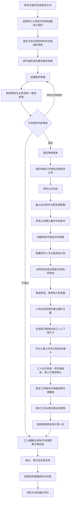

# 劳务供应链交易平台 PRD v0.1

| 项目 | 内容 |
|---|---|
| 编写日期 | 2026-10-20 |
| 文档状态 | 待评审草案，不是已批准开发或对外承诺 |
| 适用背景 | 从客户付费定制转为自主推进 |
| 依据 | 自主推进需求基线 v0.4；用工方入驻与有效需求标准 v0.1；战略与履约补充需求；v0.3/v0.2 明确未被覆盖的细则；配置与流程记录；仓库实现现状 |
| 关联文档 | [需求梳理与现状分析](需求梳理与现状分析-v0.1.md) |
| 用工方源头专项 | [用工方入驻与有效需求标准 v0.1](用工方入驻与有效需求标准-v0.1.md)，细化 FR-01、FR-02、FR-03 的组织准入、需求门禁与验收 |
| 需求基线 | [自主推进需求基线 v0.4](../../01-售前阶段/需求分析/requirements-draft-v0.4.md) |
| 决策标记 | “沿用”指已有材料记录；“建议”须负责人确认；“待定”不得静默取默认值 |
| 发布方式 | 本地 Markdown；本次不创建远程 Issue、不修改标签、不对外发布 |
| 2026-10-19 评审结论 | 继续平台模式；不采用内部验证/真实资金的产品范围拆分，不暂缓独立 App；按用工方源头、应标中标、履约、资金流转顺序展开 |
| 入驻前提补充 | 同一平台内用工方、劳务公司两类角色自主注册，审核通过后使用对应业务能力；平台使用和审核免费，本次不重议盈利策略 |
| 入驻专项细化 | [入驻与资质审核需求细化 v0.1](入驻与资质审核需求细化-v0.1.md)，具体材料与门禁为待评审建议 |
| 入驻边界确认 | 同一组织角色二选一；用工方支持各类依法设立主体；劳务公司当前仅准入合规外包、按适用规定备案主体；个人经纪人只通过劳务公司提供人员资源，不直接对接用工方 |
| 平台定位补充 | 平台提供互联网信息撮合，不作为具体外包承接方；不据此推导免于适用的信息审核、投诉处理或许可要求；本轮不展开地区及审核运营时限 |
| 2026-10-20 需求表单细化 | 建立“用工方目标—劳务公司逐项承诺—选标—双方确认快照—履约验收与结算”同源数据链；详见待评审表单专项稿 |
| 2026-10-20 用工方源头细化 | 单独形成用工方入驻与有效需求标准，并将组织认证、需求审核设为两个独立门槛；流程、字段门槛和验收规则仍待负责人评审 |
| 2026-10-20 多端与工时闭环补充 | 明确 Web、独立 App、小程序的角色和功能边界；增加工人小程序上下班打卡，并将排班、平台原始打卡、工时计算、复核确认和结算关联纳入闭环，外部考勤不得覆盖平台原始记录 |
| 2026-10-20 战略与履约补充 | 服务费战略计量基数改为经核验且符合合同条件的有效履约人天；收费对象按合同确定；增加履约方案、三类人员供给来源、有效人天及供应商履约评价 |
| 2026-10-20 战略定位升级 | 明确平台不是劳务公司管理 SaaS 的更名；招聘、档案、考勤、工资核算及返费等能力服务于交易和履约，并新增交易飞轮验证与模块价值筛选原则 |
| 补充材料范围处理 | “第一版必须/可分阶段开放”仅作输入材料建议记录；不覆盖负责人已确认的完整平台、全链路、独立 App、履约和资金范围 |

## 1. 问题陈述

用工企业、劳务公司、驻场、经纪人和工人在同一用工项目中协作，却分别依赖聊天、表格和线下转账记录。推荐归属、入职事实、工时、工资、返费和企业结算缺乏共同依据，导致重复核对、规则被事后修改、金额争议以及支付异常难以追踪。

仅为劳务公司提供内部管理软件，可以改善单家公司的流程，却不能解决真实用工需求从哪里来、如何触达合格供应商、供应商如何竞争并承诺履约、交易如何形成可核验结算依据等网络层问题。因此，产品必须围绕供需交易和履约组织，而不是围绕管理功能清单定义自身。

项目自身还存在两个问题：原定制交付以模块清单为主，需要按完整业务流程重新组织需求和建设依赖；文档中的“已完成”与代码实际状态不一致，容易错误估计后续成本。个人自主推进不是删减履约、资金能力或暂缓独立 App 的依据。

## 2. 解决方案与产品目标

围绕劳动密集型企业的真实劳务供需交易，提供交易组织、标准化履约数据、核验和结算管理基础设施，让劳务公司以更低成本、更高效率完成合规交易，而非由平台亲自成为劳务交付方。

用工方发布需求 → 劳务公司应标 → 多家中标与配额确认 → 建项目 → 履约方案与供给计划 → 自有/渠道/协同供给 → 筛选和入职准备 → 实际到岗 → 平台排班与工人上下班打卡 → 工时核算、差异复核与确认 → 工资/供应商费用/平台有效人天分别核算 → 分类账单与对账 → 资金状态记录 → 项目关闭与履约评价。

### 2.1 目标

- 每个项目能追溯至中标条件；每笔费用能追溯至有效政策、人员记录和确认依据。
- 工人能核对本人工时与工资，经纪人能核对本人推荐人员的返费，不靠劳务公司口头解释。
- 工时在平台形成从排班、工人上班/下班打卡、工时计算、异常补正、责任方复核到确认和结算引用的可追溯记录；用工方外部考勤不再是唯一工时依据。
- 账单锁定后不可被无痕修改；支付指令不重复执行，未知结果不被误判为失败或成功。
- 多组织协作不突破租户隔离，不泄露未授权报价、工资、身份和利润信息。
- 以用工方源头、劳务公司应标中标、履约及资金流转的完整业务链路验收，不把模块建设顺序误认为范围缩减。
- 平台围绕真实交易密度、合格供给、可核验履约、复购和单位成本改善创造价值；注册用户数不单独证明平台有效。
- 平台服务费的战略计量依据为经核验且符合合同计费条件的有效履约人天；收费对象、费率、成立时点、收取方式和责任主体按合同与确认后的商业规则执行。

### 2.2 战略定位：交易网络而非管理 SaaS

本产品不是以向单家劳务公司销售管理软件为核心的 SaaS，也不是传统劳务公司替代供应商承接人员交付。它组织用工单位和合规劳务公司在共同规则下完成交易：用工方提出真实需求，供应商竞争性应标并承诺交付，获选供应商组织人员履约，平台关联并核验交易、履约、计费和结算记录。

招聘、档案、考勤、工资核算、返费及项目管理等能力保留为交易基础设施的一部分：只有在它们支撑交易发生、履约成功、数据可信、结算可核验或单位服务成本下降时，才构成平台产品价值。产品路线图不得仅按传统劳务 SaaS 的功能清单扩张。

战略验证遵循以下因果链，而非以注册数或功能上线数替代结果：

**真实用工需求 → 合格供应商参与 → 竞争性选择与中标 → 供给组织及实际履约 → 可核验履约数据 → 计费结算与交易复购 → 交易密度和自动化提升 → 单位服务成本改善。**

上述因果链是需要经营数据验证的飞轮假设，不是已被证明的商业结果。“优先验证真实交易”表示优先检验产品是否解决真实交易问题，不表示仅交付内部闭环、不进入真实业务、不建设资金流转能力或暂缓独立 App。完整业务范围仍按本 PRD 第 3 节和需求基线执行。

新增或扩展产品模块时，需求评审应说明其对以下至少一项的直接贡献：帮助真实交易发生、提高履约成功率、提升交易或履约数据可信度、降低单位服务成本、支持可持续收费。缺乏清晰贡献路径的传统管理功能不自动获得建设优先级。

### 2.3 不作出的承诺

平台不默认成为用工单位、派遣单位、人员工资义务人、劳务交付方、工资垫资方或企业客户融资方；不自营资金池，不因内部账本或已出账状态宣称资金实际到账。平台提供资金通道、工资代发、账户或分账服务需依据具体合同、机构能力、授权和适用要求单独确定。T+0、资质自动核验、保险自动购买和税务自动处理均不能在依赖未验证时对外承诺。

## 3. 范围、业务顺序与商业假设

### 3.1 商业方向

负责人已确认继续平台模式。用工方与劳务公司按已确认的免费入驻和审核要求参与交易。平台服务费以经核验且符合计费合同条件的有效履约人天为战略计量方向，不预先冻结单价。具体收费对象、合同责任、计费事件、收取时点、渠道及税务口径以产品负责人批准的合同模式为准。

不得从历史 v0.3 单独推导“劳务公司必然是唯一付费方”或“平台费只能从用工方回款扣收”。费率、有效人天定义、部分计费、成本与利润模型、收费对象、税务及真实支付路径仍待验证。上述战略方向不代表商业可行性已经验证。

### 3.2 按业务流程组织完整范围

| 业务顺序 | 核心范围 | 形成的业务依据 | 对应需求 |
|---|---|---|---|
| 1：用工方源头 | 用工方来源与触达、企业入驻、需求发布、审核及可见性 | 可被劳务公司承接的有效需求 | FR-01～FR-03；源头运营细则待补充 |
| 2：应标中标 | 劳务公司准入、应标、比较选标、多家配额、中标确认与建项目 | 不可被单方修改的履约条件 | FR-02、FR-04、FR-05 |
| 3：劳务公司履约 | 责任人与供给计划、自有/经纪渠道/协同供给、候选入职、排班、工人平台打卡、工时复核、补员、有效人天与供应商评价 | 平台打卡与其他来源可区分、可核对、可追溯的实际履约和计费记录 | FR-06～FR-11、FR-13 |
| 4：账单与资金状态 | 工人报酬、用工方—劳务公司业务账、平台服务费分别核算；对账、收款及适用的支付/账户集成 | 合同对应的应收应付、真实入账或机构回执及争议状态 | FR-11～FR-13 |

FR-01 权限与 FR-14 投递审计贯穿所有环节。以上是业务依赖和需求展开顺序，不是四个缩减交付版本。不得把支付模拟、人工演示或仅完成撮合视为完整平台交付。具体工资付款责任取决于实际安排，不能将企业回款设为延后工人应得报酬的当然依据，也不能因此推定平台承担垫付义务。

### 3.3 多端职责与功能边界

三端共享同一套服务端业务规则、人员/项目/排班/工时记录、权限和审计；端的区别是适配角色与工作场景，不得各自形成互相覆盖的业务账本。独立 App 属于完整平台范围，不因 Web 或小程序可以访问部分能力而取消或延后。

| 使用端 | 主要用户 | 主要职责与功能 | 不应承担的职责 |
|---|---|---|---|
| Web 平台工作台 | 平台审核、运营、风控、财务 | 组织/资质和需求审核；交易与投递异常；风险、申诉、审计；平台账单、支付对账及运营配置 | 不以平台审核或账本操作替代交易各方合同责任、现场事实确认或真实资金回执 |
| Web 组织工作台 | 用工方管理员/业务/财务；劳务公司管理员/招聘/项目/财务 | 用工方入驻、需求发布、应标比较、选标配额、项目排班协同、工时核对确认、结算；劳务公司组织权限、应标、履约计划、人员供给、排班编制、考勤批量核对、工资返费和分类账单 | 不作为工人日常上下班打卡的默认入口；不能覆盖平台原始打卡记录 |
| 独立 App | 劳务公司项目经理、驻场及经授权的现场履约人员 | 面向现场的移动任务与待办、人员/班次查看、到岗和缺勤登记、平台打卡记录查询、漏打卡/异常核验、补正流转、工时差异跟进、入离职/保险核验及现场协同 | 不替代 Web 复杂配置、批量管理和财务工作台；不得代工人生成原始打卡；现场补录必须标记为独立来源并留审批审计 |
| 微信小程序（工人） | 工人 | 查看本人有效岗位、履约关系和班次；上班/下班打卡；查看本人原始打卡与计算工时；发起漏卡补正/工时异议；查看工资条、借支等个人信息 | 只能操作和查询本人记录；不得代他人打卡、确认工时或修改原始事件 |
| 微信小程序（经纪人） | 经授权的个人经纪人 | 查看授权岗位、分享/提报候选人、查询本人推荐归属与返费 | 不参与供应商应标、人员考勤确认或其他组织数据访问；不得代工人打卡 |

Web 是组织和平台的管理、审核与批量处理工作台；独立 App 面向项目经理/驻场的现场移动履约；小程序面向工人的个人自助与打卡，以及经纪人的轻量供给协作。三端共享同一服务端业务规则、权限和数据，不得各自形成互相覆盖的账本。页面级交互与端间跳转在后续原型中细化，但不得改变以上职责边界或把工人打卡转交给用工方系统。

工人小程序提供“上班打卡”和“下班打卡”，并将每次事件关联到本人、有效入职/履约关系、项目、岗位、班次和服务日期。平台排班与工人打卡构成平台自己的第一方考勤数据闭环：平台依据排班版本、上下班事件、休息/跨日规则形成工时明细，经过异常处理、必要复核和项目约定的确认后，才进入工资计薪、供应商结算或有效计费人天计算。打卡记录、计算工时、经复核确认的工时、工资计薪量、供应商结算量和平台有效计费人天是不同数据，不可互相替代。

平台打卡是平台自己的第一方原始数据来源，不意味着单次打卡自动证明全部实际工作时间、产生工资或可计费人天。工厂考勤接口/导入、驻场记录及其他获准数据源用于补充和差异核对，不得静默覆盖平台原始记录。定位、照片或其他现场证明按具体业务风险、必要性和隐私规则配置；不在本 PRD 中设为全平台强制项。

移动 Web 可承载分享或辅助访问，但不得作为缩减工人打卡、现场履约或独立 App 范围的理由。

### 3.4 用工方入驻与有效需求

用工方从账号注册、选择组织角色、提交主体与授权资料、组织审核，到需求草拟、结构预检、平台审核并开放合格劳务公司应标，须经过独立门槛。有效需求不只是字段齐全，还须能让供应商理解服务内容、提交可比较承诺，并让双方依据明确口径核验履约和结算。具体门槛与验收见[用工方入驻与有效需求标准](用工方入驻与有效需求标准-v0.1.md)。

目标客户、获客渠道、区域、谁推动入驻、需求真实性核验深度及平台如何触达合适供应商仍需继续评审；本标准不代表平台担保需求方付款能力、交易合法性或供应商履约结果，也不虚构获客方案或经营承诺。

### 3.5 范围与安全边界

测试、联调和真实资金上线审核是完整平台的工程要求，不构成“先交内部验证版、以后再做资金版”的产品策略。支付机构能力和资质要求应从需求设计开始确认，不到资金模块开发时才启动。未确定的外部接口和历史扩展设想逐项评审，不因本次确认自动全部纳入，也不批量后置。

平台不默认成为外包主承接方或人员工资垫资方；供给协同路径、人员及工资责任、计费和支付责任必须依各方真实合同与授权确定。战略与履约补充细节见[战略与履约流程补充需求整合](战略与履约流程补充需求整合-v0.1.md)。

## 4. 角色与权限

| 角色 | 组织/范围 | 核心能力 |
|---|---|---|
| 平台审核/运营 | 平台租户与已授权投递数据；主要使用平台 Web | 审核组织与需求，处理风险和同步异常 |
| 用工方管理员/业务 | 本组织需求与对应项目；主要使用 Web | 发需求、评标、配额、查看排班/考勤差异、按约确认履约及结算量、回款对账 |
| 劳务公司管理员 | 本组织 | 人员角色、政策、项目、审批 |
| 财务 | 授权组织/项目 | 试算、复核、账单、支付、对账 |
| 项目经理 | 授权项目；使用 Web 与独立 App | 岗位、招聘、排班编制/发布、供给计划、现场履约及项目账单 |
| 驻场 | 授权项目或工厂；主要使用独立 App | 入离职、保险凭证、班次/到岗、打卡异常与漏打卡核验、工时差异、申诉核对、独立来源补录、借支初审 |
| 内部招聘专员 | 授权渠道和人员 | 发布/分享岗位、提报、跟进 |
| 个人经纪人 | 本人及受授权合作关系；使用小程序 | 提报、查询本人归属和返费，不参与应标或考勤 |
| 工人 | 本人及所属入职/履约关系；使用小程序 | 报名、个人资料、查看本人班次、上班/下班打卡、工时、补正申请、工资、申诉和借支 |

用工方、劳务公司、平台分别属于组织租户；工人与经纪人通过成员关系和业务授权访问，不能获得全租户权限。所有端执行服务端权限检查，不依赖隐藏按钮。

## 5. 用户故事

1. 作为用工方申请人，我希望选择组织业务角色、提交与主体类型匹配的设立及授权资料并查看审核结果，以便知道组织是否具备使用用工方能力的资格。
2. 作为劳务公司管理员，我希望维护证照及有效期，以便在应标前发现资质问题。
3. 作为平台审核员，我希望记录通过、驳回和补充材料的原因，以便准入过程可追溯。
4. 作为管理员，我希望按组织、项目和岗位给成员授权，以便控制人员可操作的范围。
5. 作为已认证用工方的授权业务人员，我希望按结构化标准填写服务范围、标项、岗位、目标、报价、计量、结算和应标条件，以便劳务公司能提交可比较且可履约核验的方案。
6. 作为劳务公司，我希望只看到符合可见和准入规则的需求，以便避免无效应标。
7. 作为劳务公司，我希望在截止前修改或撤回应标，以便修正商业条件。
8. 作为用工方，我希望并列看到应标对需求条件的偏离，以便不只按最低价格选供应商。
9. 作为用工方，我希望选择多家中标公司并分配配额，以便分散履约压力。
10. 作为中标劳务公司，我希望确认中标并锁定条件，以便后续结算不被单方面改动。
11. 作为项目经理，我希望中标确认后生成唯一项目，以便不重复录入且能追溯来源。
12. 作为项目经理，我希望发布带明确工价、计价单位和返费政策的岗位，以便招聘承诺一致。
13. 作为招聘专员，我希望通过链接或名单提报候选人，以便跟进招聘进度。
14. 作为经纪人，我希望提报时知道是否撞单及下一步处理方式，以便避免无效推荐。
15. 作为候选人，我希望查看岗位条件并完成报名，以便知道应聘的是哪个项目。
16. 作为驻场，我希望批量安排面试和登记结果，以便减少重复通知与录入。
17. 作为驻场，我希望在入职前检查必需资料和保险凭证，以便阻止未完成前置条件的入职。
18. 作为驻场，我希望登记离职类型与日期，以便工资、借支和返费按实际终止日期计算。
19. 作为项目经理，我希望将回流人员建立为新的入职关系，以便不覆盖历史记录。
20. 作为驻场，我希望导入工厂考勤并看到逐行错误，以便不因一行错误污染整批数据。
21. 作为工人，我希望登记本人工时并查看与工厂记录的差异，以便及时发现少记或错记。
22. 作为工人，我希望附证据发起工时申诉并看到处理理由，以便差异不是被无声覆盖。
23. 作为用工方，我希望按劳务公司确认工时，以便结算依据明确。
24. 作为财务，我希望无争议部分先形成账单，以便争议不拖住所有工人的工资。
25. 作为月结工人，我希望看到可借额度、申请结果和扣回明细，以便理解自己的工资余额。
26. 作为借支审批人，我希望在审批时重新校验可借额度，以便并发申请不造成超额支付。
27. 作为财务，我希望按政策版本试算日结或月结工资，以便核对每项收入和扣减。
28. 作为复核人，我希望提交人与复核人职责分离，以便减少错发和滥用。
29. 作为工人，我希望查看工资条、预计付款日和真实到账状态，以便区分核算完成与收到工资。
30. 作为经纪人，我希望看到政策快照、达标过程和已结算金额，以便核对升档或离职后的返费权益。
31. 作为财务，我希望返费升档只计新增权益，以便不重复付款。
32. 作为用工方，我希望结算单列出确认量、单价和账期，以便对账与回款。
33. 作为劳务公司财务，我希望查看各业务账单的实收、未收和争议余额，并仅在合同与通道支持时执行约定分配，以便掌握结算状态。
34. 作为平台财务，我希望平台服务费账单引用适用合同、经核验的有效计费人天和规则版本，以便计费可复算且责任主体清晰。
35. 作为支付操作人，我希望查看指令、机构回执和对账差异，以便安全处理失败或未知结果。
36. 作为平台运营，我希望新增业务限制不影响已有工时和发薪，以便风控不制造新的欠薪。
37. 作为平台运营，我希望故障投递可重试并保留审计，以便不同组织看到一致版本。
38. 作为个人用户，我希望不因知道他人的记录编号而看到其资料，以便隐私得到保护。
39. 作为业务负责人，我希望导出授权范围内的对账与证据记录，以便处理协作争议。

## 6. 核心流程

模拟仅用于研发测试，不构成独立交付阶段。模拟与真实通道必须环境隔离，不能在同一业务记录上切换支付模式。平台计费与资金收取分别记录；无真实资金回执不得显示已到账。

## 7. 功能需求与验收

### FR-01：账号、组织、成员与数据权限

- 支持组织账号和个人身份，支持一个人拥有多个经授权的组织成员关系。
- 同一组织当前只能拥有用工方或劳务公司一种业务角色，不提供自由切换或双角色；个人多组织成员关系不改变该约束。
- 切换组织须验证成员身份；后端由已认证上下文确定租户，不接受客户端任意指定租户。
- 角色、项目范围、个人业务归属和字段权限共同决定可见数据。
- 敏感信息默认脱敏；查看完整信息需单独权限、用途和审计。
- 权限收回后，历史登录态和未过期链接也不能继续获得受限数据。

验收：公司 A 的驻场不能通过页面、详情接口、导出、附件或猜测编号读取公司 B、其他项目或非本人授权的记录；无租户或无成员关系请求被拒绝；平台账号不能直接查询其他租户原始业务表。

### FR-02：组织入驻和资质审核

- 已确认：用工方和劳务公司在同一平台自主注册，均需审核；平台使用与审核免费，不以付费、保证金或邀请作为本模块统一准入门槛；同一组织只能选择一种业务角色。
- 账号注册、组织真实性、经办人授权、业务角色与单项业务资质分层管理；未通过仍可登录办理申请、补正及申诉，不得发单、评标或应标。
- 用工方按主体类型提交设立证明、主体识别信息、经办人身份及代表/授权关系；企业法人、个体工商户、事业单位、分支机构及其他依法设立主体均可申请，不将企业字段强加给其他主体类型。
- 对主体进行查重；主体已存在时引导加入、管理员找回或授权复核，不创建重复组织或因上传主体材料直接接管组织。
- 组织认证通过只开通组织级能力；成员关系、需求创建/发布/评标等权限单独授予。组织审核与每份需求审核是两个独立门槛，申请状态、主体状态、组织角色及成员权限分别记录。
- 申请及审核状态包括草稿、已提交/审核中、待补正、待核验/人工核验、通过、不通过及申诉中等可追溯结果；补正、不通过、待核验须记录理由、依据和操作记录。审核免费；不设固定处理时限。
- 普通用工方审核合法主体、经办人身份与授权，不统一要求人力资源服务或劳务派遣许可证；入驻审核不替代具体需求审核。
- 当前劳务公司只准入合规外包、按适用规定备案的主体；备案不替代其他实际需要的资格，不统一要求“两证齐全”，不凭经营范围或“外包”标签放行实际派遣。
- 有效且匹配的资质是对应应标资格前置条件；长期有效证照不要求虚构到期日。历史材料中的独立招聘中介、派遣业务不据此开放，但不删除外包履约所需的合法招聘能力。
- 个人经纪人通过劳务公司授权提供人员资源，不直接对接用工方或独立应标；组织资质不通过不能自动转为个人经纪人，不能以该身份规避许可或风险限制。
- 平台不作为外包承接方；自身适用的审核、投诉处理及许可边界按实际活动核实。本轮不要求确定服务地区、核验渠道和固定处理时限，不将此视为免审依据。
- 证照过期限制相关新业务，但不删除既有项目，不简单阻断工时、申诉、工资和对账；重大风险按受控方案处理。
- 外部核验未接通时明确标记人工核验，不显示为权威系统自动核验。
- 具体主体材料、查重、成员加入及组织审核规则见[入驻专项](入驻与资质审核需求细化-v0.1.md)和[用工方入驻与有效需求标准](用工方入驻与有效需求标准-v0.1.md)；地区、核验渠道和固定审核/申诉时限不在本需求中设定。

验收：同一组织不能重复取得相反角色；各类依法设立的用工主体可以按匹配材料申请；重复主体进入加入/找回或授权复核而非重复建组织；只有组织审核通过且具备对应成员权限的用户可创建、发布需求；未通过、暂停或权限撤销均阻止发布，不能由其他端、旧会话或接口绕过；未通过或对应资质已失效的劳务公司不能新应标；经纪人不能直接对接用工方；可以免费补正和申诉；更新材料不覆盖原审核版本；审核可追溯到人员/规则、时间、依据、结果及获批能力。

### FR-03：用工需求发布

- 用工方从草拟、结构预检、提交需求审核、补正/复核到发布开放应标的具体门槛，见[用工方入驻与有效需求标准](用工方入驻与有效需求标准-v0.1.md)；需求标准中的流程和字段门槛仍为待负责人评审的产品规则建议。
- 详细表单见[招标需求与应标承诺表单设计](招标需求与应标承诺表单设计-v0.1.md)：按主体与项目、岗位现场、目标指标、报价结算、应标资格、选标规则、双方责任、附件预览八部分组织，与有效需求门槛共同评审。
- “有效需求”指主体、权限及内容达到平台开放应标条件，不构成平台对需求真实性、支付能力、交易合规性、成交或任何一方履约的担保。
- 需求草稿和审核状态独立于组织认证状态；结构预检只检查资料完整与可检测的一致性，不替代平台对服务范围、相关主体关系、风险线索和披露内容的需求审核。
- 标项分开描述地点、岗位或服务单元、数量、计量和价格；目标、硬限制和允许偏离项分开，不能只用“期望单价”表达限价。
- 影响评标、验收或金额的指标必须声明定义、单位、观测窗口、证据、确认人和用途；金额调整另有触发、归责、公式及上限，未配置不自动扣款。
- 必填：认证用工方及实际服务/签约/付款主体、合规外包服务范围、标项岗位或交付物、地点、服务期、数量单位、至少一个目标或节点、应标截止、计量定义、报价规则、账期起算事件、选标/配额方式及适用资质要求。
- 服务范围、相关主体、岗位/标项、数量单位、目标/节点、应标规则、报价与计量结算等关键内容缺失或互相冲突时，不得开放应标；影响筛选、验收或金额的指标须有定义、方向/阈值、观测窗口、数据来源、证据及确认方。
- 组织主体、实际服务接受方、签约方、付款方不一致时，须披露关系并提供必要授权/依据；附件与结构化条件冲突、服务内容超出当前开放范围或存在待核实风险线索时，转待补正/待核验/不通过，不得以“外包”标签自动放行。
- 审核通过固定需求版本、审核依据和时间；只有组织状态有效、发布人权限有效、预检和需求审核通过且未撤回/暂停的版本可按应标窗口开放给符合准入条件的劳务公司。个人经纪人不得通过公开链接获得独立应标或未经授权的需求方信息。
- 已发布的关键条件不得无痕修改；修改生成新版本并重新执行受影响的预检/审核，记录已有应标所引用版本及其后续处理/通知。撤回、暂停、截止或审核不通过后，服务端拒绝新应标。
- 不再将含义不明的“期望单价”设为通用必填。用工方选择指定单价接受、最高限价内报价或开放报价；预算参考、目标价、硬限价分别表达。账期明确起算事件和日历口径；预算与保量、最低付款义务分开。
- 岗位按实际场景填写工作内容、班次、风险、劳动关系、工资/发薪、保险、食宿与费用责任。相关承诺与岗位展示、工资政策保持可追溯；条件启用字段须完整。
- 当前直接撮合需求仅开放合规外包；基于实际服务内容、交付、现场管理和责任安排判断是否符合当前范围，不只凭“用工形式”下拉项或标签。
- 在应标前向适用方披露其适用的平台服务费条件；收费主体、计费事件和收取方式以对应合同为准。不得默认劳务公司为唯一付费方或默认从用工方回款扣收；平台服务费与供应商报价分开展示和比较，除非经批准的规则明确另有计算方式。
- 审核通过版本可立即发布或按已确定的发布时间开放；开始结束日期、应标截止及其相互关系必须有效，服务端按统一规则拒绝截止后应标。
- 截止时间按服务端时间校验；拒绝在已截止页面上迟到提交。

验收：未审核需求不可见；组织未通过/已暂停或发布人无权时，所有端和接口均不能开放应标；主体、服务范围、标项、数量单位、目标、报价、计量结算或应标规则缺失时不能提交发布；指标定义/单位/口径缺失、报价与结算单位无法转换、数量/配额/日期冲突或附件关键条件冲突时不得开放应标；需求不符合当前开放服务范围或仅有“招工/缺人”描述时不能通过；审核通过仅向合格劳务公司开放；关键条件变更产生新版本和通知，原应标保留版本关联；撤回、暂停、审核未通过或截止后由服务端拒绝新应标。审核版本、依据、操作者/规则、补正及申诉过程均可追溯。

### FR-04：应标、评标、多家中标与配额

- 应标逐项响应需求指标，保存承诺值、偏离及方案；需求目标、应标承诺和最终接受值分别保存，不用自由附件代替可计算条件。
- 硬门槛不通过不能靠综合分补救；建议默认人工综合比较，不默认最低价中标。启用评分前明确权重、公式、并列及缺项处理。
- 多家授予时联动标项、容量区间、节点和价格适用范围；不把总目标复制给每家公司，不默认为所有承诺等比例缩放。劳务公司确认完整最终条件后生效。
- 同一公司对同一需求只保留一份有效应标，可在截止前修订或撤回再提交，并保留版本。
- 应标记录承诺人数、单价、计量单位、账期、付款安排、说明和适用费率版本。
- 承诺工价建议列为必填，但在 D-15 确认前不作为已批准规则；未确定工价时不能发布招聘岗位。
- 中标前，各应标公司只见自己的应标；用工方可查看收到的应标。
- 用工方截止后选标，逐项显示偏离，不自动最低价中标。
- 配额分配总和不得超过需求人数；公司最终配额不得超过该公司承诺供给量。需求可不足额成交，但须明确确认。
- 劳务公司在指定时限内确认；时限待定。未确认或放弃的配额释放并允许重新选标。
- 已确认中标后的公开结果含中标公司与获准公开的价格信息，不公开落标方应标详情、承诺工价或利润。
- 计量型项目无确定总金额时展示单位价格和口径，不能把估算值称为固定中标总额。

验收：两人并发选标仍不超配；截止后修订失败；重复中标确认不重复占额；未中标公司不能读取他人应标详情。

### FR-05：项目、中标与政策快照

- 每个确认中标关系创建一个项目；同一需求中不同公司分别履约结算。
- 中标快照至少记录原始需求与应标版本、分配配额、节点/指标承诺、单位价格、计量口径、账期、双方责任、适用合同和确认主体/时间；若有平台服务费规则，按适用协议另存计费对象、规则版本，不推定由某一方承担。
- 招聘工价和返费规则在岗位发布时形成版本；候选人提报绑定该版本，入职再锁定适用工资及发薪安排。
- 中标接受后须指定项目、招聘/供给、现场、工时/履约、费用/对账责任人及用工单位联系人；记录实际用工、合同及工资责任安排。
- “自动建项目”必须幂等；失败可恢复，不能产生两个项目。
- 修改未来政策创建新版本，不追溯覆盖旧人员权益；必要纠错必须审批并留下新旧差异。
- 项目建立后进入履约准备，不直接把应标人数视为已招聘或已交付。
- 不自动跨项目转移在岗人员；若转移，须结束旧关系、清算并建立新入职关系。

验收：重复事件只生成一个项目；公司后调单价不影响既有中标快照；调返费不改变已经提报人员的政策。

### FR-05A：履约方案与供给计划

- 每个中标项目在实际供给前记录履约责任人、供给计划版本、关联标项/岗位、来源类型、供给责任方、负责人、计划人数、分批时间和节点目标。
- 支持三类来源：中标劳务公司自身供给；其授权个人经纪人/招聘渠道；经确认的其他合规劳务公司协同供给。
- 分别记录计划量、供应方确认能力、去重候选量、录用量、到岗量、指定日期在岗量和确认的有效履约/计费量；计划和自报能力不作为实际交付。
- 同一人员出现在多个供给来源时，按可审计的归属与分配记录去重；不泄露其他组织的个人记录。
- 按节点自动呈现目标与去重后实际数的差额；补员恢复原计划不删除原缺口、迟延和未履约事实。
- 中标配额作为项目容量上限；实际人员超配前必须经过用工方及责任方认可的配额调整，并保留变更版本。
- 缺口处理可创建自有招聘任务、经纪人/招聘渠道补员任务、协同供给申请、向用工方申请多家配额调整或申请合同允许的节点变更；每项需有责任方、时间和审批依据。
- 供给计划状态独立于项目状态，例如草拟、待确认、供给中、部分兑现、已兑现、未完成或取消。

验收：同一候选人同时在经纪渠道和协同公司名单中不重复计入可用供给；计划200、确认能力200、实际到岗180时显示缺口20；项目配额200时未审批的第201人不能进入正式可计费履约。

### FR-06：岗位、渠道、报名与撞单

- 岗位展示组织、项目、地点、工作内容、明确单位的工价、补贴扣项说明、发薪周期、岗位状态和适用版本。
- 岗位关联履约供给计划及供给来源。经纪人/招聘渠道只能看到所属劳务公司授权的任务和必要岗位资料；不直接接触用工单位、不独立应标。
- 渠道分享链接绑定岗位与渠道；批量提报提供模板、预检和逐行错误报告。
- 记录来源、推荐时间、劳务公司归属、候选状态和必要授权；推荐人数、候选人数、录用人数、到岗人数分别统计。经纪佣金/返费与平台有效人天服务费独立记录。
- 身份证作为归属识别依据，但身份证号不得出现在公开链接、查重响应或普通日志中。
- 公司内撞单沿用先报先得与保护期方向；15 天为待复核默认，起算事件和到期动作须由 D-09 决定。
- 存储加密与一致性查重应分别设计；不得仅依赖脱敏值判重。
- 归属争议支持申诉、证据、裁定理由和审计；不自动暴露另一经纪人的联系方式。
- 同一需求跨公司查重暂不启用，须先确认归属规则和跨组织授权；不得把历史“跨租户查重”当作可直接查询其他公司数据的理由。

验收：并发提报不会产生两份有效归属；相同导入批次重复提交不重复建人；查重只返回必要结果，不返回其他公司名单。

### FR-07：招聘、入职、保险核验与离职

- 支持待联系、已联系、待筛选、筛选通过/未通过、待录用确认、待入职、已入职/未入职、实际履约中和已退出等业务动作；岗位相关的面试、技能资格、健康检查或培训按适用要求启用。
- 人员档案与每次入职关系分开，回流人员不覆盖历史工时、工资或返费。
- 到岗记录关联人员、项目、岗位、班次、来源、供给责任方、适用合同/用工安排及确认主体和时间；累计到岗人数与某时点在岗人数分别统计。
- 缺勤、取消、未到岗、资料不全、岗位不匹配、供给承诺未兑现等异常记录原因、责任、证据、补员和恢复状态。
- 替换人员新建人员和入职关系，不修改原人员身份来掩盖离岗；补员不抹除原供给差异。
- 入职校验本人资料、银行卡归属、岗位政策、名额和保险前置条件；具体资料范围按 D-12 批准。
- 保险 API 前期可不接，但必须记录有效凭证、核验人、保险期间和适用岗位；不得用“待补”绕过必需保险。
- 暂按公司承担保险费用的方向设计，不自动从工人工资扣除未批准的保险费用。
- 离职记录生效日期和类型，触发剩余工资、借支余额、返费权益清算；不自动清零已达标返费。
- 禁止仅依据“日结/月结”推断法律上的用工关系。

验收：名额不足或前置条件缺失不能入职；离职后仍能查工资和申诉；再入职产生新关系且不重复使用旧名额。

### FR-08：工时、差异、申诉与确认

- 班次由有权限的项目人员按项目、岗位、服务日期、计划开始/结束时间、休息规则和人员履约关系发布；排班变更保留版本并通知受影响人员。不得用排班人数或计划工时冒充实际出勤。
- 工人通过小程序对本人有效排班执行上班打卡和下班打卡。打卡事件至少关联工人、入职/履约关系、项目、岗位、班次、服务日期、事件类型、服务端接收时间、客户端发生时间（可获取时）、来源端及事件唯一标识。
- 服务端接收时间作为平台记录的可信排序时间；客户端时间用于辅助判断和展示，不允许用户通过修改设备时间伪造服务端时间。重复提交/网络重试按事件唯一标识防重；更正采用新事件或更正申请，不编辑/删除原始打卡事件。
- 打卡地点、地理围栏、照片、人脸或其他现场证明不得默认全部启用。具体采集方式按项目场景、必要性、告知授权及隐私评估配置；无定位权限或设备异常应进入适用的异常流程，不得无提示伪造打卡成功。
- 平台打卡是平台第一方原始考勤来源之一，应能独立形成平台工时记录；外部工厂考勤接口/导入、驻场登记及其他经项目授权的数据源作为独立来源保存并用于比对，不是唯一数据来源，也不得覆盖平台打卡原始事件。
- 系统依据排班版本、上下班打卡、休息/跨日规则及适用工时规则计算班次工时和异常；具体迟到、早退、加班、休息扣除、跨班/跨日、部分出勤及折算规则按项目版本配置，不在 PRD 中硬编码统一阈值。
- 区分打卡事件、计算工时、经复核的确认工时、工资计薪量、供应商业务结算量及平台有效计费人天。计算工时不自动等于确认工时；确认工时也不自动等于工资支付量或平台计费量，分别依据项目合同和规则版本转换。
- 支持缺上班卡、缺下班卡、无有效排班、迟到/早退、班次跨日、重复/乱序事件、人员已退出、超出项目配额、异常地点（如启用）等异常队列。系统提供字段级原因，不静默补齐或将异常当正常出勤。
- 工人可以查看本人班次、上下班事件、每日计算结果和处理状态，并对漏卡、错卡或工时差异发起补正/申诉。补正需记录申请人、理由、必要证据、处理人、处理依据、前后值和时间；原始记录不可覆盖。
- 劳务公司授权项目人员负责日常异常核验与提交；用工方可按项目约定比对其考勤数据、确认业务结算量或提出异议。任何单一外部导入记录或单方手工改数均不得静默覆盖平台数据；具体确认权、时限及争议效力按项目合同和已批准的规则配置。
- 考勤及工时确认形成带来源和规则版本的不可变快照；锁定后更正以调整记录引用原快照。无争议数量可按适用规则单独确认和结算，争议部分隔离处理；“超时视为确认”仍关闭，未决前仅提醒和升级处理。
- 有效人天计费口径在项目开始前确定，记录日期、人员、供给责任方、计费规则版本、确认出勤、换算/舍入、确认和争议状态；不等于中标人数乘以项目天数。
- 有效工作时长、自然日、有效履约人天、工资计薪量、供应商结算量和平台计费人天是不同单位；从时长换算须有明确阈值、部分出勤、舍入及异常口径，不默认固定小时数等于一个计费人天。
- 重复计费检查覆盖打卡事件、人员、班次、供给来源、主供应商/协同供应商与账单维度；同一有效服务量按适用合同规则唯一计费。

验收：

1. 工人对有效排班分别完成上班、下班打卡后，平台生成两条不可覆盖的原始事件和关联班次工时；重复请求重试不重复生成事件或工时。
2. 工人缺少下班卡时，班次进入异常待处理，不自动按计划结束时间认定完整工时；补正获批后保留原事件/缺失状态及补正前后值、理由和审核轨迹。
3. 平台打卡计算为 8 小时、用工方导入记录为 9 小时时，两种来源均保留并显示差异；未按项目规则复核前，不以任一来源覆盖另一来源或直接当作无争议结算量。
4. 工人、驻场、用工方分别只能查看/操作被授权的数据；工人不能代他人打卡，驻场不能伪装成工人产生原始打卡事件。
5. 跨日班次、重复/乱序事件及排班变更按适用版本处理，历史事件可追溯，不能重复生成工时。
6. 已确认工时发生更正时生成引用原快照的调整；已出工资或结算账单不被原地重写，补差只计新增确认量。
7. 工资计薪量、供应商业务结算量和平台有效计费人天均能追溯到工时确认及其各自规则，系统不把每日打卡时长直接等同于有效计费人天。

### FR-09：工资、工资条与借支

- 分开配置计价单位（小时/天等）与发薪周期（日结/月结）；禁止将每日单价乘小时数。
- 工资由确认量、适用单价、明确加班/补贴规则及有依据的扣项生成，列出来源和政策版本。
- 发薪日期在入职时明确，不能因用工方回款迟延而自动顺延。
- 工资流转建议：草稿试算 → 提交复核 → 审批锁定 → 待支付；驳回需理由。
- 工人能查看工资条和异议入口；个人“确认看过/确认收到”不是机构支付成功的依据。
- 沿用历史配置：日结工不开放借支；月结工依岗位规则允许申请，具体政策经评审启用。
- 借支额度基于确认劳动对应的已赚取工资额度，扣除已支付、未偿借支及审批中占用，比例/上限/次数/入职限制均显式配置。
- 申请与最终批准都校验额度，审批中占用具有取消、拒绝和支付失败释放机制。
- 只有已实际支付的借支计入本金并在工资中扣回；未付或失败申请不得扣工资。
- 工资不足时扣回不得产生负实发，剩余本金结转且可查。

验收：12 小时 × 20 元/小时 = 240 元；1 天 × 200 元/天 = 200 元；本期可用于扣回工资 300 元、未偿借支 500 元时，扣回 300 元，余额 200 元、实发 0 元；同一笔借支不能被工资和回款流程重复扣回。

### FR-10：返费政策、达标与权益

- 支持人头费、工时费及混合模式；两部分独立形成权益与到期日期。
- 人头费支持多档、累加或取最高，默认取最高来自历史记录，需本次评审确认。
- 取最高模式新增计提 = 当前累计应得 − 已计提权益；累加模式每档只触发一次。支付失败不再次计提权益。
- 正常离职或自离仍保留已达标权益；未达档不提前计提。
- 工时费起算默认 30 天可配，但是否回溯起算前工时、停止日期与月份/工时上限必须明确，未明确不得发布政策。
- 日结返费的“在职天数”与“确认出勤天数”存在来源冲突，须 D-08 决策；不按开发者猜测计算。
- 经纪人只看本人推荐人员必要状态、政策、达标、返费及到账，不看员工工资或公司结算价。
- 税费与收款主体规则待专业审查，账单不得用默认零税率掩盖未定问题。

验收：取最高档为满 3 天 50 元、满 7 天 100 元，已计提 50 元，满 7 天只新增 50 元；干满 8 天离职保留 100 元累计权益；混合模式两笔权益独立到期且不相互覆盖。

### FR-11：分类账单、平台服务费与对账

- 招标目标、应标数量与预算不直接作为已履约计费量；按对应标项的中标规则、有效确认量及已确认增减项结算，未约定的绩效扣减不自动生成，更不直接扣工人工资。
- 每个项目按中标快照计算确认数量 × 单价，列明期间、人员汇总、单位、调整项、账期和到期日。
- 工时、自然日、人天、人头必须有各自明确数量定义；不通过不同单位的费率直接换算。
- 工人报酬、用工单位—劳务公司供应商业务结算、平台服务费形成独立账单/义务视图，可引用同一履约证据但分别按适用规则计算；产品字段不以含义不清的“管理费”统称。
- 平台服务费战略计量方向是经核验且符合合同计费条件的有效履约人天；保存人员/日期/项目/供给责任方/确认量/计费规则/费率/调整及争议。有效计量并不自动决定合同收费对象或付款时点。
- 服务费承担方、计费债权形成时点、账期、部分计费、税务口径和收取渠道由适用平台服务合同及获批商业规则确定；不能继续默认“劳务公司唯一承担”或“仅在用工方回款分配时收取”。
- 工资核算/记录不代表平台承担工资债务；是否提供支付代发或账户通道须有适用合同和获批合规资金方案。账本金额和状态不等于已付款/已到账。
- 支持部分确认、部分争议、部分应收/实收、调整及未结余额；真实到账以合法通道记录及对账依据核验，不以任一方单独点击“已付”冒充机构回执。
- 平台服务费具体费率、单位人天定义、争议冻结、税额和收取方式待 D-05；规则未确认不得生成实收或对外宣称统一价格。
- 回款、调整、冲正均保存来源；结算单已锁定后使用补差，不覆盖历史金额。

验收：确认100小时、中标24元/小时，业务结算基数为2400元；某角色显示应收/应付不因此证明款项实收/已付；实际合法通道核验入账1000元只记收1000元并显示未收余额。有效计费人天100日且其中20日争议时，争议金额按适用服务合同单列，不用业务结算价或未确认日数冒算平台费。

### FR-12：适用支付通道、资金状态、对账与恢复

- 支付、账户、分账、代发和托管均不是所有项目自动启用的唯一模式；按责任合同、机构能力和适用合规要求选择具体通道。平台不得自行吸收、沉淀或划转客户资金。
- 如平台接入第三方支付/账户能力，每条授权指令关联账单版本、合同定义的实际付款/收款主体、金额、用途、幂等键及机构流水；账户是否项目隔离由机构真实能力决定，不将历史设计当已具备事实。
- 已批准通道须校验授权、账户状态、可用余额、重复操作和未结金额；执行、回调和主动查询幂等，未知结果先查询核对后才能重试。
- 支付状态区分未发送、处理中、成功、明确失败、结果未知；账本扣减、指令已提交或用户自行标注都不等于真实到账。
- 是否按工资、返费、平台服务费等优先顺序进行特定资金分配，须对应合同及机构产品支持且明确授权后配置；不跨项目套用固定分配顺序。
- 不得将平台定义为默认工资垫资方；各责任方应按其实际义务安排资金。项目回款迟延不自动改变工资责任主体的支付义务。
- 如启用实际账户/通道，重试前核对最终结果；退票、退款、收款主体变化、冲正须重新审核并留痕。

验收：模拟或待出账记录不显示实际已收款；同一回调重放只更新一笔；通道超时后未知结果先核对、不重复支付；无已批准的合同和资金分配规则时不自动分配客户资金。

### FR-13：提醒、逾期、保证金与风险处置

- 提醒覆盖证照状态、中标确认、履约供给节点与缺口、工时/服务量确认、合同约定工资或其他报酬到期、平台服务费到期及同步/支付异常。
- 预警阈值和天数必须配置且版本化；v0.3 的 3 天、1 天、15 天、30 天均是待评审建议，不是事实标准。
- 风控限制以动作级控制：新应标、新报名、新入职可按批准规则受限，但存量工时、申诉、核算和发薪入口保持可用。
- 网络超时或结果未知先进入支付异常处理，不自动认定劳务公司恶意欠薪。
- 保证金现金、保函、冻结、释放和赔付仅在机构与协议支持时启用；受益人顺序、限额、剩余欠款与补足规则先明确。
- 未批准返费保障方案前，不向经纪人显示“平台保证赔付”等文案。
- 风险提示具备事实依据、异议与人工复核记录，不自动公开未经核实的失信判断。
- 供应商履约评价使用中标承诺、分批实际到岗、人员留存/补充、考勤与对账准确性、响应及已解决的争议等可解释事实；展示适用项目和数据口径，供应商可以查看并提出异议。
- 自动信用分、永久限制或公开失信标签不从单一缺勤或一次争议自动触发，需单独批准规则、证据门槛、人工复核与申诉流程。

验收：劳务公司被暂停新应标后，在岗工人仍能报工时、查工资和申诉，财务仍能补发；未知支付不会立即触发公开风险标签。

### FR-14：跨组织投递、操作审计与导出

- 遵循现有架构：组织拥有本租户原始数据，跨组织协作由投递服务按字段白名单写入接收方收件数据。
- 所有业务查询保持本租户范围；业务服务不得切换上下文或绕过租户过滤器。
- 每类投递定义来源、接收组织、字段、版本、业务键、撤回规则和授权原因；利润、价差、无必要身份明文不投递。
- 投递失败可重试、可告警、可补偿；旧版本消息不能覆盖新版本，重复消息不能重复建项目或计费。
- 接收方看到的数据带来源与版本；不可根据陈旧或已撤回的需求完成应标确认。
- 审计覆盖审核、规则变更、归属裁定、工时更正、账单审批、支付、敏感读取和导出。
- 导出按当前授权重新检查，下载链接不永久公开；保存、删除和备份策略以 D-12 为上线门槛。

验收：应标投递不带劳务公司利润；需求撤回同步后接收方不能继续投标；旧发布事件晚到不复活已撤回需求；重复中标消息只建一个项目。

## 8. 状态与核心不变量

以下为建议的业务状态，不是数据库字段设计。

| 对象 | 主要流转 | 必须保持的约束 |
|---|---|---|
| 组织资质 | 草稿 → 待审 → 通过/补充/驳回 → 失效 | 失效限制新增，不破坏存量履约 |
| 用工需求 | 草稿 → 待审 → 已发布 → 已截止 → 选标中 → 完成/流标；允许撤回 | 截止后不可新应标；改关键条件产生新版本 |
| 应标 | 草稿 → 已提交 → 已撤回/落标/待确认中标 → 已确认/放弃/超时 | 一个公司一个有效应标，中标确认受配额约束 |
| 履约供给计划 | 草拟 → 待确认 → 供给中 → 部分兑现 → 已兑现/未完成/取消 | 每项有来源、责任方和节点；实际不足明确显示，不由计划数字覆盖 |
| 招聘记录 | 报名/提报 → 待面试 → 通过/未通过 → 已入职/未到岗/取消 | 同一归属范围内不产生并行有效归属 |
| 入职/履约关系 | 待联系 → 已联系 → 待筛选 → 筛选结果 → 待入职 → 已入职 → 实际履约中 → 已退出 | 到岗与入职分立；历史关系不因替补或回流覆盖 |
| 排班 | 草拟 → 已发布 → 已变更/已取消 → 已完成 | 保留排班版本及通知记录；计划工时不等于实际出勤 |
| 原始打卡事件 | 已接收 → 待处理/异常 → 已关联/已核验 | 只追加不覆盖；按事件唯一标识防重；记录人员、项目、班次、来源和服务端接收时间 |
| 班次工时 | 待计算 → 已计算 → 待补正/待复核/有差异 → 部分确认/已确认 → 调整 | 计算结果引用排班、原始事件和规则版本；更正不删除历史 |
| 有效人天计费 | 待核验 → 待确认/争议 → 已确认 → 已计费/调整 | 引用项目开始前的合同规则与出勤证据 |
| 服务费账单 | 待计算 → 待确认 → 已出账 → 待付款 → 部分实收/已收/争议 | 收费主体按合同；“已出账”不等于已收款 |
| 工资/返费账单 | 草稿 → 待审 → 驳回/已锁定 → 未付/部分付/已付 | 审批状态与支付状态独立；锁定后补差而非覆盖 |
| 支付指令 | 待发送 → 处理中 → 成功/明确失败/结果未知 | 结果未知先查证；成功不由人工点击伪造 |
| 申诉 | 已提交 → 核对中 → 待复核 → 通过/驳回 → 已执行 | 通过不等于已调整，需记录执行结果 |

跨对象不变量：重复事件不重复建项目；已付本金不再次扣回；部分支付不直接结清；不能仅用劳务公司填写的“已付”替代通道回执；账单审批不等于已到账。

## 9. 数据模型与实现决策

### 9.1 核心领域对象

| 对象组 | 主要内容 | 关键关联 |
|---|---|---|
| 身份与组织 | 用户、组织、成员、单一组织业务角色、内部权限、项目授权、资质及审核版本 | 用户与组织多对多；同一组织用工方与劳务公司角色互斥 |
| 撮合 | 组织入驻申请及审核版本、需求及审核版本、应标版本、配额、中标确认和快照 | 入驻审核与需求审核分开留痕；一需求对多中标项目；应标引用明确需求版本 |
| 履约供给 | 项目责任人、供给计划/版本、批次、来源、供给责任方、缺口及协同关系 | 项目配额、用工方多供应商和主供应商协同分别建模 |
| 人员履约 | 岗位版本、渠道、候选、归属、人员档案、入职及到岗/退出关系 | 计划、候选、入职、到岗及在岗数量分别保存 |
| 排班与考勤 | 排班及版本、平台原始打卡事件、现场补录、外部考勤导入、班次工时计算、差异/补正/申诉、确认快照 | 工人、履约关系、项目、岗位、班次、服务日期、来源和规则版本可追溯；原始事件不可覆盖，重复事件防重 |
| 计费依据 | 确认工时、工资计薪量、供应商结算量、有效履约量、平台有效计费人天及调整 | 各类数量明确区分并引用各自合同、规则版本和确认依据；相同服务量不得重复计费 |
| 费用账单 | 工人报酬、供应商业务结算、平台服务费独立账单 | 分别引用责任合同、规则版本和确认依据 |
| 资金记录 | 合同/授权、适用机构映射、入账/支付流水、指令、机构回执及对账差异 | 平台账本与真实资金状态明确区分；不强制所有项目使用同一账户模式 |
| 供应商履约评价 | 指标定义及版本、批次/项目事实、申诉、处理和展示范围 | 可解释、可追溯；不自动生成不可申诉的信用限制 |
| 保障与协作 | 保证金记录、风险事件、通知、投递事件、收件数据、审计 | 原始业务记录与投递版本关联 |

### 9.2 关键数据要求

- 数量显式单位，金额显式币种与精度，时间显式业务时区；建议首期人民币与中国业务时区，需评审。
- 人员身份与组织内档案分层，避免跨公司共享完整档案或用全局查重泄露个人记录。
- 排班、平台打卡原始事件、外部考勤、计算工时和确认工时分层保存；每项记录保留来源、业务日期、适用规则版本及修正关系，外部数据不得覆盖平台原始事件。
- 原始上下班打卡事件只追加、不原地编辑或删除；漏卡、错误、现场补录和审核修正通过独立申请/事件形成审计链。
- 工时计算必须可由排班版本、原始打卡/获准补正记录和规则版本复算；计算工时与确认工时、工资计薪量、供应商结算量、有效计费人天分别存储。
- 每次政策变更有生效时间；生效政策与历史快照分开。
- 供给来源、供给责任方、人员劳动/合同安排、项目中标方、费用承担方是不同关联，不得用单一“所属公司”字段替代。
- 有效计费人天记录引用被确认的实际服务与合同条件；平台服务费账单单独标明合同收费方及计费规则。
- 计划量与实际量、出账与实收、标注已付与机构付款回执使用不同状态及数据来源。
- 单据具有计算基数、公式参数、舍入结果、审批版本及未付余额。
- 真实资金不以单个可编辑余额字段作为唯一账务依据，使用可对账流水与分配记录。
- 账务调整、退款和冲正不通过物理删除原记录实现。

### 9.3 实施取舍

- 保留现有 Spring Boot、PostgreSQL、MyBatis Plus 方向，采用模块化单体完成首条业务链路；本稿不重新承诺具体版本。
- 复用现有金额、脱敏、异常和上下文能力，但需通过业务测试验证，不能凭公共能力存在推断安全闭环已完成。
- 先补齐可启动工程、认证、业务迁移与测试基础，再分模块纵向交付。
- 支付机构、保险、外部市场使用独立适配边界；研发测试用模拟适配器，不侵入正式支付结果，也不作为相关业务能力的交付替代。
- 跨组织投递的授权、幂等、事件可靠性和白名单先做专项技术评审。
- 本稿约束领域行为，不固化 API 路径、表名或代码文件位置；详细设计另行输出。

## 10. 多端功能清单与职责边界

| 端 | 核心角色 | 必需页面/能力 | 明确边界 |
|---|---|---|---|
| 平台 Web | 平台审核、运营、风控、财务 | 组织/资质审核、需求审核、风险与申诉、交易/投递异常、平台服务费、支付对账、审计与运营配置 | 不替交易方确认现场事实或承担合同/付款责任 |
| 用工方 Web | 用工方管理员、业务、财务 | 入驻与成员授权、需求创建/审核状态、应标比较、选标配额、中标结果、项目排班协同、工时差异与结算确认、业务对账及回款状态 | 不修改劳务公司原始打卡；确认权按项目授权和合同规则配置 |
| 劳务公司 Web | 管理员、招聘、项目、财务 | 组织权限、需求与应标、履约方案/供给计划、岗位、招聘归属、人员档案、排班编制、考勤批量核对、异常队列、工时复核、工资/返费、供应商业务对账、平台服务费及适用资金状态 | 不将计划或外部考勤覆盖为平台原始事件；不能越权修改已锁定快照 |
| 独立 App | 项目经理、驻场、授权现场人员 | 现场待办、人员/班次查看、到岗与缺勤登记、打卡事件查询、漏卡核验与补正流转、工时差异跟进、入离职/保险核验、现场协同 | 面向现场履约而非组织复杂配置/财务批处理；补录必须与工人打卡区分并留痕 |
| 微信小程序（工人） | 工人 | 本人岗位/履约关系与班次、上班/下班打卡、本人打卡事件和工时、补正/异议申请、工资条及借支自助 | 仅本人操作和查看；不代替组织排班、审核和最终对账确认 |
| 微信小程序（经纪人） | 经授权的个人经纪人 | 授权岗位、分享/提报、归属结果、推荐进度、返费明细与状态 | 只访问本人合作范围；不参与应标、工人打卡或考勤确认 |

页面可按角色复用，但接口权限不随页面复用而放宽。身份证和银行卡等页面不出现在公开分享内容中。页面交互、端间跳转和技术适配由原型/详细设计补充，不改变本节职责划分。

## 11. 费用与敏感数据可见性

| 信息 | 用工方 | 劳务公司管理员/财务 | 项目经理 | 驻场 | 经纪人 | 工人 | 平台 |
|---|---|---|---|---|---|---|---|
| 确认工时 | 对应项目 | 授权范围 | 本项目 | 本厂/项目 | 本人推荐人员必要进度，细节待定 | 本人 | 授权投递和异常范围 |
| 中标价格、结算 | 本需求 | 授权范围 | 本项目 | 无 | 无 | 无 | 审核/对账必要范围 |
| 工价 | 招聘公示或核验结果 | 授权范围 | 本项目 | 本项目公示 | 岗位公示 | 本人适用/公示 | 授权风险核验 |
| 工资明细 | 待定，默认仅履约汇总 | 授权范围 | 本项目授权 | 待定，默认不开放完整明细 | 无 | 本人 | 通道及异常处理必要字段 |
| 返费 | 无 | 授权范围 | 本项目 | 无 | 本人 | 无 | 授权结算范围 |
| 平台服务费 | 无 | 按计费/对账职责授权 | 仅适用合同与项目账单范围 | 无 | 无 | 无 | 合同、计费、收付和对账必要范围 |
| 借支 | 无 | 授权范围 | 本项目授权 | 初审所需 | 无 | 本人 | 通道必要字段 |
| 利润、价差 | 无 | 授权范围 | 本项目 | 无 | 无 | 无 | 不投递具体利润，按需看风险结果 |
| 身份与银行卡明文 | 默认无 | 单独授权 | 默认无 | 单独授权必要字段 | 无 | 本人受控查询 | 最小授权，不默认全部可见 |

“待定”字段默认不开放额外权限。真实业务前须用 D-11 完成审批，不把本表当作所有角色已获明文授权。

## 12. 非功能要求

### 12.1 安全与隐私

- 拒绝无认证、无组织身份、越权项目和非本人数据请求；详情、列表、搜索、附件、导出一致。
- 密钥不写入源码，敏感值不写普通日志；加密、脱敏和解密权限分别验证。
- 支付回调和跨组织事件验证来源、防重放并记录业务审计。
- 真实个人数据进入前完成收集目的、告知授权、保存期限、删除例外和安全响应方案。

### 12.2 正确性与可靠性

- 金额使用精确定点/十进制计算；定义按行还是按单舍入，并以样例锁定。
- 招聘归属、配额、借支占用、权益计提、入账与支付具有并发保护和幂等键。
- 关键异步操作可查询、可重试、可告警；不得出现前端提示成功但后台无可恢复记录的状态。
- 生产支付故障时可停发新指令并保留查询、回执与对账，不盲目重试。
- 真实试点前执行备份恢复演练；RPO、RTO、容量、可用性和响应时间目标由试点规模确定，不复用历史材料中的未验证数字。

### 12.3 可用性

- 每个失败提示包含原因和后续动作；导入显示逐行错误；未知支付明确提示处理中/核实中。
- 手机端优先支持低步骤的待办处理和个人核对，不把完整后台表单搬到移动端。
- 模拟环境和真实环境持续显示明确标识；通知不带完整身份证、银行卡或不必要工资明细。

## 13. 测试与验收决策

### 13.1 测试边界

以业务对外行为为主，优先使用真实应用 API、测试数据库、跨组织投递和可控支付适配器跑完整场景；少量纯计算测试覆盖舍入、档位和计量。不要只测试内部方法调用顺序。

现有测试仅覆盖部分公共能力，可复用金额、上下文、脱敏等测试风格，尚无可证明核心链路的业务集成测试。本稿提出该测试边界供评审，不代表已取得负责人同意或已执行。

### 13.2 核心场景

| 场景 | 必须观察的结果 | 需求 |
|---|---|---|
| 用工方组织准入门禁 | 联系方式验证或组织申请中不允许发布；依法设立的不同主体可提交匹配材料；同一主体重复申请进入加入/找回或授权复核；组织审核通过也不自动授予所有成员发布权限 | FR-01、FR-02 |
| 组织与需求双重审核 | 已认证组织提交未审核需求不可见；组织或需求审核暂停、发布权限撤销时所有入口和接口均拒绝开放/新增应标 | FR-02、FR-03 |
| 有效需求必填和一致性 | 缺少主体关系、服务范围、标项/数量、目标、报价、计量结算或应标规则，或出现单位/数量/节点/日期矛盾时不能开放应标并能定位问题 | FR-03 |
| 需求补正与重审 | 审核员指出缺项/冲突及依据；用工方补正后生成新提交版本；待核验内容未解决前不得标记审核通过 | FR-03 |
| 需求版本变更 | 已发布关键条件变更生成可追溯新版本并按规则重审；已有应标关联原版本且受影响供应商可获知处理要求 | FR-03、FR-04、FR-14 |
| 需求状态与截止门禁 | 撤回、暂停、审核未通过或已截止需求不接受新应标；迟到请求即使来自旧链接也由服务端拒绝 | FR-03、FR-04 |
| 正常履约 | 需求到工资、返费、结算均追溯至中标和确认依据 | FR-03～FR-12 |
| 平台考勤闭环 | Web 编制并发布排班；工人小程序完成上下班打卡；平台生成可复算工时，独立 App/Web 处理异常与复核；确认结果关联工资/结算和有效人天 | FR-01、FR-05A、FR-08、FR-09、FR-11 |
| 平台与外部考勤不一致 | 平台打卡与用工方导入工时并存、展示差异；在适用规则下完成补正/复核，不覆盖任何原始来源，也不把未确认量作为无争议结算依据 | FR-08、FR-11 |
| 工人漏打卡与补正 | 漏上班卡或下班卡进入异常；工人提交补正、授权人员审核；保留原缺失状态、申请、证据、结论和前后值 | FR-08、FR-14 |
| 打卡重试与权限 | 网络重试不产生重复事件/工时；工人不能为他人打卡，现场人员不能伪造工人原始事件 | FR-01、FR-08、FR-14 |
| 多家中标 | 500 人分 300/200 不超配，分别建项目和锁价 | FR-04、FR-05 |
| 并发操作 | 竞争配额、重复提报和借支申请不突破约束 | FR-04、FR-06、FR-09 |
| 工时部分争议 | 无争议部分先计费，补差只对新增确认量 | FR-08～FR-11 |
| 政策变更 | 新政策不覆盖已提报/入职人员快照 | FR-05、FR-10 |
| 返费升档与离职 | 只新增权益，已达档不因自离清零 | FR-10 |
| 借支未付/工资不足 | 未付不扣回，已付不重复扣，余额可结转 | FR-09 |
| 部分付款或回款 | 按各自账单显示实收、未收和争议金额；未经合同、授权及通道规则确认不得自动分配 | FR-11、FR-12 |
| 支付重复、超时、乱序 | 不重复支付，不把未知当失败，最终可对账 | FR-12 |
| 证照过期与风控限制 | 禁止新增但存量工时、申诉和补发正常 | FR-02、FR-13 |
| 租户、个人、导出越权 | 所有访问路径拒绝未授权数据 | FR-01、FR-14 |
| 事件乱序、撤回、补偿 | 陈旧消息不复活业务，重试不产生双项目 | FR-14 |
| 失败恢复 | 服务重启后在途指令、投递和未付权益可恢复 | FR-12、FR-14 |
| 供给计划差异 | 计划、确认能力、候选、到岗、在岗与有效人天各自保持真实值 | FR-05A～FR-08 |
| 多源重复人员 | 同一人员出现在经纪人和协同供应商名册中时不能重复计入供给或计费 | FR-05A、FR-06、FR-08、FR-11 |
| 主供应商协同未授权 | 缺少用工方批准、关系/责任或资质材料的协同供给不得计入正式项目交付 | FR-05A |
| 服务费争议人天 | 已确认与争议人天分列，不超过合同规则计量，不从业务结算金额反推 | FR-08、FR-11 |
| 账单与资金分离 | 服务费已出账但无付款回执时不显示已收款 | FR-11、FR-12 |
| 履约评价申诉 | 评价引用的项目和数据可查，异议会进入复核且不自动永久禁入 | FR-13 |
| 模拟环境 | 无真实指令、不收资金、不显示真实到账承诺 | 测试环境隔离 |

### 13.3 完整平台验收与上线门槛

- 功能验收：用工方源头、应标中标、履约、资金全链路核心场景通过，Web、独立 App、小程序各自承担的任务可完成；不以“页面都有了”验收。
- 真实业务开启前：D-03～D-12、D-14 对应的适用阻塞项有明确结论；机构联调、支付异常与恢复演练通过，不以模拟回执代替真实通道验收。
- 运行核验：实际账单与机构流水逐笔可核对，重复支付为零，所有差异有责任人和处理状态。
- 未处理的严重权限泄露、重复支付、错误金额、无法恢复在途账务问题阻止上线；不以试点方口头接受替代修复。

## 14. 指标与验证

| 指标 | 定义 | 用途 |
|---|---|---|
| 闭环完成数 | 完成需求、中标、入职、确认、账单及最终回执的项目周期数 | 核心价值验证 |
| 招聘转化 | 入职人数/有效提报人数，按渠道和项目 | 招聘效果，不含重复提报 |
| 工时处理时长 | 工时提交至最终确认的时间；争议分开统计 | 协作效率 |
| 平台打卡覆盖率 | 适用项目中由工人小程序形成上下班平台打卡事件的班次数/应打卡班次数；按漏卡、补正和外部来源分别观察 | 平台第一方考勤数据完整性 |
| 工时差异与补正率 | 存在平台/外部数据差异或需人工补正的班次数/已计算班次数 | 排班、打卡与现场流程质量 |
| 账单调整率 | 锁定后需纠错的账单数/锁定账单数 | 规则与数据质量 |
| 工资按期足额率 | 到期应付对象中，按机构最终结果足额支付的比例 | 履约风险 |
| 返费兑现率 | 到期返费实际支付金额/到期应付金额 | 经纪人价值 |
| 回款准时率 | 到期应收中按期实收的金额比例 | 用工方风险 |
| 自动对账率 | 无人工干预可匹配的有效流水数/有效流水数 | 资金运营成本 |
| 规则解释成本 | 每周期人工核对与争议处理耗时 | 是否真正比表格省事 |
| 有效计费人天 | 达到双方合同条件且核验确认的计费人天数，争议量单列 | 平台服务费基数与交易规模 |
| 每有效人天服务成本 | 同期获客、核验、履约协作、对账、异常等综合成本/有效计费人天 | 规模经济 |
| 服务费实收与成本 | 按合同服务费实收减综合成本、回款损失 | 商业模式可持续性 |
| 真实需求复购 | 在统计周期内重复发布真实有效需求的用工单位比例 | 需求侧飞轮 |
| 合格供应商应标与复投 | 符合条件的有效应标数、重复参与交易的供应商数 | 供给侧价值 |
| 中标至有效履约转化 | 从中标配额转化为核验有效履约人天的比例及耗时 | 交易交付效率 |
| 账单与争议处理效率 | 分类账单按时确认率、争议解决耗时与调整率 | 平台运营效率 |

首批建立基线后再定业务增长目标；不得将历史市场预测转为确定 KPI。正确金额、零重复支付和无严重越权属于验收底线，不是可折中的增长指标。

平台注册数不单独表示飞轮成立；核心验证真实需求持续性、供应商参与、实际有效履约、复购、单位人天服务成本和可持续贡献。

## 15. 开发顺序与依赖

1. 用工方源头：依据[用工方入驻与有效需求标准](用工方入驻与有效需求标准-v0.1.md)实现组织角色选择、主体/授权审核、成员权限、需求结构预检、内容审核、补正、版本和发布交接；客户来源、触达渠道及需求真实性核验深度仍需评审。
2. 可启动基础：认证、组织成员、权限、数据库迁移、测试与环境隔离。
3. 应标中标：审核需求 → 劳务公司准入 → 应标 → 选标与配额 → 确认 → 幂等建项目与投递。
4. 劳务公司履约：岗位快照 → 报名归属 → 保险与入离职 → 工时争议与确认 → 工资、借支、返费及结算核算。
5. 资金流转：依据各方责任合同、明确授权和适用机构能力，支持相应的支付/收款通道、对账、回执及异常恢复；代发、账户、备款或分账不是默认产品安排，测试模拟与真实联调按环境隔离。
6. 完整上线评审：多端角色任务、全链路业务、授权与资质、数据保护、备份恢复、风险与运维职责。

Web、独立 App、小程序随各环节的角色任务一并设计和实现，不将 App 统一移至链路完成以后。以上顺序表达依赖，不要求所有工作严格串行；支付机构、资质和资金规则应从源头需求设计时启动，以便约束中标与履约条件。不写未经估算的固定周数，也不假设第三方一定支持目标账户结构与 T+0。

## 16. 业务边界与尚未定案的扩展项

- 自营支付、平台资金池、默认垫资、工资担保、贷款或借支计息。
- 全功能招投标、复杂自动评分或自动仲裁。
- 自动代扣代缴税务、保理放款、灵活用工税务方案。
- 原定制合同、报价方案重做及对原客户交付承诺。

独立 App、完整履约和资金流转不在排除项中。保险购买方式、电子签、宿舍车辆、外部市场同步、信用看板、跨公司网络和智能匹配等历史设想，应按履约必要性与实际依赖逐项明确具体范围；本稿不再统一标记为暂缓，也不因“基本没有暂缓”而推定所有历史设想已获批准。保险前置核验、必要合同授权和其他应履行的义务必须在对应业务环节落实。

补充材料提出的个人经纪人完整任务分发、劳务公司间供给市场、复杂协同费用处理、自动信用推荐等“第一版开放”建议，不据此删减已确认的完整平台范围；它们仍须作为完整需求的一部分继续定义，具体授权、规则和工程依赖另行细化。

## 17. 待确认事项与文档维护

完整决策清单见配套需求分析 D-01～D-15。优先确认：

1. 已确认继续平台模式；用工方入驻与有效需求已形成专项标准并补入本 PRD，专项中的流程/字段/验收建议待负责人评审；获客渠道、服务地区、真实性核验深度与需求触达策略仍待明确。
2. 已确认拒绝内部验证/真实资金的范围拆分及暂缓 App，按完整业务顺序推进；Web、独立 App、工人/经纪人小程序的高层职责及工人上下班打卡已明确，页面交互、端间交接和各方确认权限仍待原型及业务规则细化。
3. 平台服务费收费对象、计费/收取时点与有效计费人天口径；以及日结计价、返费天数/起算、保护期、确认超时和费用可见性。
4. 支付机构能力、资金授权、保证金和真实资金上线门槛。
5. 原客户资料及知识产权边界、真实个人数据处理与经纪人参与边界。
6. 平台费实际收费方、服务费债权形成时点、有效计费人天定义与争议处理；相关交易合同由何方签订。
7. 是否集成第三方工资代发、账户或分账及平台在该交易中的法律/操作角色；不默认将 v0.3 的资金结构视为既定。
8. 多劳务公司直接中标与中标主供应商协同供给的责任及合同边界；有效履约评价的指标展示范围和申诉规则。

本稿不把历史记录中的法律判断当作已核验结论，也不重复引用未经验证的法条、市场规模或供应商能力。相关问题需另行查证并由适当专业人员审阅。

负责人评审后，将采纳建议、驳回项和决策日期回填本稿，再升级版本；仅对新版本明确覆盖的内容取代旧资料。旧报价和合同保留为历史证据，不批量删除或擅自宣布合同文件全部失效。
