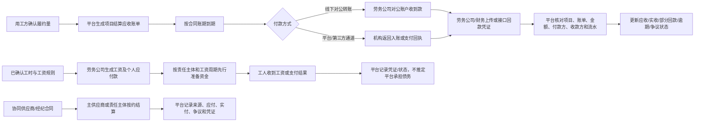

# 劳务供应链交易平台资金流转闭环与账期模型分析 v0.1

- 分析日期：2026-10-23
- 文档状态：产品经理与项目经理的资金模型决策建议，待业务、财务、技术及专业合规人员评审。
- 分析对象：用工方账期、劳务公司先行发薪、经纪/协同供给结算、线下回款、平台服务费和可选支付通道。
- 依据：[平台 PRD](PRD-v0.1.md)、[资金账户与支付指令流程](资金账户与支付指令流程-v0.1.md)、[排班—打卡—考勤核对—资金审批流程](排班-打卡-考勤核对-资金审批流程-v0.1.md)、[商业模式与收费标准](商业模式与收费标准-v0.1.md)、[战略与履约流程补充](战略与履约流程补充需求整合-v0.1.md)。

## 1. 结论先行

你的判断基本正确：**当前资金链条还不完整，但缺口不是“平台必须马上把所有钱收进来再支付出去”，而是缺少一套能够同时容纳线上、线下和混合结算的资金与账期闭环。**

当前文档已经定义了分类账单、资金审批、支付指令、第三方机构回执和对账，但主要站在“账单生成后如何发起支付”的角度；它没有充分表达真实业务中的前后错位：

1. 用工方先确认需求和履约，但按合同账期后付款；
2. 劳务公司可能在用工方回款前，已经支付工人工资、社保/保险、经纪费用和协同供应商费用；
3. 用工方可能直接线下转账到劳务公司对公账户，平台没有资金经过；
4. 平台仍需要知道这笔回款是否发生、对应哪个项目/账单、是否足额和是否逾期；
5. 平台服务费由履约方承担，计量依据是有效履约人天，不应自动等同于“用工方回款后才产生”；
6. 协同供应商与主供应商之间还会产生另一层应付关系，不能被用工方—主供应商的项目结算覆盖。

因此，平台当前应定位为**交易、履约、账务、应收应付状态和支付协同基础设施**，而不是默认资金池、垫资方、托管方或工资债务人。

如果未来希望实现由平台统一触发并支付给工人、经纪人、协同供应商和劳务公司的体验，应进一步采用[《未来平台支付与保理资金架构建议》](未来平台支付与保理资金架构建议-v0.1.md)中的三层架构：平台支付编排层 + 银行/持牌支付机构资金执行层 + 保理机构融资层。平台普通运营主体不直接持有客户资金。

## 2. 先把“资金链”拆成五条链

| 链条 | 起点 | 终点 | 平台必须知道什么 | 是否要求钱经过平台 |
| --- | --- | --- | --- | --- |
| 1. 用工方项目结算链 | 已确认履约量、账单和合同账期 | 用工方向主供应商付款 | 应收账单、到期日、付款方式、付款凭证/回执、差异、逾期和责任人 | 否；允许线下对公回款 |
| 2. 劳务公司人员支付链 | 工资/服务规则、确认工时和到期义务 | 工人或其他个人应付款收款方 | 应付依据、责任主体、应付日、实际支付状态和凭证；不能因回款未到自动改期 | 否；可先由劳务公司自有资金支付 |
| 3. 供应渠道与协同结算链 | 经纪人推荐或协同供给合同 | 经纪人/协同供应商收款方 | 来源、责任主体、结算周期、金额依据、争议和支付状态 | 否；按具体合同处理 |
| 4. 平台服务费链 | 有效履约人天和已获批费率 | 履约方向平台支付 | 计费事件、账期、应收、实收、争议和退款/冲正 | 否；不得默认从用工方回款扣除 |
| 5. 融资/资金协同链 | 已确认交易和合格应收账款 | 合作金融机构、资金方和相关回款路径 | 授权、资料包、融资状态、债权/回款关系和机构回执 | 当前不要求；属于未来可选能力 |

这五条链可以关联，但不能合并成一个“项目余额”。例如，用工方尚未付款，不代表工人尚未产生应付工资；劳务公司已经发工资，也不代表用工方项目款已经回款；平台服务费出账，也不代表平台已经收款。

## 3. 推荐的基准资金模型

### 3.1 当前默认：线下回款 + 平台记账对账

首期应把现实中最可能发生的模式定义为正式支持模式，而不是异常模式：

这里的关键是：**线下回款不是平台链条之外的不可见事件，而是平台支持的一种资金事件来源。**平台不控制银行账户，但必须能记录和核对它。

### 3.2 可选模式：平台或第三方支付协同

在机构、合同和合规安排具备后，平台可以接入余额查询、代发、付款或回款回执，但这只是上述模型的另一种执行通道。它不能改变账单、责任主体和账期起算规则，也不能把“已提交指令”显示成“已到账”。

### 3.3 未来模式：融资或保理协同

商业保理、应收账款融资和数据支撑属于未来可选增值渠道。它们可以解决部分供应商的资金缺口，但不能作为当前工资支付链的默认前置条件，也不能把平台自动变成放款方、保理商、担保方或付款保证人。融资状态必须附着在真实交易和已确认应收账款上，不能覆盖原始回款事实。

## 4. 账期必须分别定义

项目至少需要同时维护以下日期/事件，不应只有一个“项目付款日期”：

| 事件 | 说明 | 是否可由另一事件替代 |
| --- | --- | --- |
| 履约确认日 | 用工方或授权责任方确认可结算的履约量 | 不能用发票日替代 |
| 项目结算账单日 | 平台或责任方生成项目结算账单 | 不能用工资日替代 |
| 用工方付款到期日 | 按项目合同、账单或验收规则计算 | 不能由平台默认生成 |
| 工资/个人应付款日 | 按劳动/服务安排和工资周期确定 | 不能因用工方未回款自动顺延 |
| 经纪/协同结算到期日 | 按渠道或协同合同确定 | 不能直接套用用工方账期 |
| 平台服务费债权形成日 | 按平台服务合同和有效履约计量规则确定 | 不能自动等同于用工方回款日 |
| 实际付款/收款日 | 银行流水、机构回执或受控凭证能证明的日期 | 系统标记不能替代凭证 |

建议每个账单同时维护：`业务期间`、`确认日`、`出账日`、`约定到期日`、`实际支付/收款日`、`状态日`和`逾期起算日`。这样才能回答“谁已经产生义务、谁还没有付款、谁因为账期而占用资金、谁只是等待对账”。

## 5. 劳务公司的资金缺口如何体现

劳务公司的真实资金压力应当作为**资金准备和经营风险状态**体现，而不是直接变成平台的垫资义务：

`工资/个人应付款到期日 < 用工方项目款到期日`

这意味着劳务公司存在先行资金需求，资金来源可能是自有资金、银行授信、合作金融机构或其他合法安排。平台应支持：

- 展示项目预计应收、未收、已收、已逾期和争议金额；
- 展示工资、协同结算、平台服务费等应付义务的到期日和准备状态；
- 计算“预计资金缺口”作为经营分析指标，但不把它当成平台应付款；
- 在获得授权和合规前提下，为融资机构生成真实交易和履约数据包；
- 在资金不足时阻止未经授权的支付指令，提醒责任方补足，并保留未知/失败/重试记录。

平台不应在首期承诺：先替劳务公司发工资、用项目回款自动补足工资、把其他项目资金挪用，或用“平台余额”掩盖劳务公司的资金不足。

## 6. 线下回款的产品闭环

线下对公回款至少应有以下状态：

`未出账 → 已出账 → 待付款 → 部分回款 → 已回款待核对 → 已核对 → 逾期 → 争议/短款 → 退款/冲正（如适用）`

最低业务流程：

1. 平台根据中标快照、确认履约量和合同规则生成项目结算账单；
2. 账单标明付款方、收款方、项目、期间、金额、税务/发票要求、到期日和争议窗口；
3. 劳务公司或授权财务登记线下回款，上传银行回单或接入对公账户流水；
4. 平台按付款方、收款方、金额、日期、流水号和账单关联进行核对；
5. 足额匹配后更新已回款；部分匹配进入部分回款/短款；无法匹配进入待核对；超过到期日进入逾期；
6. 对争议账单保留原始账单和调整账单，不通过修改原金额消除差异；
7. 回款状态只影响项目应收、对账和风险看板，不自动改变工人工资应付状态。

## 7. 对现有产品文档的修正判断

现有《资金账户与支付指令流程》并非错误，但它更像“支付执行子流程”，不应继续承担完整资金模型。建议：

1. 保留现有支付指令、余额不足、结果未知和机构回执部分；
2. 增加线下回款登记、应收账期、部分回款、短款、逾期和银行凭证核对；
3. 将“用工方项目结算”和“工人/个人应付款”拆成相反方向的独立账务链；
4. 将“主供应商—协同供应商/经纪渠道”作为独立结算关系；
5. 增加资金缺口视图，但明确这只是预测与风险信息，不是平台垫资承诺；
6. 将平台服务费债权形成、收取账期和是否受用工方回款影响列为收费合同决策，而不是技术默认值；
7. 将支付通道抽象成线下凭证、第三方机构和未来融资协同三类来源。

## 8. 最终建议

**建议采用“账务全链路、资金多通道、责任不混同”的资金产品策略。**

- 账务全链路：从需求/合同、履约确认、账单、应收应付、账期、支付/收款、回执、对账到逾期与争议，都在平台留痕；
- 资金多通道：首期正式支持线下对公回款登记与凭证核对，同时预留第三方支付/代发接口；
- 责任不混同：用工方项目付款、劳务公司先行发薪、协同供应商结算、平台服务费和未来融资分别建模；
- 不强迫资金上平台：平台不以“所有钱必须经过平台”作为交易成立条件，否则会提高用工方采用门槛并偏离当前真实业务；
- 不放弃资金能力：虽然允许线下回款，但资金状态、账期风险和对账能力仍是完整平台范围，不应被降级为备注字段。

当前最应该补的不是“统一资金池”，而是**应收账款 + 应付义务 + 账期日历 + 线下回款核对 + 资金缺口预警**五个产品能力。

## 9. 待负责人确认的决策

| 决策项 | 建议默认 | 状态 |
| --- | --- | --- |
| 首期是否允许用工方线下直接支付劳务公司对公账户 | 允许，作为正式支持的基础模式 | 建议采纳 |
| 平台是否必须托管或代收用工方项目款 | 不必须；无合同、资质和机构方案前不代收代管 | 维持现行边界 |
| 劳务公司工资是否等待用工方回款 | 不默认等待；按适用责任和工资周期记录 | 必须项目/合同确认 |
| 资金缺口是否成为平台应付款 | 否；仅作为风险和融资协同数据 | 建议采纳 |
| 平台服务费是否必须等用工方回款后收取 | 不默认；由平台服务合同明确债权形成和付款账期 | 待收费合同确认 |
| 协同供应商/经纪渠道是否沿用用工方账期 | 不默认；按各自合同分别维护 | 建议采纳 |

## 10. 关联依据与专业审查提示

项目文档已经明确：工资支付责任、实际付款方、劳务公司资金垫付和用工方账期是不同事实；平台不默认成为工资义务人或垫资方。关于劳务派遣、外包、协同供给和工资支付责任的具体模式，仍应按项目真实合同、人员关系、岗位性质和适用地区由专业人员审查。本文不是法律、会计或融资意见。

外部规范核验入口：

- [《中华人民共和国劳动合同法》—国家市场监督管理总局公布文本](https://www.samr.gov.cn/zw/zfxxgk/fdzdgknr/bgt/art/2023/art_0abfdd261c03417b949df19d869add8d.html)
- [《劳务派遣暂行规定》—上海市人力资源和社会保障局公布文本](https://rsj.sh.gov.cn/trlzyhshbzbgz_17256/20240813/t0035_1427021.html)
