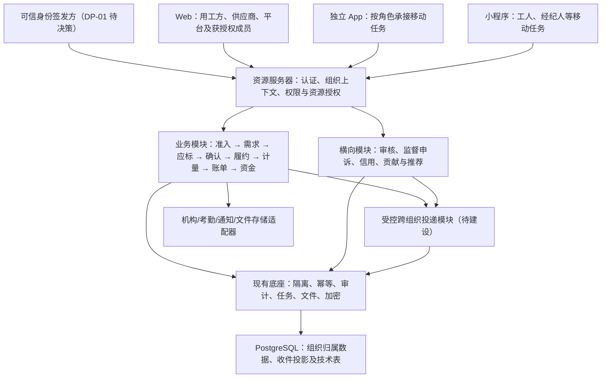

# 劳务供应链交易平台 - 详细技术方案

- **文档版本**：v2.0
- **更新日期**：2026-10-24
- **文档状态**：平台目标技术设计，待评审；不是业务规则批准记录、开发完成证明或上线许可。
- **替代范围**：替代 v1.0 面向劳务公司内部管理 SaaS 的架构假设；历史版本由 Git 保留。

## 1. 依据、边界与现状

### 1.1 文档依据及职责

| 依据 | 本方案如何使用 |
| --- | --- |
| [项目 README](../../../README.md) | 项目定位与七条护栏；所有技术决策必须遵守。 |
| [需求基线 v0.4](../../01-售前阶段/需求分析/requirements-draft-v0.4.md)、[PRD v0.1](../产品设计/00-产品全景/PRD-v0.1.md) | 交易链、参与方、功能范围及规则来源；PRD 草案不等于全部规则获批。 |
| [项目推进建议](../../00-项目管理/项目计划/项目推进建议-v0.1.md) | 按角色任务、决策和证据推进，不按页面数量判断完成。 |
| [业务包与首批实施清单](../产品设计/05-战略与实施/业务包拆解与首批实施清单-v0.1.md) | BP-01～BP-15、DP-01～DP-15、首批任务和验收场景的唯一编号来源。 |
| [需求追踪与交接门禁](../产品设计/05-战略与实施/需求追踪与交接门禁-v0.1.md) | FR 需求和 G-01～G-09 门禁；本方案提供技术承接，不替代审批。 |
| [通用后端底座建设方案](通用后端底座建设方案-v1.md)、[后端接入说明](../../../backend/README.md) | 已有基础能力、真实接口契约、验证记录及未实现边界。 |
| [工程约束](../../../CLAUDE.md) | 组织隔离、跨组织投递、数据字段及工程规范；以其中现行补充和后端实际契约为准。 |

本方案规定目标架构、领域职责、数据流、不变量、技术接入与验证方式，不再次维护收费档位、工资规则、返费天数、审核时限、推荐奖励比例或机构服务承诺。发生产品冲突时记录决策，不由研发通过默认参数替业务拍板。

### 1.2 当前真实状态

| 层次 | 仓库现状 | 不能据此推定 |
| --- | --- | --- |
| 产品与制度 | 已形成交易平台需求、专项草案、业务包及门禁。 | 文档已编写不代表详细规则已批准。 |
| 后端 | 已有非业务通用底座：认证校验、组织隔离、权限、审计、幂等、任务、加密及私有文件等。 | 不含完整身份签发、成员管理，也未实现招聘、交易、履约、结算或支付业务闭环。 |
| 数据库 | Flyway 已有底座技术表及编号序列。 | 不存在本方案所列全部业务表或跨组织投递表。 |
| Web、独立 App、小程序 | 目录与技术方向已预留，尚无完整可运行业务端。 | 不能把页面规划写成多端已开发或已联调。 |
| 部署与外部机构 | 有本地 PostgreSQL 依赖环境；生产部署、业务机构接入及真实资金能力待建设、验证和批准。 | 本地运行、模拟回调或底座测试通过不代表生产可用。 |

后端 README 记录了 2026-10-23 的 116 项单元测试、18 项集成测试及覆盖率结果；这是底座的历史验证记录，不是本次重新执行结果，更不覆盖尚未开发的业务包。

业务包分别维护四个状态维度，禁止压成一个“完成”：

1. **规则批准**：规则版本、适用范围、批准人和证据；方向确认与细则批准分开。
2. **开发完成**：实现、迁移、自动化测试、各端角色任务和运维说明。
3. **联调验证**：标明模拟环境还是真实机构环境、验证对象及结果。
4. **真实启用**：主体、合同、权限、机构、资金和运营条件满足后的授权记录。

### 1.3 七条护栏的技术落实

| 护栏 | 技术约束 |
| --- | --- |
| 不是劳务公司内部 SaaS | 人员、排班、工资等管理对象必须关联交易、项目及责任主体；不以单租户后台覆盖率代替交易能力。 |
| 不是只发布需求的撮合网站 | 覆盖准入、应标、中标确认、供给履约、计量、账单、资金状态及监督申诉。 |
| 不是平台亲自供人、垫工资 | 数据明确合同、交付、工资债务、审批和实际付款主体；平台操作不能变成供应商承诺。 |
| 不是全部资金入平台才算闭环 | 对公线下付款同样记录账期、凭证、核验、分配、短款、逾期和对账；不设计默认平台资金池。 |
| 不是只监督供应商 | 用工方、供应商、经纪人和平台自身均有事实、证据、告知、申诉及复核链。 |
| 不是以合规抹掉增长 | 保留资格、贡献、直接推荐、转化和奖励审批模块；未获批准不支付，但不能删除需求。 |
| 不是文档或测试即上线 | 审批证据、代码验证、机构联调和启用许可各自留档，界面不能混用状态。 |

## 2. 总体架构与技术选择

### 2.1 架构形态

采用**模块化单体 + PostgreSQL + 多角色多端 + 受控外部适配器**。先沿业务包建立清晰模块，不因平台化直接拆微服务；也不以“大一统管理后台”承载所有角色和权限。

图中业务、治理、投递及外部适配器均为目标设计；不代表仓库已经实现。图中的连接不授权跨租户直接查询。

### 2.2 技术基线

| 层次 | 已有基线或目标方向 | 使用约束 |
| --- | --- | --- |
| 后端运行时 | Java 17；仓库 Spring Boot 3.5.7。 | 是当前仓库版本，不是“最新”或已完成生产安全审查的结论。 |
| 数据访问与迁移 | MyBatis Plus 3.5.14、PostgreSQL 16、Flyway。 | 延用现有隔离策略；新表、新约束用新增迁移，不修改已应用迁移。 |
| 接口与安全 | Spring MVC、Validation、Spring Security OAuth2 Resource Server、springdoc 2.8.13。 | 精确权限与组织内资源授权结合，不增加另一套绕过底座的认证。 |
| 任务与可靠消息 | 现有 PostgreSQL 任务队列；目标投递发件/收件记录。 | 默认不引入 Redis、RabbitMQ 或 Kafka；确有容量/隔离需求再决策。 |
| Web | Vue 3、TypeScript、Vite、Element Plus 为既定方向。 | 初始化时确认并锁定依赖、测试和构建；不宣称已建成。 |
| 独立 App | Flutter 3.x 为既定方向。 | 按角色任务同步建设，不默认推迟为遥远增值项；具体版本、发布条件待确认。 |
| 微信小程序 | uni-app 3.x、uni-ui 为既定方向。 | 核对平台授权、隐私告知和实际接口限制；服务端仍是唯一规则执行处。 |
| 文件、部署与可观测 | 已有私有本地文件、Actuator 和请求追踪基础。 | 对象存储、多实例、高可用、告警及生产发布链均需另行实施。 |

不以假设的日交易量、租户规模或并发数证明选型。先收集需求分发规模、打卡峰值、任务积压、对账批次和文件量，再给出容量预算与压测验收值。

### 2.3 模块组织原则

- 业务模块以少量明确的应用命令和查询入口隐藏状态转换、权限、并发、证据及事件复杂性，不暴露任意修改状态的通用 CRUD。
- 模块内部再按应用编排、领域规则和持久化组织；不机械地给每个类加一层接口。
- 身份、支付机构、外部考勤、通知与存储存在真实变化，设置适配接口；模拟适配器与真实适配器明确区分。
- 通用底座不承载工资、返费、收费、推荐奖励和平台裁决规则；跨模块只通过明确合同协作，不直接改对方业务表。
- 一个组织内确需原子完成的动作使用本地事务；跨组织与机构交互依靠可靠投递、幂等和对账，不承诺跨系统大事务。

## 3. 领域模块、归属与追踪

下表是拟议逻辑模块，不是已创建的包名或数据库表清单。BP、FR 和 DP 的细节继续引用上位文档。

| 业务包 / 需求 | 模块与主要对象 | 核心职责及责任归属 |
| --- | --- | --- |
| BP-01 / FR-01 | 身份接入、组织、成员、授权、撤权 | 全局账号与组织成员分离；组织管理员仅在批准范围授权，平台不是交易方超级管理员。 |
| BP-02 / FR-02 | 入驻申请、资质版本、审核任务 | 用工方、劳务公司分别准入；登录、组织控制权和业务资格分别校验。 |
| BP-03 / FR-03 | 需求草稿、版本、审核、发布 | 用工方拥有源需求，平台核验发布条件；供应商接收白名单投影。 |
| BP-04 / FR-04 | 应标版本、承诺、偏离项、中标配额 | 供应商拥有应标，用工方拥有采购决定；平台不代选供应商。 |
| BP-05 / FR-05、FR-14 | 双方确认、条件快照、项目关系 | 双方对同一版本确认；各组织持有自己的合同快照及项目视图，重复事件不重复建项目。 |
| BP-06 / FR-05A | 履约方案、供给计划、协同请求 | 自营、经纪渠道、经批准的公司协作分别记录；主供应商不因平台调度而免除责任。 |
| BP-07 / FR-06、FR-07 | 报名、推荐归属、人员项目关系、入离职、保险核验 | 候选、承诺和实际到岗分开；人员身份可关联但敏感资料不全平台公开。 |
| BP-08 / FR-08 | 排班、打卡、外部考勤、差异、确认量 | 原始证据不可覆盖；确认主体与争议量明确；计量口径版本化。 |
| BP-09 / FR-09、FR-10 | 工资应付、借支、返费政策与权益 | 工资与渠道权益分别计算；供应商的债务和审批不转移给平台。 |
| BP-10 / FR-11 | 分类账单、平台费、对账、调整单 | 保留计算依据和合同规则；已出账不等于已收到资金。 |
| BP-11 / FR-12、FR-12A、FR-13 | 账期、应收应付、凭证、资金指令、回执 | 线上机构执行与线下对公付款均可追踪；保证金仅在规则及账户产品批准后启用。 |
| BP-11 的未来扩展 / FR-12B | 机构融资申请及数据适配 | 支付与融资不能混为一谈；保理仅预留扩展，不列为当前已批准融资或收费能力。 |
| BP-12 / FR-16～FR-19 | 审核、监督、投诉、复核、执行与回避 | 对交易各方和平台自身适用；平台审核不是代替交易方确认。 |
| BP-13 / FR-15 | 信用事实、核验、授权、纠错 | 用工方、供应商、经纪人均可形成可核验档案；投诉不自动成为失信结论。 |
| BP-14 / FR-20～FR-23 | 资格、贡献、直接推荐、转化、奖励 | 保留人事经理收益及跨企业推荐路径；不默认向在职采购经办人支付个人佣金。 |
| BP-15 / 横向覆盖 | 多端任务、安全、恢复、运营启用 | 各端完成真实角色链；不是把所有前端、安全和集成工作拖到最后才做。 |

## 4. 身份、组织与跨组织协作

### 4.1 身份与授权

现有后端只验证可信签发方的 RS256 JWT，不提供注册、登录或令牌签发。DP-01 必须先决定身份签发方、注册/找回、多端接入和组织上下文签发方式，不能在业务控制器中临时自签令牌。

每次业务请求执行以下检查：

1. 校验签名、`iss`、`aud`、`exp`、`jti`、合法 `sub` 及撤销状态。
2. 对需组织上下文的操作，取得可信 `tenant_id`，验证有效成员关系及组织状态。
3. 校验精确操作权限，再校验项目、案件、人员或账单等资源范围和当前业务状态。
4. 对审批、出账、指令、导出等关键操作重新检查实时资格，不能仅依赖历史令牌中的权限。
5. 记录必要审计及拒绝原因，避免在日志泄露令牌、证件、工资和银行账户。

成员实时检查、撤权联动和组织授权模块均待 BP-01 建设。现有 `TokenRevocations` 可作为撤销机制，但不代表成员变更已自动撤销所有相关令牌；须明确会话索引、撤销失败处理与验证场景。

组织切换由身份流程重新验证成员关系、形成可信上下文；不接受客户端组织请求头作为授权，也不在业务代码内临时切换租户。

### 4.2 租户和个人账户

- 租户等于组织：用工方、劳务公司各为组织租户，平台运营使用独立平台租户。
- 同一组织不兼具用工方与劳务公司角色；这是已确认边界，不重新开放为“可配置双角色”。
- 工人、个人经纪人是全局账号，通过成员或专项授权访问组织内本人/相关业务；不得因此获得整个租户的数据。
- 全局身份及撤销等技术数据遵守已有受控共享表策略；新增共享身份表须专项审查，不能把业务交易表配置为共享表。
- 一次请求只访问一个已授权组织上下文。个人跨公司汇总由客户端按有效成员关系分别请求后合并，不提供后台无界跨租户聚合。
- 被暂停者的历史凭证和申诉访问使用独立受限授权，不以恢复全部业务权限解决。

### 4.3 跨组织投递协议（待建设）

坚持“源数据归属方保存，接收方只查自己的收件投影”。例如：

| 源归属方 | 接收方 | 允许投递的内容示例 |
| --- | --- | --- |
| 用工方 | 符合准入与可见范围的供应商 | 已发布需求版本、有效条件、公开附件引用、截止及撤回事件。 |
| 供应商 | 对应需求的用工方 | 应标承诺、报价和偏离项；不含供应商内部利润、其他客户数据。 |
| 双方各自 | 对手方 | 选标、确认、变更、已授权履约和账单核对事件。 |
| 交易各方 | 平台 | 为准入、核验、监督所必需的资质、事实及账单字段；不等于平台读取全部源表。 |
| 平台 | 案件相关方 | 审核结果、补正、通知、复核及执行结果；按案件范围脱敏。 |

目标投递流程：

1. 源组织事务内保存事实、业务版本及发件意图；使用任务队列触发，不先提交远程副作用再补写业务事实。
2. 由**唯一受控投递模块**验证事件类型、源主体、目标资格、字段白名单和批准范围；收件人不能仅由客户端任意指定。
3. 投递模块在独立、目标明确的事务中写入接收方收件记录及投影；源业务代码不得切换租户或直接操作收件表。
4. 以源组织、事件标识和接收组织建立去重约束；记录源对象、业务版本、模式版本、请求标识及处理结果。
5. 处理重复、乱序、撤回和权限失效；旧版本不得覆盖新版本。缺失前置事件进入等待或受控重放，不凭到达顺序修改最终事实。
6. 失败进入可观测重试和人工处置；展示投递中、失败或版本落后，不用源租户查询兜底。

**实现准入**：现有租户插件不允许普通业务自行指定目标租户写入。投递模块的专用写入通道、允许访问的表和操作、调用身份、事务隔离、审计及测试必须专项评审；不能复用普通 Mapper 加 `InterceptorIgnore` 或原生 SQL 作为通用绕过手段。任何例外只限批准的投递实现，不向业务模块暴露任意目标租户能力。

现有任务恢复的是来源上下文且不恢复权限，不能把任务携带的源租户或来源操作者当成目标组织授权。接收方后续确认必须由接收方真实获授权人员执行，投递成功不等于业务确认。

### 4.4 跨组织附件与敏感数据

现有私有文件默认仅上传者可访问，尚未实现业务附件绑定及跨组织文件授权。后续需建设附件所属业务对象、授权用途、接收方授权、有效期及撤回规则。

文件元数据、收件引用或知晓文件 ID 都不是下载权限；下载时重新检查租户、业务对象和字段级权限。证件、工资、银行账户和内部报价不随整个项目对象序列化后投递。必要脱敏、导出范围及访问留痕由服务端执行。

## 5. 完整交易链的技术合同

以下状态是设计语义示例，正式枚举、时限和回退规则须随 DP 评审，不将本节直接视作批准的业务制度。

### 5.1 入驻、有效需求与发布

- 组织申请、资质版本与业务能力分开：审核通过某类材料不代表所有服务范围均获准。
- 用工方需求采用“草稿—提交审核—补正/审核结果—获准发布—暂停/撤回/关闭”的受控命令；平台审核与用工方采购授权分别校验。
- 发布前检查主体资格、需求完整性、计价计量、账期及披露条件；具体矩阵引用专项规则，不硬编码建议阈值。
- 发布生成不可覆盖版本和供应商可见快照；关键变更生成新版本、按规则重审并通知已参与方。
- 暂停、撤回及截止必须在服务端拒绝不允许的新应标；同步事件到各接收方，不能只隐藏前端按钮。
- 新投递仍需核验供应商资格；资格变化后哪些历史内容可读、哪些新动作被禁用，应按 DP-04/07 明确。

### 5.2 应标、多家中标与双方确认

- 供应商应标显式回应需求版本、供给承诺、价格和偏离项，撤改保留历史；不让用工方看到其他供应商无关商业信息。
- 用工方选标是独立授权操作；平台审核或推荐不生成采购同意。
- 在组织内通过需求聚合版本、必要行锁及唯一约束控制配额，防止并发中标超过需求或对应承诺量。
- 选标结果投递给供应商；供应商对最终条件版本确认后，才按批准规则形成有效双方快照。
- 双方快照包含需求、应标、配额、计量、责任、合同和相关政策版本；不同版本的两次确认不能拼成同一合同。
- 跨组织确认通过确认消息及接收状态推进，不在一个事务中修改两方租户业务表；建立项目的幂等键关联中标结果及确认版本。
- 拒绝、超时、配额释放和重选须有 DP-09 规则；不预设“默认同意”。

### 5.3 供给计划、招聘与到岗

- 项目关联供应商履约方案，分别记录自有、经纪渠道、合作劳务公司供给计划、实际候选及到岗。
- 协作公司供给先走获准触达、响应与批准流程，分别保存人员、合同、交付和结算责任；不以平台界面把多个主体合成平台供人。
- 同人识别在授权范围内使用受保护身份信息或受控匹配标识，不公开证件、不允许跨组织遍历人员库。
- 撞单和推荐归属保存来源、时间、规则版本及处理证据；不沿用旧 SaaS 默认保护期或“先录入者永久归属”。
- 入职、保险核验、排班、到岗和离职分别成事实；报名人数、可供人数、实际到岗和有效履约人数不能相互替代。
- 保险或签约材料的“上传”“核验”“适用关系”分开，哈希值不能证明材料真实或保险必然有效。

### 5.4 排班、打卡、差异与计量

- 班次保留业务日期、项目时区和跨日区间；工人小程序实际打卡作为独立来源，服务端保留接收时间及校验结果。
- 外部考勤保留来源系统、原始记录标识、导入批次和版本；适配器不可覆盖平台打卡。
- 定位、设备、照片等采集只按获批必要性执行，不默认引入持续定位或人脸识别。
- 补卡、工时修正和差异处理形成追加记录；原始证据不因补正或撤销被物理替换。
- 用工方、供应商及工人按获批权限核对、确认或申诉；单方导入不自动成为双方无争议计量。
- 分别生成工资计量、供应商结算计量、返费达标量与平台有效计费人天，保存规则及确认版本，禁止共用一个可编辑“天数”字段。
- 争议部分与无争议部分拆开处理；确认后的更正通过重算差额和调整单传递，不静默重写已出账依据。

### 5.5 工资、借支、返费与分类账单

- 工资债务属于相应责任主体；用工方未回款不是自动延迟工资义务的系统前置条件。
- 工资条、借支、渠道返费、合作公司结算、买卖双方项目账单与平台服务费分别建模、授权和对账。
- 未实际支付的借支不形成扣回；不足时不通过负实发掩盖差额，按批准规则形成待处理记录。
- 已锁定返费权益保留政策和归属快照；经纪人只见授权权益，不见工人工资或供应商结算底价。
- 账单关联确认计量、价格及规则版本、期间、债权债务主体、到期日和调整；出账、确认、开票、付款、实收分别记录。
- 平台服务费只引用[商业模式与收费标准](../产品设计/03-账单与资金/商业模式与收费标准-v0.1.md)的现行批准版本，不在技术方案复制费率；收取路径、合同及税务未批准前不启用实收。
- 锁账后以追加调整、冲正或退款关系表达变更；“付款中”“部分实收”“争议中”“逾期”保留各自语义。

## 6. 资金、账期与机构接入

### 6.1 五条独立资金关系

| 资金关系 | 必须明确的主体与状态 |
| --- | --- |
| 用工方 → 供应商 | 项目应付/应收、账期、凭证、核验、实收及差额。 |
| 供应商 → 工人 | 工资、已付借支及扣回、工资审批、实际付款；不由买方回款状态替代。 |
| 供应商 → 经纪人/合作供应商 | 各自权益或合同应付、批准、税务及收款核验。 |
| 供应商 → 平台 | 已批准平台费账单、实收、退款及对账；不是平台代管全部交易资金。 |
| 未来机构融资 | 独立申请、机构授信/融资合同、放款和还款关系；当前不启用保理承诺或费用。 |

项目可以呈现各链汇总，但不能只有一个可手工调整的“项目余额”。账单金额、支付指令金额、机构执行金额和已核验实收金额分开；禁止以内部状态变更模拟资金真实到账。

### 6.2 线下对公付款闭环

1. 依据合同记录账期起算事件、到期日、币种及应收应付主体；账期规则待 DP-12 批准。
2. 付款方提交凭证或由授权渠道导入流水，标记“待核验”，不立即增加可用资金或结束债务。
3. 授权核验人核对账户归属、金额、币种、日期及流水标识；重复提交同一流水不能重复计收。
4. 在并发控制下将已核验流水分配到一张或多张账单，约束累计分配不超可分配金额；保留未分配款、部分收款及短款。
5. 争议、更正和撤销核验以追加记录处理，保留原凭证及核验链；账单余额、对账状态与逾期提示重新计算。

线下核验是平台事实记录，不自动证明银行资金已由平台保管，也不允许将截图当成机构结算回执。

### 6.3 支付指令与未知结果恢复

支付适配器须区分平台记录/编排、供应商授权和备款、持牌机构实际执行。未经 DP-13 确认的账户产品、分账路径或支付接口不宣称可用。

目标流程为：

`业务应付 → 责任主体审批 → 固化支付意图 → 机构提交 → 处理中/结果未知 → 查询或回调核验 → 最终结果 → 对账`

- 同一支付意图使用稳定业务指令号、机构幂等标识、收付款方、金额/币种和授权版本；关键字段变更须新审批，不复用旧批准。
- 本地事务保存意图及待处理任务，远程调用在事务外执行；现有 `IdempotentExecutor` 不提供银行、短信或文件系统的原子事务。
- 超时、连接断开或回执丢失进入 `UNKNOWN` 类状态，先按原指令查询和对账；不能换新幂等键盲目重付。
- 机构回调在适配器入口验签、防重放并持久化去重，然后按指令范围处理；回调不承担用户授权、租户选择或审批功能。
- 核对机构、订单、账户、金额、币种及允许的状态转换；重复/乱序回调不能把成功退回处理中，也不能重复记实付。
- 外部回调和定时查询共同收敛结果；长时间未知或无法匹配转人工调查，保留机构证据和处置轨迹。
- 余额不足、账户冻结、授权失效等暂停或失败原因分别记录；恢复前重新检查执行条件。
- 模拟适配器使用独立配置、账户和数据标识，不能通过开关将模拟成功自动提升为真实机构回执。

保证金、退款、分账及未来融资均需要独立规则与机构产品验证，不从一个通用“支付成功”标志推导所有链路完成。

## 7. 中立监督、信用与增长

### 7.1 审核、案件与平台自约束

目标对象包括审核任务、证据、补正、监督事项、投诉、复核、执行及回避声明。各对象保存关联业务版本、当事方、理由、经办岗位和证据授权范围。

- 系统允许材料不齐、需补正、争议未决等中间状态，不能把投诉提交即视作违约成立。
- 审核、复核与执行职责分离，原经办不能独立复核自身案件；涉及平台自身的投诉有独立受理和回避路径。
- 平台可以核验事实、提醒、监督整改及按批准规则限制能力，但不能代用工方确认工时、代供应商批准工资或用裁决状态直接触发银行付款。
- 制裁、暂停和恢复须有适用规则、依据、告知及申诉渠道；原始交易事实不因处罚被删除。
- 平台自查、越权访问、错误核验及申诉改判也记录事实和改正结果，不仅记录供应商问题。

### 7.2 三方交易信用

信用模块分别记录用工方、供应商和经纪人的交易事实及核验状态。事实、主张、争议、最终处理和更正不能混成一个评分字段。

每项展示和导出检查用途、接收者授权及最小范围。未经 DP-14 批准，不自动公开黑名单、跨组织评分或向资金方分享档案；未来融资资料包须重新核对授权、来源、争议和有效期。

### 7.3 人事经理贡献与跨企业推荐

采用“资格申请—利益冲突核验—真实服务成果/直接引荐—转化归属—合格平台实收核对—奖励审批—获准路径结算”的目标链。

- FR-20：适格身份、所属组织、授权、利益冲突及合同分别记录；组织成员身份不自动等于奖励收款资格。
- FR-21：贡献关联真实服务成果及验收证据，不以本人采购金额直接生成佣金。
- FR-22：直接推荐保留被推荐组织授权、线索去重和转化事实；不设计多层级拉人返佣。
- FR-23：拟议权益、已批准应付和已付款分开；奖励依据关联批准规则版本、预算及符合条件的实际平台收入，防重复计算和退款后超付。
- 资格、参数、税务、合同和付款路径未批准时支持申请、证据与模拟测算，但不生成可提现承诺；不能仅写“禁止返佣”后删除增长工作。

## 8. 数据、接口与一致性设计

### 8.1 逻辑数据分组及建表要求

| 分组 | 拟议记录类型 | 约束重点 |
| --- | --- | --- |
| 身份与准入 | 组织、成员、授权、申请、资质版本 | 控制权、互斥组织角色、授权撤销及资质有效性。 |
| 交易 | 需求版本、应标版本、配额、双方确认、项目快照 | 归属明确、唯一业务键、不可覆盖的条件版本。 |
| 履约与计量 | 供给关系、报名归属、到岗、班次、原始记录、差异及确认量 | 来源分离、人员去重、跨日、计量规则及修正链。 |
| 账务与资金 | 分类账单、调整、账期、凭证、分配、指令、机构回执 | 债权债务与资金权属明确，累计金额约束、稳定指令及对账。 |
| 治理与增长 | 案件、回避、信用事实、授权、贡献、推荐和奖励 | 证据范围、独立复核、归属去重及规则版本。 |
| 协作 | 发件意图、接收记录、组织内投影、附件授权 | 字段白名单、目标组织授权、幂等及版本推进。 |

以上不是可直接执行的 DDL。各业务包开发前必须输出实体关系、表归属、必备字段、索引、唯一/外键/检查约束、保留策略及迁移测试，进行数据库设计评审。

落实以下公共规则：

- 普通业务表具有 `tenant_id` 和工程要求的主键、创建/更新及删除标记等字段；已有技术共享表不因本方案强行重建。物理外键和唯一约束须考虑租户维度，防止跨组织关联。
- 显式登记租户表或受控共享表；未知表拒绝访问。不能将项目、账单或信用事实列为共享表来实现平台可见。
- DTO 不接受可任意设置的 `tenant_id`；租户表 INSERT 由插件注入，UPDATE 不改租户，遵循现有实体字段策略；租户表 upsert 不在底座支持合同内。
- 业务编号使用 `SequenceIds.nextId()` / `nextReference(prefix)`；序列可跳号，不当作严格时间顺序或连续会计凭证号。文件 ID 继续使用底座随机 UUID。
- 金额使用 `BigDecimal` / PostgreSQL `NUMERIC`，不使用浮点数；正式精度遵守现行工程约束，若需扩展须先评审迁移。计算中间精度、工资单价、工时、人天、汇总和舍入时点按业务规则分别定义，不能把两位小数工具当通用算法。
- 绝对时间与业务日期、班次时区分开；`TIMESTAMPTZ` 的 Java 映射及 JSON 时区须结合现行规范做往返验证，不在未评审时替换所有日期类型。
- 事实、快照、账单及回执不可借软删除隐藏修正链；撤回、作废、调整和更正应表达为有原因的状态或追加记录。

### 8.2 应用接口合同

接口采用现有 `/api` 基线。以 `submitDemand`、`publishDemand`、`confirmAward`、`confirmMeasurement`、`approvePaymentIntent` 等命令语义表达操作，不开放任意 `setStatus`。

每个命令进入开发前给出：

| 合同项 | 必须说明 |
| --- | --- |
| 调用资格 | 角色、当前组织、精确权限、资源范围及业务前置状态。 |
| 请求 | 稳定 DTO、必填及范围校验、预期版本；明确不允许客户端设置的归属和审批字段。 |
| 幂等 | 稳定操作名及版本、幂等键、请求摘要范围、重放前授权；冲突语义。 |
| 结果 | 本地事实与版本、是否已确认、是否仍待投递/机构处理；不将受理成功写成履约成功。 |
| 异常 | 越权、无效状态、版本冲突、规则未启用、依赖未知及可恢复方式。 |
| 副作用 | 同事务数据、发件意图、任务、接收方、白名单及审计；外部副作用的补偿与对账。 |
| 多端 | Web/App/小程序的发起、审批、查看、补正和异常恢复任务。 |

继续遵守底座合同：业务 JSON 使用 `Result<T>` 及真实 HTTP 状态；下载、Actuator 和 OpenAPI 按原生响应处理。所有 `Long/long` 对外序列化为字符串，金额及高精度计量在前端避免浮点运算；分页使用 `PageQuery`，单页上限 200。

### 8.3 并发、幂等与任务

- 组织内状态推进使用预期版本及必要的 `@Version` 乐观锁；涉及配额、核销或金额分配时增加数据库约束及必要行锁。不能只靠前端禁用按钮或 JVM 锁。
- `IdempotentExecutor` 的隔离键是组织、操作者、操作及键值；不同请求体复用键返回冲突。同一业务由不同操作者重试还需业务唯一约束，不能只依赖接口幂等。
- 幂等重放前重新授权；稳定 DTO 和操作版本避免改变序列化含义。现有记录没有自动过期，保留与归档另行设计。
- `TaskQueue` 与业务事务内入队，任务至少一次执行；负载上限 64 KiB，文件和敏感大对象只保存受控引用。
- 工作器有租约和重试，但没有租约续期或强制中断保证；处理器设超时，并对重复执行和租约过期后并行执行保持幂等。
- 任务恢复上下文但权限为空，执行时重新验证业务授权或受控系统执行资格；审批人历史身份不等于任务永久权限。
- 不宣称“消息恰好一次”或“分布式锁保证资金不重复”；最终保障来自业务唯一约束、机构幂等、查询和对账。

### 8.4 审计与证据

使用底座 `AuditRecorder` 记录安全标识、对象、动作、结果和请求关联，不写完整敏感 DTO。现有审计与业务同事务，回滚时记录也会回滚，不能声称已经具备独立失败审计或不可篡改账本。

对审批否决、越权尝试、平台自查、资金调查等需要独立留存的事件，应另行评审安全日志/独立审计存储、访问控制、保留与归档；不能为了留痕吞掉业务异常或提交部分业务数据。

文件摘要、事件标识和快照摘要仅用于完整性与版本关联，不自动构成法律真实性证明。合同、材料来源和核验过程仍需业务证据。

## 9. 多端、安全、运行与恢复

### 9.1 多端按任务交付

多端职责引用[多端功能清单与职责边界](../产品设计/00-产品全景/多端功能清单与职责边界-v0.1.md)，不是把同一管理后台缩放成多个端。

- 用工方完成入驻、需求、采购确认、计量确认、对账和申诉；供应商完成应标、供给、招聘、履约、审批及资金跟踪。
- 工人完成本人入职、班次、实际打卡、核对、工资查看及申诉；经纪人完成授权报名、归属和本人权益查看。
- 平台完成审核、监督、回避复核、执行及自身投诉处理，不能使用平台身份替代交易方点击确认。
- 每个业务包同步确定各端任务、接口、附件、通知及异常恢复；不能只验收后台接口后将必要独立 App 或小程序统称“以后再做”。
- 各端使用相同规则版本和服务端状态机，端内缓存不得成为审批与支付的授权依据。

### 9.2 安全接入基线

- 延用 `ExecutionContext`、精确权限和租户插件；禁止客户端身份头、管理员绕过或调试免认证。
- 加密使用底座外部密钥配置的版本化 AES-GCM 和用途隔离；不使用 ECB、固定密钥或明文账户。
- Web CORS 精确白名单，生产不开放通配来源；令牌安全存储、App/小程序登录与刷新方案随 DP-01 评审。
- 延用请求 JSON 1 MiB、单文件 10 MiB、multipart 总量 11 MiB 的现行限制；扩大前须评审资源风险。文件类型、恶意内容检测及业务用途校验作为业务附件接入项。
- 请求标识沿用现有校验和清理机制；日志脱敏、导出审批、文件下载和安全事件访问需测试。
- 回调采用经审查的机器身份与验签入口，不能为接收机构回调将普通业务接口匿名开放。

### 9.3 部署、可观测与恢复

生产目标先采用可运维的单体部署，不把主从、高可用、容器编排或异地容灾写成已具备能力。多实例启用前验证任务竞争、唯一约束、文件可见性和定时任务幂等。

上线前逐项落实：

1. 隔离开发、测试和生产的数据库、身份发行方、密钥、文件及机构账户，模拟事件不可混入生产。
2. 生产关闭开发文档暴露面，最小化 Actuator 权限与日志访问；迁移账号与运行账号分离，限制数据库及文件权限。
3. 验证依赖漏洞、镜像/制品来源、密钥轮换及证书到期；本文件版本表不代替安全审查。
4. 监控认证拒绝、关键命令失败、任务延迟/重试/积压、投递落后、考勤差异、未知支付、未分配款和对账不平；告警指向责任岗位。
5. PostgreSQL 备份及恢复演练与私有文件协调执行；现有本地存储不自动具备多实例共享、孤儿清理或灾后恢复。
6. 按真实业务确定 RPO/RTO、容量、备份周期和恢复验收值，执行演练后记录，不使用未经验证的可用率和恢复承诺。
7. 发布采用兼容迁移和分阶段开关；不可逆迁移或已执行的银行付款不能依赖回滚代码撤销，必须有前向修复、调查及对账流程。

## 10. 验证、实施顺序与待决策事项

### 10.1 按模块接口验证的重点场景

| 范围 | 必须覆盖的反例与验收证据 |
| --- | --- |
| BP-01～BP-03 | 非成员、已撤权、伪造组织、互斥角色、未准入发布、采购权限不足、关键字段遗漏及变更重审。 |
| 跨组织投递 | 越权目标、字段泄露、重复/乱序/遗漏、撤回、资格失效、失败重试、目标事务失败及附件越权。 |
| BP-04～BP-05 | 并发超配额、过期应标、双方版本不一致、拒绝/释放、重复中标消息不重复建项目。 |
| BP-06～BP-08 | 多来源同人、未批准协作、报名不算到岗、跨日班、漏卡补正、外部记录冲突、争议量不进入无争议量。 |
| BP-09～BP-10 | 工资与回款解耦、未付借支不扣回、负实发防护、旧权益不被覆盖、计量版本及舍入、锁账追加调整。 |
| BP-11 | 未审批/账户不符、余额不足、未知先查、重复/乱序回调、金额不符、线下重复凭证、部分核销和并发超分配。 |
| BP-12～BP-13 | 投诉未决不定失信、原经办不能自复核、平台自身投诉、暂停仍可受限申诉、档案未授权不可导出。 |
| BP-14 | 身份不适格、利益冲突、贡献无成果、推荐重复归属、多层级拒绝、未实收/退款、未批准规则不可产生可提现权益。 |
| BP-15 | 各端真实角色旅程、权限撤销、文件隔离、任务租约过期、故障重放、备份恢复、模拟与真实环境隔离。 |

使用 PostgreSQL 验证真实租户插件、约束、锁、事务和任务竞争；不能只以 Mock 测试推断跨组织安全。机构适配器先做合同测试及故障模拟，再在获准环境验证真实授权、查询、回调和对账。

沿用后端门禁：`mvn test` 只跑单元测试；完整验证为 `mvn -B -ntp -Pintegration clean verify`，使用 Java 17、PostgreSQL 16 和独立 `_test` 测试库。集成测试会清理测试表，禁止指向生产或共享业务库；不得跳过测试或降低覆盖率门禁。多端初始化后补充各自构建、静态检查、任务旅程及隐私授权验证。

### 10.2 依赖顺序与交付门禁

| 阶段 | 实施内容 | 进入下一段的证据 |
| --- | --- | --- |
| 1. 身份组织与用工方源头 | BP-01、BP-02、BP-03；同步建设最小投递能力、附件授权及必要多端任务。 | DP-01～DP-08 的相应子规则与 G-01；有效需求能在授权范围内发布和接收。 |
| 2. 应标到项目 | BP-04、BP-05，扩展双向投递、配额与快照。 | DP-09、G-02；双方对同一版本确认，重放不重复建项目。 |
| 3. 供给到计量 | BP-06～BP-08，包括三类供给、招聘保险及工人真实打卡。 | DP-10/11、G-03；来源、到岗、差异及确认量可核验。 |
| 4. 权益到账单及资金 | BP-09～BP-11；线上机构与线下对公并行建模。 | DP-12/13、G-04/G-05；审批、未知恢复、凭证核验及对账通过。 |
| 贯穿各段 | BP-12～BP-15：审核监督、信用、贡献推荐、多端、安全及运营。 | DP-05/14/15、G-06～G-09；对应阶段的岗位、申诉、合法增长路径和启用条件成立。 |

这是依赖顺序，不是把范围收缩为内部 SaaS MVP，也不是先“假闭环”后补真实履约。业务包可按已批准子任务并行，但未批准的关键规则只做草稿、原型或隔离模拟。

每个子任务交付：规则证据、状态/权限矩阵、数据设计、接口/事件合同、端内任务、异常恢复、测试、迁移和运维说明。具体首批任务及 AC 场景引用业务包清单，本方案不另建重复任务编号。

### 10.3 技术评审待办与决策映射

| 决策 | 技术评审输出 | 未决时的限制 |
| --- | --- | --- |
| DP-01～DP-03 | 身份签发与多端会话、组织控制权、成员撤权、岗位/资源权限矩阵。 | 不自创签发方，不信任客户端成员声明，不开放真实组织业务。 |
| DP-04～DP-08 | 准入和需求矩阵、审核回避、发布状态机、白名单、关键变更及收费/合同前提。 | 不把建议材料或默认费率变成自动放行与实收规则。 |
| DP-09 | 配额并发、双方快照与确认协议、项目幂等及拒绝释放规则。 | 不默认同意，不未经双方有效确认建立真实履约承诺。 |
| DP-10～DP-11 | 供给责任模型、去重归属、外部考勤合同、计量与工资/返费规则版本。 | 不把供给响应算到岗，不把单方考勤算成最终无争议量。 |
| DP-12～DP-13 | 分类账务、金额精度、账期、线下核验、机构授权与未知恢复方案。 | 不默认平台保管资金、不实收未获准费用、不启用未验证机构能力。 |
| DP-14～DP-15 | 信用事实展示/导出矩阵、收益资格、直接推荐、奖励预算及合法结算路径。 | 不默认对外共享信用，不承诺个人佣金或删除增长需求。 |
| 横向技术评审，随相关 DP 留档 | 专用投递写入通道、附件授权、审计独立留存、时间映射、生产容量与恢复。 | 本方案中的目标设计不能作为绕过底座隔离或跳过上线门禁的许可。 |

## 11. 本次相对旧方案的变化

- 由“员工—考勤—工资”的内部管理中心，改为“主体准入—有效需求—应标确认—供给履约—计量—账单—资金—监督增长”的完整交易链。
- 由泛化管理员和客户端租户上下文，改为可信身份、组织成员、精确操作权限、资源范围和受控跨组织投递。
- 由平台统一收款/自动发薪的暗含假设，改为责任主体独立、分类账务、线下对公闭环和机构授权执行。
- 由旧技术版本、强制缓存/消息中间件及未验证性能结论，改为复用实际模块化单体底座，并以测量证据决定扩展。
- 由大量制度示例代码和“写完即完成”，改为引用规则唯一来源、按 BP/DP/G 交付并分别证明批准、开发、联调和真实启用。
